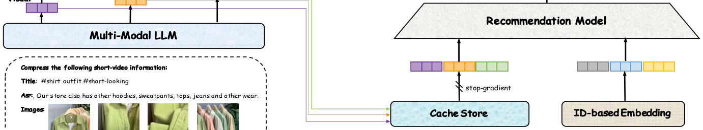
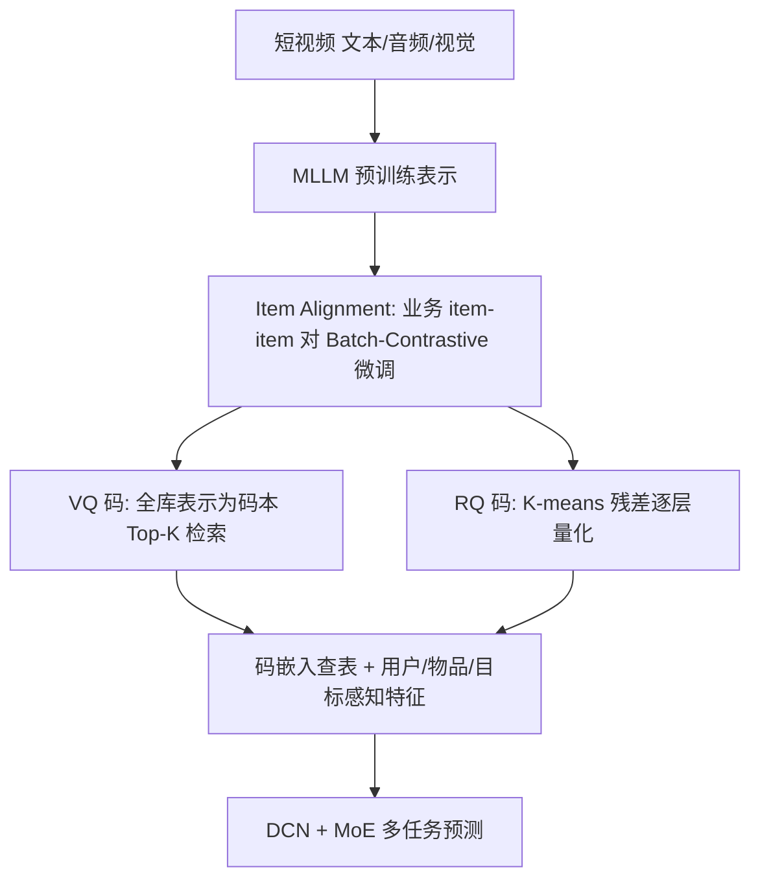

# QARM: Quantitative Alignment Multi-Modal Recommendation at Kuaishou (快手量化对齐多模态推荐)

- **会议/期刊**: CIKM 2025（arXiv 2024-11，work in progress 版本）
- **作者与机构**: Xinchen Luo, Jiangxia Cao, Tianyu Sun, Jinkai Yu, Rui Huang, ... Kun Gai, Guorui Zhou（快手科技）
- **推荐链路定位**: 召回（User2Item / Item2Item）+ 精排（多任务排序）共用同一套语义码特征
- **研究方向**: 多模态推荐 / 生成式推荐（语义 ID 量化）
- **论文原文**: [https://arxiv.org/abs/2411.11739v1](https://arxiv.org/abs/2411.11739v1)
- **开源代码**: 暂未开源

## TL;DR (1分钟核心速览)

工业界主流做法是「MLLM 预训练产出多模态表示 → 缓存 → 作为下游推荐模型的固定静态输入」，存在**表示不匹配**（MLLM 由图文匹配等任务无关目标监督，与用户行为分布脱节）与**表示不可学习**（缓存向量不随推荐梯度更新）两大瓶颈。QARM 先用业务 item-item 对以 Batch-Contrastive 微调 MLLM 完成对齐，再用 VQ（全库表示即码本，Top-K 检索）与 RQ（K-means 残差逐层量化）把对齐表示压成可查表的语义码，从而让多模态信息以 ID 式嵌入端到端训练。在快手广告/电商离线 AUC 上 CTR +0.18%/+0.23%，线上电商 GMV +2.296%、广告冷启曝光 +5.324%。

## Background & Motivation (背景与核心矛盾)

- **主流范式**: 两阶段级联——先预训练 MLLM 压缩短视频的文本/音频/视觉为通用表示并存入 cache store，下游召回/排序模型把它当作额外固定特征拼接进 ID 特征体系（图 1）。
- **前人局限**: ① 表示不匹配：多模态表示由 image-text matching 等任务无关自监督目标得到，与以用户交互为监督的 ID 特征目标割裂；② 表示不可学习：缓存向量不参与反向传播，而 ID 嵌入可端到端优化，静态特征拖慢收敛与拟合上限。
- **核心洞察 (Key Insight)**: 已有工作用「多模态表示 ↔ item ID」对比学习做对齐，但正样本仅一个 item ID、ground-truth 多样性不足，对比损失弱且易过拟合；真正该对齐的是**业务内的 item-item 行为关系**，而非孤立 ID。
- **本文切入点**: 用现有召回模型挖掘的高置信 item-item 对监督 MLLM 微调（对齐），再把表示离散化为语义码（可学习），一举解决两个矛盾。

<figure class="paper-figure" markdown="span">
  <figcaption>图1：(a) 表示不匹配：多模态特征通过图文匹配等下游任务无关的自监督任务获得。(b) 表示遗忘：生成的多模态表示始终仅作为推荐模型的额外固定静态输入特征。</figcaption>
</figure>

## Method (核心方法设计)

### 1. 整体框架 (Overall Architecture)

QARM 分三段闭环：**(a) 对齐微调**——从 User2Item 召回模型（用户正反馈目标物品 ↔ 其最近 50 个正点击中 ID 空间最相似者）与 Item2Item 召回模型（如 Swing 导出的高相似稳定物品对）挖掘高质量 item-item 对集合 $\mathcal{D}$，仅以多模态输入训练 item2item 对齐模型；**(b) 量化编码**——对全体对齐表示$\mathbf{M}\in\mathbb{R}^{|\mathcal{I}|\times d}$ 分别生成 VQ 码与 RQ 码并写入 cache store；**(c) 下游使用**——把码当作 ID 特征查嵌入，构造物品侧、用户侧、目标物品感知三类特征，经 DCN + MoE 多任务头输出 CTR/CVR/CTCVR，梯度可回传至码嵌入表。

### 2. 关键设计拆解 (Key Designs)

1. **Item Alignment（业务对齐微调）**：痛点是对比学习正样本单一、与业务分布脱节。做法是构造 item2item 对后，仅用多模态 token 前向，在 batch 内做对称对比：
$\mathcal{L}_{\text{align}}=\text{Batch-Contrastive}(\mathbf{M}_{\text{trigger}},\mathbf{M}_{\text{target}},\mathcal{B})$其中$\mathbf{M}_{\text{trigger}},\mathbf{M}_{\text{target}}\in\mathbb{R}^{|\mathcal{B}|\times d}$。直觉：让 MLLM 表示空间直接继承「用户会一起点击/购买」的相似性结构，而非通用图文相似性；不同业务（广告 vs 电商）各自微调，实现业务定制。

2. **Quantitative Code（VQ + RQ 双重量化）**：痛点是对齐后的浮点表示仍是静态缓存、不可学习。VQ 直接令码本 $\mathbf{V}=\mathbf{M}$（免训练码本），用$\text{TopKCode}(\mathbf{V},\mathbf{m},K)$取 Top-$K$ 近邻索引，刻画「近邻物品集合」式信息；RQ 则用 faiss K-means 逐层量化残差：
$\mathbf{R}_1=\text{Kmeans}(\mathbf{M},N),\ \mathbf{M}_1=\mathbf{M}-\text{NearestRep}(\mathbf{M},\mathbf{R}_1),\ \dots,\ \mathbf{R}_L=\text{Kmeans}(\mathbf{M}_{L-1},N)$每层取最近码$r_l=\text{NearestCode}(\mathbf{R}_l,\mathbf{m}_{l-1},1)$，形成由粗到细的层级路径。两者互补：VQ 表达邻域语义，RQ 表达层级残差语义，故拼接使用增益最大。

3. **训练目标、负采样与推理效率**：下游为多任务交叉熵 $\mathcal{L}=-\sum_{x_{\text{tr}}}\left(y\log\hat{y}+(1-y)\log(1-\hat{y})\right)$，覆盖 CTR/CVR/CTCVR；码嵌入随交互梯度端到端更新，无需额外负采样（对比学习阶段用 in-batch 负样本）。推理侧只做码表查嵌入，MLLM 前向完全离线，线上开销与普通 ID 特征同量级。

## Experimental Setup & Evaluation Protocol (实验设置与评估协议)

- **数据集与预处理**: 快手广告与电商（Shopping）两大业务真实日志，物品按购买频次分为 L1（最少）至 L6（最多）六组用于长尾分析；离线训练样本为百亿级日更用户-物品对。

| 场景 | 业务 | 核心指标 | 基线是否已含缓存 MLLM 表示 | 码配置 |
| :--- | :--- | :--- | :---: | :--- |
| Advertising | 广告短视频/直播 | AUC / UAUC / GAUC（CTR、CVR） | 是 | $K=25$,$L=6$,$d=64$ |
| Shopping | 电商短视频/商城 | AUC / UAUC / GAUC（CTR、CVR、CTCVR） | 是 | $K=25$,$L=6$,$d=64$ |

- **数据划分与防穿越 (Splitting Strategy)**: 工业在线日志按天增量训练、次日评估的时序方式（离线数据引擎每日组装特征与标签），线上以 A/B 实验验证。
- **排名评测协议 (Ranking Protocol)**: 采用工业标准 **GAUC/UAUC**（用户级 AUC 及其按样本量加权版），非全库 Full-Ranking；线上以曝光、成本、收入、订单、GMV、GPM 等业务指标衡量。
- **对比基线与超参设置**: 基线为已融合缓存 MLLM 表示的强工业模型；变体为 +IA Rep、+VQ Code、+RQ Code、+VQ&RQ Code；码维度 $d\in\{16,32,64\}$，VQ 长度$K\in\{5,10,15,20,25\}$。

## Key Experimental Results (实验关键数据)

### 1. 主实验对比 (Main Results)

广告场景（相对基线提升，%）：

| 变体 | CTR AUC | CTR UAUC | CTR GAUC | CVR AUC | CVR UAUC | CVR GAUC |
| :--- | :---: | :---: | :---: | :---: | :---: | :---: |
| Baseline | 90.85 | 70.88 | 72.43 | 88.29 | 69.01 | 74.03 |
| + IA Rep | +0.02 | +0.05 | -0.01 | +0.03 | +0.04 | -0.02 |
| + VQ Code | +0.11 | +0.20 | +0.17 | +0.09 | +0.05 | +0.11 |
| + RQ Code | +0.10 | +0.15 | +0.13 | +0.07 | +0.09 | +0.10 |
| **+ VQ & RQ Code** | **+0.18** | **+0.29** | **+0.25** | **+0.17** | +0.08 | **+0.12** |

电商场景（相对基线提升，%）：

| 变体 | CTR AUC | CTR UAUC | CTR GAUC | CVR AUC | CTCVR AUC | CTCVR GAUC |
| :--- | :---: | :---: | :---: | :---: | :---: | :---: |
| Baseline | 79.31 | 66.48 | 68.05 | 86.79 | 87.92 | 71.41 |
| + IA Rep | -0.03 | +0.02 | -0.01 | -0.02 | -0.07 | +0.02 |
| + VQ Code | +0.09 | +0.20 | +0.21 | +0.11 | +0.19 | +0.52 |
| + RQ Code | +0.12 | +0.33 | +0.26 | +0.14 | +0.18 | +0.40 |
| **+ VQ & RQ Code** | **+0.23** | **+0.56** | **+0.50** | **+0.26** | **+0.35** | **+0.92** |

线上 A/B（相对基线）：广告 #1 冷启组曝光 +5.324%、成本 +7.676%、收入 **+9.704%**，其他组收入 +3.147%；广告 #2 冷启收入 +9.555%；电商 #1 订单 +1.396%、**GMV +2.296%**、GPM +0.553%；电商 #2 GMV +1.568%、GPM +3.110%。

### 2. 消融实验 (Ablation Study)

| 消融项 | 设置 | 电商 CTR AUC | 广告 CTR AUC | 说明 |
| :--- | :--- | :---: | :---: | :--- |
| VQ 码长 $K$ | 5 / 10 / 15 / 20 / 25 | +0.02 / +0.03 / +0.04 / +0.06 / **+0.09** | — | 单调递增，25 最优 |
| 码维度 $d$ | 16 / 32 / 64 | — | +0.11 / +0.16 / **+0.18** | 维度越大越好 |
| 长尾分组 CTR-AUC | L1→L6 | +0.26 / +0.25 / +0.23 / +0.22 / +0.24 / +0.21 | — | L1 增益最高 |

### 3. 关键实验发现 (Key Findings)

1. **对齐本身几乎不涨、量化才涨**：+IA Rep 在广告 CTR AUC 仅 +0.02%、电商甚至 -0.03%，而 +VQ&RQ 达 +0.18%/+0.23%，定量证明「表示不可学习」比「表示不匹配」是更致命的瓶颈——静态浮点特征即便对齐也无法被模型吸收。
2. **VQ 与 RQ 互补而非冗余**：单独使用各约 +0.09~0.12%，联合后电商 CTR AUC 提升近乎翻倍（+0.23%），印证 VQ 编码邻域语义、RQ 编码层级残差两条信息通路正交。
3. **多模态天然利好冷启与长尾**：离线 L1 组 CTR-AUC +0.26% 高于 L6 的 +0.21%；线上 L1 组订单 +5.381%、GMV +8.035%，而 L5 订单为 -0.407%，说明语义码不依赖交互热度，能有效为新上传物品「破冰」，同时重塑曝光公平性（图 5）。

## Highlights & Limitations (亮点、对比与审稿批判)

- **与代表作对比 (vs. Prior Work)**: 相比 VBPR/LATTICE 把视觉特征作固定拼接、AlignRec 在固定多模态表示上与 ID 做对比对齐，QARM 把对齐目标换成业务 item-item 关系并进一步离散化；相比 TIGER 用 RQ-VAE 学码本做生成式检索，QARM 直接以全库对齐表示为 VQ 码本、K-means 残差为 RQ 码本，免训练码本、面向判别式排序，工程成本更低。
- **可迁移亮点**: ①「用现有召回模型蒸馏 item-item 对来监督多模态编码器」是零标注成本的对齐范式；②「浮点特征 → 语义码 → 可学习嵌入表」可推广到任何静态预训练特征（图嵌入、LLM 文本向量）的端到端化改造。
- **审稿级局限批判**: ① 缺少与 TIGER/RQ-VAE 等语义 ID 方法的离线同协议对比，且无公开数据集与开源代码，复现性弱；② VQ 码本等于全库表示，Top-K 检索复杂度随物品数线性增长，新物品需重算码，码本漂移与更新频率未讨论；③ 提升幅度在 AUC 上仅千分位，缺乏显著性检验与方差报告。

## Rating (四维评分)

- **方法创新性 (Novelty)**: ⭐⭐⭐⭐ （「业务 item-item 对齐 + 免训练 VQ/RQ 双码」组合新颖，但单点技术均为已有组件的巧妙工程拼装）
- **评估协议与实验扎实度 (Protocol & Experiments)**: ⭐⭐⭐⭐ （双业务离线 + 大规模线上 A/B + 长尾分组分析完整，但缺公开数据集与 SOTA 语义 ID 基线对比）
- **写作与数学规范度 (Clarity & Rigor)**: ⭐⭐⭐ （公式简洁可读，但符号与算法描述偏工程化，VQ/RQ 公式存在排版笔误，缺复杂度分析）
- **工业落地与复现价值 (Industrial & Practical Value)**: ⭐⭐⭐⭐⭐ （服务 4 亿日活、广告收入 +9.704%、电商 GMV +2.296%，落地价值极高；可惜未开源）

