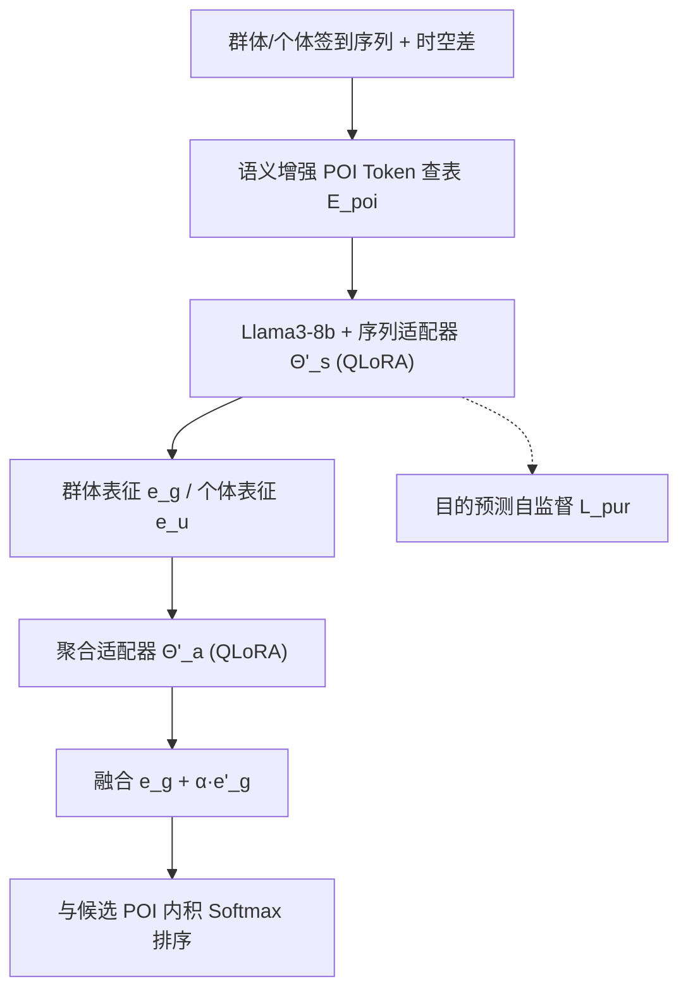
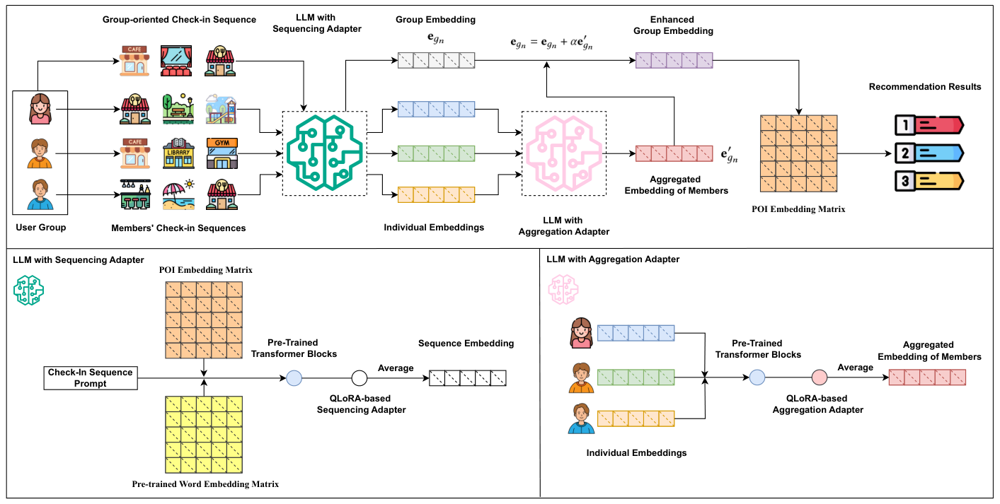

# Harnessing Large Language Models for Group POI Recommendations ( harnessing 大语言模型赋能群体 POI 推荐)

- **会议/期刊**: CIKM 2025
- **作者与机构**: Jing Long, Liang Qu, Junliang Yu, Tong Chen, Quoc Viet Hung Nguyen, Hongzhi Yin（昆士兰大学、格里菲斯大学）
- **推荐链路定位**: 召回（Next-POI 候选排序）
- **研究方向**: 时空轨迹与 POI 本地生活推荐 / 大语言模型推荐
- **论文原文**: [https://arxiv.org/abs/2411.13415v2](https://arxiv.org/abs/2411.13415v2)
- **开源代码**: 暂未开源

## TL;DR (1分钟核心速览)

群体 POI 推荐面临两大痛点：群体成员偏好异质且群体偏好可能偏离个体，以及群体签到数据比个体稀疏 50–100 倍。本文提出 LLMGPR，把 POI 作为特殊 Token 注入 Llama3-8b，用 QLoRA 训练"序列适配器"与"聚合适配器"分别学习签到序列表征与成员偏好聚合，并以"行程目的"自监督任务（GPT-4 打标，人工校验准确率 92%）缓解稀疏。在 Foursquare/Weeplace/Gowalla 上采用 Leave-One-Out + 500 近邻候选采样排序，HR@10 相对最强基线 MICL 平均提升 7.09%/4.39%/9.01%。

## Background & Motivation (背景与核心矛盾)

- **主流范式**: 群体 POI 推荐沿用"两阶段"管线——先把群体当虚拟用户学群体表征，再用平均/加权/注意力/GCN 聚合成员表征增强之；近期 LLM4POI 等工作把 LLM 微调用于**个体** POI 推荐。
- **前人局限**: ① 现有群体方法几乎全基于 ID 嵌入，只挖掘稀疏签到中的统计共现，POI 名称/类别/评论的语义富矿被浪费；② 聚合策略（均值、注意力、超立方体、超图）无法刻画成员间复杂交互，且群体签到极稀疏导致群体表征严重欠拟合。
- **核心洞察 (Key Insight)**: 个体签到数据远比群体丰富（约 50–100 倍），且签到序列背后隐含"商务出差/家庭度假"等**行程目的**，该目的对下一站 POI 有强预测力，可作为免费的自监督信号把个体知识迁移到群体侧。
- **本文切入点**: 用 LLM 的世界知识做语义增强 POI Token，并以两个独立 QLoRA 适配器解耦"序列建模"与"偏好聚合"，再用目的预测自监督预训练序列适配器。

## Method (核心方法设计)

### 1. 整体框架 (Overall Architecture)

输入为群体签到序列 $X_{g_n}$与各成员个体序列$X_{u_k}$。首先用 LLM 提示词为每个 POI 生成语义嵌入，构成 POI 嵌入矩阵$\mathbf{E}_{poi}$，签到序列中的 POIID 被当作特殊 Token 查表而非走词表；序列经冻结的 Llama3-8b + 序列适配器$\Theta'_s$编码取末层均值得到群体/个体表征；个体表征集合再送入聚合适配器$\Theta'_a$得到聚合偏好，与群体表征加权融合后与候选 POI 嵌入做内积 Softmax 排序。训练分三阶段：目的自监督预训练$\to$POI 预测训练$\to$ 聚合适配器训练。

<figure class="paper-figure" markdown="span">
  <figcaption>图2：我们提出的LLMGPR概览。</figcaption>
</figure>

### 2. 关键设计拆解 (Key Designs)

1. **语义增强 POI Token 与时空上下文注入**：ID 嵌入无语义、纯语义又丢失地点唯一性。本文用提示词（名称/类别/描述/评论/经纬度/地址）让 LLM 生成 POI 嵌入初始化 $\mathbf{E}_{poi}\in\mathbb{R}^{P\times d}$，并在序列提示中显式编码 `(POIID, timestamp, Δt, Δd)`。关键差异在于：当两次签到时空差过大时，前一次不应作为后一次上下文——这是与词序列的本质区别，显式 Δt/Δd 让注意力能自适应截断长程依赖。

2. **双 QLoRA 适配器解耦序列与聚合**：单一适配器同时承担序列编码与偏好聚合会相互干扰。本文为两任务各设一个同构 QLoRA 适配器（$b=4$、$r=16$），聚合时把成员表征集合$\mathbf{E}_{g_n}=\{\mathbf{e}_{u_1},...,\mathbf{e}_{u_K}\}$**直接送入首个 Transformer Decoder，跳过词嵌入与位置编码**（成员无序），末层输出即聚合偏好，最终$\mathbf{e}_{g_n}\leftarrow \mathbf{e}_{g_n}+\alpha\mathbf{e}'_{g_n}$，$\alpha=0.7$。物理直觉：LLM 的自注意力天然适合建模成员间高阶交互，且无需为每个新群体重训。

3. **行程目的自监督与训练目标**：群体签到过稀，故用 GPT-4 按 11 类目的（商务、通勤、旅游、短假、文娱、购物餐饮等）为短序列打标（相邻签到间隔 >5 天即切分），预训练序列适配器：$\mathbf{b}=\mathbf{E}_{pur}\mathbf{e}_X^{\top}$，$\mathcal{L}_{pur}=\mathrm{CE}(\mathbf{b},y_p)$；主任务$\mathcal{L}_{poi}=\mathrm{CE}(\mathrm{Softmax}(\mathbf{E}_{cand}\mathbf{e}_{g_n}^{\top}),y)$。训练采用**逐前缀下一站预测**（$\{p_1\},\{p_1,p_2\},...$），群体与个体序列共同优化$\Theta'_s$与$\mathbf{E}_{poi}$，聚合适配器仅用群体数据训练。推理为候选集内积排序，无负采样。

## Experimental Setup & Evaluation Protocol (实验设置与评估协议)

- **数据集与预处理**: 过滤交互 <10 的用户与 POI；群体由社交网络连通且**同时同地**签到的用户集合构造。

| 数据集 | #Users | #Groups | #POIs | #User Check-ins | #Group Check-ins | 群体人均签到 |
| :--- | :---: | :---: | :---: | :---: | :---: | :---: |
| Foursquare | 7,507 | 1,715 | 80,962 | 1,214,631 | 12,594 | 7.34 |
| Weeplace | 4,560 | 923 | 44,194 | 623,654 | 11,974 | 12.97 |
| Gowalla | 31,751 | 2,186 | 81,123 | 862,502 | 7,738 | 3.54 |

- **数据划分与防穿越**: `Leave-One-Out`——每条序列最后一个 POI 测试、倒数第二个验证、其余训练；最大序列长度 200。
- **排名评测协议**: `Sampled Ranking`——每个真值仅与 **500 个同区域未访问且最近的 POI** 组成候选排序（理由：POI 场景用户极少跨远距离连续移动），指标 HR@5/10、NDCG@5/10。
- **对比基线与超参**: 群体基线 MF-AVG/AGREE/GroupIM/CubeRec/HHGR/MICL，个体基线 GeoMF/STAN/DRAN/Diff-POI/META ID/LLMMove/LLM4POI；嵌入维度 $d=4096$（对齐 Llama3-8b），学习率 2e-4，dropout 0.2，batch 16，epoch 5。

## Key Experimental Results (实验关键数据)

### 1. 主实验对比 (Main Results)

群体推荐对比（节选 HR@10 / NDCG@10）：

| 模型 | Foursquare HR@10 | Foursquare NDCG@10 | Weeplace HR@10 | Weeplace NDCG@10 | Gowalla HR@10 | Gowalla NDCG@10 |
| :--- | :---: | :---: | :---: | :---: | :---: | :---: |
| MF-AVG | 0.3577 | 0.2114 | 0.3752 | 0.2279 | 0.3205 | 0.1875 |
| AGREE | 0.3869 | 0.2303 | 0.4201 | 0.2459 | 0.3486 | 0.2038 |
| GroupIM | 0.3872 | 0.2420 | 0.4431 | 0.2498 | 0.3595 | 0.2009 |
| CubeRec | 0.4016 | 0.2454 | 0.4435 | 0.2582 | 0.3656 | 0.2061 |
| HHGR | 0.4247 | 0.2584 | 0.4409 | 0.2595 | 0.3718 | 0.2178 |
| MICL | 0.4291 | 0.2571 | 0.4672 | 0.2676 | 0.3808 | 0.2299 |
| **LLMGPR** | **0.4767** | **0.2760** | **0.4799** | **0.2829** | **0.4203** | **0.2512** |
| Improv. | +11.09% | +7.35% | +2.72% | +5.72% | +10.37% | +9.26% |

个体 POI 推荐对比中，LLMGPR 亦全面领先最强基线 LLM4POI：Foursquare HR@10 0.4872 vs 0.4776、NDCG@10 0.2995 vs 0.2849；Gowalla HR@10 0.4483 vs 0.4246、NDCG@10 0.2586 vs 0.2492。

### 2. 消融实验 (Ablation Study)

| 变体 | Foursquare HR@10 | Weeplace HR@10 | Gowalla HR@10 | Gowalla NDCG@10 |
| :--- | :---: | :---: | :---: | :---: |
| LLMGPR | **0.4767** | **0.4799** | **0.4203** | **0.2512** |
| LLMGPR-FT（不微调） | 0.3978 | 0.4301 | 0.3381 | 0.2006 |
| LLMGPR-M（微调但不改结构） | 0.4176 | 0.4362 | 0.3526 | 0.2203 |
| LLMGPR-ER（去成员聚合增强） | 0.4227 | 0.4306 | 0.3673 | 0.2116 |
| LLMGPR-SSL（去目的自监督） | 0.4541 | 0.4502 | 0.3739 | 0.2370 |

### 3. 关键实验发现 (Key Findings)

1. **稀疏度决定收益幅度**：Gowalla 群体人均签到仅 3.54（最稀疏），LLMGPR 相对 MICL 的 HR@10 提升达 10.37%，显著高于 Weeplace 的 2.72%，说明语义 Token + 自监督正是稀疏场景的解药。
2. **聚合增强是最大单点贡献**：去掉成员聚合（LLMGPR-ER）在 Gowalla 上 HR@10 从 0.4203 跌至 0.3673（-12.6%），跌幅超过去掉自监督（-11.0%）与不微调（-19.6%），印证"群体数据本身不足以学出好表征"。
3. **冷启动鲁棒性突出**：在剔除 <10 次签到的 200 条冷启动群体序列上，LLMGPR HR@10 仍达 0.4630/0.4686/0.4051，相对非冷启动的衰减幅度为所有模型最小；超参上 $r>16$后收益饱和、$\alpha>0.7$ 反而下降，说明成员偏好注入需适度。

## Highlights & Limitations (亮点、对比与审稿批判)

- **与代表作对比 (vs. Prior Work)**: 相比 MICL/HHGR 等图/超图群体模型，本文首次把 LLM 引入群体 POI 场景，用语义替代纯 ID 共现；相比 LLM4POI 仅做个体微调，本文额外解耦出聚合适配器与目的自监督，直接针对群体稀疏；相比 LLMMove 零样本提示，本文的 QLoRA 任务对齐带来数量级更稳的精度。
- **可迁移亮点**: ① "POI/物品作为特殊 Token 查表 + 末层均值取表征"可低成本迁移到任意 LLM4Rec 召回；② 用强 LLM 打伪标签构造目的/意图自监督，是缓解长尾与冷启动的通用套路。
- **审稿级局限批判**: ① 基于 Llama3-8b + 双适配器，训练与在线编码开销大，论文未报告推理延迟与显存占用；② 群体由"社交连通 + 同时同地"启发式构造，真实群体语义存疑，且候选仅 500 近邻采样排序，未做 Full-Ranking，绝对精度可能被高估；③ 目的标签体系（11 类）与 5 天切分阈值均为人工设定，跨城市/跨文化泛化性未验证。

## Rating (四维评分)

- **方法创新性 (Novelty)**: ⭐⭐⭐⭐ （首个 LLM 群体 POI 框架，双适配器解耦 + 目的自监督组合有新意，但各组件均为已有技术的场景化拼装）
- **评估协议与实验扎实度 (Protocol & Experiments)**: ⭐⭐⭐⭐ （三数据集 + 群体/个体双视角 + 消融 + 冷启动 + 超参齐全，但仅 500 近邻采样排序、缺 Full-Ranking 与显著性检验）
- **写作与数学规范度 (Clarity & Rigor)**: ⭐⭐⭐⭐ （框架图与算法流程清晰，公式简洁；但部分符号前后不一致、聚合适配器输入跳过位置编码的理论论证偏直觉）
- **工业落地与复现价值 (Industrial & Practical Value)**: ⭐⭐⭐ （思路可落地，但 8B 模型 + 双 QLoRA 的线上成本高，且未开源代码，复现门槛较高）

