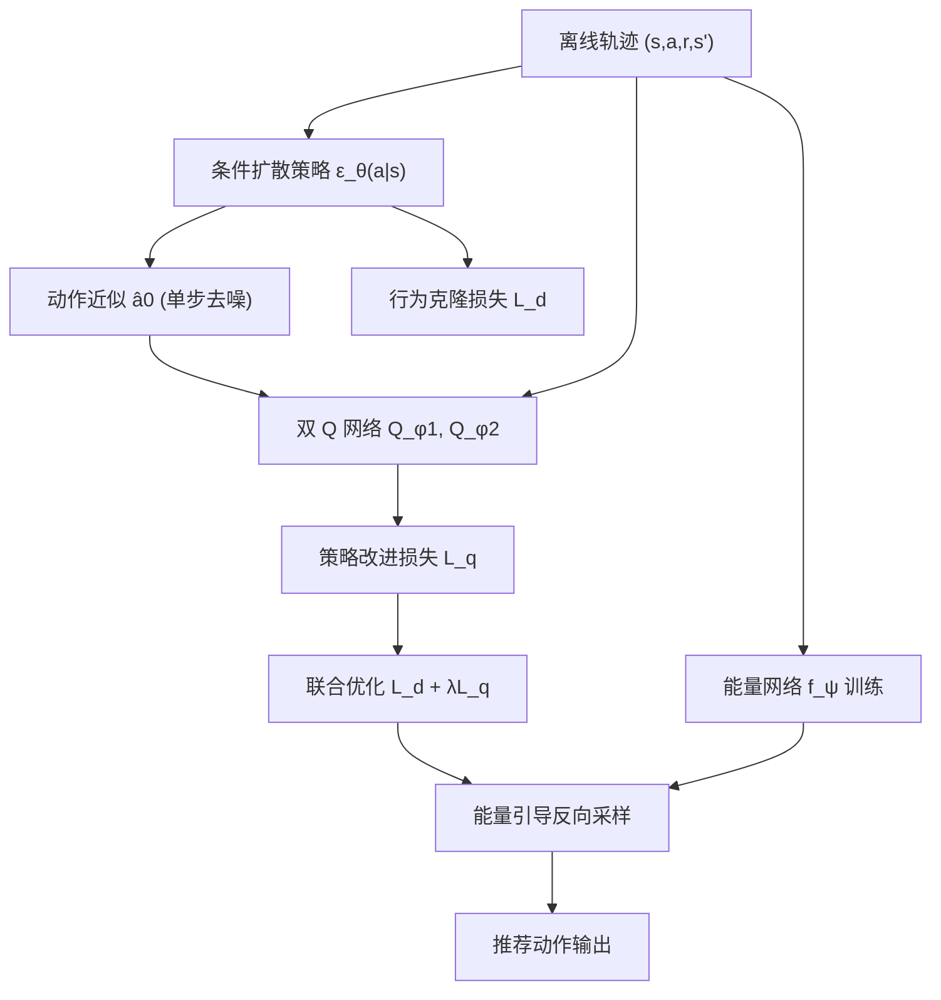
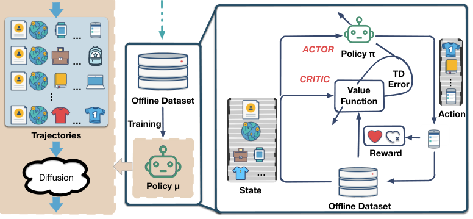

# Energy-Guided Diffusion Sampling for Long-Term User Behavior Prediction in Reinforcement Learning-based Recommendation (面向强化学习推荐中长期用户行为预测的能量引导扩散采样)

- **会议/期刊**: CIKM 2025
- **作者与机构**: Xiaocong Chen, Siyu Wang, Lina Yao (Data61 CSIRO / Macquarie University / UNSW)
- **推荐链路定位**: 端到端生成式（离线 RL 策略学习）
- **研究方向**: 强化学习与动态探索推荐 / 生成式推荐
- **论文原文**: [https://arxiv.org/abs/2510.12815v1](https://arxiv.org/abs/2510.12815v1)
- **开源代码**: 暂未开源

## TL;DR (1分钟核心速览)

离线 RL4RS 的核心瓶颈是行为克隆式策略正则把探索空间压得过窄，且行为策略表达能力不足，交互轨迹越长 CTR 掉得越狠。本文提出 DAC4Rec：用条件扩散模型直接参数化行为策略（而非模仿），叠加 Q 值引导的策略改进项与能量引导采样抑制生成随机性。在 6 个真实数据集（Coat/YahooR3/ML-1M/KuaiRec/KuaiRand/VirtualTB）上，$R_{avg}$与$R_{cumu}$ 全面超越 CDT4Rec/EDT4Rec，31+ 长交互段 CTR 达 0.702（EDT4Rec 仅 0.587）。

## Background & Motivation (背景与核心矛盾)

- **主流范式**: 离线 RL4RS 以 Decision Transformer 系（DT4Rec / CDT4Rec / EDT4Rec）为主，通过行为克隆项约束策略不偏离数据集行为策略，再用 Q 值或因果层做策略改进。
- **前人局限**: 其一，行为克隆把策略锁死在行为策略的窄邻域内，Q-learning 收敛到次优解；其二，行为策略本身表达能力弱，无法刻画多峰、偏斜的用户偏好分布，交互轨迹一长（图 1 中 31+ 段）CDT4Rec/EDT4Rec 的 CTR 显著下滑。
- **核心洞察 (Key Insight)**: 扩散模型的反向过程天然能表达多模态、偏斜分布，且扩散模仿学习已在机器人领域证明可建模复杂轨迹；但直接搬来推荐域会失效——它假设行为策略来自专家示范、不存在更优动作，而推荐中的历史行为受隐性动机干扰、并非最优动作。
- **本文切入点**: 把扩散模型当作"可表达的行为策略先验"，再用 Q 值做策略改进、用能量函数做采样引导，三者解耦。

## Method (核心方法设计)

### 1. 整体框架 (Overall Architecture)

DAC4Rec 建立在 actor-critic 骨架上，分两阶段训练。第一阶段：以状态 $s$为条件的扩散网络$\epsilon_\theta$作为 actor，通过去噪损失学习行为策略分布；同时 critic 双 Q 网络按 TD 误差更新，并用"动作近似"把扩散策略接入 Q 值最大化目标，形成行为克隆项$\mathcal{L}_d$与策略改进项$\mathcal{L}_q$的加权和。第二阶段：单独训练能量网络$f_\psi$拟合$t>0$ 时刻的能量函数，推理时在反向扩散每一步叠加能量梯度引导，使采样向高 Q 区域收缩。整体可无缝替换 SAC/DDPG 的策略网络。

<figure class="paper-figure" markdown="span">
  <figcaption>图2：离线RL4RS概述及所提出的DAC4Rec框架。策略𝜇表示所提出的扩散策略。DAC4Rec基于actor-critic结构构建，但可轻松适配任何涉及Q值的RL方法，包括Q-learning、SAC和DDPG（或TD3）。</figcaption>
</figure>

### 2. 关键设计拆解 (Key Designs)

1. **扩散即策略（Diffusion as a Policy）**：痛点是用高斯策略参数化行为策略表达力不足。本文将反向链 $p(a_{i-1}|a_i,s)=\mathcal{N}(a_{i-1};\sigma_\theta(a_i,s,i),\beta_i I)$直接作为策略$\mu$，训练目标为标准去噪回归$\mathcal{L}_d(\theta)=\mathbb{E}_{i,\epsilon,(s,a)\sim\mathcal{D}}\|\epsilon-\epsilon_\theta(\sqrt{\bar\alpha_i}a+\sqrt{1-\bar\alpha_i}\epsilon,s,i)\|^2$。关键差别在于：它不显式估计行为策略密度，只要求从$\mathcal{D}$ 与当前策略采样，因此对"非专家"的人类行为数据天然鲁棒，且能刻画多模态偏好。

2. **动作近似驱动的 Q 值策略改进**：扩散策略的似然不可解，无法直接对 $\max_\theta \mathbb{E}[Q_\phi(s,a)]$求梯度。作者利用前向重参数化$a_i=\sqrt{\bar\alpha_i}a_0+\sqrt{1-\bar\alpha_i}\epsilon$反解出单步去噪近似$\hat{a}_0=\frac{1}{\sqrt{\bar\alpha_i}}a_i-\frac{\sqrt{1-\bar\alpha_i}}{\sqrt{\bar\alpha_i}}\epsilon_\theta(a_i,i;s)$，把策略改进写成$\mathcal{L}_q(\theta)=-\mathbb{E}_{s\sim\mathcal{D},\hat{a}_0\sim\mu_\theta}[Q_\phi(s,\hat{a}_0)]$。这样只需一次去噪即可回传 Q 梯度，避免了完整反向链的采样开销，是本文工程上最关键的一步。

3. **能量引导采样（Energy-Guided Sampling）**：扩散策略推理时需随机采样，方差大、推荐不稳定。作者构造目标分布 $\pi^*(a|s)\propto e^{Q(s,a)}\mu(a|s)$，并证明其第$t$步边缘满足$\pi_t(a_t|s)\propto e^{\mathcal{E}_t(s,a_t)}\mu_t(a_t|s)$，其中$\mathcal{E}_t(s,a_t)=\log\mathbb{E}_{\mu_{0|t}(a_0|a_t,s)}[e^{Q_\phi(s,a_0)}]$。于是 score 分解为$\nabla_{a_t}\log\pi_t=\nabla_{a_t}\log\mu_t+\nabla_{a_t}\mathcal{E}_t$，第二项由额外网络$f_\psi$以回归损失$\mathbb{E}(f_\psi(s,a_t,t)-\log\mathbb{E}_{\mu_{0|t}}[e^{Q_\phi(s,a_0)}])^2$ 拟合。物理直觉：能量项等价于在去噪轨迹上做"软 Q 值筛选"，把随机采样拉向高回报动作，同时保留扩散分布的多模态性。

4. **训练目标与开销**：总损失 $\mathcal{L}(\theta)=\mathcal{L}_d(\theta)+\lambda\mathcal{L}_q(\theta)$，critic 用双 Q + 目标网络的标准 TD 损失，无需负采样（离线数据集本身即样本源）。推理需$N$步反向扩散，作者取$N=100$ 平衡精度与延迟；能量网络仅在采样阶段前向一次，额外开销可控。

## Experimental Setup & Evaluation Protocol (实验设置与评估协议)

- **数据集与预处理**: 六个数据集均经 EasyRL4Rec 转为 RL 环境，状态编码器分别用 GRU 与 SASRec 各跑一遍：

| 数据集 | #Users | #Items | #Train 交互 | 场景说明 |
| :--- | :---: | :---: | :---: | :--- |
| Coat | 290 | 300 | 7,000 | 商品推荐，测试 4,600 |
| YahooR3 | 15,400 | 1,000 | 311,700 | 音乐推荐，测试 54,000 |
| MovieLens-1M | 58,000 | 3,000 | 5,900,000 | 电影，测试 4,400,000 |
| KuaiRec | 1,000 | 6,700 | 594,400 | 短视频，测试 371,000 |
| KuaiRand | — | — | 571,300 | 短视频，测试 371,000 |
| VirtualTB | — | — | 在线仿真 | 100,000 步交互仿真 |

- **数据划分与防穿越**: 沿用 EasyRL4Rec 的离线轨迹切分（训练/测试按用户轨迹划分），VirtualTB 为在线仿真逐步交互，不存在穿越问题。
- **排名评测协议**: 采用 RL 环境下的序列决策评测，指标为累计奖励 $R_{cumu}$、平均每步奖励$R_{avg}$（作者强调其归一化后最具信息量）与轨迹长度 Length；长程实验按交互长度分桶（11–20 / 21–30 / 31+）报告 Avg. CTR。
- **对比基线与超参**: 基线含 DDPG、SAC、TD3、DT、DT4Rec、CDT4Rec、EDT4Rec 共 7 个；扩散步数 $N\in\{20,50,100,200\}$，$\beta_{\min}=0.1,\beta_{\max}=10.0$，结果报告均值±方差。

## Key Experimental Results (实验关键数据)

### 1. 主实验对比 (Main Results)

GRU 编码器下核心结果（$R_{avg}$ 为主指标，加粗为最优）：

| 方法 | Coat $R_{avg}$| ML-1M$R_{avg}$| KuaiRec$R_{avg}$| YahooR3$R_{avg}$| KuaiRand$R_{avg}$| VirtualTB$R_{avg}$ |
| :--- | :---: | :---: | :---: | :---: | :---: | :---: |
| DDPG | 2.3277 | 3.0329 | 1.0192 | 2.675 | 0.3287 | 5.6470 |
| SAC | 2.8321 | 3.4642 | 0.7632 | 2.6612 | 0.6011 | 5.2063 |
| DT | 2.7916 | 3.8135 | 0.9070 | 2.8688 | 0.6749 | 5.9706 |
| DT4Rec | 2.6273 | 3.2953 | 0.8302 | 2.7968 | 0.6082 | 5.5243 |
| CDT4Rec | 2.8698 | 4.0935 | 1.0075 | 3.3591 | 0.6481 | 5.6516 |
| EDT4Rec | 2.8622 | 4.0551 | 1.0478 | 3.4345 | 0.6487 | 5.7211 |
| **DAC4Rec** | **2.8774** | **4.2640** | **1.0825** | **3.5068** | **0.6523** | **6.1529** |
| Improv.% (vs 最优基线) | +0.26% | +4.17% | +3.31% | +2.11% | +0.55% | +7.55% |

SASRec 编码器下趋势一致：ML-1M $R_{avg}$ 4.2660 vs EDT4Rec 3.9777（+7.25%），KuaiRec 1.0682 vs 1.0397（+2.74%），VirtualTB 6.1532 vs 5.6741（+8.44%）。

### 2. 消融实验 (Ablation Study)

VirtualTB 上 100,000 步平均 CTR（图 3c）：

| 变体 | 说明 | Avg. CTR |
| :--- | :--- | :---: |
| DAC4Rec 完整 | 扩散 + 动作近似 + 能量引导 | 最高 |
| DAC4Rec-A | 去掉动作近似 | 明显下降 |
| DAC4Rec-E | 去掉能量引导 | 小幅下降 |

跨骨干泛化（表 4）：

| 方法 | 策略类型 | Avg. CTR |
| :--- | :---: | :---: |
| DDPG | 确定性 | 0.7877 |
| DDPG + Diffusion | 确定性 | 0.8665 |
| DDPG + Diffusion + Energy | 确定性 | **0.8771** |
| SAC | 随机 | 0.6824 |
| SAC + Diffusion | 随机 | 0.7927 |
| SAC + Diffusion + Energy | 随机 | **0.8455** |

### 3. 关键实验发现 (Key Findings)

1. **长交互是扩散策略的主战场**：31+ 交互段 DAC4Rec CTR 0.702，EDT4Rec 仅 0.587、CDT4Rec 0.564，相对提升约 19.6%，且方差（±0.022）远小于基线（±0.042），直接验证了"行为克隆表达力不足导致长程衰减"这一动机。
2. **动作近似是性能主贡献项，能量引导是稳定器**：消融中去掉动作近似（DAC4Rec-A）掉点显著，而去掉能量引导（DAC4Rec-E）仅小幅下降——因为能量引导的设计目标是抑制随机策略的采样方差，对确定性策略（TD3 类）本就收益有限。
3. **能量引导对随机策略增益更大**：SAC 加能量引导从 0.7927 升至 0.8455（+6.7%），DDPG 仅从 0.8665 升至 0.8771（+1.2%），与"能量项降低随机性"的设计意图完全吻合；同时扩散策略本身对两种骨干都带来 8–16% 的 CTR 提升，说明其可插拔性成立。

## Highlights & Limitations (亮点、对比与审稿批判)

- **与代表作对比 (vs. Prior Work)**: 相比 CDT4Rec/EDT4Rec 仍以 DT 为骨架、靠行为克隆正则约束策略，本文把策略本体换成扩散生成模型，从"约束不偏离"转为"直接表达分布"；相比机器人领域的 Diffuser/扩散模仿学习，本文显式处理了"示范非最优"这一推荐域特有假设，用 Q 值引导替代纯模仿。
- **可迁移亮点**: ① 动作近似 $\hat{a}_0$ 的单步去噪回传技巧，可迁移到任何"生成模型 + Q 值"的离线 RL 推荐框架；② 能量引导采样可作为一种通用推理期去随机化插件，挂到其他扩散式推荐模型上。
- **审稿级局限批判**: ① 推理需 $N=100$ 步反向扩散，线上实时推荐的延迟开销未做量化，且能量网络额外引入一次前向；② 主实验提升幅度在部分数据集上偏小（Coat +0.26%、KuaiRand +0.55%），且未报告显著性检验；③ 离线数据集仅用 EasyRL4Rec 转换，未讨论转换引入的仿真偏差对结论的影响。

## Rating (四维评分)

- **方法创新性 (Novelty)**: ⭐⭐⭐⭐ （首次将扩散策略 + 能量引导采样系统引入离线 RL4RS，动作近似与能量 score 分解有清晰推导）
- **评估协议与实验扎实度 (Protocol & Experiments)**: ⭐⭐⭐⭐ （六数据集 + 双状态编码器 + 在线仿真 + 长程分桶 + 跨骨干泛化，覆盖全面，但缺显著性检验）
- **写作与数学规范度 (Clarity & Rigor)**: ⭐⭐⭐⭐ （扩散步与轨迹步的符号区分交代清楚，能量函数推导完整，部分公式排版略密）
- **工业落地与复现价值 (Industrial & Practical Value)**: ⭐⭐⭐ （可插拔性强、思路易复现，但 100 步扩散推理延迟与未开源是落地短板）

