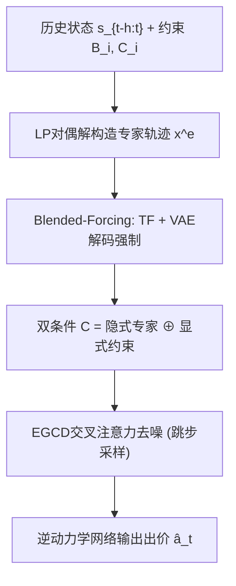
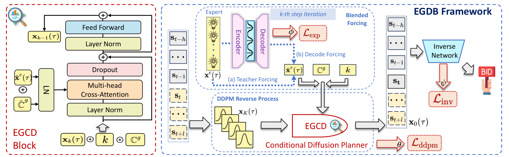

# Expert-Guided Diffusion Planner for Auto-bidding (专家引导的自动出价扩散规划器)

- **会议/期刊**: CIKM 2025 (Applied Research Track)
- **作者与机构**: Yunshan Peng, Wenzheng Shu, Jiahao Sun, Yanxiang Zeng 等（快手科技、西安交通大学）
- **推荐链路定位**: 精排（出价决策层，广告竞价策略）
- **研究方向**: 强化学习与动态探索推荐 / 生成式推荐
- **论文原文**: [https://arxiv.org/abs/2508.08687v2](https://arxiv.org/abs/2508.08687v2)
- **开源代码**: [https://github.com/alimama-tech/AuctionNet](https://github.com/alimama-tech/AuctionNet)

## TL;DR (1分钟核心速览)

自动出价中，条件扩散规划器仅以标量回报作为最优性条件，缺乏个性化结构信息，且扩散的 T 步迭代采样与在线竞价严格时延冲突。本文提出 EGDB：用线性规划对偶解构造专家轨迹，经 VAE 建模 + 混合强制（Blended-Forcing）生成隐式专家条件，再与显式预算/ROI 约束拼接为双条件输入交叉注意力去噪网络，并用跳步采样加速推理。在 AuctionNet 模拟环境 P14–P20 七个周期上多数周期最优，线上 A/B 转化 +11.29%、收入 +12.36%，推理资源节省 25%。

## Background & Motivation (背景与核心矛盾)

- **主流范式**: 自动出价主流分两支——基于 MDP 的离线 RL（CQL/IQL）与序列建模式生成方法（Decision Transformer、DiffBid 条件扩散规划器）。后者不依赖 MDP 马尔可夫假设，长程规划能力更强。
- **前人局限**: (i) DiffBid 类方法推理时仅以累计回报这一**标量**作为条件，解空间巨大且无个性化结构，难以收敛到真正最优轨迹；(ii) 扩散模型需 T 步自回归迭代去噪，与竞价系统毫秒级时延要求直接冲突。
- **核心洞察 (Key Insight)**: 出价问题在真实拍卖假设下存在线性规划对偶闭式最优解 $x^e_j=\frac{1+\alpha_c\cdot C_i}{\alpha_b+\alpha_c}\cdot v_j$，该解本身就是高质量的"专家轨迹"，可作为比标量回报信息量高得多的结构化条件。
- **本文切入点**: 把专家轨迹作为隐式条件注入扩散去噪网络，同时保留显式约束条件，并用跳步采样压缩推理步数。

## Method (核心方法设计)

### 1. 整体框架 (Overall Architecture)

输入为历史状态窗口 $s_{t-h:t}$与广告主约束（预算$B_i$、ROI$C_i$）。离线阶段先用 LP 对偶解构造专家轨迹$x^e(\tau)$，经 Blended-Forcing（教师强制 + VAE 解码强制按概率$\delta$混合）得到精炼专家表示$\hat{x}^e(\tau)$；再与归一化回报、约束指示函数拼接成双条件$\mathcal{C}$，送入以交叉注意力替代自注意力的 EGCD 去噪块，逐步预测$\hat{x}_0(\tau)$。推理时用跳步采样（步长$\gamma$）加速反向过程，取预测的下一状态$s'_{t+1}$经逆动力学网络$f_\psi$输出出价参数增量$\hat{a}_t$。

<figure class="paper-figure" markdown="span">
  <figcaption>图1：我们提出的方案的基础框架由以下组件构成：(1) 专家引导的条件扩散（EGCD）模块，以及(2) EGDB的整体架构。</figcaption>
</figure>

### 2. 关键设计拆解 (Key Designs)

1. **Blended-Forcing 专家条件构造**：纯教师强制存在曝光偏差（训练见真值、推理只能靠自身预测），而 Scheduled Sampling 的启发式混合无法适应竞价环境的快速漂移。本文用 VAE 隐空间编码"给定状态下的最优专家动作分布"，推理时解码出伪真值替代缺失的 ground truth，并按概率混合：
$$\hat{x}^e(\tau)=\mathbb{I}\left[TF(x^e(\tau))^{\delta},\,DF(x^e(\tau))^{1-\delta}\right]$$
直觉上 TF 保证模仿稳定性、DF 借助 VAE 的生成能力探索观测轨迹之外的最优模式，二者互补缓解分布偏移。

2. **双条件交叉注意力去噪块 (EGCD)**：将原 Transformer 自注意力替换为交叉注意力，Query 由当前噪声序列、扩散步 $k$与显式约束$C_g$拼接而成，Key/Value 来自条件$\mathcal{C}$：
$$\text{Cross-Attn}=\text{Softmax}\!\left(\frac{(QW_Q)(\mathcal{C}W_K)^\top}{\sqrt{d}}\right)(\mathcal{C}W_V)$$
其中 $\mathcal{C}=\hat{x}^e(\tau)\oplus[f(R(\tau))\oplus f'(C(\tau))]$。这样每个去噪步都能同时"看到"个性化专家语义与硬约束，避免仅靠标量回报导致的弱引导。

3. **跳步采样与训练目标**：将反向转移改写为 $p_\theta(x_{k-\gamma}(\tau)\mid x_k(\tau))$，一次跨越$\gamma$步，把推理开销从$O(K)$降到$O(K/\gamma)$。总损失为
$$\mathcal{L}_{total}=\mathcal{L}_{ddpm}+\xi(\mathcal{L}_{exp}+\mathcal{L}_{inv})$$
其中 $\mathcal{L}_{ddpm}$为预测$x_0$的重建项（规避离散空间表征坍缩），$\mathcal{L}_{exp}$为 VAE 重构 + KL 项，$\mathcal{L}_{inv}$ 为逆动力学动作重构。训练无需负采样，条件以随机 dropout 方式实现 classifier-free guidance。

## Experimental Setup & Evaluation Protocol (实验设置与评估协议)

- **数据集与环境**: 采用 NeurIPS 2024 竞赛的 Alibaba/AuctionNet 模拟环境，覆盖 21 个周期（P7–P27），每周期 50 万+ 曝光机会、48 步、48 个竞价 agent，总记录超 5 亿条，含预估转化值、出价、拍卖详情与曝光结果。

| 数据集 | #Periods | #Impressions/Period | #Steps | #Agents | 场景说明 |
| :--- | :---: | :---: | :---: | :---: | :--- |
| AuctionNet | 21 (P7–P27) | >500,000 | 48 | 48 | 广告竞价模拟器 |

- **数据划分与防穿越**: 按**周期切分**，P7–P13 训练、P14–P20 评估，严格时间前向，无未来信息泄漏。
- **排名评测协议**: 非排序类任务，采用带 CPA 超支惩罚的累计转化得分 $\text{score}=P(CPA,C)\sum_i x_iE_iV_i$，其中$P=\min\{(CPA/C)^\lambda,1\}$，$\lambda=2$；测试时固定其余 47 个 agent 出价，仅调整目标 agent。
- **对比基线与超参**: CQL、IQL、BC、DT、DiffBid、EBaReT 六类基线；超参 $\gamma\in\{1,2,4,8,16\}$、$\delta\in\{0,0.2,0.4,0.6,0.8\}$、$\xi\in\{0.25,0.5,1,2,4\}$ 做敏感性分析。

## Key Experimental Results (实验关键数据)

### 1. 主实验对比 (Main Results)

| Method | P14 | P15 | P16 | P17 | P18 | P19 | P20 |
| :--- | :---: | :---: | :---: | :---: | :---: | :---: | :---: |
| CQL | 31.09 | 29.99 | 29.88 | 29.73 | 27.97 | 33.45 | 27.99 |
| IQL | 32.75 | 25.43 | 27.05 | 35.09 | 30.38 | 34.07 | 28.39 |
| BC | 28.53 | 27.37 | 30.55 | 28.64 | 29.13 | 31.70 | 26.43 |
| DT | 30.01 | 29.79 | 30.31 | 31.92 | 29.52 | 34.42 | 29.70 |
| DiffBid | 31.95 | 28.62 | 30.65 | 35.59 | 27.72 | 34.36 | 29.79 |
| EBaReT | **37.89** | 33.31 | 36.09 | **40.40** | 33.42 | **40.66** | 33.71 |
| **EGDB** | **38.91** | **33.69** | **37.56** | 39.51 | **34.73** | 38.66 | **34.01** |

EGDB 在 P14/P15/P16/P18/P20 五个周期最优，P17/P19 次优；相对最强基线 EBaReT，P14 提升 +2.69%、P16 +4.07%、P18 +3.92%。

### 2. 消融实验 (Ablation Study)

| 配置 | P14 | P15 | P16 | P17 | P18 | P19 | P20 |
| :--- | :---: | :---: | :---: | :---: | :---: | :---: | :---: |
| w/o Acc.（逐步去噪） | 37.52 | 31.83 | 36.40 | 37.89 | 33.66 | 36.89 | 32.92 |
| w/o BF.（去 Blended-Forcing） | 38.09 | 32.31 | 36.58 | 38.40 | 33.13 | 36.76 | 32.81 |
| w/o CA.（自注意力替代交叉注意力） | 35.29 | 29.54 | 31.29 | 35.49 | 31.91 | 35.72 | 31.08 |
| **All** | **38.91** | **33.69** | **37.56** | **39.51** | **34.73** | **38.66** | **34.01** |

### 3. 关键实验发现 (Key Findings)

1. **交叉注意力块是最大贡献源**：移除后 P16 从 37.56 跌至 31.29（-16.7%）、P15 跌 12.3%，远超其他模块，说明"专家语义 + 约束"的双条件注入是性能主引擎，而非扩散骨架本身。
2. **跳步采样几乎无损且更优**：w/o Acc. 在 P17 反而略高（37.89 vs 39.51 的 All 仍占优），但整体 All 配置在 6/7 周期领先，证明 $\gamma$ 跳步在压缩 25% 推理资源的同时甚至起到隐式正则作用。
3. **Blended-Forcing 提供正则收益但幅度有限**：移除后各周期仅下降 0.3–1.4 分，说明 VAE 伪真值主要缓解曝光偏差而非直接提升上限；参数敏感性显示 $\xi$过大（偏重专家重构）会压制 DDPM 泛化，$\delta$ 相对鲁棒。

## Highlights & Limitations (亮点、对比与审稿批判)

- **与代表作对比 (vs. Prior Work)**: 相比 DiffBid 仅用标量回报作条件，EGDB 引入 LP 对偶专家轨迹作为结构化隐式条件，把"弱引导"升级为"个性化强引导"；相比 EBaReT 的 Decision Transformer + 专家轨迹路线，本文用扩散建模多模态轨迹分布并显式嵌入预算约束，长程规划更稳；相比 CQL/IQL 等 MDP 方法，完全规避自举误差与 OOD 动作查询。
- **可迁移亮点**: (i) 用 LP 对偶闭式解"免费"构造专家轨迹作为生成模型条件，可迁移到任何有解析最优解的约束决策任务；(ii) 跳步采样 + 逆动力学网络的组合，是把扩散规划器压进在线时延预算的通用范式。
- **审稿级局限批判**: (i) 仅在单一 AuctionNet 模拟器与快手单业务线上验证，跨平台/跨行业泛化性存疑，且专家解依赖"真实拍卖"假设，非真实拍卖下最优性无保证；(ii) 主实验中 P17/P19 仍落后 EBaReT，作者未给出为何序列建模基线在特定周期反超的机制解释，且线上 A/B 仅 7 天、单一 campaign 批次，统计功效有限。

## Rating (四维评分)

- **方法创新性 (Novelty)**: ⭐⭐⭐⭐ （LP 对偶专家轨迹 + 双条件交叉注意力扩散的组合有新意，但各组件均为已有技术的工程化拼装）
- **评估协议与实验扎实度 (Protocol & Experiments)**: ⭐⭐⭐⭐ （离线 7 周期 + 消融 + 敏感性 + 线上 A/B 闭环完整，但仅单模拟器、线上周期偏短）
- **写作与数学规范度 (Clarity & Rigor)**: ⭐⭐⭐⭐ （公式与算法伪代码清晰，符号 $k$/$t$ 区分明确；部分推导如 Eq.13 的 ELBO 衔接略跳步）
- **工业落地与复现价值 (Industrial & Practical Value)**: ⭐⭐⭐⭐⭐ （已在快手线上部署，跳步采样省 25% 推理资源，代码基于开源 AuctionNet，落地价值突出）

