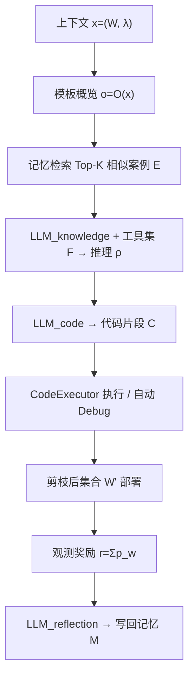

# KP-Agent: Keyword Pruning in Sponsored Search Advertising via LLM-Powered Contextual Bandits (基于 LLM 驱动上下文赌博机的赞助搜索广告关键词剪枝)

- **会议/期刊**: CIKM 2025
- **作者与机构**: Hou-Wan Long (CUHK), Yicheng Song (University of Minnesota), Zidong Wang (DS Digital Technology Group), Tianshu Sun (长江商学院)
- **推荐链路定位**: 广告投放策略层（关键词集合维护，非传统召回/精排链路）
- **研究方向**: 强化学习与动态探索推荐 / 大语言模型推荐
- **论文原文**: [https://arxiv.org/abs/2601.05257v1](https://arxiv.org/abs/2601.05257v1)
- **开源代码**: 暂未开源

## TL;DR (1分钟核心速览)

赞助搜索广告中关键词集合膨胀导致预算被低价值词稀释，而关键词剪枝长期被忽视且现有做法依赖搜索引擎侧的用户 query 数据（广告主无法获取）。本文提出 KP-Agent，将剪枝建模为上下文赌博机，用 LLM Agent 结合领域工具集与长期记忆模块生成可执行代码片段来裁剪关键词集。在美团 45 个广告计划、21 天真实数据上，累计利润相对最优基线提升 2.46%，相对最弱基线提升 49.28%，且 $N_{\min}$ 越小优势越显著。

## Background & Motivation (背景与核心矛盾)

- **主流范式**: SSA 中出价调整（RTBAgent 等）与关键词生成已被充分研究，工业界剪枝仍依赖静态启发式规则（按曝光/CTR/CVR 排序砍尾）。
- **前人局限**: ① 唯一较相关的剪枝工作依赖用户搜索 query 的语义相关性，但 query 是搜索引擎专有数据，广告主拿不到；② 静态排序规则无法适应动态市场，美团数据显示 45 个计划 21 天内仅发生 29 次关键词调整（占 4.6%）。
- **核心洞察 (Key Insight)**: 数据分析显示极少数关键词贡献了绝大部分利润，但头部 25% 与尾部 25% 盈利关键词的出价分布几乎相同——说明低价值词并非出价低，而是**挤占了高价值词的预算份额**，剪枝的本质是预算再分配问题。
- **本文切入点**: 只用广告主侧 KPI 数据，把剪枝决策交给 LLM Agent 在上下文赌博机框架下通过"生成代码—执行—反思"闭环迭代优化。

## Method (核心方法设计)

### 1. 整体框架 (Overall Architecture)

每个决策日 $t$，对每个广告计划$i$观测上下文$x_{i,t}=(W_{i,t},\lambda_{i,t})$（关键词集 + 曝光/CTR/CVR 等 KPI）。先用模板函数$\mathcal{O}(\cdot)$把表格数据压缩为结构化概览$o_{i,t}$；再从记忆模块$\mathcal{M}$中检索$K$个相似历史案例$E_{i,t}$；`LLM_knowledge` 结合工具集$\mathcal{F}$产出领域推理$\rho_{i,t}$；`LLM_code` 将推理转译为可执行代码片段$C_{i,t}$，经 CodeExecutor 执行（失败则自动 debug 重试）得到剪枝后集合$W'_{i,t}$；部署后观测利润奖励$r_{i,t}$，由 `LLM_reflection` 生成反思$\phi_{i,t}$ 并连同概览、知识、代码一起写回记忆。核心设计是**不让 LLM 直接对表格做数值推理**，而是让它写代码、由确定性执行器完成计算。

### 2. 关键设计拆解 (Key Designs)

1. **上下文赌博机形式化与约束优化**：剪枝决策主要依赖当前计划状态而非长程状态转移，故无需完整 MDP。目标为在预算与最小词数约束下最大化总利润：

$$\max \sum_{i=1}^{M}\sum_{w\in W_i} p_{w,i}, \quad \text{s.t. } |W_i| > N_{\min},\ \sum_{w\in W'_i} b_{w,i}\le B_i$$

策略 $\pi_\theta(a_{i,t}\mid x_{i,t},\rho_{i,t})\equiv \text{Exe}(C_{i,t},W_{i,t})$，即动作由代码执行结果定义。这样把"策略学习"转化为"代码生成质量"问题，规避了 LLM 直接输出动作的不可控性。

2. **领域工具集 + 代码生成抗幻觉**：LLM 原生不擅长表格数值推理，直接喂 markdown 表格易幻觉。作者与 SSA 行业专家协作，把关键词评估原则（排序、过滤、阈值筛选等）封装为函数工具集 $\mathcal{F}$，LLM 只负责"选工具 + 写调用代码"，关键数值洞察全部由函数输出承担。这是本文最实用的工程 trick：**用确定性代码替代 LLM 算术**。

3. **记忆增强反思与少样本迁移**：记忆条目为四元组 $(o,\rho,C,\phi)$，检索用负 Levenshtein 距离衡量概览相似度：

$$E_{i,t}=\arg\text{TopK}\max_{o\in\mathcal{M}} \text{sim}(o_{i,t},o)$$

检索到的案例自带历史反思 $\phi$，相当于把"上次这么剪结果如何"的经验注入 prompt，实现跨计划的策略迁移。奖励$r_{i,t}=\sum_{w\in W_{i,t+1}}p_{w,i}$ 直接取剪枝后集合的利润，无需额外奖励塑形。

## Experimental Setup & Evaluation Protocol (实验设置与评估协议)

- **数据集与预处理**: 美团某医药广告主 2025 年 21 天真实 SSA 数据，过滤掉特殊促销类少词计划后保留 45 个计划、278 个唯一关键词、220 万曝光、175,816 次点击、广告花费 83,531 元，CPC 计费。

| 数据集 | #Campaigns | #Keywords | #Impressions | #Clicks | 场景说明 |
| :--- | :---: | :---: | :---: | :---: | :--- |
| Meituan-SSA | 45 | 278 | 2.2M | 175,816 | 医药广告主，21 天，CPC |

- **数据划分与防穿越 (Splitting Strategy)**: 非标准 ML 划分，而是**滚动窗口模拟**：第 7 天确立初始关键词集，第 $t$天（$t=7\ldots20$）用$t-6$至$t$的 7 日窗口数据决策第$t+1$ 天，评估第 8–21 天共 14 天的累计利润。严格只用历史窗口，无穿越。
- **排名评测协议 (Ranking Protocol)**: 非排序指标，采用**离线历史数据模拟评估**（作者明确说明真实 A/B 测试成本高且需广告主授权）。预算假设：每日预算 $B_i$ 在活跃关键词间均分，剪枝后剩余词按比例获得更高份额，总花费不变。
- **对比基线与超参设置**: 4 个工业界常用静态规则基线——Impression-Rank、CTR-Rank、CVR-Rank、Impression Regression（7 日曝光线性回归斜率）。基础 LLM 为 GPT-4.1 nano，$N_{\min}\in\{5,7,9\}$ 三档。

## Key Experimental Results (实验关键数据)

### 1. 主实验对比 (Main Results)

原文主结果为图 4（日利润与累计利润曲线），此处按文中报告数值整理为表：

| 对比基线 | 剪枝策略类型 | 累计利润相对 KP-Agent | 说明 |
| :--- | :--- | :---: | :--- |
| **KP-Agent** | LLM Agent + Bandit | — | 全档 $N_{\min}$ 最优 |
| Impression-Rank | 静态曝光排序 | -2.46% | 差距最小的基线 |
| CTR-Rank | 静态点击率排序 | 显著落后 | 忽略转化与利润 |
| CVR-Rank | 静态转化率排序 | 显著落后 | 忽略曝光规模 |
| Impression Regression | 趋势回归 | **-49.28%** | 差距最大的基线 |

### 2. 消融实验 (Ablation Study)

原文未提供严格消融表，仅通过 $N_{\min}$ 敏感性间接验证组件价值：

| 配置 | 现象 | 归因 |
| :--- | :--- | :--- |
| $N_{\min}=9$ | KP-Agent 领先幅度最小 | 可剪空间小，策略优势被压缩 |
| $N_{\min}=7$ | 领先幅度扩大 | 中等剪枝自由度 |
| $N_{\min}=5$ | 领先幅度最大 | 高自由度下精准识别冗余词的能力凸显 |

### 3. 关键实验发现 (Key Findings)

1. **剪枝自由度是收益放大器**：$N_{\min}$ 从 9 降到 5 时 KP-Agent 与基线差距显著拉大，说明其优势不在于"敢剪"，而在于"剪得准"——低价值词识别精度随可选空间增大而兑现为更多利润。
2. **趋势类基线最脆弱**：Impression Regression 落后 49.28%，因为曝光下滑未必等于利润下滑（可能是低质曝光自然衰减），纯趋势信号与利润目标错位最严重。
3. **静态排序天花板明显**：最强的 Impression-Rank 也仅差 2.46%，说明单指标排序已接近其能力上限，多 KPI 联合推理 + 历史反思带来的增益是规则方法难以复制的。

## Highlights & Limitations (亮点、对比与审稿批判)

- **与代表作对比 (vs. Prior Work)**: 与依赖用户 query 的语义剪枝工作相比，本文只用广告主侧 KPI，数据可得性质变；与同组 RTBAgent（多记忆检索 + 两步决策调出价）相比，本文把 Agent 范式从"出价"迁移到"关键词集合维护"，且用代码生成替代直接数值输出，抗幻觉更强。
- **可迁移亮点**: ① "LLM 只写代码、执行器做计算"的抗幻觉范式可直接迁移到任何表格型投放/预算分配任务；② 记忆条目携带反思文本的检索式少样本学习，适合冷启动计划快速复用历史策略。
- **审稿级局限批判**: ① 评估完全基于离线模拟与预算均分假设，未做线上 A/B，利润提升在真实竞价环境中可能被竞争反馈削弱；② 单广告主、单行业（医药）、仅 45 个计划 278 个词，泛化性证据薄弱；③ 每日每计划多次 LLM 调用 + 代码执行 + debug 重试，推理延迟与 token 成本未做任何量化，工业部署经济性存疑；④ 缺少对工具集、记忆模块、反思机制的严格消融。

## Rating (四维评分)

- **方法创新性 (Novelty)**: ⭐⭐⭐ （把关键词剪枝形式化为上下文赌博机并用代码生成定义动作空间，思路新颖但技术组件均为已有范式的组合）
- **评估协议与实验扎实度 (Protocol & Experiments)**: ⭐⭐ （仅离线模拟、单广告主小规模数据、无消融、无显著性检验，实验说服力偏弱）
- **写作与数学规范度 (Clarity & Rigor)**: ⭐⭐⭐ （形式化清晰、算法伪代码完整，但奖励设计与策略优化的理论衔接较松，$\pi_\theta$ 与 LLM 参数的关系未严格定义）
- **工业落地与复现价值 (Industrial & Practical Value)**: ⭐⭐⭐ （工具集 + 代码执行的设计极具工程落地价值，但未开源、LLM 调用成本与延迟未评估，复现门槛较高）

