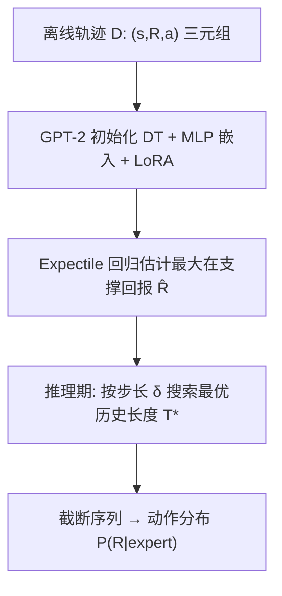
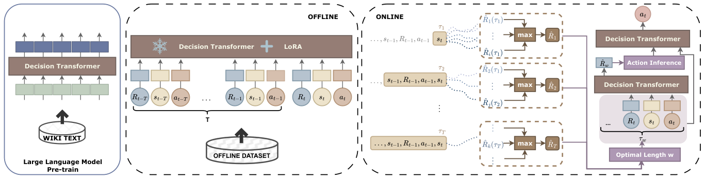

# Maximum In-Support Return Modeling for Dynamic Recommendation with Language Model Prior (基于语言模型先验的最大在支撑回报建模动态推荐)

- **会议/期刊**: CIKM 2025
- **作者与机构**: Xiaocong Chen, Siyu Wang, Lina Yao (CSIRO Data61 / Macquarie University / UNSW)
- **推荐链路定位**: 端到端生成式（离线 RL 序列决策）
- **研究方向**: 强化学习与动态探索推荐 / 大语言模型推荐
- **论文原文**: [https://arxiv.org/abs/2510.12816v1](https://arxiv.org/abs/2510.12816v1)
- **开源代码**: 暂未开源

## TL;DR (1分钟核心速览)

离线 RL 推荐（RLRS）长期受困于用户反馈次优/稀疏与用户-物品交互表征不足两大痛点。本文提出 MDT4Rec：把轨迹拼接从训练期搬到**动作推理期**，用 expectile 回归（$\alpha=0.99$）估计"最大在支撑回报"并据此自适应截断历史长度，从而丢弃失败历史片段；同时以 GPT-2 权重初始化 Decision Transformer、线性嵌入换 MLP、LoRA 微调。在 Coat/MovieLens-1M/KuaiRec/KuaiRand/YahooR3 五个数据集与 VirtualTB 仿真上，累计回报$R_{cumu}$ 相对 EDT4Rec 提升约 1.9%–7.8%，且方差更低。

## Background & Motivation (背景与核心矛盾)

- **主流范式**: 以 Decision Transformer (DT) 为核心的离线 RLRS（DT4Rec、CDT4Rec、EDT4Rec）把推荐建模为"状态-回报-动作"三元组序列的条件生成，靠 return-to-go 引导策略。
- **前人局限一**: EDT4Rec 在**训练期**做轨迹拼接，用相似最优轨迹片段替换次优片段，但人工合成的转移与真实用户意图不一致，模型预测与真实行为产生错位。
- **前人局限二**: 现有 RLRS 几乎无人处理用户-物品交互的复杂表征问题；而 LLM 在传统 RS 中已证明有强知识迁移能力，在 RLRS 中却仅被用于"语言描述状态"或简单初始化，收益有限。
- **核心洞察 (Key Insight)**: 历史长度本身应随轨迹质量自适应——若当前轨迹已接近最优，保留长历史以稳定预测；若历史含失败片段，缩短历史反而让模型"探索"出更优轨迹。即"最优历史长度"是一个可被回报估计器搜索的变量。
- **本文切入点**: 用 expectile 回归逼近数据集内的**最大在支撑回报 (maximum in-support return)**，在推理时按不同截断长度逐一打分，选回报估计最高的历史长度作为输入。

## Method (核心方法设计)

### 1. 整体框架 (Overall Architecture)

离线阶段：以 GPT-2 预训练权重初始化 DT 主干，输入/输出线性投影替换为两层 MLP 以缓解语言-决策域间失配，仅对 Attention 的 Q/K/V 施加 LoRA 低秩更新，联合优化 DT 损失、语言建模辅助损失与最大在支撑回报估计损失。在线推理阶段：对查询序列按步长 $\delta$枚举候选历史长度$T$，用回报估计网络$\hat{R}_t(\tau_T)$ 为每个截断序列打分，取最高者对应的截断序列送入策略网络，再经 Bayes 规则化的专家回报采样得到动作分布。

<figure class="paper-figure" markdown="span">
  <figcaption>图1：所提出的MDT4Rec的整体结构</figcaption>
</figure>

### 2. 关键设计拆解 (Key Designs)

1. **最大在支撑回报建模 (Maximum In-Support Return Modeling)**：痛点是把拼接放训练期会造出假转移。本文改为估计"给定长度 $T$的历史片段在数据集内可达到的回报上界"，用$\alpha$-expectile 非对称平方损失逼近内层最大化：
$$\hat{R}_t^T=\max_{\tau_T\in\mathcal{D}}R_t(\tau_T)\approx\arg\min_{\hat{R}_t(\tau_T)}\mathbb{E}_{\tau_T\in\mathcal{D}}\left[L_2^\alpha\left(\hat{R}_t(\tau_T)-R_t\right)\right],\quad L_2^\alpha(u)=|\alpha-\mathbb{I}(u<0)|u^2$$
作者证明 $\lim_{\alpha\to1}g_\alpha(\mathcal{S}_t)=R_t^{\max}$（Theorem 3.1），故取$\alpha=0.99$即可无痛逼近数据集最大回报。直觉：高$\alpha$ 让"低估"的惩罚远大于"高估"，回归点被推向回报分布右尾，天然适配稀疏覆盖下的上界估计。

2. **推理期最优历史长度搜索 (Action Inference Stitching)**：痛点是不存在可用的拼接轨迹。本文在推理时枚举 $T\in\{1,1+\delta,\dots,T_{\max}\}$，取$\hat{R}_t$最大的截断序列，再按$P(R_t\,|\,\text{expert}_t,\dots)\propto\exp(\kappa R_t)P(R_t)$（$\kappa=10$）采样动作。短历史带来更大预测方差，恰好充当"探索"以跳出次优轨迹；长历史则在轨迹已优时提供稳定性——这一"质量-长度依赖"是方法有效性的物理直觉。

3. **LLM 先验与训练目标**：GPT-2 权重初始化 + MLP 嵌入 + LoRA（$W=W_0+BA$，$r\ll\min(d,k)$，仅作用于 Q/K/V）+ WikiText 语言建模辅助任务防过拟合。总损失：
$$\mathcal{L}=\mathcal{L}_{dt}+\lambda\cdot\mathcal{L}_{language}+\mathcal{L}_{\max},\quad \lambda=0.1$$
其中 $\mathcal{L}_{dt}=\mathcal{L}_{N_e}+\mathcal{L}_{N_g}$分别为回报估计的 MSE 与动作生成的交叉熵。推理开销为$O(T_{\max}/\delta)$次前向，$\delta=2$ 时约为暴力搜索的 1/2。

## Experimental Setup & Evaluation Protocol (实验设置与评估协议)

- **数据集与预处理**: 五个公开数据集经 EasyRL4Rec 转为 Gymnasium 风格 RL 环境，缺失交互用矩阵分解补全；状态编码器统一用 SASRec，LLM 统一用 GPT-2：

| 数据集 | #Users | #Items | #Train Inter. | 反馈类型 | 场景说明 |
| :--- | :---: | :---: | :---: | :---: | :--- |
| Coat | 290 | 300 | 7,000 | 显式评分 | 产品推荐，极小规模 |
| YahooR3 | 15,400 | 1,000 | 311,700 | 显式 | 音乐推荐 |
| MovieLens-1M | 58,000 | 3,000 | 5,900,000 | 显式 | 电影，大规模 |
| KuaiRec | 1,000 | 6,700 | 594,400 | 隐式 | 短视频 |
| KuaiRand | — | — | 571,300 | 隐式 | 短视频随机曝光 |
| VirtualTB | — | — | 仿真交互 | 仿真 | 在线模拟器 |

- **数据划分与防穿越**: 沿用 EasyRL4Rec 的离线轨迹切分（训练/测试交互分离），VirtualTB 为在线交互式仿真，训练数据受限，另用 DDPG 作为行为策略采集有限条专家轨迹。
- **排名评测协议**: 非传统 Top-K 排序，而是 RL 指标——累计回报 $R_{cumu}$、平均每步回报$R_{avg}$、轨迹长度 Length；离线评估在 100 个并行测试环境上取均值±标准差。
- **对比基线与超参设置**: 基线含 DDPG/SAC/TD3（在线 RL）与 DT/DT4Rec/CDT4Rec/EDT4Rec（离线 RLRS）；默认 $T=20$、$\delta=2$、$\alpha=0.99$、$\kappa=10$、$\lambda=0.1$。

## Key Experimental Results (实验关键数据)

### 1. 主实验对比 (Main Results)

| 方法 | Coat $R_{cumu}$| Coat$R_{avg}$| ML-1M$R_{cumu}$| ML-1M$R_{avg}$| KuaiRec$R_{cumu}$| YahooR3$R_{cumu}$| KuaiRand$R_{cumu}$| VirtualTB$R_{cumu}$ |
| :--- | :---: | :---: | :---: | :---: | :---: | :---: | :---: | :---: |
| DDPG | 15.28 | 2.12 | 9.03 | 2.47 | 9.40 | 7.44 | 1.40 | 74.65 |
| SAC | 80.98 | 2.90 | 34.12 | 3.46 | 23.42 | 73.67 | 6.87 | 73.43 |
| DT | 83.49 | 2.78 | 33.22 | 3.49 | 29.03 | 79.82 | 6.96 | 78.88 |
| DT4Rec | 82.18 | 2.62 | 32.87 | 3.32 | 28.54 | 78.52 | 6.82 | 76.79 |
| CDT4Rec | 87.87 | 2.90 | 35.13 | 4.00 | 30.49 | 80.76 | 7.33 | 79.21 |
| EDT4Rec | 88.19 | 2.90 | 35.83 | 3.98 | 31.07 | 82.42 | 7.58 | 79.67 |
| **MDT4Rec** | **89.87** | **2.93** | **38.64** | **4.29** | **33.01** | **83.18** | **7.71** | **81.79** |
| Improv. vs EDT4Rec | +1.9% | +1.1% | +7.8% | +7.9% | +6.2% | +0.9% | +1.7% | +2.7% |

### 2. 消融实验 (Ablation Study)

| 变体 | Coat $R_{cumu}$| ML-1M$R_{cumu}$| KuaiRec$R_{cumu}$| YahooR3$R_{cumu}$| VirtualTB$R_{cumu}$ |
| :--- | :---: | :---: | :---: | :---: | :---: |
| MDT4Rec (完整) | **89.87** | **38.64** | **33.01** | **83.18** | **81.79** |
| w/o LM 先验 (MDT4Rec-LM) | 88.77 | 37.62 | 32.02 | 82.47 | 80.73 |
| w/o 最大在支撑回报 (MDT4Rec-Max) | 87.93 | 36.34 | 31.83 | 82.40 | 79.87 |
| 全量微调 (替代 LoRA) | — | — | — | — | 77.89 |
| 冻结参数 (替代 LoRA) | — | — | — | — | 80.12 |
| 线性嵌入 (替代 MLP) | — | — | — | — | 76.46 |

### 3. 关键实验发现 (Key Findings)

1. **最大在支撑回报建模是最大贡献项**：去掉后 Coat 掉 1.94、ML-1M 掉 2.30、VirtualTB 掉 1.92，降幅普遍大于去掉 LM 先验（约 1.1–1.5），说明"推理期自适应截断历史"比"换更强主干"更关键，直接验证了次优历史是离线 RLRS 的主要瓶颈。
2. **LoRA 优于全量微调与冻结**：VirtualTB 上 LoRA 81.79 vs 全量微调 77.89 vs 冻结 80.12，全量微调因灾难性遗忘反而最差，LoRA 在"保留预训练结构"与"任务适配"间取得最优平衡；MLP 嵌入较线性投影提升 5.33（81.79 vs 76.46），证明异构状态信号需要非线性高阶交互。
3. **超参稳健但非单调**：$T=20$时$R_{cumu}$最高且序列长度可控；$\delta=2$最优，$\delta=6$出现明显回落、$\delta=8$ 小幅回升，说明搜索粒度存在非平凡的最优点，工程上不能盲目加大步长换速度。

## Highlights & Limitations (亮点、对比与审稿批判)

- **与代表作对比 (vs. Prior Work)**: 与 EDT4Rec 的本质区别在于拼接的**发生位置**——EDT4Rec 在训练期合成假转移，本文在推理期通过截断真实历史实现"隐式拼接"，不引入任何虚构样本；与 LM4RL 类工作（Reid et al.）相比，本文不止于"用 LM 初始化"，而是把 MLP 嵌入、LoRA、语言辅助损失组合成一套面向推荐异构状态的适配方案。
- **可迁移亮点**: (1) "推理期搜索历史长度 + 上界回报估计器"可迁移到任何以 return-to-go 为条件的序列决策模型（如序列推荐中的长短期兴趣截断）；(2) 用 expectile 回归估计数据集内上界，是处理离线数据覆盖稀疏时替代 max 算子的通用技巧。
- **审稿级局限批判**: (1) 推理需 $T_{\max}/\delta$次前向，$\delta=2$、$T=20$ 时约 10 次前向，在线延迟是 EDT4Rec 的数倍，论文未给出实际毫秒级开销；(2) 评估完全依赖 RL 回报指标而非 Top-K 排序指标（HR/NDCG），与主流推荐评测不可直接比较，且 VirtualTB 为合成仿真器，线上真实收益仍待验证；(3) 语言辅助损失需 WikiText 文本，作者自承多数推荐数据集无文本，该模块的普适性存疑。

## Rating (四维评分)

- **方法创新性 (Novelty)**: ⭐⭐⭐⭐ （把轨迹拼接从训练期搬到推理期并用 expectile 上界估计驱动，视角新颖且有 Theorem 3.1 收敛性支撑，但各组件本身均为已有技术的组合）
- **评估协议与实验扎实度 (Protocol & Experiments)**: ⭐⭐⭐ （五数据集 + 在线仿真覆盖面广、含方差报告，但缺 Top-K 排序指标与真实线上 A/B，评测维度偏单一）
- **写作与数学规范度 (Clarity & Rigor)**: ⭐⭐⭐⭐ （Theorem 3.1 证明完整、损失函数与算法伪代码清晰，但部分符号如 $\theta_s/\theta_a$ 定义略含糊，表格排版有数字粘连）
- **工业落地与复现价值 (Industrial & Practical Value)**: ⭐⭐⭐ （LoRA 降低微调成本、方法思路易迁移，但推理多次前向的延迟与未开源代码削弱了直接部署价值）

