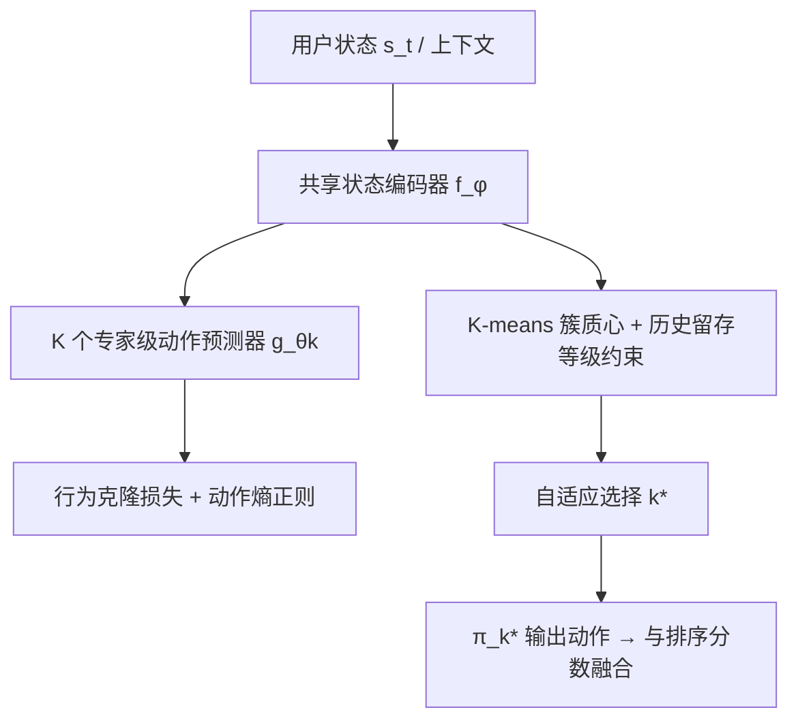
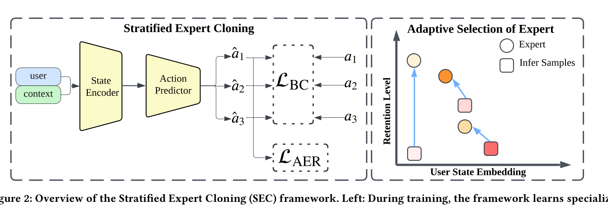

# Stratified Expert Cloning for Retention-Aware Recommendation at Scale (面向大规模留存感知推荐的分层专家克隆)

- **会议/期刊**: CIKM 2025
- **作者与机构**: Chengzhi Lin, Annan Xie, Shuchang Liu, Wuhong Wang, Chuyuan Wang, Yongqi Liu, Han Li（快手科技 / 北京大学）
- **推荐链路定位**: 重排（与一/二级排序分数融合）
- **研究方向**: 强化学习与动态探索推荐 / 多任务学习与列表级重排
- **论文原文**: [https://arxiv.org/abs/2504.05628v2](https://arxiv.org/abs/2504.05628v2)
- **开源代码**: 暂未开源

## TL;DR (1分钟核心速览)

长期留存优化中，RL 面临延迟奖励归因难、动作空间巨大导致样本低效、探索有伤用户体验三大痛点。本文提出 SEC，把"高留存用户"当作专家，按留存分数分层做多级行为克隆，辅以动作熵正则防止策略坍缩，推理时用状态嵌入 + 历史留存等级自适应选专家。离线 KuaiRand 上返回时间较 GFN 降 5.7%，快手双平台 A/B 活跃天数累计 +0.098%/+0.122%，各折合 20 万+ DAU。

## Background & Motivation (背景与核心矛盾)

- **主流范式**: 工业界留存优化分两派——CTR/内容类模型只看短期点击，RL（GFN、RLUR、Decision Transformer）试图直接优化长期回报。
- **前人局限**: ① RL 的奖励延迟使 credit assignment 极难，且全库动作空间下探索样本效率低、坏推荐直接伤用户体验；② 二值化"专家/非专家"划分过于粗糙，忽略了留存行为本身是连续谱。
- **核心洞察 (Key Insight)**: 图 3 的 t-SNE 显示，level-1/2/3 专家在状态空间形成清晰簇，而大量非专家用户并不靠近最高留存专家，反而贴近 level-2/3——说明"向谁学"应当分层而非一刀切。
- **本文切入点**: 用模仿学习绕开 RL 的探索与奖励设计，把"向哪一级专家学"变成可学习的路由问题。

## Method (核心方法设计)

### 1. 整体框架 (Overall Architecture)

输入用户状态 $s_t$（人口属性、偏好、近期交互），共享状态编码器$f_\phi$输出紧凑表征$h_t$；$K$个专家级动作预测器$g_{\theta_k}$并行做行为克隆，训练目标叠加动作熵正则。推理时对每级专家的状态空间做 K-means 聚类，按用户状态到各簇质心的最小距离 + 历史留存等级约束选出$k^*$，由$\pi_{k^*}$ 输出推荐动作，再与现有排序分数融合。

<figure class="paper-figure" markdown="span">
  <figcaption>图2：分层专家克隆（SEC）框架概览。左：训练时，框架通过从多个高留存专家级别的用户进行行为克隆来学习专门的推荐策略。状态编码器处理用户上下文和状态信息，同时训练多个专家策略以捕捉来自不同级别专家用户的推荐策略。右：推理时，框架根据当前用户的状态嵌入和历史留存级别自适应选择最合适的专家策略。</figcaption>
</figure>

### 2. 关键设计拆解 (Key Designs)

1. **多级专家分层克隆（Multi-level Expert Stratification）**：痛点是把留存行为二值化会抹掉中间态用户的可学信号。做法是按留存分数（月活跃天数/LTV 分位数）把专家划为 $K$级，共享编码器、各级独立预测头，逐级最小化负对数似然$\mathcal{L}^k_{BC}=\sum_{(s,a)\in\mathcal{D}_k}-\log\pi_k(a|s)$。直觉是：中间层专家提供了"跳一跳够得着"的行为示范，比只学顶级专家更易被普通用户匹配。

2. **动作熵正则（Action Entropy Regularization, AER）**：图 4 显示纯 BC 学出的动作分布在 PCA/t-SNE 上高度集中，策略坍缩、覆盖不了多样兴趣。连续动作空间下用动作矩阵 $A_k\in\mathbb{R}^{B\times d}$的核范数作熵代理：$\mathcal{L}^k_{AER}=-|A_k|_*=-\sum_{i=1}^{\min(B,d)}\sigma_i(A_k)$；离散空间则最大化类平均概率的熵$\sum_j p_{k,j}\log p_{k,j}$。核范数最大化等价于抬升动作矩阵的谱，直接撑开动作子空间，图 5 验证分布显著变宽。

3. **自适应专家选择与训练目标**：推理时计算 $d_k=\min_c d(f_\phi(s),\mu_{k,c})$，取满足$d_k\le\delta_k$的最小$k$，并用历史留存等级$r_h$约束$k^*=\min(k^*,r_h)$，防止把高留存用户错配到低质策略导致体验回退。总损失$\mathcal{L}=\sum_{k=1}^{K}(\mathcal{L}^k_{BC}+\lambda\mathcal{L}^k_{AER})$，$\lambda=0.01$；离线用连续动作（MSE 形式），线上因视频 ID 规模巨大改用多模态聚类后的离散动作 + 交叉熵，无需负采样。

## Experimental Setup & Evaluation Protocol (实验设置与评估协议)

- **数据集与预处理**: 离线用 KuaiRand-Pure（随机曝光、含 click/view/like/hate/leave 等多信号），并用 KuaiSim 留存模拟器（leave 模块 + return 模块）仿真长期行为，配置沿用 GFN。

| 数据集 | #Users | #Items | #Interactions | 稀疏度/密度 | 特征/场景说明 |
| :--- | :---: | :---: | :---: | :---: | :--- |
| KuaiRand-Pure | 27,285 | 7,551 | 1,436,609 | 0.70% | 短视频随机曝光，含留存/离开信号 |

- **数据划分与防穿越 (Splitting Strategy)**: 基于 KuaiSim 模拟器的序列式长期仿真评估，返回时间 $\le 3$ 天的用户按不同阈值划为各级专家；用户嵌入预训练后冻结。
- **排名评测协议 (Ranking Protocol)**: 非传统 Top-N 排序，而是模拟器驱动的长期指标——Return Time（越低越好）、Click Rate、Long View Rate、Like Rate；线上以 7 天窗口 Active Days 为主指标。
- **对比基线与超参设置**: 基线含 CEM、DIN、TD3、SAC、RLUR、GFN；Transformer 策略网络，Adam，batch 128，lr 3e-4，$\lambda=0.01$，每级 1000 个 K-means 簇，$\delta_k$取簇间平均距离的一半；线上 10% 流量双周 A/B，显著性$p<0.05$。

## Key Experimental Results (实验关键数据)

### 1. 主实验对比 (Main Results)

| Model | Return Time↓ | Click Rate↑ | Long View Rate↑ | Like Rate↑ |
| :--- | :---: | :---: | :---: | :---: |
| TD3 | 2.382 | 0.800 | 0.791 | 0.852 |
| SAC | 2.373 | 0.801 | 0.795 | 0.857 |
| DIN | 1.947 | 0.773 | 0.764 | 0.812 |
| CEM | 1.889 | 0.762 | 0.757 | 0.804 |
| RLUR | 1.786 | 0.789 | 0.778 | 0.831 |
| GFN | 1.496 | 0.805 | 0.794 | **0.885** |
| **SEC (Ours)** | **1.411** | **0.833** | **0.825** | 0.806 |
| Improv. vs GFN | ↓5.7% | ↑3.5% | ↑3.9% | ↓8.9% |

线上 A/B（Active Days，均显著 $p<0.05$）：

| 阶段 | Kuaishou | Kuaishou Lite |
| :--- | :---: | :---: |
| BC + Entropy（一级排序） | +0.034% | +0.037% |
| BC + Entropy（二级排序） | +0.036% | +0.042% |
| 多级专家带来的增量 | +0.028% | +0.043% |
| **累计提升** | **+0.098%** | **+0.122%** |

### 2. 消融实验 (Ablation Study)

| Variant | Return Time↓ | Click Rate↑ | Long View Rate↑ |
| :--- | :---: | :---: | :---: |
| SEC (Full) | **1.411** | 0.833 | **0.825** |
| w/o Multi-level | 1.423 | 0.821 | 0.815 |
| w/o Action Entropy | 1.449 | **0.836** | 0.805 |

### 3. 关键实验发现 (Key Findings)

1. **多级分层是留存增益的主来源之一**：去掉分层后返回时间 +0.9%、点击与长播均跌超 1.0%；线上多级专家单独贡献 +0.028%/+0.043% 活跃天数，印证图 3 中"非专家更贴近中低层专家"的连续谱假设。
2. **熵正则存在"短期让利、长期获益"的权衡**：去掉 AER 后点击率反升 1.7%，但长播率跌 2.4%、返回时间恶化 1.8%；线上图 7 显示加 AER 后各级专家 AUC 全面上升（十亿级样本），说明多样性正则确实改善了泛化而非单纯牺牲即时指标。
3. **Like Rate 的 8.9% 下降是目标函数的必然代价**：SEC 明确以留存而非即时满意度为目标，与 GFN 的差异恰好刻画了"即时爽感 vs 长期留存"的帕累托前沿；同时有效兴趣簇在双平台分别 +1.31%/+1.14%，佐证兴趣拓展而非收窄。

## Highlights & Limitations (亮点、对比与审稿批判)

- **与代表作对比 (vs. Prior Work)**: 相比 GFN 把留存建模为会话概率流、RLUR 做可解释留存因子建模，SEC 完全绕开奖励设计与在线探索，把问题降维成"分层监督学习 + 路由"；相比 DT4Rec 的离散奖励 prompt，SEC 用专家分层直接提供行为监督信号，工程上更易落地。
- **可迁移亮点**: ① 用核范数最大化作为连续动作空间的熵代理，可低成本移植到任何 embedding 级生成式召回/重排的多样性约束；② "状态聚类质心 + 历史等级上限约束"的路由机制，可直接复用到多场景/多目标策略选择，避免降级错配。
- **审稿级局限批判**: ① 离线评估高度依赖 KuaiSim 模拟器，其 leave/return 模块本身的偏差会放大结论不确定性，缺少真实长期留存的离线可复现协议；② 方法强依赖足量高质量专家用户，冷启动与新平台场景失效（作者亦承认），且每级 1000 簇的 K-means + 多专家头带来额外推理与维护开销，论文未给出延迟量化。

## Rating (四维评分)

- **方法创新性 (Novelty)**: ⭐⭐⭐⭐ （把留存优化重构为分层模仿学习，思路朴素但切中 RL 落地痛点，核范数熵代理有理论支撑）
- **评估协议与实验扎实度 (Protocol & Experiments)**: ⭐⭐⭐⭐ （双平台十亿级用户 A/B + 显著性检验极具说服力，但离线依赖模拟器、缺少标准 Top-N 协议）
- **写作与数学规范度 (Clarity & Rigor)**: ⭐⭐⭐⭐ （公式简洁、图示动机链完整，但连续/离散两套 AER 定义的衔接与 $\delta_k$ 选取缺少敏感性分析）
- **工业落地与复现价值 (Industrial & Practical Value)**: ⭐⭐⭐⭐ （已在快手双端全量验证、20 万+ DAU 实绩，但未开源且专家分层阈值强依赖业务先验）

