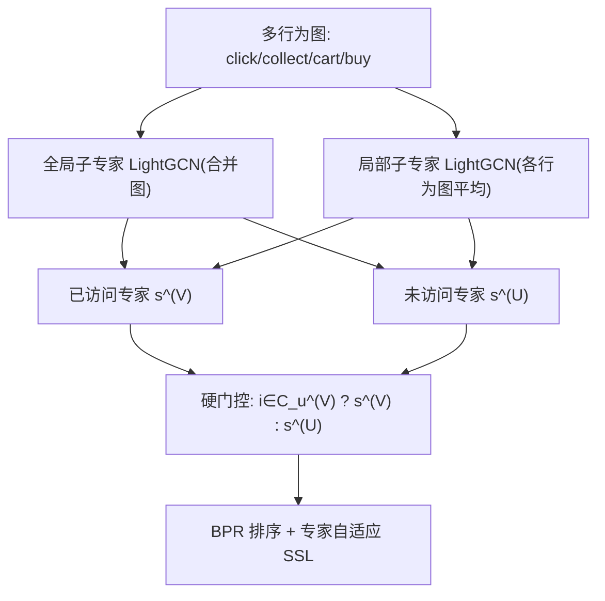
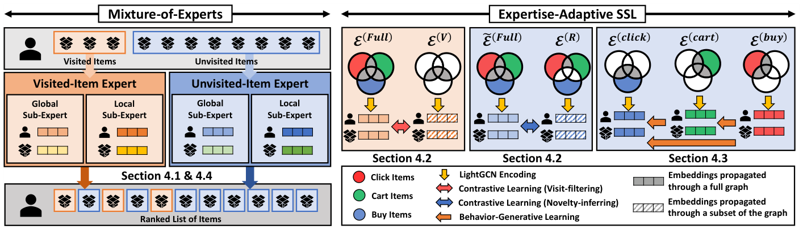

# A Self-Supervised Mixture-of-Experts Framework for Multi-behavior Recommendation (面向多行为推荐的自监督混合专家框架)

- **会议/期刊**: CIKM 2025
- **作者与机构**: Kyungho Kim, Sunwoo Kim, Geon Lee, Kijung Shin (KAIST)
- **推荐链路定位**: 召回（全库排序打分）
- **研究方向**: 自监督对比学习与交互去噪 / 协同过滤
- **论文原文**: [https://arxiv.org/abs/2508.19507v2](https://arxiv.org/abs/2508.19507v2)
- **开源代码**: [https://github.com/K-Kyungho/MEMBER](https://github.com/K-Kyungho/MEMBER)

## TL;DR (1分钟核心速览)

多行为推荐（点击/收藏/加购辅助购买预测）长期被当作单一目标优化，但作者发现现有模型在**已访问物品**（有辅助行为）与**未访问物品**（直接购买、无前置行为）上的推荐质量存在巨大鸿沟（平均 824.2%），且两类物品的最优模型互不相同。MEMBER 将目标重定义为两个子任务，用**硬门控 MoE** 分配两个独立专家，并各自配备专家自适应自监督损失（访问过滤对比 / 新颖性推断对比 + 行为生成）。在 Tmall/Taobao/JData 三数据集、全库排序协议下，标准设定全部 12 项指标最优，HR@20 相对最强基线 MULE 最高提升 **65.46%**。

## Background & Motivation (背景与核心矛盾)

- **主流范式**: 多行为推荐将点击、收藏、加购等辅助行为图与购买目标图联合编码（MB-GMN、CRGCN、MB-HGCN、MULE 等），通过注意力/Transformer/对比学习融合多行为信号提升整体排序质量。
- **前人局限一**: 所有基线在未访问物品上的性能断崖式下跌——Tmall 上已访问物品 HR@10 平均比未访问物品高 824.2%，说明辅助行为信号反而"绑架"了模型，使其只会推荐用户已点过/加购过的物品。
- **前人局限二**: 两类物品上的模型排名严重不一致，甚至最简单的单行为 MF-BPR 在未访问物品上反而最强，证明"单一架构通吃两类目标"不可行。
- **核心洞察 (Key Insight)**: 未访问物品并非冷启动物品（后者是全局层面交互稀少，前者是用户个体层面无辅助行为），其购买信号稀疏但真实存在，需要与"已访问→购买"完全不同的归纳偏置。
- **本文切入点**: 把"买已访问"与"买未访问"显式拆成两个子任务，用 MoE 让两个专家各自专精，并用定制 SSL 把每个专家"推"向自己的目标分布。

## Method (核心方法设计)

### 1. 整体框架 (Overall Architecture)

每个专家内部采用"全局子专家 + 局部子专家"双路 LightGCN 编码：全局子专家在合并所有行为的全局图 $\mathcal{G}^{(global)}$上传播以捕获行为协同，局部子专家在每个行为图$\mathcal{G}^{(m)}$上独立传播后按行为数平均以保留行为特异性，两路打分以系数$\lambda$加权融合。两个专家参数完全不共享，分别由访问过滤对比损失与（新颖性推断对比 + 行为生成）损失驱动，最终以硬门控按物品是否属于$\mathcal{C}_u^{(V)}$ 选择唯一专家打分。

<figure class="paper-figure" markdown="span">
  <figcaption>图3：MEMBER的可视化，这是一种基于专家混合的所提出的多行为推荐方法。MEMBER采用两个专家：(1) 已访问物品专家，专门用于已访问物品推荐；(2) 未访问物品专家，专门用于未访问物品推荐。这种专业化由专家自适应自监督学习（SSL）引导，其中已访问物品专家利用访问过滤对比学习，而未访问物品专家整合新颖性推断对比学习和行为生成学习。</figcaption>
</figure>

### 2. 关键设计拆解 (Key Designs)

1. **硬门控双专家 MoE（解决"一模型通吃"矛盾）**：软门控需对每个 user-item 对评估全部专家，推理昂贵且在本场景无必要——因为已访问/未访问物品在定义上互斥且可即时判定。故直接令 $s^*_{ui}=\mathbb{I}[i\in\mathcal{C}_u^{(V)}]s^{(V)}_{ui}+\mathbb{I}[i\in\mathcal{C}_u^{(U)}]s^{(U)}_{ui}$。消融显示硬门控反而优于平均与可学习软门控，因为专家选择零歧义、且避免了弱专家对强专家的分数污染。

2. **访问过滤 vs. 新颖性推断对比学习（把两个专家推向各自分布）**：将交互集切为访问购买集 $\mathcal{E}^{(V)}=\mathcal{E}^{(buy)}\cap(\bigcup_{m\neq buy}\mathcal{E}^{(m)})$与其余集$\mathcal{E}^{(R)}=\mathcal{E}^{(global)}\setminus\mathcal{E}^{(V)}$。已访问专家对齐"全图视图"与"仅$\mathcal{E}^{(V)}$视图"的嵌入，迫使其聚焦真正导致购买的辅助行为；未访问专家则对齐"全图视图"与"仅$\mathcal{E}^{(R)}$ 视图"，防止被海量访问购买信号淹没。以用户侧为例：
$$\mathcal{L}_{CL}^{(V),user}=-\sum_{u\in\mathcal{U}}\log\frac{\exp(\cos(\mathbf{E}_u^{(full)},\mathbf{E}_u^{(V)})/\tau)}{\sum_{u'\in\mathcal{U}}\exp(\cos(\mathbf{E}_u^{(full)},\mathbf{E}_{u'}^{(V)})/\tau)}$$
   直觉：$\mathcal{E}^{(R)}$ 中"无前置行为直接购买"样本虽稀少，但对比目标把它从长尾噪声提升为显式监督信号。

3. **行为生成学习（补足未访问样本稀疏）**：仅靠对比学习，未访问购买样本过少难以支撑训练。故按行为自然序 $\xi$（click→collect→cart→buy），用后阶段行为的局部嵌入去重构前阶段行为图的边，即用稠密行为监督稀疏行为：
$$\mathcal{L}_{n\to m}=-\frac{1}{|\mathcal{U}|}\sum_{u\in\mathcal{U}}\Big(\sum_{i\in\mathcal{I}_u^{(m)}}\log\sigma(s_{ui}^{(n)})+\sum_{j\notin\mathcal{I}_u^{(m)}}\log(1-\sigma(s_{uj}^{(n)}))\Big)$$
   总损失为 $\mathcal{L}^{(V)}=\mathcal{L}_{BPR}+\gamma_1\mathcal{L}_{CL}^{(V)}$、$\mathcal{L}^{(U)}=\mathcal{L}_{BPR}+\gamma_2\mathcal{L}_{CL}^{(U)}+\gamma_3\mathcal{L}_{GEN}^{(U)}$，两专家各自独立反向传播。负采样采用每 epoch 采样固定数量负例（非全负例），编码复杂度为$O(\sum_m|\mathcal{V}^{(m)}|+|\mathcal{E}^{(m)}|)$，与基线同阶。

## Experimental Setup & Evaluation Protocol (实验设置与评估协议)

- **数据集与预处理**:

| 数据集 | #Users | #Items | #Clicks | #Collects | #Carts | #Buys |
| :--- | :---: | :---: | :---: | :---: | :---: | :---: |
| Tmall | 41,738 | 11,953 | 1,813,498 | 221,514 | 1,996 | 225,586 |
| Taobao | 48,749 | 39,494 | 1,548,162 | – | 193,747 | 211,022 |
| JData | 93,334 | 24,624 | 1,681,430 | 45,613 | 49,891 | 321,883 |

- **数据划分与防穿越**: 沿用多行为推荐惯例的留一法式目标行为测试划分（每用户最后一次购买入测试集），训练使用全部行为图。
- **排名评测协议**: 无偏 **Full-Ranking（全库未购买物品排序）**，标准设定下按 $s^*_{ui}$排序；物品类型设定下分别用$\mathbb{I}[(u,i)\in\mathcal{C}_u^{(V)}]s^{(V)}_{ui}$与$\mathbb{I}[(u,i)\in\mathcal{C}_u^{(U)}]s^{(U)}_{ui}$ 生成两份独立榜单，所有基线施加同一协议以保证公平。
- **对比基线与超参**: 9 个基线（单行为 MF-BPR、LGCN；多行为 LGCN-G、MB-GMN、CML、CIGF、CRGCN、BCIPM、MB-HGCN、MULE）。因双专家参数翻倍，MEMBER 取 $d\in\{16,32\}$对应基线$d\in\{64,128\}$；batch=1024，lr=$5\times10^{-3}$，2 层 LightGCN，$\tau,\tau'\in\{0.1,\dots,1.0\}$，$\lambda\in\{0.4,0.5,0.6\}$，$\gamma\in\{10^{-3},\dots,1.0\}$，三次运行取均值并报告标准差。

## Key Experimental Results (实验关键数据)

### 1. 主实验对比 (Main Results)

标准全库排序设定（节选 HR@20 / NDCG@20）：

| 数据集 | 指标 | MF-BPR | LGCN-G | CRGCN | BCIPM | MB-HGCN | MULE | MEMBER | Improv. |
| :--- | :--- | :---: | :---: | :---: | :---: | :---: | :---: | :---: | :---: |
| Tmall | HR@20 | 0.0497 | 0.1902 | 0.1731 | 0.2983 | 0.2741 | 0.3416 | **0.5652** | +65.46% |
| Tmall | NDCG@20 | 0.0216 | 0.0867 | 0.0782 | 0.1317 | 0.1245 | 0.1629 | **0.2326** | +42.79% |
| Taobao | HR@20 | 0.0338 | 0.1858 | 0.1263 | 0.3276 | 0.1896 | 0.3060 | **0.4677** | +42.84% |
| Taobao | NDCG@20 | 0.0152 | 0.0932 | 0.0608 | 0.1503 | 0.0894 | 0.1639 | **0.2115** | +29.04% |
| JData | HR@20 | 0.3826 | 0.5868 | 0.5850 | 0.6693 | 0.6450 | 0.6790 | **0.7608** | +12.05% |
| JData | NDCG@20 | 0.2077 | 0.3078 | 0.3234 | 0.3475 | 0.3533 | 0.4370 | **0.4687** | +7.25% |

物品类型设定（NDCG@10，节选）：

| 数据集 | 设定 | BCIPM | MB-HGCN | MULE | MEMBER | Improv. |
| :--- | :--- | :---: | :---: | :---: | :---: | :---: |
| Tmall | Visited | 0.1967 | 0.1833 | 0.2211 | **0.2256** | +2.04% |
| Tmall | Unvisited | 0.0293 | 0.0220 | 0.0273 | **0.0661** | +125.60% |
| Taobao | Unvisited | 0.0083 | 0.0107 | 0.0137 | **0.0150** | +9.49% |
| JData | Visited | 0.4340 | 0.4325 | 0.4739 | **0.5088** | +7.36% |

### 2. 消融实验 (Ablation Study)

| 变体 | Tmall Visited H@10 | Tmall Unvisited H@10 | Taobao Unvisited H@10 | JData Unvisited H@10 |
| :--- | :---: | :---: | :---: | :---: |
| MEMBER-MoE (平均门控) | 0.4208 | 0.0560 | 0.0218 | 0.2912 |
| MEMBER-$\mathcal{L}_{SSL}^{(V)}$ | 0.4377 | 0.0896 | 0.0271 | 0.4011 |
| MEMBER-$\mathcal{L}_{CL}^{(U)}$ | 0.4423 | 0.0765 | 0.0181 | 0.4117 |
| MEMBER-$\mathcal{L}_{GEN}^{(U)}$ | 0.4540 | 0.0854 | 0.0259 | 0.3883 |
| MEMBER (完整) | **0.4593** | **0.1024** | **0.0272** | **0.4159** |

### 3. 关键实验发现 (Key Findings)

1. **未访问专家是收益主引擎**：Tmall 未访问物品 NDCG@10 从 MULE 的 0.0273 跃至 0.0661（+125.60%），而已访问物品仅提升 2.04%，说明 65.46% 的整体增益几乎全部来自对"无前置行为直接购买"这一稀疏分布的建模，而非对已访问物品的进一步精修。
2. **两个 SSL 损失各司其职、不可互换**：移除 $\mathcal{L}_{SSL}^{(V)}$使 Tmall 已访问 H@10 从 0.4593 降至 0.4377（降幅最大），而移除$\mathcal{L}_{CL}^{(U)}$ 使 Taobao 未访问 H@10 从 0.0272 崩至 0.0181（-33.5%），验证了"专家-损失"对齐设计的必要性；同时移除任一未访问损失都会连带轻微提升已访问指标，反映两类目标间存在此消彼长的张力。
3. **硬门控优于软门控**：MEMBER-MoE（分数平均）在 Tmall 未访问 H@10 仅 0.0560，比硬门控低 45.3%，说明弱专家对强专家的分数稀释在两类物品分布差异极大时是致命的；此外 $\lambda$与$\gamma$ 的敏感性实验显示最差配置仍优于最强基线，鲁棒性良好。

## Highlights & Limitations (亮点、对比与审稿批判)

- **与代表作对比 (vs. Prior Work)**: 相比 MB-HGCN/MULE 这类"统一图 + 注意力融合"路线，本文的本质区别是把多行为推荐从"单目标多信号"重构为"双目标双专家"，让 MoE 首次在该场景获得明确的任务语义；相比 SGL/SimGCL 类通用图对比增广，本文的对比视图由**行为语义**（访问购买集 vs. 其余集）而非随机扰动定义，增广更具任务指向性。
- **可迁移亮点**: (1) "按目标分布切分交互集构造对比视图"的思路可直接迁移到长尾/冷启动场景构造正样本对；(2) 按行为自然序做"后阶段重构前阶段"的生成式自监督，可迁移至任何具有时序层级的多行为/多事件建模。
- **审稿级局限批判**: (1) 硬门控依赖 $\mathcal{C}_u^{(V)}$ 的即时可得性，在会话式或匿名场景下该划分不稳定，且双专家参数翻倍带来显存开销（虽论文称推理开销可接受，但未给出大规模线上延迟数据）；(2) 未访问物品的评估仅覆盖"测试集中恰好为未访问购买"的用户子集，样本量小导致 Taobao 上标准差达 0.001–0.019，且 JData 未访问设定下 MEMBER 反被 MULE 超越（0.4159 vs. 0.4557），说明方法对数据分布敏感、并非全域占优。

## Rating (四维评分)

- **方法创新性 (Novelty)**: ⭐⭐⭐⭐ （将 MoE 与多行为推荐的目标重定义结合，硬门控 + 行为语义对比视图的组合有新意，但单点技术均为已有组件的巧妙重组）
- **评估协议与实验扎实度 (Protocol & Experiments)**: ⭐⭐⭐⭐ （三数据集、全库排序、9 基线、双设定 + 完整消融与敏感性分析，唯物品类型设定样本偏少、JData 未访问未占优）
- **写作与数学规范度 (Clarity & Rigor)**: ⭐⭐⭐⭐ （问题定义与符号清晰、复杂度分析完整，但公式 6 中 item 侧对比损失分母误写为 $u'$ 求和，属笔误级瑕疵）
- **工业落地与复现价值 (Industrial & Practical Value)**: ⭐⭐⭐⭐ （代码数据全开源、复杂度与基线同阶、硬门控推理仅激活单专家，落地门槛低；双专家参数与显存开销需工程权衡）

