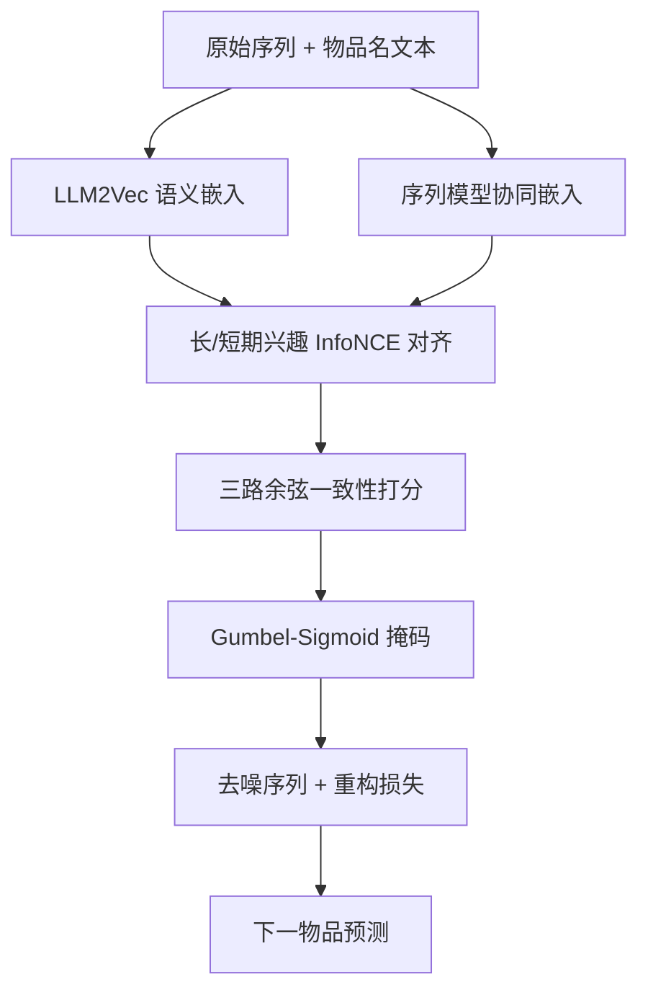
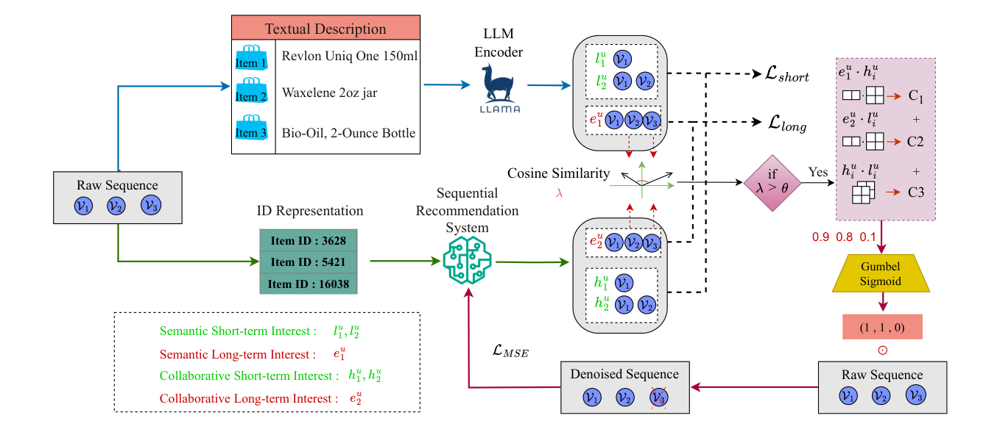

# Empowering Denoising Sequential Recommendation with Large Language Model Embeddings (用大语言模型嵌入赋能去噪序列推荐)

- **会议/期刊**: CIKM 2025
- **作者与机构**: Tongzhou Wu, Yuhao Wang, Maolin Wang, Chi Zhang, Xiangyu Zhao (香港城市大学、哈尔滨工程大学)
- **推荐链路定位**: 召回（序列召回前的数据去噪预处理）
- **研究方向**: 自监督对比学习与交互去噪 / 序列与会话推荐
- **论文原文**: [论文原文链接](https://arxiv.org/abs/2510.04239v1)
- **开源代码**: [开源代码仓库链接](https://github.com/Applied-Machine-Learning-Lab/IADSR)

## TL;DR (1分钟核心速览)

现有去噪序列推荐仅依赖协同信号判定噪声，导致冷门物品被大量误删（over-denoising）。本文提出 IADSR：用 LLM2Vec 抽取物品语义嵌入，与序列模型协同嵌入做长/短期兴趣的 InfoNCE 跨模态对齐，再以三路余弦一致性打分 + Gumbel-Sigmoid 生成软硬掩码，并加序列重构损失防止信息漂移。在 Beauty/Sports/Toys/ML-100K 四数据集、Leave-One-Out 全库排序下，Beauty+GRU4Rec 平均提升 24.6%，冷门桶（bucket 4/5）相对增益更明显。

## Background & Motivation (背景与核心矛盾)

- **主流范式**: HSD、SSDRec、STEAM、DCRec 等去噪方法均从用户-物品交互矩阵中挖掘协同不一致信号，据此删除、替换或重加权噪声交互。
- **前人局限**: ① 纯协同信号对交互稀疏的冷门物品缺乏上下文，无法区分"真实小众偏好"与"随机误点"，导致冷门物品被成批误删；② 已有 LLM 方案（LLM4DSR、LLaRD）需昂贵微调且与特定骨干耦合，泛化性差。
- **核心洞察 (Key Insight)**: 图 1 在 Beauty 上按流行度分 5 桶统计去噪比例，发现 HSD/STEAM 对冷门桶的去噪比例与热门桶几乎一致，而 NDCG@5 在 bucket 4/5 断崖式下跌——说明"均匀过滤"忽视了冷门物品的语义合理性。
- **本文切入点**: 引入 LLM 语义模态作为协同信号的互补证据，只在两模态兴趣一致时才判定噪声，从源头抑制冷门物品的过度删除。

## Method (核心方法设计)

### 1. 整体框架 (Overall Architecture)

两阶段流水线：第一阶段并行构建双模态表征——物品侧用 LLM2Vec 编码物品名得语义嵌入 $\mathbf{e}^{LLM}_i$，序列侧用 GRU4Rec/SASRec/Caser 得协同嵌入；用户侧将完整序列与各前缀子序列分别送入两路编码器，得到长期兴趣$(\mathbf{e}^u_1,\mathbf{e}^u_2)$与短期兴趣序列$(\{\mathbf{l}^u_t\},\{\mathbf{h}^u_t\})$。第二阶段先做跨模态兴趣对齐，再对通过一致性门槛的用户逐时刻计算三路余弦分数，经 Gumbel-Sigmoid 生成二值掩码过滤序列，最后用解码器重构原始序列以约束信息损失。整个去噪器与骨干模型联合端到端训练，推理时仅需一次前向生成掩码。

<figure class="paper-figure" markdown="span">
  <figcaption>图2：IADSR 框架概览。黑色箭头表示数据流。蓝色和绿色分别表示语义模态和协同模态。</figcaption>
</figure>

### 2. 关键设计拆解 (Key Designs)

1. **跨模态长/短期兴趣对齐（InfoNCE）**：两模态表征空间异构，直接拼接会让噪声判定被协同噪声主导。作者假设"同一用户的兴趣不因表征模态而变"，对长期兴趣对 $(\mathbf{e}^u_2,\mathbf{e}^u_1)$与批内全部短期兴趣对$(\mathbf{h}^i,\mathbf{l}^i)$ 分别施加 InfoNCE：

$$\mathcal{L}_{Info}=\mathcal{L}_{long}+\mathcal{L}_{short},\quad \mathcal{L}_{long}=-\frac{1}{N}\sum_{i=1}^{N}\log\frac{e^{sim(\mathbf{e}^i_2,\mathbf{e}^i_1)/\tau}}{\sum_{j=1}^{N}e^{sim(\mathbf{e}^i_2,\mathbf{e}^j_1)/\tau}}$$

   直觉：对齐后两模态对"何为真实兴趣"形成共识，冷门物品即便协同信号弱，只要语义上与用户长期兴趣吻合就不会被误判。

2. **三路一致性打分 + Gumbel-Sigmoid 软硬掩码**：单一相似度易受模态偏差干扰，故对每个时刻 $t$同时计算语义长期-协同短期$c_1(t)$、协同长期-语义短期$c_2(t)$、短期跨模态$c_3(t)$三路余弦并求和$score(t)=c_1+c_2+c_3$，再用带 Gumbel 噪声的 Sigmoid 离散化：

$$m_t=\text{GumbelSigmoid}(score(t),\tau,\text{hard=True}),\quad y_t=\delta\!\left(\frac{score(t)+g_t}{\tau}\right)$$

   硬采样配合 straight-through 估计器保留梯度，使"删/留"决策可反向传播；三路交叉设计保证噪声需在多个视角下同时"说不"才被删除，天然偏向保守，缓解过度去噪。

3. **渐进式重构损失与总目标**：为防表征漂移，每轮用上一轮掩码作用于原始嵌入 $\mathbf{X}^{(e)}_u=\mathbf{X}^{original}_u\odot\mathbf{K}^{(e-1)}_u$，解码器重构$\hat{\mathbf{X}}_u=\text{Decoder}(\mathbf{H}_u\odot\mathbf{K}_u)$，并以$\mathcal{L}_{recon}=\frac{1}{|\mathcal{U}_{mask}|}\sum\|\hat{\mathbf{X}}_u-\mathbf{X}^{original}_u\|^2_2$约束。总损失$\mathcal{L}_{total}=\mathcal{L}_{CE}+\mathcal{L}_{Info}+\mathcal{L}_{recon}$。训练采用批内负样本（InfoNCE 分母即批内其他用户），无需额外负采样；LLM 嵌入离线预计算，在线仅增一次掩码前向，开销可控。

## Experimental Setup & Evaluation Protocol (实验设置与评估协议)

- **数据集与预处理**: Amazon 三域取 `5-core` 版本，ML-100K 原版；序列按时间戳升序，Amazon 最大长度 32、ML-100K 为 50。

| 数据集 | #Users | #Items | #Interactions | 稀疏度 | 特征/场景说明 |
| :--- | :---: | :---: | :---: | :---: | :--- |
| Beauty | 22,363 | 12,101 | 198,502 | 99.93% | 美妆电商，均长 8.9 |
| Sports | 35,598 | 18,357 | 296,337 | 99.95% | 户外运动，均长 8.3 |
| Toys | 19,412 | 11,924 | 167,597 | 99.93% | 玩具，均长 8.6 |
| ML-100K | 943 | 1,682 | 100,000 | 93.70% | 电影，均长 106.0 |

- **数据划分与防穿越**: `Leave-One-Out`（末位交互为测试、倒数第二位验证），严格按时间戳排序构造序列，无未来信息泄漏。
- **排名评测协议**: 无偏 `Full-Ranking`（对全库未交互物品排序），指标 HR@{5,10,20} 与 NDCG@{5,10,20}。
- **对比基线与超参设置**: 骨干为 GRU4Rec / Caser / SASRec；基线含 HSD、SSDRec、STEAM、DCRec；嵌入维度 $d=64$、隐层 128、2 层 GRU、batch 32、Adam lr=1e-4，语义嵌入由 Llama-3.1-8B-Instruct + LLM2Vec 离线生成，阈值$\theta=-0.9$，显著性用双侧 t 检验$p<0.05$。

## Key Experimental Results (实验关键数据)

### 1. 主实验对比 (Main Results)

Beauty 与 Toys 代表性结果（Full-Ranking，加粗为最优）：

| 数据集/骨干 | 方法 | HR@5 | HR@10 | HR@20 | NDCG@5 | NDCG@10 | NDCG@20 |
| :--- | :--- | :---: | :---: | :---: | :---: | :---: | :---: |
| Beauty/GRU4Rec | base | 0.0174 | 0.0249 | 0.0351 | 0.0120 | 0.0144 | 0.0169 |
| | HSD | 0.0229 | 0.0365 | **0.0520** | 0.0141 | 0.0185 | 0.0234 |
| | SSDRec | 0.0218 | 0.0360 | 0.0510 | 0.0136 | 0.0181 | 0.0229 |
| | **IADSR** | **0.0300** | **0.0396** | 0.0486 | **0.0213** | **0.0244** | **0.0267** |
| Beauty/SASRec | SSDRec | **0.0342** | **0.0538** | 0.0782 | 0.0196 | 0.0259 | 0.0321 |
| | **IADSR** | 0.0323 | **0.0538** | **0.0836** | **0.0202** | **0.0272** | **0.0349** |
| Toys/Caser | HSD | 0.0066 | 0.0124 | 0.0192 | 0.0041 | 0.0060 | 0.0076 |
| | SSDRec | 0.0065 | 0.0116 | 0.0198 | 0.0044 | 0.0060 | 0.0081 |
| | **IADSR** | **0.0098** | **0.0163** | **0.0224** | **0.0080** | **0.0108** | **0.0129** |
| ML-100K/SASRec | SSDRec | 0.0223 | 0.0435 | 0.0785 | 0.0140 | **0.0209** | 0.0295 |
| | **IADSR** | 0.0212 | **0.0477** | **0.0827** | **0.0145** | 0.0205 | **0.0311** |

相对次优基线：Beauty+GRU4Rec 平均 +24.6%（HR@5 +31.0%、NDCG@5 +51.1%）；Toys+Caser 平均 +36.3%；ML-100K+SASRec 平均 +7.8%；Beauty+SASRec 的 HR@20 从 0.0554 升至 0.0836（+50.9%）。

### 2. 消融实验 (Ablation Study)

Beauty 数据集（GRU4Rec 骨干）：

| 变体 | HR@5 | HR@10 | HR@20 | NDCG@5 | NDCG@10 | NDCG@20 |
| :--- | :---: | :---: | :---: | :---: | :---: | :---: |
| w/o both | 0.0174 | 0.0249 | 0.0351 | 0.0120 | 0.0144 | 0.0169 |
| w/o $\mathcal{L}_{info}$ | 0.0283 | 0.0346 | 0.0386 | 0.0202 | 0.0223 | 0.0233 |
| w/o $\mathcal{L}_{recon}$ | 0.0213 | 0.0305 | 0.0416 | 0.0139 | 0.0168 | 0.0196 |
| Short-only | 0.0218 | 0.0329 | 0.0483 | 0.0144 | 0.0180 | 0.0219 |
| Long-only | 0.0225 | 0.0328 | 0.0456 | 0.0151 | 0.0181 | 0.0223 |
| **Full Model** | **0.0300** | **0.0396** | **0.0486** | **0.0196** | **0.0259** | **0.0321** |

### 3. 关键实验发现 (Key Findings)

1. **对齐损失是命门**：去掉 $\mathcal{L}_{info}$后 HR@5 从 0.0300 跌至 0.0283、NDCG@20 从 0.0321 跌至 0.0233，跌幅远大于去掉$\mathcal{L}_{recon}$（HR@5 0.0213），说明跨模态空间对齐比重构约束更关键；两者全去则 HR@5 暴跌 42.0%，验证双损失互补。
2. **长短期缺一不可**：Long-only 的 HR@5 为 0.0225、Short-only 为 0.0218，均显著低于 Full Model 的 0.0300（相对提升最高 33.3% HR@5 / 36.1% NDCG@5），长期兴趣提供稳定锚点、短期兴趣捕捉漂移，二者融合才能精准定位噪声。
3. **阈值需"宽松"**：$\theta$在$[-0.9,-0.1]$区间性能平稳，$\theta=-0.9$时 HR@5=0.03 达峰；一旦$\theta>0.7$ 强制两模态高度一致，性能全面崩塌——说明语义与协同本就应保留互补差异，过度对齐反而丢失去噪证据。

## Highlights & Limitations (亮点、对比与审稿批判)

- **与代表作对比 (vs. Prior Work)**: HSD/SSDRec 仅用 ID 协同不一致信号删噪，冷门物品误删率高；STEAM 用自校正改写序列但同样缺语义；LLM4DSR/LLaRD 引入 LLM 却需微调且绑定架构。IADSR 的差异在于"免微调 LLM 嵌入 + 模态对齐后再判噪"，且作为插件兼容三种骨干。
- **可迁移亮点**: ① "LLM 语义 + 协同双模态一致性投票"可迁移到冷启动召回与假阳性负样本过滤；② Gumbel-Sigmoid + straight-through 的软硬掩码机制可复用于任意需要离散样本选择的训练流程。
- **审稿级局限批判**: ① 每个用户需对 $n-1$个前缀子序列分别做 LLM2Vec 编码，长序列（ML-100K 均长 106）离线编码成本高，论文未报告训练/推理时延；② 阈值$\theta$与温度$\tau$敏感，且$\theta=-0.9$ 这种"负阈值"缺乏理论解释，跨域迁移需重新调参；③ 仅在 Amazon/ML-100K 离线全排序验证，无线上 A/B 与工业级稀疏场景证据。

## Rating (四维评分)

- **方法创新性 (Novelty)**: ⭐⭐⭐⭐ （首次将 LLM 语义嵌入以"对齐后投票"方式嵌入去噪决策，思路清晰但组件均为现成模块的组合）
- **评估协议与实验扎实度 (Protocol & Experiments)**: ⭐⭐⭐⭐ （四数据集 × 三骨干 × 全排序 + 显著性检验 + 消融/超参/案例齐全，缺线上验证）
- **写作与数学规范度 (Clarity & Rigor)**: ⭐⭐⭐⭐ （公式与流程交代清楚，但阈值选取与复杂度分析偏薄）
- **工业落地与复现价值 (Industrial & Practical Value)**: ⭐⭐⭐⭐ （代码开源、插件式兼容多骨干，LLM 嵌入可离线缓存，前缀编码开销是主要落地障碍）

