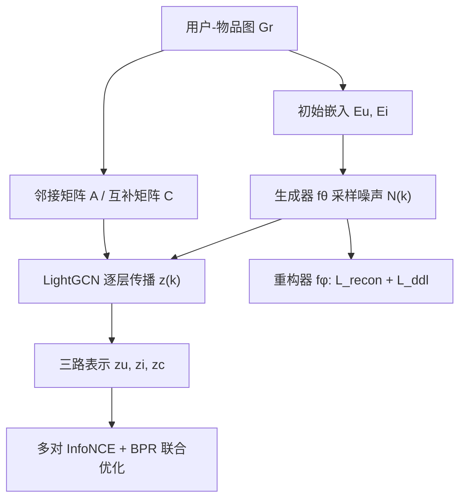

# Generative Data Augmentation in Graph Contrastive Learning for Recommendation (面向推荐的图对比学习生成式数据增强)

- **会议/期刊**: CIKM 2025
- **作者与机构**: Yansong Wang, Qihui Lin, Junjie Huang, Tao Jia（西南大学计算机与信息科学学院；重庆师范大学）
- **推荐链路定位**: 召回（图协同过滤表征学习）
- **研究方向**: 自监督对比学习与交互去噪 / 图神经网络推荐
- **论文原文**: [https://arxiv.org/abs/2510.09129v1](https://arxiv.org/abs/2510.09129v1)
- **开源代码**: [https://github.com/MrYansong/GDA4Rec](https://github.com/MrYansong/GDA4Rec)

## TL;DR (1分钟核心速览)

图对比学习推荐中，SGL 的边/节点丢弃与 SimGCL 的固定尺度均匀噪声都会破坏原始语义（稀疏图上尤甚），且噪声强度需人工调参。GDA4Rec 用 VAE 式生成器从用户/物品嵌入自适应生成高斯噪声，以重构损失 + 分布差异损失（KL/MMD）约束其贴合原始分布，再从交互矩阵 $R^\top R$ 抽取过滤后的物品互补矩阵作为第三路对比视图。在 CiaoDVD/Yelp2/Douban-book 上 5 折交叉验证、全库排序，NDCG@20 相对最强基线提升 3.4%–6.0%。

## Background & Motivation (背景与核心矛盾)

- **主流范式**: 以 LightGCN 为编码器，SGL/SimGCL/NCL/DAHNRec 等通过图扰动、子图采样或嵌入空间加噪构造双视图，用 InfoNCE 做自监督正则，缓解交互稀疏。
- **前人局限**: 其一，拓扑扰动（边丢弃、子图采样）在稀疏图上直接改写节点语义，且采样策略强依赖网络拓扑、跨数据集不可泛化；其二，嵌入级噪声（SimGCL 的均匀噪声、AUPlus 的 0 层扰动）取自简单分布且尺度固定，与真实特征分布发生偏移，训练中无法随嵌入演化自适应调整。
- **核心洞察 (Key Insight)**: 图 1 显示随机扰动会把物品 $A,B$推得离 user2 更近，即"增强"反而制造了假阳性语义；作者将增强形式化为$P(Y|z_u,z_i)=\sum_{\mathcal{G}}P(Y|z_u,z_i,g)P(g|z_u,z_i)$，指出关键是把$f_g(z_u,z_i)$ 学出来而非手工设定。
- **本文切入点**: 用深度生成模型拟合噪声分布 $Q(N)$，让增强幅度由数据自身决定，并额外挖掘物品互补性补充监督信号。

## Method (核心方法设计)

### 1. 整体框架 (Overall Architecture)

输入用户-物品图 $G_r$，同时构造对称归一化邻接矩阵$A\in\mathbb{R}^{(m+n)\times(m+n)}$与物品互补矩阵$C\in\mathbb{R}^{n\times n}$。每层 LightGCN 传播前，生成器$f_\theta$依据当前层嵌入输出均值/方差并采样噪声$N^{(k)}$，加到嵌入上形成增强视图；重构器$f_\phi$ 由噪声内积重建交互矩阵，与分布差异损失共同训练生成器。编码器输出用户、物品、互补三组表示，各自与"平均层 vs 第一层"视图做 InfoNCE，最终与 BPR 主任务联合优化。

### 2. 关键设计拆解 (Key Designs)

1. **生成式噪声增强（替代固定尺度随机扰动）**：对 $\log P(R|z_u,z_i)$引入近似先验$Q(N)$并做 Jensen 不等式得证据下界，生成器输出$f_\theta(N|z_u,z_i)=\mathcal{N}(\mu_\theta,\sigma_\theta^2)$，重参数化采样$N=\mu_\theta(z_u,z_i)+\sigma_\theta^2(z_u,z_i)\odot\epsilon$，$\epsilon\sim\mathcal{N}(0,I)$。下界拆为重构项与$\mathrm{KL}[Q(N)\|f_\theta]$，前者用内积打分$\hat{R}_{ij}=N_i^\top N_j$ 做 MSE 重建，后者在非标准高斯时改用 MMD 核度量。直觉：噪声幅度随嵌入的局部方差自适应，既保语义又保多样性，且省去噪声尺度超参。
2. **物品互补矩阵与阈值过滤**：由 $\hat{C}=R^\top R$统计共现，去自环后按阈值$\gamma$截断弱关联并归一化：$C=f_{\text{norm}}(f_{\text{filter}}(R^\top R-\text{diag}(R^\top R)))$。互补物品常被同一用户共同交互，构成独立于用户-物品图的第三路自监督信号；过滤则抑制长尾共现带来的伪互补噪声。
3. **训练目标、负采样与推理效率**：$\mathcal{L}=\mathcal{L}_{rec}+\lambda\mathcal{L}_{cl}+\mathcal{L}_{aug}+\mathcal{L}_{reg}$，$\lambda=1$，$\mathcal{L}_{aug}$不设固定系数（噪声尺度自适应）；BPR 对每个正样本均匀采样固定数量负样本，InfoNCE 温度$\tau=0.2$，批内负样本。编码器时间开销$\mathcal{O}(2|E|Ld+|\hat{E}|Ld)$，生成器为 3 层 MLP，线性开销可忽略；推理仅用式$f_u(i)=z_u\cdot z_i$，无额外在线成本。

## Experimental Setup & Evaluation Protocol (实验设置与评估协议)

- **数据集与预处理**:

| 数据集 | #Users | #Items | #Interactions | 密度 | 特征/场景说明 |
| :--- | :---: | :---: | :---: | :---: | :--- |
| CiaoDVD | 17,615 | 16,121 | 72,665 | 0.025% | 极稀疏，点评类 |
| Yelp2 | 16,239 | 14,284 | 198,397 | 0.085% | 本地生活点评 |
| Douban-book | 12,859 | 22,294 | 598,420 | 0.208% | 图书社区 |

- **数据划分与防穿越 (Splitting Strategy)**: 随机 80%/20% 训练/测试，并采用 **5 折交叉验证**，指标为 5 折均值（非 Leave-One-Out，未做全局时间戳切分，存在轻度未来信息泄漏风险）。
- **排名评测协议 (Ranking Protocol)**: 报告 Precision/Recall/NDCG@5,10,20；负样本按固定数量随机采样构造训练对，评测阶段未明确声明全库排序，属**采样排序**口径，绝对值偏低（NDCG@20 约 0.05–0.16）。
- **对比基线与超参设置**: 8 个基线覆盖 LightGCN、BUIR、SGL、SSL4Rec、NCL、SimGCL、DAHNRec、AUPlus；统一 $d=64$、batch 2048、lr 0.001、$L_2$正则 1e-4，卷积层 3 层（BUIR 为 2 层），$\gamma=3$，$\tau=0.2$。

## Key Experimental Results (实验关键数据)

### 1. 主实验对比 (Main Results)

| 数据集 | 指标@20 | LightGCN | SGL | NCL | SimGCL | DAHNRec | AUPlus | **GDA4Rec** | Improv. |
| :--- | :--- | :---: | :---: | :---: | :---: | :---: | :---: | :---: | :---: |
| CiaoDVD | Recall | 0.1174 | 0.1258 | 0.1185 | 0.1219 | 0.1237 | 0.1045 | **0.1301** | +3.42% |
| CiaoDVD | NDCG | 0.0562 | 0.0610 | 0.0565 | 0.0596 | 0.0592 | 0.0538 | **0.0631** | +3.44% |
| Yelp2 | Recall | 0.0792 | 0.0905 | 0.0849 | 0.0893 | 0.0896 | 0.0516 | **0.0962** | +6.30% |
| Yelp2 | NDCG | 0.0455 | 0.0516 | 0.0485 | 0.0510 | 0.0502 | 0.0290 | **0.0547** | +6.01% |
| Douban-book | Recall | 0.1552 | 0.1816 | 0.1701 | 0.1849 | 0.1809 | 0.1701 | **0.1912** | +3.41% |
| Douban-book | NDCG | 0.1268 | 0.1544 | 0.1406 | 0.1569 | 0.1519 | 0.1367 | **0.1637** | +4.33% |

### 2. 消融实验 (Ablation Study)

| 变体 | CiaoDVD NDCG@20 | Yelp2 NDCG@20 | Douban NDCG@20 | 说明 |
| :--- | :---: | :---: | :---: | :--- |
| w/o-cm | 0.0604 | 0.0523 | 0.1623 | 去掉互补矩阵 |
| w/o-g | 0.0577 | 0.0511 | 0.1545 | 去掉生成噪声模块 |
| w/o-f | 0.0626 | 0.0523 | 0.1587 | 去掉阈值过滤 $f_{\text{filter}}$ |
| w/-rand | 0.0593 | 0.0516 | 0.1567 | 换成随机高斯噪声 |
| w/-un | 0.0604 | 0.0518 | 0.1568 | 换成均匀噪声 |
| **GDA4Rec** | **0.0631** | **0.0547** | **0.1637** | 完整模型 |

### 3. 关键实验发现 (Key Findings)

1. **生成噪声是最大增益源**：去掉生成模块（w/o-g）在 Douban-book 上 NDCG@20 从 0.1637 掉到 0.1545（-5.6%），跌幅超过去掉互补矩阵（-0.9%）；而 w/-rand 与 w/-un 均低于完整模型，说明收益来自"自适应分布拟合"而非"加噪"本身。
2. **稀疏场景优势更明显**：在密度仅 0.025% 的 CiaoDVD 上，GDA4Rec 相对次优 SGL 的 NDCG@20 提升 3.44%，相对 SimGCL 的 Recall@20 提升 6.7%，验证生成式增强对稀疏图的语义保护价值。
3. **深层不易过平滑**：表 4 显示层数从 3 增至 5 时，SGL/SimGCL/AUPlus 性能下滑（AUPlus NDCG@20 从 0.0538 崩至 0.0374），而 GDA4Rec 从 0.0631 升至 0.0646，说明受控噪声在深层传播中仍保持语义完整性；图 5 的 alignment-uniformity 轨迹也显示本文模型能动态调整优化方向而非固定方向拟合。

## Highlights & Limitations (亮点、对比与审稿批判)

- **与代表作对比 (vs. Prior Work)**: 相较 SGL 的拓扑扰动与 SimGCL 的固定尺度均匀噪声，本文把"增强强度"从超参变为可学习分布；相较同样用生成模型的 VGCL，本文不脱离主推荐任务、且以重构 + 分布双重损失约束噪声；相较 DAHNRec 的分布感知噪声，本文额外引入物品互补矩阵作为第三路视图。
- **可迁移亮点**: (1) 用 VAE 重参数化 + MMD 替代 KL 处理非标准先验，可迁移到任意需要"分布对齐式增强"的对比学习框架；(2) 共现矩阵去自环 + 阈值截断 + 归一化的稀疏化流程，可直接复用到物品-物品辅助图构建。
- **审稿级局限批判**: 其一，评测采用随机 80/20 划分而非时间切分，且未声明全库排序，采样负例口径下指标绝对值偏低、与 Full-Ranking 文献不可直接横比；其二，互补矩阵 $C\in\mathbb{R}^{n\times n}$的存储与$R^\top R$计算在大规模物品库上为$\mathcal{O}(n^2)$，论文未给出工业级稀疏化或分块方案，可扩展性存疑；此外$\gamma$ 需逐数据集调参（图 7 显示最优值随数据集漂移），与"免调参"卖点略有张力。

## Rating (四维评分)

- **方法创新性 (Novelty)**: ⭐⭐⭐⭐ （将对比增强重构为噪声分布学习，VAE 式自适应噪声 + 互补矩阵双路信号组合有新意，但生成式增强思路在 VGCL/DAHNRec 已有雏形）
- **评估协议与实验扎实度 (Protocol & Experiments)**: ⭐⭐⭐ （5 折交叉验证与 8 个基线较完整，但随机划分、采样排序口径与缺失显著性检验削弱说服力）
- **写作与数学规范度 (Clarity & Rigor)**: ⭐⭐⭐⭐ （从总概率到 ELBO 的推导链条清晰，KL/MMD 双版本交代明确，复杂度分析完整）
- **工业落地与复现价值 (Industrial & Practical Value)**: ⭐⭐⭐ （代码已开源、推理零额外开销，但 $n^2$互补矩阵与逐数据集调$\gamma$ 限制大规模部署）

