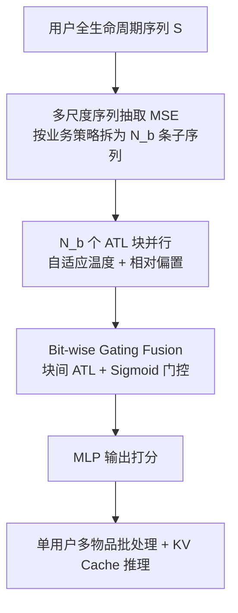
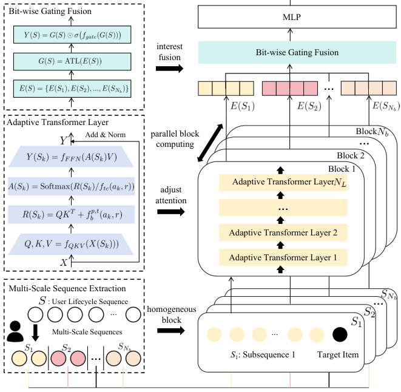

# Climber: Toward Efficient Scaling Laws for Large Recommendation Models (面向大推荐模型高效缩放律的 Climber 框架)

- **会议/期刊**: CIKM 2025
- **作者与机构**: Songpei Xu, Shijia Wang, Da Guo, Xianwen Guo, Qiang Xiao, Bin Huang, Guanlin Wu, Chuanjiang Luo（网易云音乐 NetEase Cloud Music）
- **推荐链路定位**: 精排（排序打分）
- **研究方向**: 序列与会话推荐 / CTR 预估与特征交叉
- **论文原文**: [https://arxiv.org/abs/2502.09888v2](https://arxiv.org/abs/2502.09888v2)
- **开源代码**: 暂未开源

## TL;DR (1分钟核心速览)

本文直击 Transformer 在推荐系统中"缩放不理想 + 线上延迟严苛"的双重困境：工业级实测发现 FLOPs 低于 $10^{8.2}$时 Transformer 反而不如 DLRM，且多源异构行为导致注意力分布紊乱。作者提出 Climber，用多尺度子序列抽取把复杂度从$O(n_s^2 d)$降到$O(n^2 d/N_b)$，用自适应温度系数适配多场景注意力，并配套"单用户多物品"批处理与 KV 缓存。在 Spotify/30Music/Amazon-Book 及网易云工业数据上，Climber-large 相对 DLRM 取得 +2.21% AUC，线上 A/B 整体指标 +12.19%，训练吞吐 5.15×、推理较 DLRM 快 2.92–14.38×。

## Background & Motivation (背景与核心矛盾)

- **主流范式**: 生成式推荐被视为在推荐系统中兑现 Scaling Law 的最有希望路径，HSTU 用层次化自注意力建模长行为序列，MARM 用记忆缓存把推理复杂度从 $O(n^2d)$降到$O(nd)$。
- **前人局限**: 其一，Transformer 与推荐特有特征存在结构性不兼容——NLP 是连续句法序列，推荐是跨多场景的碎片化行为，注意力难以在稀疏多源模式中区分相关行为；其二，多场景分布差异被当作辅助特征而非显式分布控制器，单一 $\sqrt{d_k}$ 缩放因子无法适配各子序列的分布差异。
- **核心洞察 (Key Insight)**: 工业级实测（图 1a）显示 DLRM 与 Transformer 的交叉点在 FLOPs $=10^{8.2}$，低于该点 Transformer 全面落后；且图 1b 表明同等 FLOPs 下不同"序列长度 × 层数"组合存在近 1% 的 AUC 性能区间，说明资源分配方式本身即是被忽视的缩放维度。
- **本文切入点**: 不追求单纯堆资源，而是从"推荐视角重构 Transformer 结构 + 协同设计工程加速"两条腿走路，把缩放曲线整体左移（更高截距、更大斜率）。

## Method (核心方法设计)

### 1. 整体框架 (Overall Architecture)

Climber 由三个模块串联：多尺度序列抽取（MSE）将用户全生命周期序列 $S$按业务策略（点击/点赞/分享等）拆成$N_b$条等长子序列$S_k$，每条子序列送入独立的 Adaptive Transformer Layer（ATL）堆叠块提取兴趣；ATL 在标准注意力上引入由抽取策略$a_k$与推荐场景$r$共同决定的自适应温度系数与相对位置/时间偏置；最后 Bit-wise Gating Fusion（BGF）把$N_b$ 个块输出拼接后经一层 ATL 做块间交互，再用 sigmoid 门控逐位调制，输出统一打分。训练与推理统一采用"单用户多物品"样本组织，配合编码器级 KV 缓存复用用户侧计算。

<figure class="paper-figure" markdown="span">
  <figcaption>图2：Climber 模型架构。</figcaption>
</figure>

### 2. 关键设计拆解 (Key Designs)

1. **多尺度序列抽取（MSE）**：痛点在于全序列自注意力 $O(n_s^2 d)$随生命周期序列爆炸。MSE 按策略$a_k$抽取等长子序列$S_k = \mathrm{MSE}(S, a_k)$，满足$\sum_{k=1}^{N_b} n_k = n \ll n_s$（仅保留正向行为）。串行时复杂度降为$O(n^2 d / N_b)$，全并行时降为$O(\max(n_k)^2 d)$，只依赖最长子序列长度。直觉上，把"全历史稠密注意力"换成"多兴趣稀疏注意力"，既降复杂度又天然对齐多场景兴趣分块。

2. **自适应温度调制（ATL）**：痛点在于各子序列分布差异大，固定 $\sqrt{d_k}$ 无法兼顾。ATL 将注意力改写为
$$\boldsymbol{A}(S_k) = \mathrm{Softmax}\!\left(\frac{\boldsymbol{Q}\boldsymbol{K}^{\top} + f_{p,t}^{b}(a_k, r)}{f_{tc}(a_k, r)}\right)$$
其中温度 $f_{tc}$与偏置$f_{p,t}^{b}$均由抽取策略$a_k$和场景$r$ 决定。相比 HSTU 的固定温度，这让不同行为/场景的注意力锐度可学习，缓解稀疏多源模式下的注意力紊乱。

3. **逐位门控融合（BGF）与训练/推理效率**：子序列独立编码后缺乏交互，BGF 先拼接 $\boldsymbol{E}(S) \in \mathbb{R}^{N_b \times d}$，经 ATL 做块间相似度交互得$\boldsymbol{G}(S)$，再逐位门控$\boldsymbol{Y}(S) = \boldsymbol{G}(S) \odot \sigma(f_{gate}(\boldsymbol{G}(S)))$。由于$N_b \ll d$，该注意力$O(N_b^2 d)$ 开销可忽略。总损失为多行为目标的加权 BCE 之和；训练采用"单用户多物品"打包（候选物品与全历史全可见掩码、候选间对角掩码隔离），无需额外负采样；推理侧预计算用户多层 KV 缓存，仅对候选物品特征做注意力交互。

## Experimental Setup & Evaluation Protocol (实验设置与评估协议)

- **数据集与预处理**: 四个数据集，工业数据经隐私特殊处理（展示量低于真实值）：

| 数据集 | #Users | #Items | #Interactions | 特征/场景说明 |
| :--- | :---: | :---: | :---: | :--- |
| Spotify | 0.16M | 3.7M | 1.2M | 音乐场景，公开 |
| 30Music | 0.02M | 4.5M | 16M | 音乐场景，公开 |
| Amazon-Book | 0.54M | 0.37M | 1.09M | 图书，跨域验证 |
| Industrial | >40M | >6M | >1B | 网易云音乐真实场景 |

- **数据划分与防穿越 (Splitting Strategy)**: 采用按用户历史交互预测候选物品行为的序列预测式划分（历史序列 → 目标物品多行为标签），工业侧按线上日志时间顺序构造，避免未来行为泄漏。
- **排名评测协议 (Ranking Protocol)**: 以 AUC 与 LogLoss 为主指标，属全量候选打分下的分类式评估（非采样负例排序），与线上排序目标一致。
- **对比基线与超参设置**: 基线含 DLRM（线上主模型，序列长 2000）、DIN（1000）、TWIN（GSU 2000 / ESU 1000）、Transformer（2000）、HSTU（2000）；Climber 基础版序列长 200、2 层，Climber-large 扩至 12 层、序列长 800。

## Key Experimental Results (实验关键数据)

### 1. 主实验对比 (Main Results)

| 模型 | Spotify AUC | Amazon-Book AUC | 30Music AUC | Industrial AUC | Industrial LogLoss |
| :--- | :---: | :---: | :---: | :---: | :---: |
| DLRM (Baseline) | 0.7606 | 0.7842 | 0.8927 | 0.8216 | 0.7067 |
| DIN | 0.7557 | 0.7796 | 0.8861 | 0.8158 | 0.7109 |
| TWIN | 0.7589 | 0.7831 | 0.8903 | 0.8203 | 0.7078 |
| Transformer | 0.7621 | 0.7836 | 0.8930 | 0.8214 | 0.7074 |
| HSTU | 0.7626 | 0.7869 | 0.8938 | 0.8217 | 0.7053 |
| Climber | 0.7663 | 0.7887 | 0.8986 | 0.8230 | 0.7029 |
| **Climber-large** | **0.7702** | **0.7914** | **0.9035** | **0.8398** | **0.6911** |
| Improv.% (vs DLRM) | +1.26% | +0.91% | +1.20% | **+2.21%** | −2.20% |

### 2. 消融实验 (Ablation Study)

| 配置 | Industrial AUC | 相对 Transformer |
| :--- | :---: | :---: |
| Transformer | 0.8214 | — |
| Climber (-ATL, -BGF) | 0.8221 | +0.085% |
| Climber (-BGF) | 0.8225 | +0.134% |
| Climber (full) | 0.8230 | +0.195% |

### 3. 关键实验发现 (Key Findings)

1. **MSE 是效率与效果的双重基石**：仅保留 MSE（去掉 ATL/BGF）即比 Transformer 高 +0.085% AUC，同时把序列从 2000 压到 200 仍不损效果，说明"多兴趣稀疏注意力"替代"全历史稠密注意力"是低风险高收益的结构改造。
2. **ATL 与 BGF 增益互补且递增**：ATL 贡献 +0.049%、BGF 再贡献 +0.061%，BGF 增益最大，印证子序列独立编码后块间兴趣融合不可省略；三者叠加后相对 DLRM 提升 +0.170%。
3. **缩放需"序列与深度均衡扩张"**：同等 FLOPs 下，$4.11\times10^8$时$(400s \times 4l)$最优（0.8301），$1.01\times10^9$时$(400s \times 8l)$最优（0.8335）；FLOPs 翻 4 倍时$(800s \times 8l)$达 0.8382，显著优于单因子扩张的$(1600s \times 4l)$与$(400s \times 16l)$。线上据此交替扩序列与层数，最终 620× FLOPs 模型带来 +12.19% 指标，为全年最大涨幅。

## Highlights & Limitations (亮点、对比与审稿批判)

- **与代表作对比 (vs. Prior Work)**: 相比 HSTU 的层次化注意力与随机序列采样，Climber 用业务策略驱动的多尺度抽取直接降复杂度常数因子，并把固定温度换成场景自适应温度；相比 MARM 的静态用户模式缓存假设，Climber 的 KV 缓存与"单用户多物品"打包在训练/推理两端统一，且不假设行为静态；相比 DLRM，Climber 在低 FLOPs 区把交叉点左移，实现"更省资源即超越"。
- **可迁移亮点**: ①"单用户多物品"打包 + 候选间对角掩码隔离，可直接迁移到任何以用户序列为输入的排序模型以压缩样本量；②同等 FLOPs 下交替扩张序列与深度的资源分配准则，对工业迭代排期有直接指导价值。
- **审稿级局限批判**: ①多尺度抽取策略（点击/点赞/分享等）高度依赖业务先验，跨域迁移时策略设计成本与效果不确定性未量化；②线上增益来自架构与工程加速的联合贡献，论文未给出纯架构在同等推理预算下的独立线上归因；③温度系数与偏置函数 $f_{tc}, f_{p,t}^{b}$ 的具体参数化与超参敏感性缺少消融。

## Rating (四维评分)

- **方法创新性 (Novelty)**: ⭐⭐⭐⭐ （多尺度抽取 + 场景自适应温度的组合针对推荐异构性做了扎实的结构性改造，但单点算子新颖度中等，胜在系统性与工业验证）
- **评估协议与实验扎实度 (Protocol & Experiments)**: ⭐⭐⭐⭐ （四个数据集 + 完整缩放曲线 + 同等 FLOPs 资源分配表 + 线上 A/B，工业证据链罕见地完整；公开集规模偏小、缺显著性检验）
- **写作与数学规范度 (Clarity & Rigor)**: ⭐⭐⭐⭐ （公式简洁、复杂度推导清晰，MSE/ATL/BGF 三模块边界明确；温度与偏置函数参数化细节略欠）
- **工业落地与复现价值 (Industrial & Practical Value)**: ⭐⭐⭐⭐⭐ （千万级用户线上部署、5.15× 训练加速、推理快 2.92–14.38×、100× 模型扩容不增资源，落地价值极高；可惜未开源）

