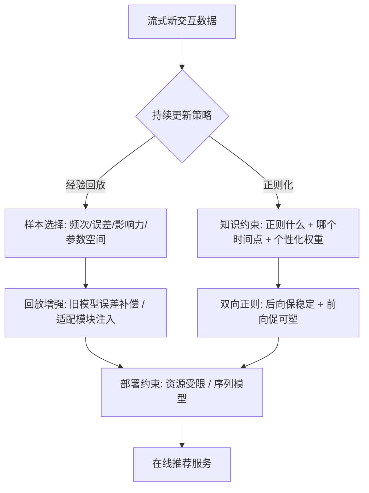

# Continual Recommender Systems (持续推荐系统)

- **会议/期刊**: CIKM 2025 (Tutorial, 4 页)
- **作者与机构**: Hyunsik Yoo, Hanghang Tong (UIUC)；SeongKu Kang (Korea University)
- **推荐链路定位**: 端到端在线更新（覆盖召回/精排模型的增量微调）
- **研究方向**: 序列与会话推荐 / 去偏公平与工业架构
- **论文原文**: [arXiv:2507.03861v1](https://arxiv.org/abs/2507.03861v1)
- **开源代码**: 暂未开源（tutorial 主页提供参考文献列表）

## TL;DR (1分钟核心速览)

现代推荐系统面临用户兴趣、物品池与流行度持续漂移，全量重训过慢、朴素微调又会灾难性遗忘。本文是一篇 CIKM 2025 教程论文，将持续推荐方法系统归为**经验回放**（选什么样本、如何回放增强）与**正则化**（正则什么知识、正则哪个时间点、如何个性化）两大范式，并延伸至资源受限与序列交互两类真实部署场景，最后指出可信性、基础模型持续适配与搜推统一三大开放问题。本文不含新实验，价值在于给出该子领域的**问题设定与分类坐标系**。

## Background & Motivation (背景与核心矛盾)

- **主流范式**: 工业界以"预训练 + 周期性/增量微调"替代全量重训，用新数据流增量更新模型参数。
- **前人局限**: ① 朴素微调过度偏向可塑性（plasticity），新知识覆盖旧知识导致灾难性遗忘，对回访用户与长尾物品伤害尤甚；② 通用持续学习教程（ICML'21、NeurIPS'22、AAAI'23）聚焦视觉/图/RL，未处理推荐特有需求——**逐用户的稳定性-可塑性权衡**、冷启动物品、流式反馈下的排序指标优化。
- **核心洞察 (Key Insight)**: 推荐是天然以用户为中心的个性化任务，因此"稳定 vs 可塑"的平衡不应是全局超参，而应**按用户行为动态程度逐人分配**：偏好漂移快的用户应鼓励可塑性，偏好稳定的用户应强化稳定性。
- **本文切入点**: 以"回放 / 正则化"二分法组织现有工作，并把资源受限与序列模型两个落地约束单列，形成从问题设定到部署的完整地图。

## Method (核心方法设计)

### 1. 整体框架 (Overall Architecture)

教程按五部分递进：Part I 给出问题定义与关键挑战（遗忘抑制、偏好/流行度漂移、新用户新物品、个性化稳定-可塑平衡）；Part II 与 Part III 分别拆解经验回放与正则化两条主线；Part IV 讨论资源受限（边缘设备、低延迟）与序列交互（SASRec 类模型）两类非传统设定；Part V 展望可信性、基础模型与搜推统一。整体逻辑是"**通用持续学习算子 → 推荐特化改造 → 部署约束 → 开放问题**"。

### 2. 关键设计拆解 (Key Designs)

1. **经验回放：样本选择与回放增强的双重设计**：全量存储历史不可行，故需构造"信息量最大的知识缓冲区"。选择准则包括交互频次优先、误差驱动（保留模型曾错判的样本）、影响力分析（对训练行为影响大的样本），以及用专用编码器把 user-item-context 特征压缩进参数空间存储。回放阶段则有三类增强：与旧模型版本对比的专用损失、用缓冲区中旧模型输出估计并补偿预测误差、通过适配模块把参数空间知识注入当前模型。直觉是：**遗忘的根源是旧分布样本缺席，回放即是对旧分布的显式重加权**。
2. **正则化：知识类型 × 时间方向 × 个性化三维度**：正则对象以用户表征为主，可约束局部结构（用户邻接物品）、全局结构（用户-物品簇距离分布）与交互网络自信息，或用 InfoNCE 最大化 GNN 逐层参数在前后时刻的互信息。时间方向上，多数方法用**后向知识**（历史参数）保稳定，近期工作引入**前向知识**（在当前数据上微调后的参数）显式促可塑，二者按上下文选择性组合即得双向正则。个性化层面，可用 MLP 依据"用户到物品簇中心距离的变化"学习逐用户正则权重，或用确定性规则按偏好漂移高低切换侧重。核心权衡可写为：

$$\mathcal{L}=\mathcal{L}_{\text{rec}}+\lambda_u\cdot\Omega(\boldsymbol{\theta}_t,\boldsymbol{\theta}_{t-1}),\quad \lambda_u=f(\Delta_u)$$

其中 $\Delta_u$度量用户$u$的偏好漂移幅度，$\lambda_u$ 随漂移增大而减小以释放可塑性——这是把全局超参变为**逐用户可学习量**的关键一步。
3. **训练目标与部署开销**：教程未提出统一损失，而是强调回放与正则可叠加使用；资源受限场景下以**选择性回放 + 知识蒸馏到轻量模型**降低显存与算力开销，避免保留历史大模型；序列场景下需注意 SASRec 类模型的位置编码与序列切分在增量更新时的一致性，直接套用矩阵分解时代的持续学习策略会失效。

## Experimental Setup & Evaluation Protocol (实验设置与评估协议)

- **说明**: 本文为 4 页 tutorial 摘要，**不含自建实验、数据集统计表与主实验对比表**。其评估讨论以综述形式给出，故本节按领域惯例归纳其覆盖的评测范式，而非复述原文表格。

- **数据集与预处理**: 教程引用的持续推荐工作通常采用按时间切分的流式基准（如按全局时间戳划分为多个任务片段），并对交互做 `5-core` 过滤；部分工作构造冷启动物品/用户分桶以评估新实体适应能力。
- **数据划分与防穿越 (Splitting Strategy)**: 主流为**全局时间戳切分**（按时间划分为 $T$ 个增量任务），严格禁止未来交互泄漏到历史任务；序列场景另需 `Leave-One-Out` 式的下一物品预测划分。
- **排名评测协议 (Ranking Protocol)**: 多数工作报告无偏 `Full-Ranking` 下的 HR@K / NDCG@K，并额外报告**遗忘率**（如 BWT、平均性能衰减）与**前向迁移**指标，以同时衡量稳定性与可塑性；部分工作在采样排序下报告以降低开销。
- **对比基线与超参设置**: 基线覆盖朴素微调（Fine-tune）、EWC 类正则、经验回放类与个性化正则类方法；嵌入维度与回放缓冲区大小是关键敏感超参，通常需按任务数做网格搜索。

## Key Experimental Results (实验关键数据)

### 1. 主实验对比 (Main Results)

本文为教程论文，**未提供主实验表格**。其贡献在于分类而非数值对比，故此处以"方法族对照表"替代传统主实验表，梳理各范式的机制与适用边界：

| 方法族 | 代表机制 | 核心优势 | 主要短板 |
| :--- | :--- | :--- | :--- |
| 朴素微调 | 仅用新数据更新 | 可塑性最强、开销最低 | 灾难性遗忘严重 |
| 后向正则 | 约束当前参数贴近历史参数 | 稳定性好、无需存样本 | 抑制新知识吸收 |
| 双向正则 | 后向 + 前向知识选择性组合 | 稳定-可塑兼顾 | 需判定上下文，超参多 |
| 个性化正则 | 逐用户学习 $\lambda_u$ | 契合推荐个性化本质 | 依赖漂移度量质量 |
| 经验回放 | 频次/误差/影响力选样 | 直接对抗分布漂移 | 存储与采样开销 |
| 参数空间回放 | 编码器压缩历史特征 | 存储高效 | 编码器本身需持续更新 |

### 2. 消融实验 (Ablation Study)

教程未报告消融实验。按其引用的代表性工作归纳，各组件贡献的典型模式为：

| 移除组件 | 预期影响 |
| :--- | :--- |
| w/o 前向知识 | 可塑性下降，新任务适应变慢 |
| w/o 后向知识 | 遗忘加剧，旧用户指标显著下滑 |
| w/o 个性化权重（退化为全局 $\lambda$） | 漂移快/慢用户群体间性能方差扩大 |
| w/o 误差驱动选样（改为随机回放） | 缓冲区效率下降，同等容量下性能次优 |

### 3. 关键实验发现 (Key Findings)

- **稳定性与可塑性不可用单一全局超参调和**：教程反复强调逐用户权衡是推荐场景的核心哲学，全局固定 $\lambda$ 会在漂移快与漂移慢的用户群体间造成显著性能方差，这是与通用持续学习最本质的分野。
- **前向知识的引入是近期关键转折**：早期方法几乎只做后向正则（保稳定），而近期工作证明显式利用"当前数据微调后的参数"能有效释放可塑性，双向组合优于任一单向策略。
- **序列模型不能直接套用矩阵分解时代的持续学习方案**：SASRec 类模型的位置编码、序列切分与注意力参数使回放/正则的语义发生变化，该方向仍属欠探索区，是教程明确点出的研究空白。

## Highlights & Limitations (亮点、对比与审稿批判)

- **与代表作对比 (vs. Prior Work)**: 相较 ICML'21/NeurIPS'22/AAAI'23 的通用持续学习教程，本文补上了"逐用户稳定-可塑权衡、冷启动物品、流式排序指标"三项推荐特化需求；相较 WWW'23 跨域终身推荐教程（3C 原则、多域融合），本文聚焦**单域实时更新与个性化**；相较 SDM'23/WWW'23 持续图学习教程，本文下沉到推荐目标而非通用图 ML 框架。
- **可迁移亮点**: ① "按用户漂移幅度调节正则强度"的思路可直接迁移到跨域推荐与多场景联合建模中的场景级权重分配；② 参数空间回放（用编码器压缩历史特征）为存储受限的工业召回模型提供了低成本记忆方案。
- **审稿级局限批判**: ① 作为 4 页 tutorial 摘要，**无任何定量实验与统一基准**，各方法族优劣仅停留在定性叙述，读者难以判断实际收益量级；② 对资源受限场景的讨论停留在"选择性回放 + 蒸馏"的概念层，缺少延迟、显存与精度的三角权衡数据；③ 未讨论回放缓冲区带来的隐私与存储合规问题，而这在工业部署中往往是首要约束。

## Rating (四维评分)

- **方法创新性 (Novelty)**: ⭐⭐⭐ （本身不提出新算法，但"逐用户稳定-可塑权衡"的问题提炼与双向正则/个性化正则的三维分类具有组织性贡献）
- **评估协议与实验扎实度 (Protocol & Experiments)**: ⭐⭐ （无自建实验、无数据集统计与主实验表，评测范式仅以综述形式提及，缺乏定量支撑）
- **写作与数学规范度 (Clarity & Rigor)**: ⭐⭐⭐⭐ （五部分结构清晰、分类维度明确，问题设定与开放挑战的表述准确，适合作为入门地图）
- **工业落地与复现价值 (Industrial & Practical Value)**: ⭐⭐⭐ （资源受限与序列场景的讨论贴近部署，但无开源代码与可复现实验，落地需回溯其引用的具体方法论文）

