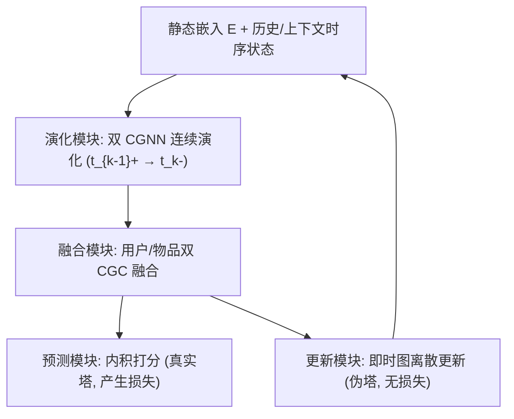
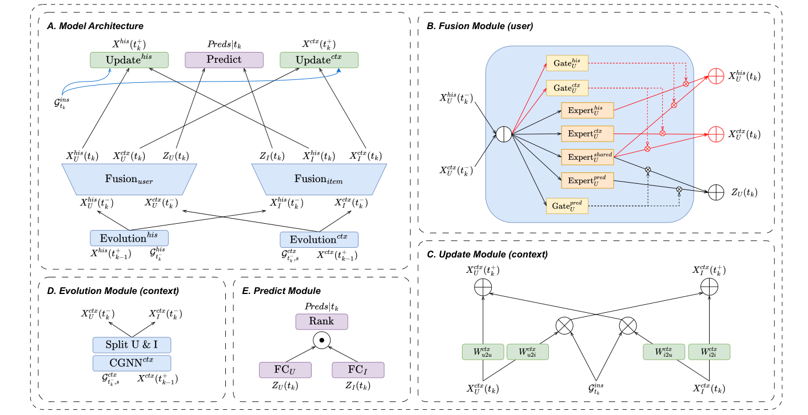

# CPMR: Context-Aware Incremental Sequential Recommendation with Pseudo-Multi-Task Learning (上下文感知的伪多任务增量序列推荐)

- **会议/期刊**: CIKM 2023
- **作者与机构**: Qingtian Bian, Jiaxing Xu, Yiping Ke (南洋理工大学)；Hui Fang (上海财经大学)
- **推荐链路定位**: 召回（增量式 Next-Item 全库排序）
- **研究方向**: 序列与会话推荐 / 图神经网络推荐
- **论文原文**: [https://arxiv.org/abs/2309.04802v3](https://arxiv.org/abs/2309.04802v3)
- **开源代码**: [https://github.com/DiMarzioBian/CPMR](https://github.com/DiMarzioBian/CPMR)

## TL;DR (1分钟核心速览)

现有增量序列推荐演化模型（JODIE、CoPE）把全部历史交互一视同仁地做连续演化，既稀释了近期交互的时效性，又忽略了"用户会被他人近期行为影响"这一上下文现象。CPMR 为每个用户/物品同时维护静态嵌入、历史时序状态与上下文时序状态三套表征，并用**伪多任务学习 (PMTL)** 把"更新时序状态"这类无损失任务与"推荐"这一真实任务堆叠进共享底层联合优化。在 4 个数据集、按时间 80/10/10 切分、全库排序协议下，MRR 平均提升 30.98%、Recall@10 平均提升 27.39%。

## Background & Motivation (背景与核心矛盾)

- **主流范式**: 增量序列推荐 (ISR) 用连续时间上的信息传播与演化来建模用户表征，代表作为 JODIE（RNN 离散更新轨迹）与 CoPE（CGNN 在全部历史图上做连续演化）。
- **前人局限**: ① 演化在**整个历史图**上进行，新批次交互相对海量历史占比极小，动态信号被淹没；② 完全忽略**上下文场景**——用户兴趣易受其他用户近期行为（流行趋势）影响，而历史图无法刻画这种短窗口漂移。
- **核心洞察 (Key Insight)**: 用户动机可拆为静态偏好与动态兴趣，而动态兴趣在"历史长程"与"上下文短窗"两个尺度上表现不同，应分别建模再融合；同时"状态更新"本身不产生损失，无法直接套用常规 MTL。
- **本文切入点**: 引入固定长度滑动窗口的**上下文图**作为历史图的补充通道，并用"真实塔 + 伪塔"的 PMTL 范式把无监督的状态更新任务纳入联合优化。

## Method (核心方法设计)

### 1. 整体框架 (Overall Architecture)

CPMR 为每个用户/物品学习三套表征：静态嵌入 $\boldsymbol{E}$、历史时序状态$\boldsymbol{X}_{his}$、上下文时序状态$\boldsymbol{X}_{ctx}$。系统按时间戳$t_k$循环执行四个模块：**演化模块**（两个并行 CGNN，分别在历史图与上下文图上把状态从$t_{k-1}^+$连续演化到$t_k^-$）、**融合模块**（两个 CGC 实例，分别面向用户与物品，融合双通道状态并输出推荐表征$\boldsymbol{Z}(t_k)$）、**预测模块**（内积打分）、**更新模块**（两个实例，用即时图$G_{ins}^{t_k}$把状态从$t_k$离散跳到$t_k^+$）。其中演化与融合模块构成 PMTL 的共享底层，两个更新模块为伪塔，预测模块为真实塔。

<figure class="paper-figure" markdown="span">
  <figcaption>图3：所提出的上下文感知伪多任务推荐系统的结构。在子图A中，共享底层网络由所有蓝色块组成，每个绿色或粉色块表示一个伪塔或一个真实塔。</figcaption>
</figure>

### 2. 关键设计拆解 (Key Designs)

1. **上下文图与双通道连续演化**：痛点在于历史图演化稀释近期信号。本文额外构造上下文图 $G_{ctx}^{t,s}$（窗口$[t-s,t)$内的交互，如同时间轴上的 FIFO 队列），并为两图分别定义带可学习谱半径$\boldsymbol{\alpha}$的 ODE：$\frac{\mathrm{d}\boldsymbol{X}(t)}{\mathrm{d}t}=(\boldsymbol{A}_t-\boldsymbol{I})\boldsymbol{X}(t)+\boldsymbol{E}$，其中$\boldsymbol{A}:=\mathrm{Broadcast}(\mathrm{Sigmoid}(\boldsymbol{\alpha}))\odot\tilde{\boldsymbol{a}}\boldsymbol{d}\boldsymbol{j}$，且$\boldsymbol{\alpha}_{his}\neq\boldsymbol{\alpha}_{ctx}$。解析解为$\boldsymbol{X}(t)=(\boldsymbol{A}-\boldsymbol{I})^{-1}(e^{(\boldsymbol{A}-\boldsymbol{I})\Delta t}-\boldsymbol{I})\boldsymbol{E}+e^{(\boldsymbol{A}-\boldsymbol{I})\Delta t}\boldsymbol{X}(t_{k-1}^+)$。直觉：上下文图只保留近期趋势，谱半径可学习使不同节点拥有差异化传播强度，从而在短窗内放大流行信号。

2. **伪多任务学习 (PMTL) 与 CGC 融合**：常规 MTL 每个任务都产生损失，而"状态更新"不产生损失。PMTL 将产生损失的推荐任务设为真实任务，将状态更新设为伪任务——伪任务虽无直接损失，但改变了下一轮循环的输入，使下一轮损失不同，从而通过 TBPTT 实现"类 MTL"的联合优化。融合模块基于 CGC（PLE 单层版），以用户侧为例：$\boldsymbol{X}_{in}^U=\boldsymbol{X}_{his}^U(t_k^-)\ominus\boldsymbol{X}_{ctx}^U(t_k^-)$，$\boldsymbol{w}_{his}^U=\mathrm{Softmax}(\mathrm{Gate}_{his}^U(\boldsymbol{X}_{in}^U))$，$\boldsymbol{X}_{his}^U(t_k)=\boldsymbol{w}_{his}^U\cdot[\mathrm{Expert}_{his}^U(\boldsymbol{X}_{in}^U),\mathrm{Expert}_{shared}^U(\boldsymbol{X}_{in}^U)]^T$。共享专家受所有任务影响、任务专属专家只受自身任务影响，实现选择性信息融合。

3. **训练目标、负采样与推理效率**：更新模块用即时图做离散跳变，如 $\Delta\boldsymbol{X}_{ctx}^U(t_k)=\mathrm{ReLU}((\boldsymbol{D}_{ins}^{t_k,U})^{-1}\boldsymbol{W}_{i2u}^{ctx}\boldsymbol{B}_{ins}^{t_k}\boldsymbol{X}_{ctx}^I(t_k))$，$\boldsymbol{X}_{ctx}^U(t_k^+)=\boldsymbol{W}_{u2u}^{ctx}\boldsymbol{X}_{ctx}^U(t_k)+\boldsymbol{M}_{t_k,U}\odot\Delta\boldsymbol{X}_{ctx}^U(t_k)$，掩码$\boldsymbol{M}$保证只更新参与交互的节点。损失为 InfoNCE：$\mathcal{L}(u,i,t_k)=-\log\frac{e^{\lambda(u,i,t_k)}}{e^{\lambda(u,i,t_k)}+\sum_{(u',i',t_k)\in\mathcal{E}_{neg}^{t_k}}e^{\lambda(u',i',t_k)}}$，每个正样本采样$N_{neg}=8$个负用户与 8 个负物品（均为$t_k$ 前从未交互者）。每 20 个批次执行一次 TBPTT，兼顾效率与防过拟合。

## Experimental Setup & Evaluation Protocol (实验设置与评估协议)

- **数据集与预处理**: 采用 Caser/CoPE 相同的递归 `5-core` 过滤（用户与物品均至少 5 次交互）：

| 数据集 | #Users | #Items | #Interactions | #Timestamps | 场景说明 |
| :--- | :---: | :---: | :---: | :---: | :--- |
| Garden | 1,686 | 962 | 13,272 | 1,888 | 园艺工具，迭代极慢 |
| Video | 5,130 | 1,685 | 37,126 | 1,946 | 亚马逊即时视频 |
| Game | 24,303 | 10,672 | 231,780 | 5,302 | 视频游戏 |
| ML-100K | 943 | 1,349 | 99,287 | 49,119 | 电影评分 |

- **数据划分与防穿越 (Splitting Strategy)**: 按**全局时间戳 80%/10%/10%** 切分为训练/验证/测试，严格遵循 ISR 无数据泄漏原则（预测 $t_k$时仅可用$t_k$ 前全部交互）；时间戳粗化为"天"以平衡粒度与效率。
- **排名评测协议 (Ranking Protocol)**: 无偏 **Full-Ranking**（对全部物品计算内积并排序），报告 MRR 与 Recall@10；CPMR 与重写版 CoPE 均以 5 个随机种子取均值±标准差，并用配对 t 检验（$p\le0.01$标 `***`，$p\le0.05$ 标 `**`）。
- **对比基线与超参设置**: 基线含 LightGCN（图）、Time-LSTM/RRN（循环）、DeepCoevolve/JODIE*/CoPE*（时序网络嵌入）及作者重写调优的 CoPE (ours)；嵌入维度 $d=128$，Adam 优化器，最大 50 epoch，上下文窗口$s$ 从 5 到 100 以步长 5 搜索。

## Key Experimental Results (实验关键数据)

### 1. 主实验对比 (Main Results)

| 模型 | Garden MRR | Garden R@10 | Video MRR | Video R@10 | Game MRR | Game R@10 | ML-100K MRR | ML-100K R@10 |
| :--- | :---: | :---: | :---: | :---: | :---: | :---: | :---: | :---: |
| LightGCN | 0.025 | 0.087 | 0.019 | 0.036 | 0.015 | 0.026 | 0.012 | 0.025 |
| Time-LSTM | 0.038 | 0.134 | 0.028 | 0.044 | 0.014 | 0.020 | 0.022 | 0.058 |
| RRN | 0.072 | 0.152 | 0.033 | 0.068 | 0.018 | 0.029 | 0.032 | 0.065 |
| DeepCoevolve | 0.046 | 0.121 | 0.023 | 0.050 | 0.013 | 0.027 | 0.029 | 0.069 |
| JODIE* | 0.049 | 0.127 | 0.037 | 0.078 | 0.021 | 0.035 | 0.034 | 0.074 |
| CoPE* | 0.081 | 0.192 | 0.048 | 0.088 | 0.026 | 0.047 | 0.038 | 0.081 |
| CoPE (ours) | 0.0844 | 0.1953 | 0.0421 | 0.0922 | 0.0302 | 0.0585 | 0.0443 | 0.0954 |
| **CPMR** | **0.0853** | **0.2021** | **0.0664** | **0.1327** | **0.0445** | **0.0842** | **0.0522** | **0.1128** |
| **Improv.%** | +1.06% | +3.48% `**` | +57.71% `***` | +43.92% `***` | +47.35% `***` | +43.93% `***` | +17.83% `***` | +18.23% `***` |

### 2. 消融实验 (Ablation Study)

| 变体 | Garden MRR | Garden R@10 | Video MRR | Video R@10 |
| :--- | :---: | :---: | :---: | :---: |
| CPMR 完整版 | **0.0853** | **0.2021** | **0.0664** | **0.1327** |
| w/o ctx（去上下文状态） | 0.0789 | 0.1935 | 0.0565 | 0.1078 |
| w/o his（去历史状态） | 0.0804 | 0.1950 | 0.0613 | 0.1262 |
| w/o fusion（去融合模块） | 0.0838 | 0.2021 | 0.0611 | 0.1171 |

### 3. 关键实验发现 (Key Findings)

1. **上下文通道是主要增益来源，且增益与场景流行度强相关**：Video 上去掉上下文状态使 MRR 从 0.0664 跌至 0.0565（-14.9%），而去掉历史状态仅跌至 0.0613；Garden 上两者差距很小（0.0789 vs 0.0804），因为园艺工具几乎无流行趋势，最优窗口仅 5 天（总跨度 5221 天），这也解释了 Garden 上仅 +1.06% 的微弱提升。
2. **融合模块的价值取决于上下文信息量**：Video 上去掉融合模块 MRR 从 0.0664 降至 0.0611（-8.0%），而 Garden 上 R@10 完全不变（0.2021），说明当上下文图与历史图高度冗余时，CGC 融合无从获益——这是一个诚实的负向发现。
3. **窗口长度与业务周期吻合**：最优 $s$在 Garden/Video/Game/ML-100K 上分别为 5/35/50/35 天，与"工具迭代慢—影视剧播出周期—游戏社区长讨论周期"的现实节奏一致；TBPTT 批次数$n_{tbptt}=20$ 为最优，过小导致任务级过拟合、过大则削弱状态演化的引导信号。

## Highlights & Limitations (亮点、对比与审稿批判)

- **与代表作对比 (vs. Prior Work)**: 相比 JODIE 的 RNN 离散轨迹与 CoPE 的全历史图连续演化，CPMR 的本质区别是**引入短窗上下文图作为第二条演化通道**，并用 PMTL 把"无损失的状态更新"合法化为伪任务；相比常规 MTL（MMoE/PLE），PMTL 不要求每个任务都有监督信号，这是范式层面的增量。
- **可迁移亮点**: ① "真实塔 + 伪塔"的 PMTL 思路可迁移到任何需要"状态维护但无直接监督"的在线增量系统（如流式图召回、会话状态跟踪）；② 可学习谱半径 $\boldsymbol{\alpha}$ 按节点差异化传播强度，是低成本增强 GNN 表达力的通用技巧。
- **审稿级局限批判**: ① 每个时间戳需跑两次 CGNN 演化 + 两次 CGC 融合 + 两次更新，矩阵指数近似与逆矩阵近似带来可观在线开销，论文未给出延迟对比；② 上下文窗口 $s$ 需按数据集逐一网格搜索（5–100 步长 5），跨域迁移时超参敏感；③ 仅在 4 个中小规模公开数据集验证，无工业级线上 A/B；④ 负采样仅 8 用户 + 8 物品，Full-Ranking 下训练/评测负样本分布存在偏差。

## Rating (四维评分)

- **方法创新性 (Novelty)**: ⭐⭐⭐⭐ （上下文图双通道演化 + PMTL 伪任务范式均有实质增量，但 ODE 解析解与 CGC 融合均为已有组件的组合）
- **评估协议与实验扎实度 (Protocol & Experiments)**: ⭐⭐⭐⭐ （4 数据集、时间切分、Full-Ranking、5 种子 + t 检验齐全，但缺效率实验与线上验证）
- **写作与数学规范度 (Clarity & Rigor)**: ⭐⭐⭐⭐ （ODE 解析解与模块公式推导清晰，符号统一；部分近似（固定 $\boldsymbol{A}_{ctx}$、矩阵指数近似）的误差分析略简）
- **工业落地与复现价值 (Industrial & Practical Value)**: ⭐⭐⭐⭐ （代码已开源，TBPTT 每 20 批更新适配流式场景；但双通道 GNN 的在线推理开销是部署前必须评估的门槛）

