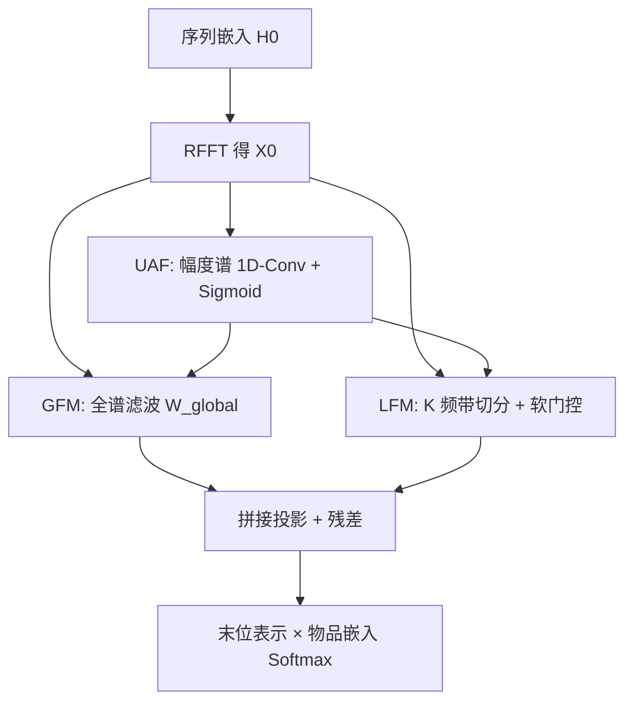
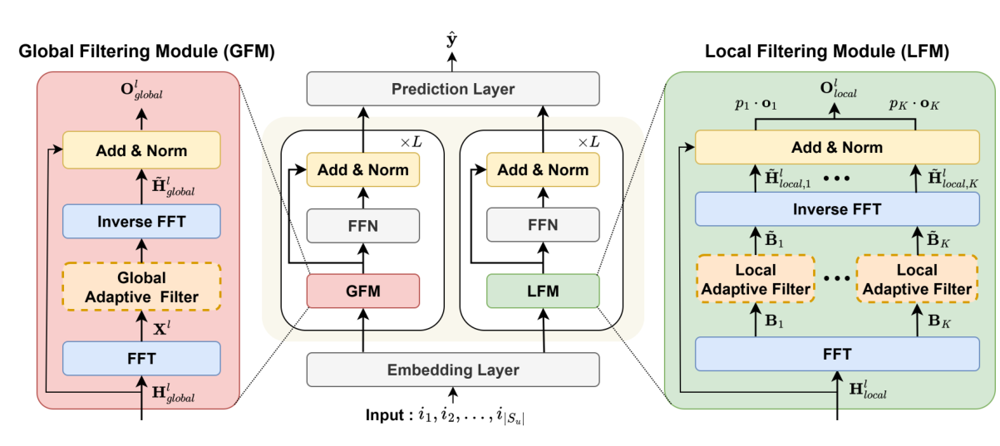

# MUFFIN: Mixture of User-Adaptive Frequency Filtering for Sequential Recommendation (用户自适应频率滤波混合的序列推荐)

- **会议/期刊**: CIKM 2025
- **作者与机构**: Ilwoong Baek, Mincheol Yoon, Seongmin Park, Jongwuk Lee（成均馆大学）
- **推荐链路定位**: 召回（Next-Item 序列建模）
- **研究方向**: 序列与会话推荐 / 生成式与频域表征
- **论文原文**: [https://arxiv.org/abs/2508.13670v1](https://arxiv.org/abs/2508.13670v1)
- **开源代码**: [https://github.com/ilwoong100/MUFFIN](https://github.com/ilwoong100/MUFFIN)

## TL;DR (1分钟核心速览)

现有频域序列推荐存在两大硬伤：滤波器只覆盖部分频带（全谱 vs. 局部二选一），且对所有用户施加**同一组**可学习滤波器，无法适配个体频率特征。MUFFIN 提出全局滤波模块（GFM，全谱）+ 局部滤波模块（LFM，K 个频带软门控加权）双分支，并用**用户自适应滤波器（UAF）**基于初始序列频谱幅度经 1D 卷积生成个性化滤波权重。在 5 个 Amazon/Yelp/ML-1M 数据集、Leave-One-Out + Full-Ranking 协议下，相对最强频域基线 SLIME4Rec 平均 R@10 提升 4.12%、N@10 提升 5.48%，且训练速度约为其 2 倍。

## Background & Motivation (背景与核心矛盾)

- **主流范式**: 以 SASRec/BERT4Rec 为代表的自注意力序列模型擅长长程依赖，但对细粒度周期模式不敏感；频域路线（FMLPRec、FEARec、BSARec、SLIME4Rec）用 DFT 把序列分解为可解释的谱分量，低频对应兴趣渐变、高频对应突变切换。
- **前人局限一（频带覆盖受限）**: FMLPRec 用单一全谱滤波器，SLIME4Rec 用分层频带选择但会**完全置零**某些频带（图 3 中 Beauty 上出现零幅度），二者无法同时兼顾"全局谱理解"与"局部频带细粒度建模"。
- **前人局限二（缺乏个性化）**: 所有用户共享同一组滤波器权重，而真实用户频谱差异极大（图 1(a)：低频主导型、双峰型、高频切换型），统一滤波导致信息稀释。
- **核心洞察 (Key Insight)**: 用户初始序列的**频谱幅度**本身就编码了其行为节奏，可作为条件信号动态生成滤波器，从而把"静态滤波"升级为"用户条件滤波"。
- **本文切入点**: 双分支（全谱 + 频带混合）+ UAF 条件化滤波 + 辅助监督与负载均衡正则，一次性解决覆盖与个性化两个矛盾。

## Method (核心方法设计)

### 1. 整体框架 (Overall Architecture)

输入用户序列嵌入 $\mathbf{H}^0\in\mathbb{R}^{n\times d}$，先经 RFFT 得到初始频谱$\mathbf{X}^0=\mathcal{F}(\mathbf{H}^0)\in\mathbb{C}^{m\times d}$（$m=\lfloor n/2\rfloor+1$，利用共轭对称只算半谱）。UAF 以$\|\mathbf{X}^0\|$为条件生成用户专属滤波权重$h(\mathbf{X}^0)$，分别与 GFM、LFM 的可学习滤波器逐元素相乘。GFM 在全谱上滤波后 IDFT 回时域；LFM 把频谱切成$K$段、各段独立滤波+零填充回时域，再用软门控加权求和。两分支各经残差+LayerNorm+FFN 堆叠$L$ 层，末层拼接投影后与初始嵌入残差相加，取末位表示与物品嵌入内积做 softmax 全库打分。

<figure class="paper-figure" markdown="span">
  <figcaption>图 2：MUFFIN 概览，其通过两个并行模块训练：全局滤波模块（GFM）和局部滤波模块（LFM）。两个模块均利用用户自适应滤波器（UAF）在频域中适应个体用户行为模式。模块输出的混合用于预测目标物品。</figcaption>
</figure>

### 2. 关键设计拆解 (Key Designs)

1. **用户自适应滤波器 UAF（把静态滤波变成条件滤波）**：痛点是共享滤波器抹平个体差异。做法是对幅度谱做转置后 1D 卷积（核跨相邻频点聚合），再 Sigmoid 得到逐频点权重：
$$h(\mathbf{X}^0)=\sigma\big(\text{BN}(\text{Conv1D}(\|\mathbf{X}^0\|^\top))\big)^\top\in\mathbb{R}^{m\times d}$$
关键细节：UAF **只吃初始频谱 $\mathbf{X}^0$**，不随层更新，保证滤波器始终锚定用户原始行为节奏；用卷积而非 MLP 是因为相邻频点存在局部相关性（消融中 MLP 替代后 Beauty R@10 从 0.0919 掉到 0.0913）。

2. **LFM 的频带软门控 + 零填充（局部建模不丢信息）**：痛点是对比方法用 top-$k$硬选频带会丢弃潜在有用信号。LFM 将频谱切为$K$段$\mathbf{B}_t$，各段滤波后零填充回全长再做 IDFT，得到$K$个时域候选$\mathbf{o}_t$，用幅度谱经三层 MLP 产生软权重：
$$p_t=\text{Softmax}\big(g(\|\mathbf{X}^l_{local}\|)\big)_t,\qquad \mathbf{O}^l_{local}=\sum_{t=1}^{K}p_t\cdot\mathbf{o}_t$$
软加权保证所有频带贡献均被保留，同时让模型自行决定各频带重要性。

3. **训练目标、负采样与推理效率**：总损失为
$$\mathcal{L}=\mathcal{L}_{rec}+\alpha\mathcal{L}_{aux}+\beta\mathcal{L}_{bal}$$
其中 $\mathcal{L}_{rec}$为全库 softmax 交叉熵（**免负采样**，直接对$|\mathcal{I}|$个物品归一化）；$\mathcal{L}_{aux}$对 GFM/LFM 各自输出单独施加交叉熵，迫使两分支学出互补表征；$\mathcal{L}_{bal}=\frac{1}{K}\sum_t\|p_t-1/K\|_2^2$ 防止门控塌缩到单一频带。推理时仅需一次前向 + 全库内积，Beauty 上单用户评估开销比 SLIME4Rec 多约 0.03ms。

## Experimental Setup & Evaluation Protocol (实验设置与评估协议)

- **数据集与预处理**: 全部采用 `5-core` 过滤，序列最大长度 50。

| 数据集 | #Users | #Items | #Interactions | 稀疏度 | 场景说明 |
| :--- | :---: | :---: | :---: | :---: | :--- |
| Beauty | 22,363 | 12,101 | 198,502 | 99.93% | Amazon 美妆 |
| Toys | 19,412 | 11,924 | 167,597 | 99.93% | Amazon 玩具 |
| Sports | 35,598 | 18,357 | 296,337 | 99.95% | Amazon 运动 |
| Yelp | 30,499 | 20,068 | 317,182 | 99.95% | 本地生活 |
| ML-1M | 6,041 | 3,417 | 999,611 | 95.16% | 电影（长序列，均长 165.5） |

- **数据划分与防穿越**: `Leave-One-Out`——末位为测试、倒数第二位为验证、其余训练。
- **排名评测协议**: 无偏 `Full-Ranking`，真值物品与**全部**物品（含训练期已交互物品）共同排序，指标 Recall@{5,10,20} 与 NDCG@{5,10,20}，5 个随机种子取均值。
- **对比基线与超参**: 8 个基线，时域 GRU4Rec/SASRec/BERT4Rec/DuoRec，频域 FMLPRec/FEARec/BSARec/SLIME4Rec；嵌入维度 $d=64$、2 层、Adam lr=0.001、batch=256；$K\in\{2,4,6,8,10\}$、$\alpha,\beta\in\{0.05,\dots,1\}$网格搜索，卷积核$c\in\{3,5,7\}$；单尾$t$检验$p<0.05$。

## Key Experimental Results (实验关键数据)

### 1. 主实验对比 (Main Results)

| 数据集 | 指标 | SASRec | DuoRec | FMLPRec | BSARec | SLIME4Rec | **MUFFIN** | Improv.% |
| :--- | :--- | :---: | :---: | :---: | :---: | :---: | :---: | :---: |
| Beauty | R@10 | 0.0843 | 0.0863 | 0.0861 | 0.0874 | 0.0885 | **0.0919** | 3.80 |
| Beauty | N@10 | 0.0418 | 0.0446 | 0.0424 | 0.0437 | 0.0460 | **0.0487** | 5.80 |
| Toys | R@10 | 0.0898 | 0.0946 | 0.0901 | 0.0944 | 0.0995 | **0.1005** | 0.97 |
| Toys | N@10 | 0.0440 | 0.0483 | 0.0441 | 0.0478 | 0.0506 | **0.0542** | 7.25 |
| Sports | R@10 | 0.0476 | 0.0498 | 0.0511 | 0.0511 | 0.0530 | **0.0570** | 7.48 |
| Sports | N@10 | 0.0223 | 0.0254 | 0.0239 | 0.0239 | 0.0271 | **0.0281** | 3.82 |
| Yelp | R@10 | 0.0597 | 0.0634 | 0.0681 | 0.0691 | 0.0729 | **0.0755** | 3.66 |
| Yelp | N@10 | 0.0377 | 0.0381 | 0.0412 | 0.0400 | 0.0405 | **0.0429** | 4.21 |
| ML-1M | R@10 | 0.3103 | 0.3098 | 0.3049 | 0.3090 | 0.3044 | **0.3187** | 2.71 |
| ML-1M | N@10 | 0.1791 | 0.1798 | 0.1774 | 0.1782 | 0.1765 | **0.1848** | 2.78 |

### 2. 消融实验 (Ablation Study)

| 变体 | Beauty R@10 | Beauty N@10 | ML-1M R@10 | ML-1M N@10 |
| :--- | :---: | :---: | :---: | :---: |
| MUFFIN 完整 | **0.0919** | **0.0487** | **0.3187** | **0.1848** |
| w/o UAF（改固定滤波） | 0.0906 | 0.0473 | 0.3151 | 0.1803 |
| w/o GFM | 0.0887 | 0.0460 | 0.3086 | 0.1759 |
| w/o LFM | 0.0906 | 0.0467 | 0.3079 | 0.1798 |
| w/o $\mathcal{L}_{aux}$ | 0.0862 | 0.0471 | 0.3101 | 0.1813 |
| w/o $\mathcal{L}_{bal}$ | 0.0907 | 0.0475 | 0.3151 | 0.1810 |
| UAF 卷积→MLP | 0.0913 | 0.0476 | 0.3115 | 0.1810 |

### 3. 关键实验发现 (Key Findings)

1. **辅助损失是最大单点贡献**：去掉 $\mathcal{L}_{aux}$ 后 Beauty R@10 从 0.0919 跌至 0.0862（-6.2%），跌幅超过去掉任一分支模块，说明双分支若只靠融合输出监督会退化为"单分支主导"，独立监督才是互补性的真正来源。
2. **两分支互补而非冗余**：去掉 GFM 在 ML-1M 上 R@10 掉 3.2%（0.3187→0.3086），去掉 LFM 掉 3.4%（→0.3079），二者跌幅相当且均大于去掉 UAF（-1.1%），证明全谱与频带局部视角各自不可替代，而个性化是在此基础上的增益项。
3. **负载均衡确实修复了频带塌缩**：$\beta=0$时 LFM 门控概率高度集中于最低频带$\mathbf{o}_1$，$\beta=0.2$时 Beauty 上$\mathbf{o}_2\sim\mathbf{o}_6$ 分布趋于均衡；同时 ML-1M 上低频带概率始终偏高，说明低频承载稳定偏好、高频承载个性化波动，与频域直觉一致。效率上 MUFFIN 训练 15.4s/epoch（Beauty），约为 SLIME4Rec（31.7s）的 2 倍加速。

## Highlights & Limitations (亮点、对比与审稿批判)

- **与代表作对比**: 相比 FMLPRec 的单一全谱静态滤波，MUFFIN 增加频带级软混合；相比 SLIME4Rec 的硬性频带置零 + 对比学习增广，MUFFIN 用软门控保留全谱信息且省去昂贵增广（训练快 2 倍）；相比 BSARec 把频域偏置注入注意力，MUFFIN 走纯滤波路线，结构更轻。
- **可迁移亮点**: (1) 用**初始表征的幅度谱**作为条件信号生成逐样本滤波权重，这一"条件化滤波"范式可平移到时间序列预测、多模态特征融合中的通道注意力设计；(2) 双分支各自施加辅助交叉熵以强制表征分化，是比对比学习更廉价的正则手段。
- **审稿级局限批判**: (1) 评估开销上升明显（Beauty 0.67s vs. SLIME4Rec 0.16s，约 4 倍），双分支 + $K$次 IDFT 在工业级全库打分场景下需谨慎；(2) 仅在 5-core 稠密过滤后的公开集上验证，未涉及冷启动/超短序列用户，而 UAF 依赖初始频谱幅度，序列过短时频谱估计方差大，个性化滤波可能失效；此外$K$、$\alpha$、$\beta$ 三个超参需逐数据集网格搜索，迁移成本不低。

## Rating (四维评分)

- **方法创新性 (Novelty)**: ⭐⭐⭐⭐ （双分支全谱/频带混合与用户条件滤波的组合是频域 SR 的合理补全，但单点算子（1D-Conv 生成权重、软门控、负载均衡）均属已有组件的巧妙拼装，缺乏理论层面的新刻画）
- **评估协议与实验扎实度 (Protocol & Experiments)**: ⭐⭐⭐⭐ （5 数据集 + 8 基线 + Full-Ranking + 5 种子 + $t$ 检验齐全，消融覆盖每个模块与两种损失，并补充效率与超参敏感性；不足是缺少冷启动/短序列分桶分析）
- **写作与数学规范度 (Clarity & Rigor)**: ⭐⭐⭐⭐ （RFFT 半谱、零填充维度、门控公式符号一致且维度标注清晰，UAF 只取 $\mathbf{X}^0$ 这一非显然设计有明确交代；频带切分边界公式略显琐碎）
- **工业落地与复现价值 (Industrial & Practical Value)**: ⭐⭐⭐⭐ （代码已开源、基于 RecBole-DA 可直接复现，训练效率优于 SLIME4Rec；但推理侧每用户额外 0.03ms 与 $K$ 次逆变换在超大规模候选集下需工程优化）

