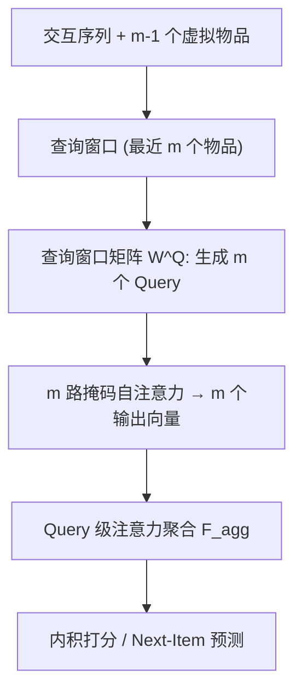
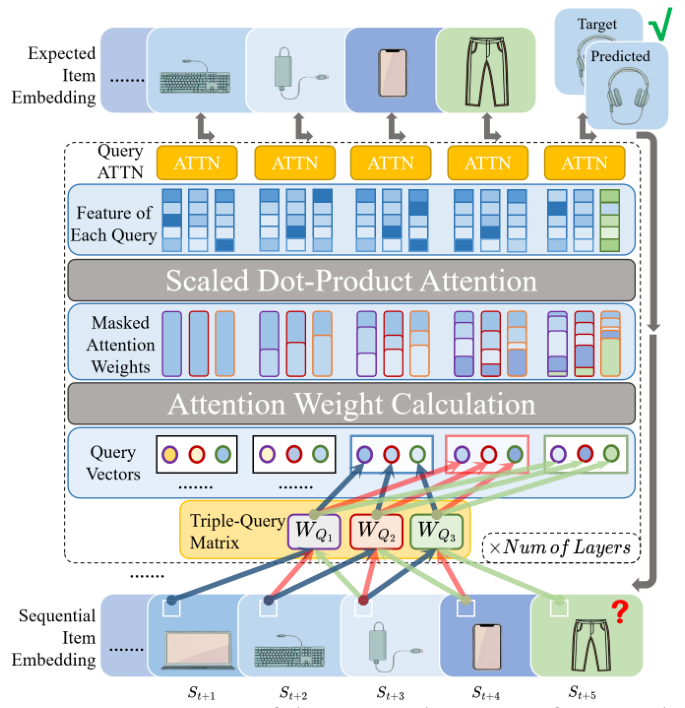

# Multi-Item-Query Attention for Stable Sequential Recommendation (面向稳定序列推荐的多物品查询注意力)

- **会议/期刊**: CIKM 2025
- **作者与机构**: Mingshi Xu, Haoren Zhu, Wilfred Siu Hung Ng（香港科技大学）
- **推荐链路定位**: 召回（Next-Item 序列建模）
- **研究方向**: 序列与会话推荐 / 自监督与交互去噪
- **论文原文**: [https://arxiv.org/abs/2509.24424v1](https://arxiv.org/abs/2509.24424v1)
- **开源代码**: [https://github.com/mxuax/MQ-Attn2025](https://github.com/mxuax/MQ-Attn2025)

## TL;DR (1分钟核心速览)

针对序列推荐中掩码注意力仅用**最近一个物品**生成 Query、对交互噪声高度敏感的问题，本文提出 MIQ-Attn：从最近 $m$个物品（含虚拟物品）经查询窗口矩阵生成$m$ 个多样化 Query，再做 Query 级注意力聚合。作为即插即用替换件，在 Leave-One-Out + Full-Ranking 协议下，ML-1M 上 SASRec 的 HR@5 从 0.0850 提升至 0.1030（+21.2%），LastFM 上 S3Rec 变体取得 SOTA（HR@5 +25.5%）。

## Background & Motivation (背景与核心矛盾)

- **主流范式**: SASRec/BERT4Rec 类模型以因果掩码自注意力聚合历史，但 Query 向量始终由序列末位物品投影得到，输出高度依赖单一交互点。
- **前人局限**: ① 末位物品若为误点击/噪声，Query 即被污染，预测剧烈偏移（图 1 所示偏差）；② 长序列中用户兴趣多面性被压缩为单点表征，早期信号无法进入 Query 通道。
- **核心洞察 (Key Insight)**: 注意力层虽"看到"全序列，但 Query 生成路径是信息瓶颈——把 Query 从单点扩展为窗口内多点，即可在不改主干的前提下分散噪声影响。
- **本文切入点**: 用最近 $m$ 个物品 + 虚拟物品构造多 Query，并以 Query 级注意力自适应加权，实现"去单点依赖"的稳定预测。

## Method (核心方法设计)

### 1. 整体框架 (Overall Architecture)

输入用户交互序列，在序列头部拼接 $m-1$个可学习虚拟物品$d_i$以对齐窗口；对每个时间步取长度$m$的查询窗口，经$m$个独立投影矩阵$W^{q_j}$生成$m$个 Query，各自执行标准掩码注意力得到$m$个输出向量；再以 Query 级注意力聚合为单一表征$F_{agg}$，最后与物品嵌入内积打分、softmax 预测下一物品。训练沿用 SASRec 的交叉熵 + 全库负采样，推理时仅需一次前向。

<figure class="paper-figure" markdown="span">
  <figcaption>图2：所提出的MIQ-Attn框架概览，查询窗口𝑚=3。</figcaption>
</figure>

### 2. 关键设计拆解 (Key Designs)

1. **虚拟物品 + 查询窗口构造（解决序列头部无历史可查）**：若直接取最近 $m$项，序列前$m-1$ 步窗口不足。作者在序列前拼接可学习虚拟物品（类比 BERT 的 `[CLS]`/padding），使首部物品与后部物品获得同等 Query 上下文：
   $S_{q,t,i}=\{d_t,\dots,d_{m-1},s^i_1,\dots,s^i_t\}\ (t<m),\quad \{s^i_{t-m},\dots,s^i_t\}\ (m\le t<T_i)$。
   相比零填充或复制首物品，虚拟物品提供**可学习语义先验**，缓解冷启动位置的表征塌缩。

2. **查询窗口矩阵 QWM（让每个 Query 关注不同兴趣面）**：直接复用原始嵌入作 Query 会导致 $m$个 Query 高度同质。QWM 为窗口内每个位置配置独立投影$W^{q_j}\in\mathbb{R}^{d\times d}$，$q_j=\hat{E}W^{q_j}$，使各 Query 捕获不同时间片段/兴趣维度，等效于"在 Query 侧做多头"，但头数与窗口位置一一绑定。

3. **Query 级注意力与训练目标**：$m$个输出简单平均会稀释可靠 Query。以输出堆叠$O_{agg}$ 再做一层注意力：
   $\alpha_j=\mathrm{softmax}_j\big((O_{agg}W^K)(o_jW^Q)^\top/\sqrt{d_k}\big),\quad F_{agg}=\sum_{j=1}^{m}\alpha_j(o_jW^V)$。
   总损失即标准下一物品交叉熵 $\mathcal{L}=-\sum\log\hat{y}_{s_{T+1}}$，负采样采用**全库未交互物品**（full-corpus），无额外对比/去噪损失。复杂度由$O(T^2d)$增至$O(mT^2d+m^2Td)$，空间$O(d^2)\to O(md^2)$，因$m\ll T$且$md^2\ll|I|d$，开销可忽略。

## Experimental Setup & Evaluation Protocol (实验设置与评估协议)

- **数据集与预处理**:

| 数据集 | #Users | #Items | #Interactions | 平均长度/用户 | 特征/场景说明 |
| :--- | :---: | :---: | :---: | :---: | :--- |
| Amazon Beauty | 52,024 | 57,289 | 0.4M | 7.6 | 稀疏短序列，美妆评论 |
| MovieLens-1M | 6,040 | 3,416 | 1.0M | 163.5 | 长序列，电影评分 |
| LastFM | 1,090 | 3,646 | 52,551 | 48.2 | 音乐社交，含辅助特征 |

- **数据划分与防穿越 (Splitting Strategy)**: `Leave-One-Out`——末位为测试、倒数第二位为验证、其余训练；Beauty/ML-1M 沿用 SASRec 配置，LastFM 沿用 S3Rec 配置。
- **排名评测协议 (Ranking Protocol)**: 无偏 `Full-Ranking`（全部未交互物品作负样本），指标 HR@{5,10,20} 与 NDCG@{5,10,20}。
- **对比基线与超参设置**: GRU4Rec$_F$、SRGNN$_F$、SASRec$_F$、S$^3$Rec（含预训练变体）；嵌入维度随$m$调整（图 3 显示最优维度随$m$增大而增大），dropout 同步调参；$p<0.05$显著性检验（LastFM 表以$*$ 标注）。

## Key Experimental Results (实验关键数据)

### 1. 主实验对比 (Main Results)

Beauty / ML-1M 上 SASRec 与 MIQ-Attn 对比（节选核心列）：

| 数据集 | 模型 | HR@5 | NDCG@5 | HR@10 | NDCG@10 | HR@20 | NDCG@20 |
| :--- | :--- | :---: | :---: | :---: | :---: | :---: | :---: |
| Beauty | SASRec | 0.0165 | 0.0093 | **0.0267** | **0.0125** | 0.0412 | 0.0162 |
| Beauty | MIQ-Attn$_2$ | 0.0175 | 0.0096 | 0.0258 | 0.0123 | 0.0402 | 0.0160 |
| Beauty | MIQ-Attn$_3$ | 0.0123 | 0.0066 | 0.0246 | 0.0104 | **0.0494** | **0.0167** |
| Beauty | MIQ-Attn$_{10}$ | 0.0021 | 0.0010 | 0.0021 | 0.0010 | 0.0052 | 0.0018 |
| ML-1M | SASRec | 0.0850 | 0.0508 | 0.1570 | 0.0739 | 0.2610 | 0.0999 |
| ML-1M | MIQ-Attn$_3$ | 0.0910 | 0.0451 | 0.1610 | 0.0677 | 0.2770 | 0.0967 |
| ML-1M | MIQ-Attn$_5$ | 0.0880 | 0.0453 | 0.1780 | 0.0742 | 0.2740 | 0.0984 |
| ML-1M | **MIQ-Attn$_{10}$** | **0.1030** | **0.0515** | **0.1790** | **0.0759** | **0.2910** | **0.1041** |
| ML-1M | MIQ-Attn$_{15}$ | 0.0960 | 0.0471 | 0.1660 | 0.0692 | 0.2590 | 0.0926 |

LastFM 上跨模型验证（$m=5$）：

| 类型 | 模型 | HR@5 | NDCG@5 | HR@10 | NDCG@10 | HR@20 | NDCG@20 |
| :--- | :--- | :---: | :---: | :---: | :---: | :---: | :---: |
| Type1 | SASRec$_F$ | 0.0303 | 0.0161 | 0.0486 | 0.0221 | 0.0826 | 0.0305 |
| Type1 | MIQ-Attn$_{SASRec_F}$ | **0.0376** | **0.0194** | **0.0578** | **0.0261** | **0.0881** | **0.0337** |
| Type2 | S$^3$Rec$_F$ | 0.0431 | 0.0250 | 0.0743 | 0.0349 | 0.1266 | 0.0481 |
| Type2 | MIQ-Attn$_{S^3Rec_F}$ | **0.0541** | **0.0365** | **0.0844** | **0.0459** | **0.1294** | **0.0572** |

MIQ-Attn$_{SASRec_F}$相对 SASRec$_F$：HR@5 +24.09%、NDCG@5 +20.50%、HR@10 +18.93%（均显著）；MIQ-Attn$_{S^3Rec_F}$相对 S$^3$Rec$_F$：HR@5 +25.52%、NDCG@5 +38.26%，为 LastFM 新 SOTA。

### 2. 消融实验 (Ablation Study)

原文未设独立消融表，但通过 $m$ 扫描与组件替换构成等效消融：

| 配置 | ML-1M HR@5 | ML-1M NDCG@20 | 说明 |
| :--- | :---: | :---: | :--- |
| SASRec（单 Query 基线） | 0.0850 | 0.0999 | 无 QWM、无虚拟物品 |
| MIQ-Attn $m=3$ | 0.0910 | 0.0967 | 窗口过小，增益有限 |
| MIQ-Attn $m=5$ | 0.0880 | 0.0984 | 中等窗口 |
| MIQ-Attn $m=10$ | **0.1030** | **0.1041** | 最优，约为平均长度 1/10 |
| MIQ-Attn $m=15$ | 0.0960 | 0.0926 | 窗口过大，虚拟物品占比过高 |
| Beauty $m=10$（平均长度 7.6） | 0.0021 | 0.0018 | 窗口超序列长度，性能崩塌 |

### 3. 关键实验发现 (Key Findings)

1. **窗口 $m$与平均序列长度强耦合**：ML-1M 平均长度 163.5，最优$m=10$（约 1/10 平均长度），HR@5 提升 21.2%；Beauty 平均长度仅 7.6，$m=10$ 时 HR@5 从 0.0165 崩至 0.0021，说明虚拟物品在短序列中反客为主、淹没真实信号。
2. **长序列场景收益最大、短序列收益不稳**：ML-1M 全指标一致提升，Beauty 仅 $m=2/3$ 在部分指标微增（HR@5 +6.1%），NDCG@10 反而下降，验证"多 Query 分散噪声"依赖足够长的历史支撑。
3. **即插即用性成立**：同一机制在 SASRec 与 S$^3$Rec 两类架构上分别带来 +24.09% 与 +25.52% 的 HR@5 相对提升，且图 3 显示最优嵌入维度随$m$ 同步增大，提示窗口与表征容量需联合调参。

## Highlights & Limitations (亮点、对比与审稿批判)

- **与代表作对比 (vs. Prior Work)**: 与 SASRec 的本质差异在 Query 生成路径（单点 → 窗口多点 + QWM），而非注意力聚合方式；与 LLM 中的 Multi-Query/Grouped-Query Attention 动机相反——后者为省显存/提速，本文为抗噪与稳定，且引入虚拟物品与 Query 级聚合，机制不同。
- **可迁移亮点**: ① 虚拟物品作为"可学习位置先验"可迁移到任何定长窗口的序列建模；② Query 级注意力加权可替代简单平均，用于多表征融合（如多兴趣召回）。
- **审稿级局限批判**: ① 增益高度依赖 $m$与序列长度比例，Beauty 上出现性能崩塌，缺乏自适应$m$选择机制（作者亦列为未来工作）；② 空间从$O(d^2)$增至$O(md^2)$，且未报告训练/推理时延实测与显著性检验在 Beauty/ML-1M 上的完整结果，评估说服力略弱。

## Rating (四维评分)

- **方法创新性 (Novelty)**: ⭐⭐⭐ （Query 侧多窗口 + 虚拟物品思路简洁有效，但本质是注意力变体工程，理论分析仅停留在复杂度层面）
- **评估协议与实验扎实度 (Protocol & Experiments)**: ⭐⭐⭐ （Full-Ranking + Leave-One-Out 规范，三数据集跨架构验证，但缺独立消融表与 Beauty 上的显著性检验）
- **写作与数学规范度 (Clarity & Rigor)**: ⭐⭐⭐⭐ （公式与符号定义清晰，复杂度分析完整，动机图直观）
- **工业落地与复现价值 (Industrial & Practical Value)**: ⭐⭐⭐⭐ （drop-in 替换、代码开源、额外开销可控，但需按序列长度调 $m$ 增加调参成本）

