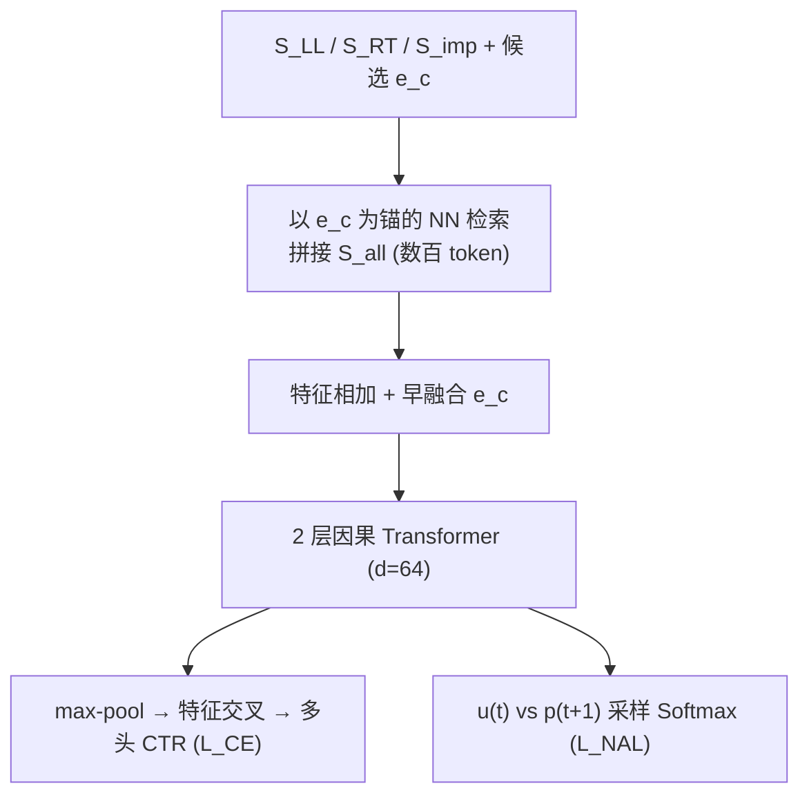
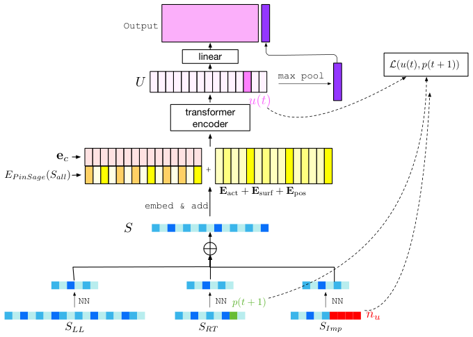

# TransAct V2: Lifelong User Action Sequence Modeling on Pinterest Recommendation (Pinterest 终身用户行为序列建模)

- **会议/期刊**: CIKM 2025
- **作者与机构**: Xue Xia, Saurabh Vishwas Joshi, Kousik Rajesh, Kangnan Li, Yangyi Lu, Nikil Pancha, Dhruvil Deven Badani, Jiajing Xu, Pong Eksombatchai（Pinterest）
- **推荐链路定位**: 精排（Homefeed Ranking，CTR 多目标预估）
- **研究方向**: 序列与会话推荐 / 工业架构与系统优化
- **论文原文**: [https://arxiv.org/abs/2506.02267v1](https://arxiv.org/abs/2506.02267v1)
- **开源代码**: 暂未开源

## TL;DR (1分钟核心速览)

工业 CTR 模型普遍只用 $O(10^2)$的短期序列，长历史要么被离线聚类压缩（信息丢失），要么靠昂贵的离线推理缓存；且点式排序框架内缺少"预测下一动作"的显式监督。TransAct V2 用候选 Pin 作锚点对$O(10^4)$ 终身序列做 NN 检索，把拼接序列压回数百 token 送入 2 层 Transformer，并叠加基于曝光负采样的 Next Action Loss（NAL）。离线 HIT@3/repin 相对 TransAct 提升 13.31%、HIT@3/hide 下降 11.25%；线上 Repin Volume +6.35%、Hide Volume -12.80%。

## Background & Motivation (背景与核心矛盾)

- **主流范式**: 工业精排以点式多任务 wide&deep 为主干，序列侧走"两阶段"路线——先用候选做相关性检索（SIM / TransAct / TWIN），再对子序列跑 self-attention。
- **前人局限**: 其一，序列长度被卡在 $O(10^2)$，长期兴趣被截断，导致回音室效应与多样性塌缩；其二，TWIN v2 类方法靠离线聚类压缩终身历史，压缩与候选无关且不可逆地丢信息，TWIN 还需实时更新独立压缩模型。
- **核心洞察 (Key Insight)**: 终身序列的存储/网络成本是 $O(L)$与$O(NL)$，但真正进入 Transformer 的只有与候选相关的 top-$K$ 子序列——因此"全量序列"不必上线，只需上线"检索结果"。
- **本文切入点**: 把 NN 检索前移到在线服务端（broadcast-free），并把"下一动作预测"作为辅助对比任务塞进 CTR 训练目标，一举解决表达力与监督信号两个短板。

## Method (核心方法设计)

### 1. 整体框架 (Overall Architecture)

输入侧有四路序列：终身序列 $S_{LL}$（$O(10^4)$，仅含 repin/click/hide 等显式动作，不含曝光）、实时序列$S_{RT}$（$O(10^2)$）、曝光序列$S_{imp}$，以及始终保留的最近$r$条$S_{RT}[:r]$。以候选 Pin 的 PinSage 向量$e_c$为 query，分别对三路序列做内积 top-$K$检索后拼接为$S_{all}$（控制在数百 token）；每个 token 由 PinSage 向量（int8 量化存储）、动作类型、曝光面、位置编码相加而成，并与$e_c$早融合。$S_{all}$经 2 层单头 Transformer（$d_{model}=64$，FFN=32，因果掩码）编码后分两路：max-pool + linear 汇入特征交叉层做多目标 CTR 预测；同时用每步隐状态$u(t)$ 做下一动作对比预测。训练与 serving 走不同数据通路，但 NN 特征表示保持一致。

<figure class="paper-figure" markdown="span">
  <figcaption>图3：Transact V2 架构</figcaption>
</figure>

### 2. 关键设计拆解 (Key Designs)

1. **候选锚定的终身序列 NN 检索**：痛点是全量 $O(10^4)$序列无法上线、离线压缩又与候选无关。做法是以$e_c$与序列 PinSage 矩阵做内积取 top-$K$：$S_{all}=\mathrm{NN}(S_{LL},c)\oplus S_{RT}[:r]\oplus \mathrm{NN}(S_{RT}[r:],c)\oplus \mathrm{NN}(S_{imp},c)$。直觉上这是"以候选为中心的可微硬注意力"，把序列长度从$O(10^4)$降到$O(10^2)$，同时保留与当前候选最相关的长期证据；强制保留最近$r$ 条则兜住短期意图不被检索挤掉。

2. **Next Action Loss（NAL）**：痛点是点式 CTR 只学"这条 Pin 好不好"，不学"用户下一步会做什么"，序列编码器缺乏动作级监督。做法是在因果掩码下用 $t$时刻用户表示$u(t)$预测$t+1$时刻正样本$p_u(t+1)$，采用采样 Softmax 而非交叉熵以便灵活调正负比：
$$\mathcal{L}(u(t),p(t{+}1))=-\log\frac{e^{\langle u(t),p_u(t+1)\rangle}}{e^{\langle u(t),p_u(t+1)\rangle}+\sum_{n_u}e^{\langle u(t),n_u\rangle}}$$
关键在负样本：用 $S_{imp}$ 中"看过但未互动"的 Pin 作负样本，比 in-batch 随机负样本更硬、更贴近"用户不感兴趣"的真实分布，直接压低了 hide 率。

3. **训练目标与推理效率**：总损失 $\mathcal{L}=\mathcal{L}_{CE}+w_{NAL}\cdot\mathcal{L}_{NAL}$，$\mathcal{L}_{CE}$为多头加权交叉熵；NAL 正样本取$S_{RT}[:r]$中正反馈 token，负样本为曝光负采样（$N$个）。推理侧四项工程优化：NN 特征日志（存储$O(L)\to O(1)$）、请求级去重稀疏张量（PCIe 传输降 8×）、融合反量化+NN 检索（延迟 -20%）、单核统一 Transformer SKUT（前向快 6.6×，seq=192 时延迟 -85.09%）。

## Experimental Setup & Evaluation Protocol (实验设置与评估协议)

- **数据集与预处理**: 仅用 Pinterest 内部数据（作者明确指出公开 CTR 数据集缺少终身/实时/曝光三路序列与元数据，无法复现），从两周 Homefeed 行为降采样：

| 数据集 | #Users | #Items | #Interactions | 稀疏度/密度 | 特征/场景说明 |
| :--- | :---: | :---: | :---: | :---: | :--- |
| Pinterest Homefeed | 182 M | 350 M | 6.9 B | 极稀疏 | 终身/实时/曝光序列 + PinSage 32-d + 动作类型/曝光面 |

- **数据划分与防穿越 (Splitting Strategy)**: 时间切分——用连续两周数据训练，评估集取训练最后一天之后第 7 天采集的数据，天然防穿越。
- **排名评测协议 (Ranking Protocol)**: 非全库排序，而是按 $(u,c)$请求分组、组内按多头加权分$S=\sum_h w_h f(x)_h$ 排序，计算 HIT@3/repin 与 HIT@3/hide（前者越高越好，后者越低越好）。
- **对比基线与超参设置**: 基线为无序列的 Wide&Deep、BST、TransAct，以及 TransAct + NAL 变体；Transformer 取 2 层、单头、$d_{model}=64$、FFN=32、序列长度 192；线上 A/B 每组占 1.5% 流量，基线为强基线 TransAct，$*$ 表示统计不显著。

## Key Experimental Results (实验关键数据)

### 1. 主实验对比 (Main Results)

离线（相对无序列 Wide&Deep 基线的 HIT@3 变化）：

| 方法 | HIT@3/repin | HIT@3/hide |
| :--- | :---: | :---: |
| BST (RT seq) | +6.04% | -0.49%* |
| TransAct (RT seq) | +7.74% | -6.86% |
| TransAct + NAL_in-batch | +8.41% | -8.63% |
| TransAct + NAL_imp | +8.92% | -9.08% |
| **TransAct V2 (RT+LL+NAL_imp)** | **+13.31%** | **-11.25%** |

线上 A/B（基线为 TransAct）：

| 线上指标 | NAL_imp | TransAct V2 |
| :--- | :---: | :---: |
| Homefeed Repin Volume | +0.27%* | **+6.35%** |
| Homefeed Hide Volume | -6.26% | **-12.80%** |
| Impression Diversity | +0.08%* | **+0.45%** |
| Time Spent on App | +0.10%* | **+1.41%** |

### 2. 消融实验 (Ablation Study)

| 消融项 | HIT@3/repin | HIT@3/hide |
| :--- | :---: | :---: |
| NAL 负采样：in-batch | +0.63% | -1.90% |
| NAL 负采样：impression-based | **+1.10%** | **-2.39%** |
| SKUT vs PyTorch（seq=192） | 延迟 **-85.09%** | 显存 -13.24% |
| 请求去重 + Pinned Arena（batch=256） | Model Run 延迟 **-75%** | 拷贝时间 -82% |
| 全优化端到端 p99 | **250× 加速** | — |

### 3. 关键实验发现 (Key Findings)

1. **终身序列是最大增益源**：从 TransAct+NAL_imp（+8.92%）到加入 LL 序列（+13.31%），repin 指标再涨 4.4 个点，说明 NN 检索式长历史并非冗余，而是提供了短期序列无法覆盖的兴趣证据；同时 hide 从 -9.08% 恶化到 -11.25%，正负两侧同向改善。
2. **负样本质量决定 NAL 上限**：曝光负采样比 in-batch 随机负采样在 repin 上多 +0.47%、hide 上多 -0.49%，线上单独上线 NAL_imp 即带来 Hide -6.26%（显著），验证"看过不点"是最贴近真实不兴趣分布的硬负样本。
3. **系统优化不是配角**：SKUT 在 seq=192 处取得峰值 -85.09% 延迟（恰为生产输入形状调优结果），请求去重使批准备快 5×、排队延迟降约 1300×，端到端 p99 提速 250×——正是这套优化才让 $O(10^4)$ 序列在 29,000 QPS/主机下可行。

## Highlights & Limitations (亮点、对比与审稿批判)

- **与代表作对比 (vs. Prior Work)**: 相比 SIM/TransAct 的短序列两阶段检索，本文把检索对象扩展到 $O(10^4)$ 终身序列且在线执行；相比 TWIN v2 的离线聚类压缩，本文不做有损压缩、检索与候选强相关且无需维护独立压缩模型；相比 HSTU 类生成式推荐，本文坚持 CTR 范式，避免万亿参数带来的成本不可控。
- **可迁移亮点**: ①"NN 特征日志"把训练/服务的数据通路解耦但保持特征语义一致，是长序列上线的通用范式；②用曝光未点击作对比学习负样本，可直接迁移到任何有曝光日志的排序任务。
- **审稿级局限批判**: ①全部实验基于 Pinterest 内部数据，无公开数据集复现，HIT@3 也非标准全库排序指标，横向可比性弱；②NAL 权重 $w_{NAL}$、序列长度 192、FFN=32 等超参明显由延迟预算反向确定（图 6 显示性能随长度单调上升），存在"为 latency 牺牲表达力"的次优风险；③SKUT 依赖$d_{model}=64$ 才能把全部权重塞进 8MB 共享内存，向大模型维度扩展性存疑。

## Rating (四维评分)

- **方法创新性 (Novelty)**: ⭐⭐⭐ （NN 检索与 NAL 均为已有组件的工业级组合创新，理论新意有限，但"曝光负采样 + 终身序列在线检索"的搭配有实用巧思）
- **评估协议与实验扎实度 (Protocol & Experiments)**: ⭐⭐⭐ （线上 A/B 规模真实、指标全面，但无公开数据集、HIT@3 非标准协议、缺显著性检验细节）
- **写作与数学规范度 (Clarity & Rigor)**: ⭐⭐⭐⭐ （公式简洁、系统章节工程细节充分，量化压缩与检索公式定义清楚，仅符号表略显冗余）
- **工业落地与复现价值 (Industrial & Practical Value)**: ⭐⭐⭐⭐⭐ （已服务 5 亿月活，延迟/存储优化逐项量化到 p99 与 PCIe 字节级，是长序列上线的极佳工程参考）

