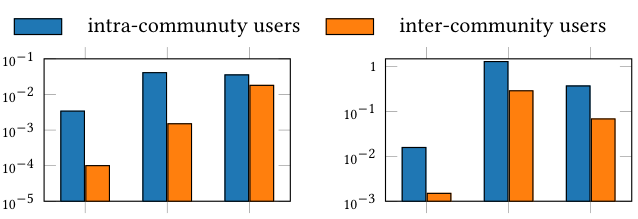
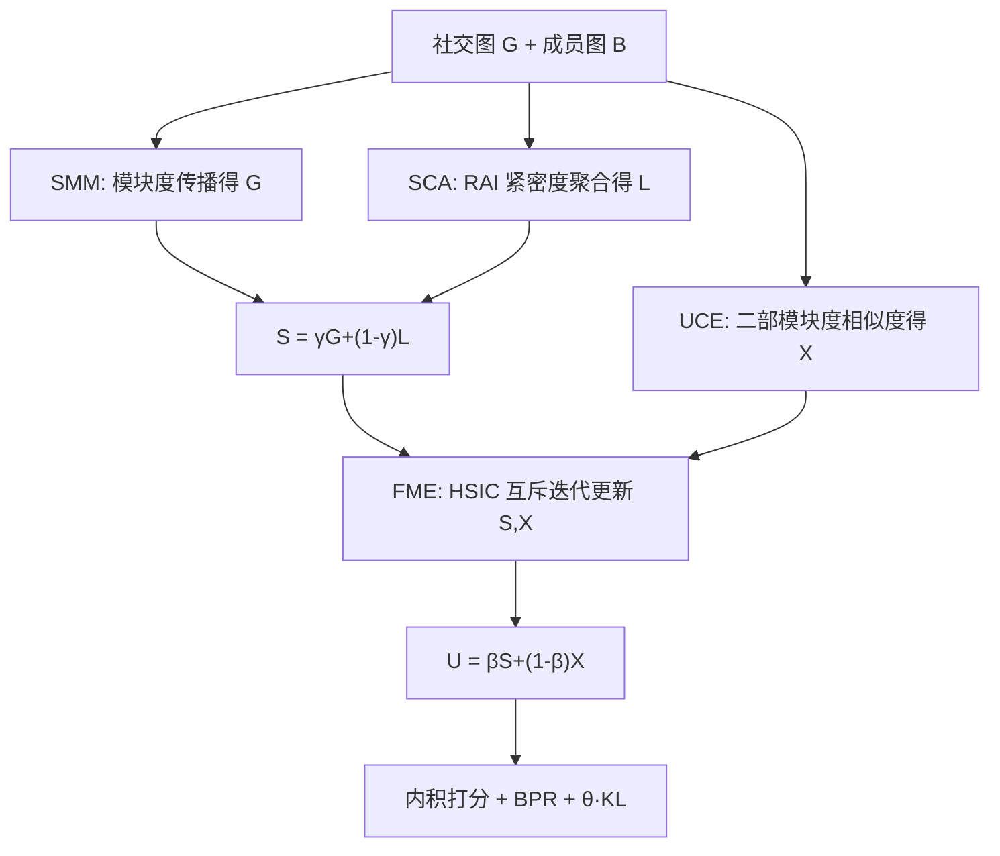

# Community-Aware Social Community Recommendation (社区感知的社交社区推荐)

- **会议/期刊**: CIKM 2025
- **作者与机构**: Runhao Jiang, Renchi Yang (香港浸会大学), Wenqing Lin (京东)
- **推荐链路定位**: 召回（用户-社区匹配打分）
- **研究方向**: 社交与群组推荐 / 图神经网络推荐
- **论文原文**: [论文原文链接](https://arxiv.org/abs/2508.05107v2)
- **开源代码**: [开源代码仓库链接](https://github.com/HKBU-LAGAS/CASO)

## TL;DR (1分钟核心速览)

现有社交推荐模型为博客/商品等常规物品设计，直接迁移到"社区推荐"时失效：社区由高动态用户构成，且蕴含独特的社区内/间连边结构。本文提出 CASO，用社交模块度最大化 (SMM) 抽取全局结构、社交紧密度聚合 (SCA) 抽取局部结构、协同编码 (UCE) 抽取成员关系信号，并以 HSIC 特征互斥去冗余、KL 社区检测损失精炼社区向量。在 6 个真实社交网络、全库排序协议下，NDCG@3 相对最优基线最高提升 5.38%（Youtube）。

## Background & Motivation (背景与核心矛盾)

- **主流范式**: 社区推荐早期依赖 CF（CCF、PairwisePLSI）挖掘用户-社区共现；近年 GNN 社交推荐（DiffNet++、MHCN、GBSR）通过邻域聚合建模社交同质性与影响力扩散。
- **前人局限**: 其一，GNN 社交推荐面向常规物品，忽略社区"由成员构成、高度动态"的本质，无法刻画社区内/间连边模式；其二，唯一针对社区的 GNN 工作 [81] 仅支持"每人最多加入一个社区"的强约束，且未利用社区结构。
- **核心洞察 (Key Insight)**: 作者用 AC/ACN/ACC 三个度量在 DBLP、Youtube 上验证：社区内用户的平均连边、共同好友、共同社区数均显著高于社区间用户（图 1），即存在**全局结构模式**（内密外疏）、**局部结构模式**（共同好友多则同社区）、**协同模式**（成员关系相似则同社区）。
- **本文切入点**: 将三类模式分别交由三个解耦编码器显式建模，再用互斥约束保证互补而非冗余。

<figure class="paper-figure" markdown="span">
  <figcaption>图1：DBLP和Youtube上社区内与社区间节点的AC、ACN和ACC。</figcaption>
</figure>

## Method (核心方法设计)

### 1. 整体框架 (Overall Architecture)

CASO 采用双塔结构：用户侧由 SMM 与 SCA 分别产出全局/局部社交表征 $\mathbf{G}$、$\mathbf{L}$，按$\mathbf{S}=\gamma\mathbf{G}+(1-\gamma)\mathbf{L}$融合；UCE 从用户-社区二部图产出协同表征$\mathbf{X}$；FME 对$\mathbf{S},\mathbf{X}$做 HSIC 互斥更新后按$\mathbf{U}=\beta\mathbf{S}+(1-\beta)\mathbf{X}$得最终用户向量。社区侧仅维护可学习向量$\mathbf{C}$，由 KL 社区检测损失精炼。训练仅更新初始用户向量$\mathbf{U}^\circ$与$\mathbf{C}$，复杂度与矩阵分解同级。

### 2. 关键设计拆解 (Key Designs)

1. **社交模块度最大化 SMM（全局结构）**：将"最大化归一化模块度 + 拟合观测成员"的目标松弛到嵌入空间，得 $\max_{\mathbf{G}}\alpha\,\mathrm{trace}\big(\mathbf{G}^\top(\tilde{\mathbf{A}}-\tfrac{\sqrt{\mathbf{d}}\sqrt{\mathbf{d}}^\top}{|\mathcal{E}|})\mathbf{G}\big)-(1-\alpha)\|\mathbf{G}-\mathbf{U}^\circ\|_F^2$。定理 4.2 给出闭式解为无穷级数，当$\alpha<\tfrac13$时可截断$T$步迭代$\mathbf{G}=\sum_{t=0}^{T}\frac{\alpha^t}{(1-\alpha)^t}(\tilde{\mathbf{A}}-\tfrac{\sqrt{\mathbf{d}}\sqrt{\mathbf{d}}^\top}{|\mathcal{E}|})^t\mathbf{U}^\circ$。直觉：减去度期望项等价于"惩罚跨社区连边"，使同社区用户向量被拉近，且增量式稀疏乘实现线性复杂度。

2. **社交紧密度聚合 SCA（局部结构）**：以邻域紧密度 $p(u_i,u_j)$加权聚合邻居初始向量$\mathbf{L}_i=\sum_{j}\frac{p(u_i,u_j)}{d_i}\mathbf{U}^\circ_j$。定理 4.3 证明表 1 中 CN/AAI/RAI/SI/LHNI 五种度量均可写成$f(\mathbf{A})_i f(\mathbf{A})_j^\top$，从而统一为$\mathbf{L}=\mathbf{D}^{-1}f(\mathbf{A})f(\mathbf{A})^\top\mathbf{U}^\circ$的矩阵乘形式；实验选 RAI（$f(\mathbf{A})=\mathbf{A}\mathbf{D}^{-\frac12}$），因其对高连接节点降权更稳健。

3. **协同编码 UCE 与特征互斥 FME**：UCE 用二部模块度标准化 $\hat{\mathbf{Y}}_{i,k}=\frac{\mathbf{Y}_{i,k}}{\sqrt{\delta_i}\sqrt{\sigma_k}}-\sqrt{\frac{\delta_i}{|\mathcal{Y}|}}\sqrt{\frac{\sigma_k}{|\mathcal{Y}|}}$构造偏好相似度$s(u_i,u_j)=\hat{\mathbf{Y}}_i\hat{\mathbf{Y}}_j^\top$，得$\mathbf{X}=\hat{\mathbf{Y}}\hat{\mathbf{Y}}^\top\mathbf{U}^\circ$，引理 4.4 保证相似度落在$[-\frac{\sqrt{\delta_i\delta_j}}{|\mathcal{Y}|},1-\frac{\sqrt{\delta_i\delta_j}}{|\mathcal{Y}|}]$的合理区间。FME 因社交与协同信号高度重叠而引入$\mathrm{HSIC}(\mathbf{S},\mathbf{X})=\|\mathbf{S}^\top\mathbf{X}\|_F^2$，对$\|\mathbf{S}-\mathbf{S}^\circ\|_F^2+\|\mathbf{X}-\mathbf{X}^\circ\|_F^2+\lambda\mathrm{HSIC}$求导得交替更新$\mathbf{S}^{(i+1)}=\mathbf{S}^\circ-\lambda\mathbf{X}^{(i)}\mathbf{X}^{(i)\top}\mathbf{S}^{(i)}$（$\mathbf{X}$ 对称），行归一化防梯度爆炸。

4. **训练目标与推理**：总损失 $\mathcal{L}=\mathcal{L}_{\text{BPR}}+\theta\cdot\mathcal{L}_{\text{KL}}$，BPR 为成对损失、每正样本随机采一个负社区；KL 项以 Student-t 软分配$q_{i,k}$对齐观测成员分布$p_{i,k}$，使社区向量成为成员簇质心。打分$\hat{y}_{i,k}=\mathbf{U}_i\mathbf{C}_k^\top$，全库排序取 Top-K。

## Experimental Setup & Evaluation Protocol (实验设置与评估协议)

- **数据集与预处理**:

| 数据集 | #Users | #Items(社区) | #Interactions | 密度/人均 | 特征/场景说明 |
| :--- | :---: | :---: | :---: | :---: | :--- |
| BlogCatalog | 5,196 | 6 | 5,196 | 1.0000 | 稠密小图，博客社交 |
| Flickr | 7,575 | 9 | 7,575 | 1.0000 | 稠密小图，图片社交 |
| Deezer-HR | 54,573 | 84 | 343,665 | 6.2973 | 音乐平台，人均多社区 |
| Deezer-RO | 41,773 | 84 | 252,132 | 6.0358 | 同上，罗马尼亚 |
| DBLP | 317,080 | 5,000 | 112,228 | 0.3539 | 学术合作网，极稀疏 |
| Youtube | 1,134,890 | 5,000 | 72,959 | 0.0643 | 百万级社交边，极稀疏 |

- **数据划分与防穿越**: 对每个用户随机抽取 80% 成员关系作训练/验证，余 20% 作测试；训练集为每个正例随机采一个负社区。
- **排名评测协议**: 无偏 **Full-Ranking**（所有未交互社区均为候选），指标 Recall@K、NDCG@K（K=3,5），5 折交叉验证、10 次试验取均值。
- **对比基线与超参**: 9 个基线含 CF 类（SVD++、BPR、LightGCN）、社交 GNN 类（LightGCN-S、DiffNet、DiffNet++、SEPT、MHCN、GBSR）；嵌入维度统一 $d=64$，$\alpha=0.33$、$\gamma=0.3$、$T=2$，$\lambda\in[0.001,1]$、$\beta\in[0.1,1]$、$\theta\in[0.001,1]$ 网格搜索，Adam 学习率 0.01、batch 2048。

## Key Experimental Results (实验关键数据)

### 1. 主实验对比 (Main Results)

| 方法 | BlogCatalog N@3 | Flickr N@5 | Deezer-HR N@5 | Deezer-RO N@5 | DBLP N@3 | Youtube N@3 |
| :--- | :---: | :---: | :---: | :---: | :---: | :---: |
| BPR | 0.3570 | 0.3299 | 0.5605 | 0.5665 | 0.1256 | 0.0903 |
| LightGCN | 0.3590 | 0.3277 | 0.5462 | 0.5518 | 0.1332 | 0.1680 |
| LightGCN-S | 0.7713 | 0.6124 | 0.5638 | 0.5624 | 0.8215 | 0.4501 |
| DiffNet++ | 0.7753 | 0.5974 | 0.3713 | 0.3800 | 0.7633 | 0.3435 |
| SEPT | 0.3664 | 0.3774 | 0.5635 | 0.5688 | 0.3386 | 0.1858 |
| MHCN | 0.8379 | 0.7277 | 0.1532 | 0.5612 | 0.8024 | 0.3237 |
| GBSR | 0.7426 | 0.5537 | 0.5738 | 0.5683 | 0.8251 | 0.4870 |
| **CASO** | **0.8535** | **0.7451** | **0.5949** | **0.5906** | **0.8656** | **0.5132** |
| Improv. | +1.87% | +2.39% | +3.68% | +3.84% | +4.90% | +5.38% |

（N@K 即 NDCG@K；CASO 在 6 数据集 24 个指标中 22 个最优，仅 Flickr/DBLP 的 Recall@5 略低于 MHCN/GBSR，但同数据集 NDCG 全面领先。）

### 2. 消融实验 (Ablation Study)

| 变体 | BlogCatalog R@5 | Flickr R@5 | Deezer-HR R@5 | DBLP R@5 | Youtube R@5 |
| :--- | :---: | :---: | :---: | :---: | :---: |
| w/o SMM | 下降 | 下降 | 下降 | 下降 | 降幅达 0.0381 |
| w/o SCA | 下降 | 下降 | 降幅达 0.1094 | 下降 | 下降 |
| w/o UCE | 下降 | 明显下降 | 明显下降 | 下降 | 下降 |
| w/o FME | 平均 -0.0024 | — | — | -0.0081 | — |
| w/o $\mathcal{L}_{\text{KL}}$ | 平均 R@5 -0.80% | — | — | — | NDCG@5 -1.95% |
| CASO | 0.9962 | 0.9333 | 0.6983 | 0.9415 | 0.6413 |

### 3. 关键实验发现 (Key Findings)

1. **SCA 是绝对主力**：移除 SCA 后 Deezer-HR 的 Recall@5 骤降 0.1094、NDCG@5 降 0.1185，远超其他模块，说明"共同好友多则同社区"的局部结构是社区推荐最强信号；五种 NSC 度量中 RAI 在 4/6 数据集最优，仅小图 BlogCatalog/Flickr 略逊于 CN/AAI。
2. **SMM 的收益随图规模放大**：小图 Flickr 上 SMM 仅带来 0.0037 Recall@5 增益，而在百万级边的 Youtube 上增益达 0.0381，印证全局模块度项在稠密大图上才能有效区分社区内外连边。
3. **KL 损失不可省且 $\lambda$需小**：去掉$\mathcal{L}_{\text{KL}}$平均损失 0.80% Recall@5 与 1.95% NDCG@5；$\lambda\le0.05$时性能稳定，$\lambda$增至 0.4–1.0 时 Flickr 显著下滑，因 HSIC 梯度项$\mathbf{S}\mathbf{S}^\top$ 会淹没原始特征。

## Highlights & Limitations (亮点、对比与审稿批判)

- **与代表作对比**: 相比 MHCN/GBSR 等社交 GNN，CASO 不堆叠多层邻域聚合，而是用模块度闭式传播 + 紧密度矩阵乘一次性编码全局/局部结构，且显式针对"社区由成员构成"设计 KL 质心损失；相比 [81] 的社区 GNN，CASO 支持一人多社区的一般设定。
- **可迁移亮点**: (1) 用 HSIC 互斥约束两路异质表征去冗余，可迁移到多行为/多场景融合；(2) 将模块度目标松弛为嵌入空间的截断级数传播，可作为轻量图传播层替代多层 GCN。
- **审稿级局限批判**: (1) 社区侧仅用可学习向量 + KL 对齐，未建模社区间层级/包含关系，且 KL 目标分布直接取观测成员归一化，对噪声成员缺乏鲁棒性；(2) 实验仅在离线 Full-Ranking 上验证，未报告训练/推理时延与线上 A/B，且 $\beta$ 在 Deezer 上呈非单调（0.3 谷、0.5–0.6 峰），超参敏感度较高。

## Rating (四维评分)

- **方法创新性 (Novelty)**: ⭐⭐⭐⭐ （模块度闭式解 + 三路解耦 + HSIC 互斥的组合有理论支撑，但各组件均为已有工具的重组）
- **评估协议与实验扎实度 (Protocol & Experiments)**: ⭐⭐⭐⭐ （6 数据集、9 基线、Full-Ranking、5 折 10 次试验齐全，但缺时延与线上验证）
- **写作与数学规范度 (Clarity & Rigor)**: ⭐⭐⭐⭐ （定理 4.2/4.3/4.4 与复杂度分析完整，符号统一，附录承载证明）
- **工业落地与复现价值 (Industrial & Practical Value)**: ⭐⭐⭐⭐ （代码开源，训练参数仅初始嵌入、复杂度同 MF，稀疏乘可高效部署）

