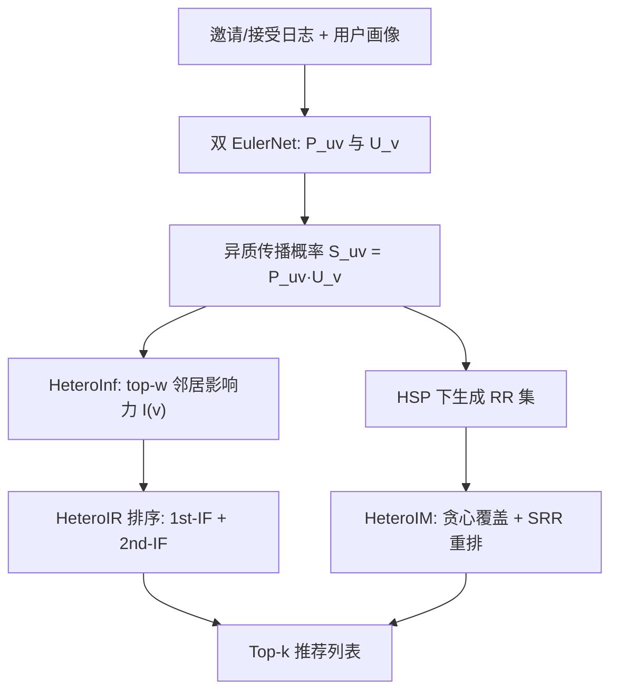

# Heterogeneous Influence Maximization in User Recommendation (用户推荐中的异质影响力最大化)

- **会议/期刊**: CIKM 2025
- **作者与机构**: Hongru Hou, Jiachen Sun, Wenqing Lin, Wendong Bi, Xiangrong Wang, Deqing Yang（复旦大学数据科学学院 / 腾讯 / 深圳大学）
- **推荐链路定位**: 重排（候选好友列表的排序与重排）
- **研究方向**: 社交与群组推荐 / 强化学习与动态探索推荐
- **论文原文**: [https://arxiv.org/abs/2508.13517v1](https://arxiv.org/abs/2508.13517v1)
- **开源代码**: [https://github.com/socialalgo/HIM](https://github.com/socialalgo/HIM)

## TL;DR (1分钟核心速览)

游戏社交场景的好友邀请推荐既要"用户愿意点"（交互意愿），又要"被邀请者能继续裂变"（传播能力）。传统 CTR 模型只建模点击意愿、忽略候选人的二次传播潜力；而影响力最大化（IM）方法只挑高传播节点、忽略邀请者是否愿意交互。本文提出 HeteroIR（一阶意愿 + 二阶传播收益的排序函数）与 HeteroIM（基于共享 RR 集的重叠去重 + 意愿重排），在 TXG-B/C 与 Twitter 上以 NSpread@K、Recall@K、NDCG@K 全面超越 7 个基线（$p<0.05$），线上腾讯 FPS 活动 A/B 分别提升 8.5% 与 10%。

## Background & Motivation (背景与核心矛盾)

- **主流范式**: 好友/用户推荐主流是 CTR 预估（AutoInt、FinalNet、EulerNet），只建模邀请者 $u$对候选$v$的交互概率$P_{u,v}$；IM 侧则以 RR 集贪心选种子（IMM、OPIM-C、RR-OPIM+）最大化传播覆盖。
- **前人局限**: ① CTR 类方法把候选视为"终点"，未释放被邀请者自身再邀请的裂变能力；② IM 类方法只按传播覆盖选人，完全不考虑邀请者是否愿意点，导致推荐列表"高传播但低点击"。
- **核心洞察 (Key Insight)**: 作者在腾讯 FPS 日志中发现，用户平均有 50 个好友，但平均传播影响力小 16 倍，且好友数与影响力 Pearson 相关仅 0.06——**局部结构类指标（Degree/Coreness）严重高估真实传播力**，必须用"邀请概率 × 接受概率"的异质传播概率来度量。
- **本文切入点**: 把传播过程拆成"邀请—接受"两阶段异质扩散，将传播收益直接写进推荐排序打分，并用 RR 集解决多候选间的传播重叠。

## Method (核心方法设计)

### 1. 整体框架 (Overall Architecture)

模型先用两个 EulerNet 分别学习邀请概率 $P_{u,v}$与接受概率$U_v$，得到异质传播概率$S_{u,v}=P_{u,v}U_v$；HeteroIR 用 HeteroInf 估计每个候选的二阶影响力并构造排序函数；HeteroIM 进一步在异质传播概率下生成 RR 集，贪心选覆盖最多 RR 集的候选、删除其覆盖集以去重叠，最后按共享 RR 集数量重排。两模型均为 model-agnostic 插件，可套在任意 CTR 打分之上。

### 2. 关键设计拆解 (Key Designs)

1. **HeteroInf 异质影响力估计（截断 top-$w$聚合）**：痛点是用全部邻居求和会被大量"僵尸好友"稀释、且与真实传播力低相关。做法是只保留传播概率排名前$w$的出邻居集合$N_u^{w}$求和：$I_w(u)=\sum_{v\in N_u^{w}}P_{u,v}U_v$，其中$w$ 为交互能力上限。直觉上它模拟了"用户只会向最亲密的少数好友发起邀请"的真实行为，抑制长尾噪声邻居的虚高贡献。

2. **HeteroIR 一阶+二阶收益排序**：把推荐收益拆成两段，$R_{u,v}=\underbrace{P_{u,v}U_v}_{\text{1st-IF}}+\underbrace{P_{u,v}U_v I_w(v)}_{\text{2nd-IF}}$。第一项保证"点得动"，第二项用候选自身影响力$I_w(v)$ 奖励"能继续裂变"的人，从而在不牺牲点击的前提下把传播潜力注入排序打分。

3. **HeteroIM 共享 RR 集去重叠与重排**：HeteroIR 忽略多候选传播到同一批人的重叠。HeteroIM 在 IC 模型 + 异质传播概率下按 RR-OPIM+ 的 $RN=2i_{max}\epsilon^{-2}\ln\binom{n}{\delta}$生成 RR 集，贪心选覆盖最多 RR 集的候选后**删除其覆盖的 RR 集**以消除重叠；再用共享 RR 集数量$\rho(i,j)=|\mathcal{R}'\cap\{i,j\}|$ 作为交互意愿代理对列表重排——共享 RR 集越多说明两人越可能互相触达，意愿越高。RR 集生成采用均匀采样（US）让每个节点都当源点，降低源点采样偏差。

4. **训练目标与推理开销**：$P_{u,v}$、$U_v$ 分别用 EulerNet 做二分类（交叉熵），Twitter 上以 DeepWalk 64 维嵌入为输入、正负样本 1:1；HeteroIM 的 RR 集生成是离线一次性开销，在线仅做贪心覆盖计数与排序，复杂度与候选度线性相关，满足工业重排时延。

## Experimental Setup & Evaluation Protocol (实验设置与评估协议)

- **数据集与预处理**:

| 数据集 | #Nodes | #Edges | #Spreads | 说明 |
| :--- | :---: | :---: | :---: | :--- |
| TXG-A | 109.1M | 177.1M | 62.4M | 腾讯 FPS 邀请日志，训练 P/U 模型 |
| TXG-B | 131.6M | 211.4M | 43.2M | 验证集场景 |
| TXG-C | 115.5M | 179.4M | 35.2M | 验证集场景 |
| Twitter | 0.46M | 14.9M | 0.15M | mention 视为传播 |

- **数据划分与防穿越**: TXG-A 按 8:1:1 划分训练/验证/测试；Twitter 按传播者 8:2 划分，正样本为训练集用户的有效传播轨迹、负样本为无传播边，1:1 采样。
- **排名评测协议**: 采用 `Sampled Ranking`（Twitter 1:1 负采样）与全候选排序混合；传播侧提出归一化指标 $\text{NSpread@}K=\text{Spread@}K/\text{ISpread@}K$，其中 ISpread@K 为给定$k$个候选时的理论上界覆盖（去重后），$K\in\{1,2,3\}$（对应游戏平均点击 3 次）；推荐侧用 Recall@N、NDCG@N，TXG 上以"点击且接受"为 ground truth。
- **对比基线与超参**: IM 基线 IMM、OPIM-C、RR-OPIM+；推荐基线 PPR、AutoInt、FinalNet、EulerNet；影响力基线 Degree、Coreness、Windex、MC、LR、TOPSIS、DeepInf。HeteroIM/OPIM-C/RR-OPIM+ 统一 $\epsilon=0.1,\ \delta=1/n$，$w$网格搜索，显著性$p<0.05$。

## Key Experimental Results (实验关键数据)

### 1. 主实验对比 (Main Results)

TXG-B 与 Twitter 代表性结果（NS@1/NS@3 为 NSpread，R/N 为 Recall/NDCG）：

| Model | TXG-B NS@1 | TXG-B NS@3 | TXG-B R@1 | TXG-B N@3 | Twitter NS@1 | Twitter R@1 | Twitter N@1 |
| :--- | :---: | :---: | :---: | :---: | :---: | :---: | :---: |
| IMM | 0.3457 | 0.5254 | 0.1654 | 0.3008 | 0.1846 | 0.0938 | 0.1173 |
| OPIM-C | 0.3480 | 0.5269 | 0.1724 | 0.3087 | 0.1818 | 0.0972 | 0.1212 |
| RR-OPIM+ | 0.3520 | 0.5310 | 0.1798 | 0.3154 | 0.1792 | 0.0946 | 0.1188 |
| PPR | 0.3255 | 0.4688 | 0.1453 | 0.2798 | 0.1640 | 0.1121 | 0.1359 |
| AutoInt | 0.3879 | 0.5548 | 0.1922 | 0.3375 | 0.2234 | 0.2721 | 0.3140 |
| FinalNet | 0.3925 | 0.5579 | 0.1986 | 0.3487 | 0.2249 | 0.2817 | 0.3261 |
| EulerNet | 0.3949 | 0.5598 | 0.2021 | 0.3532 | 0.2258 | 0.2849 | 0.3302 |
| **HeteroIR** | **0.4253** | **0.5813** | **0.2278** | **0.3822** | **0.2432** | 0.2933 | 0.3402 |
| **HeteroIM** | **0.4398** | **0.5979** | **0.2303** | **0.3878** | **0.2445** | **0.3655** | **0.4284** |
| Improv.% | +11.39% | +6.79% | +13.96% | +9.80% | +8.28% | +28.29% | +29.73% |

### 2. 消融实验 (Ablation Study)

Twitter 数据集：

| 变体 | R@1 | R@2 | N@1 | N@2 | NS@1 | NS@2 |
| :--- | :---: | :---: | :---: | :---: | :---: | :---: |
| HeteroIR w/o 1st-IF | 0.2503 | 0.3837 | 0.2933 | 0.3540 | 0.2342 | 0.3298 |
| HeteroIR w/o 2nd-IF | 0.2849 | 0.4070 | 0.3302 | 0.3816 | 0.2258 | 0.3166 |
| **HeteroIR** | **0.2933** | **0.4244** | **0.3402** | **0.3969** | **0.2432** | **0.3425** |
| HeteroIM w/o Rerank | 0.1176 | 0.2342 | 0.1416 | 0.2030 | 0.1845 | 0.2843 |
| HeteroIM w/o HSP | 0.3487 | 0.4643 | 0.4082 | 0.4475 | 0.2247 | 0.3199 |
| HeteroIM w/o US | 0.3598 | 0.4731 | 0.4221 | 0.4581 | 0.2439 | 0.3297 |
| **HeteroIM** | **0.3655** | **0.4997** | **0.4284** | **0.4780** | **0.2445** | **0.3543** |

### 3. 关键实验发现 (Key Findings)

1. **二阶传播项是传播指标的命门**：去掉 2nd-IF 后 NS@1 从 0.2432 跌至 0.2258（降 7.2%），而 Recall 几乎不降，说明传播收益与点击意愿确实是两个可解耦、需分别建模的目标。
2. **去重叠重排贡献最大**：HeteroIM 去掉 Rerank 后 R@1 从 0.3655 崩到 0.1176（降约 68%），NS@1 也从 0.2445 掉到 0.1845，证明"共享 RR 集 = 交互意愿代理"这一重排信号是 IM 与推荐任务真正打通的关键。
3. **异质传播概率优于同质假设**：去掉 HSP 后 NS@1 从 0.2445 降至 0.2247（降 8.1%），说明把 $P_{u,v}U_v$ 的个性化概率注入 RR 集生成，比传统 IM 的均匀传播假设更贴合真实裂变；线上 X2 事件中 HeteroIM 相对 Intimacy 基线在 Sec-IR/Sec-IT/RRR 上分别提升 10%、9.64%、14.83%。

## Highlights & Limitations (亮点、对比与审稿批判)

- **与代表作对比 (vs. Prior Work)**: 相比 RR-OPIM+（只按传播覆盖选人、无意愿建模），HeteroIM 在 RR 集生成阶段就注入异质传播概率并用 SRR 重排补上意愿；相比 EulerNet 等 CTR 模型（只建模一阶点击），HeteroIR 仅加一个二阶影响力项即把 NS@1 从 0.3949 提到 0.4253，且不改动原打分主干，属低成本即插即用增强。
- **可迁移亮点**: ① "共享 RR 集数量"可作为任意社交推荐中用户对亲密度的无监督代理特征；② top-$w$ 截断聚合可迁移到社交信任去噪、群组影响力聚合等场景，抑制长尾噪声邻居。
- **审稿级局限批判**: ① HeteroIM 的 RR 集生成在亿级图上仍是离线重开销，论文未给出 RR 集数量 $RN$与重排时延的定量权衡；② 线上 A/B 仅报告相对 Intimacy 基线的提升，未与 CTR 类强基线做线上对比，且$w$ 依赖网格搜索、跨场景（Twitter 与游戏）泛化性证据偏弱。

## Rating (四维评分)

- **方法创新性 (Novelty)**: ⭐⭐⭐⭐ （把异质传播概率注入 RR 集并用 SRR 代理交互意愿，是 IM 与推荐任务间少见的务实桥接，但单点算子本身较直接）
- **评估协议与实验扎实度 (Protocol & Experiments)**: ⭐⭐⭐⭐ （三数据集 + 7 基线 + 消融 + 显著性检验 + 两场线上 A/B，传播指标 NSpread 的归一化设计合理，唯 Twitter 采用采样排序略欠无偏性）
- **写作与数学规范度 (Clarity & Rigor)**: ⭐⭐⭐⭐ （扩散模型与排序函数公式简洁清晰，RR 集数量推导引用规范，但部分符号（如 $\rho$ 与 SRR 计数）在正文与算法伪码间表述略有不一致）
- **工业落地与复现价值 (Industrial & Practical Value)**: ⭐⭐⭐⭐⭐ （已在腾讯 FPS 亿级用户上线并开源代码，model-agnostic 设计可直接套在现有 CTR 重排链路上，落地价值突出）

