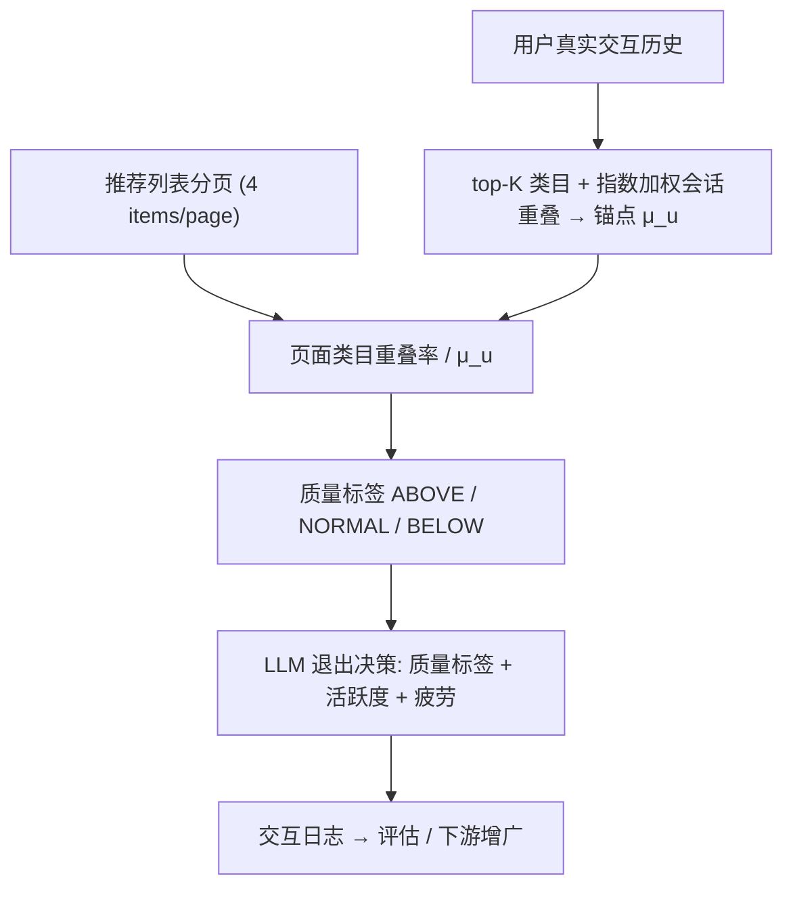

# A Behavioral Trait Leaks into Preferences: Diagnosing Trait Interference in LLM User Simulators (行为特质泄漏进偏好：诊断 LLM 用户模拟器中的特质干扰)

- **会议/期刊**: CIKM 2026 (Short Paper)
- **作者与机构**: Chaehyun Kim, Sein Kim, Hongseok Kang, Chanyoung Park (KAIST)
- **推荐链路定位**: 端到端生成式（离线评估与模拟交互数据增广）
- **研究方向**: 对话推荐与智能体仿真 / 大语言模型推荐
- **论文原文**: [https://arxiv.org/abs/2609.25572v1](https://arxiv.org/abs/2609.25572v1)
- **开源代码**: [https://github.com/chaehyun1/PQA](https://github.com/chaehyun1/PQA)

## TL;DR (1分钟核心速览)

LLM 用户模拟器通常注入两类特质：偏好属性（决定"看什么"）与行为活跃度（决定"看多久"），并默认二者独立。本文定量证明该假设在模拟中崩塌——活跃度放大会迫使模拟器与偏好不匹配的物品交互以"凑够"浏览深度（Trait Interference），并使满意度分数随页数虚高、与推荐质量脱钩（Evaluation Invalidity）。作者提出 PQA，用用户历史类目重叠率构造个性化页面质量锚点 $\mu_u$，在退出决策前先判定页面 ABOVE/NORMAL/BELOW，使活跃度仅在偏好合规页面内调节深度。在 MovieLens/Amazon CDs 上，PQA 使 Agent4Rec 的 NDCG@5 从 0.2819 提升至 0.3046（+8.1%），并显著抑制高活跃度下的满意度膨胀。

## Background & Motivation (背景与核心矛盾)

- **主流范式**: Agent4Rec、SimUSER 等模拟器将用户画像与特质写入 prompt，模拟器逐页浏览推荐列表并自主决定何时退出，以替代昂贵的在线 A/B 测试。
- **前人局限**: ① 活跃度特质被放大时，模拟器为满足"多浏览"约束而放松偏好边界，与语义不匹配物品交互；② 满意度指标随浏览页数单调膨胀，即使推荐质量被人为劣化（1:9 正负比）仍居高不下，评估结果被特质分布而非推荐器性能主导。
- **核心洞察 (Key Insight)**: 真实数据中用户活跃度与平均评分呈**显著负相关**（MovieLens Kendall $\tau=-0.366$，$p=2.9\times10^{-25}$），即高活跃用户反而更挑剔；而模拟器表现出相反的通融行为，说明这是特质干扰而非自然行为。根因是模拟器缺少一个显式的"页面质量锚点"，导致行为约束可以覆盖偏好对齐。
- **本文切入点**: 把用户历史类目重叠率固化为个性化阈值 $\mu_u$，在退出决策前先做页面质量门控，将活跃度的作用域限制在"偏好合规页面内"。

## Method (核心方法设计)

### 1. 整体框架 (Overall Architecture)

PQA 是一个**提示层（prompt-level）插件**，不修改 LLM 权重。离线阶段，从用户真实交互历史中提取 top-$K$（$K=5$）类目，按会话切分并计算加权类目重叠基线 $\mu_u$；在线模拟阶段，对当前推荐页计算页面级类目重叠率并与 $\mu_u$ 比较得到相对质量比，映射为 ABOVE/NORMAL/BELOW 三档标签注入系统提示；模拟器先基于页面质量形成"整体感受"（活跃度被显式禁止改写该判断），再联合质量标签、活跃度与累积会话疲劳做出继续/退出决策。

### 2. 关键设计拆解 (Key Designs)

1. **个性化页面质量锚点 $\mu_u$（把"偏好标准"变成可比较的数值）**：痛点在于模拟器没有量化标准，只能让活跃度自由裁量。作者直接复用诊断指标作为锚点：对会话 $i$ 计算 $\text{overlap}_i=\frac{1}{|\text{session}_i|}\sum_{v}|\text{categories}(v)\cap \text{top-}K|$，再以 $\gamma=0.9$ 的指数权重聚合 $\mu_u=\sum_i w_i\cdot\text{overlap}_i$（$i=0$ 为最近会话）。由于锚点完全来自真实历史，它天然刻画了该用户"可接受页面"的密度下界，无需人工调阈值。

2. **三档质量门控与退出规则（把活跃度关进"合规页面"的笼子）**：将页面重叠率与 $\mu_u$ 的比值离散化为 ABOVE/NORMAL/BELOW（MovieLens 阈值 $(1.0,0.7)$，CDs 为 $(0.5,0.3)$）。ABOVE 页强制"再翻一页"，防止低活跃用户机械早退；NORMAL 页首次遇到给一页粘性探索；BELOW 页仅在首页给一次"好奇宽限"，**连续两页 BELOW 则无视活跃度强制退出**。直觉是：质量判断先于行为调节，活跃度只决定"在好页面里看多深"，而非"在坏页面里忍多久"。

3. **训练目标、负采样与推理效率**：本文无参数训练，PQA 是零样本提示工程，无损失函数与负采样设计。额外开销仅为每页一次类目集合交集运算与一次 prompt token 注入；主要成本仍是 LLM 调用（GPT-4o-mini），但由于 BELOW 页被提前截断，**平均总页数反而下降**，端到端模拟成本降低。

## Experimental Setup & Evaluation Protocol (实验设置与评估协议)

- **数据集与预处理**: MovieLens 与 Amazon CDs，均含物品类目元数据；用户画像与特质由与 SASRec 相同的训练数据构造。

| 数据集 | #Users | #Items | #Interactions | 稀疏度/密度 | 特征/场景说明 |
| :--- | :---: | :---: | :---: | :---: | :--- |
| MovieLens | 未报告 | 未报告 | 未报告 | 未报告 | 电影，类目体系清晰，含评分 |
| Amazon CDs | 未报告 | 未报告 | 未报告 | 未报告 | CD 音乐，类目较粗，长尾明显 |

- **数据划分与防穿越 (Splitting Strategy)**: 骨干 SASRec 采用 `Leave-Last-Out` 训练；模拟所用画像/特质仅取自训练数据，测试集不参与模拟构造。
- **排名评测协议 (Ranking Protocol)**: 每个用户构造 20 项推荐列表，按预测 logit 降序排列，正负比 $1{:}k$（$k\in\{1,3,9\}$），每页 4 项共 5 页，**相关性随页深严格递减**——这是刻意设计的受控劣化，用于检验高活跃度是否驱使用户越界浏览。下游增广后在全库离线测试集上报告 NDCG@5 / HR@5。
- **对比基线与超参设置**: 模拟器基线为 Agent4Rec 与 SimUSER，骨干推荐器 SASRec（另提及 LightGCN、MultVAE 作为可选骨干）；LLM 统一为 GPT-4o-mini；人似度由 GPT-4o 以 5 点 Likert 量表打分；文本嵌入用 all-MiniLM-L6-v2。

## Key Experimental Results (实验关键数据)

### 1. 主实验对比 (Main Results)

模拟交互用于增广并微调 SASRec 后的下游推荐性能（Table 3）：

| Variant | Trait | Simulator | ML NDCG@5 | ML HR@5 | CDs NDCG@5 | CDs HR@5 |
| :--- | :--- | :--- | :---: | :---: | :---: | :---: |
| Base | Low | Agent4Rec | 0.2819 | 0.3915 | 0.3322 | 0.4623 |
| Base | Low→High | Agent4Rec | 0.2945 | 0.4007 | 0.3273 | 0.4519 |
| Base | Low | SimUSER | 0.2945 | 0.4026 | 0.3187 | 0.4390 |
| Base | Low→High | SimUSER | 0.2842 | 0.3952 | 0.3200 | 0.4390 |
| **PQA** | Low | **Agent4Rec** | **0.3046** | **0.4082** | **0.3479** | **0.4805** |
| PQA | Low→High | Agent4Rec | 0.2950 | 0.4063 | 0.3341 | 0.4623 |
| PQA | Low | SimUSER | 0.3004 | 0.3933 | 0.3437 | 0.4675 |
| **PQA** | Low→High | **SimUSER** | **0.3024** | **0.4156** | 0.3264 | 0.4519 |

人似度评分（GPT-4o，5 分制，Table 4）：

| Simulator | MovieLens | CDs |
| :--- | :---: | :---: |
| Agent4Rec | 3.57 ± 0.03 | 3.64 ± 0.02 |
| SimUSER | 4.26 ± 0.04 | 4.05 ± 0.11 |
| **PQA-Agent4Rec** | **4.15 ± 0.04** | **4.22 ± 0.04** |
| **PQA-SimUSER** | **4.35 ± 0.08** | 4.06 ± 0.07 |

### 2. 消融实验 (Ablation Study)

本文为 short paper，未设传统模块消融，其"消融"体现为**特质维度与质量档位的受控对照**（Table 1 / Table 2）：

| 受控变量 | 设置 | Agent4Rec $N_{exit}$ (ML) | Agent4Rec $S_{sat}$ (ML) | 结论 |
| :--- | :--- | :---: | :---: | :--- |
| 活跃度 | Low → High | 1.00 → 3.10 | 3.18 → 7.44 | 页数与满意度双膨胀 |
| 从众性 | Low → High | 1.36 → 1.32 | 3.74 → 3.86 | 几乎无变化 |
| 多样性 | Low → High | 1.10 → 1.08 | 3.34 → 3.50 | 几乎无变化 |
| 质量 1:9 + 高活跃 | Low → High | 1.00 → 3.89 | 3.06 → 6.51 | 劣化页面下仍膨胀 |
| PQA 介入 | Low→High | 页数回落、满意度去膨胀 | — | 干扰被抑制（Fig. 3） |

### 3. 关键实验发现 (Key Findings)

1. **膨胀是活跃度特异的，不是所有特质的通病**：从众性与多样性放大后 $N_{exit}$ 与 $S_{sat}$ 波动均在 0.2 以内，而活跃度放大使 $S_{sat}$ 从 3.18 飙至 7.44（+134%），直接锁定行为特质为评估失效的唯一污染源。
2. **膨胀与推荐质量解耦**：在 1:9 极端劣化下，高活跃 Agent4Rec 仍探索 3.89 页、满意度 6.51，说明满意度度量的是"注入了多少活跃度"而非"推荐器多好"，这是对现有模拟器评估范式的根本性质疑。
3. **PQA 的收益来自"过滤脏交互"而非"多造交互"**：PQA-Agent4Rec 在 MovieLens 上 NDCG@5 相对 Base-Low 提升 8.1%、相对 Base-Low→High 提升 3.4%，且高活跃设定下不再出现性能倒退（Base 从 0.2945 跌至 0.2842，PQA 稳定在 0.2950），证明截断 BELOW 页确实阻止了偏好错配样本污染增广数据。

## Highlights, Limitations & Rating (亮点、对比与审稿评价)

- **与代表作对比 (vs. Prior Work)**: Agent4Rec 与 SimUSER 专注于"把画像造得更真"（社会特质、感知/记忆模块），但默认特质独立且只报告聚合满意度；本文首次把矛头指向**模拟器行为合规性**本身，属于对评估工具的反身性审视。相较 RecoWorld 用模拟器主动反馈驱动推荐器适配，PQA 关注的是反馈信号本身是否可信，二者互补。
- **可迁移亮点**: ① "用诊断指标反哺方法设计"——把度量基线直接复用为干预阈值，省去超参搜索；② 质量门控 + 连续低质强制退出的规则化 prompt 设计，可迁移到任何 LLM Agent 的多步决策早停场景（如工具调用、检索式问答）。
- **审稿级局限批判**: ① 锚点仅基于**类目级粗粒度重叠**，对类目体系扁平或跨类目兴趣的用户（如 CDs）区分力弱，作者亦在结论中承认需引入 item-item 关系或协同信号；② 三档阈值 $(1.0,0.7)$ / $(0.5,0.3)$ 为数据集特定手工设定，跨域迁移需重新校准，且全文仅两个数据集、单一 LLM 后端（GPT-4o-mini），对模型规模与提示敏感性的鲁棒性证据不足；③ 人似度由 GPT-4o 自评，存在 LLM-as-judge 的自我偏好风险。
- **四维评分**: 创新性 ⭐⭐⭐⭐ | 实验扎实度 ⭐⭐⭐ | 方法清晰度 ⭐⭐⭐⭐⭐ | 落地价值 ⭐⭐⭐⭐

