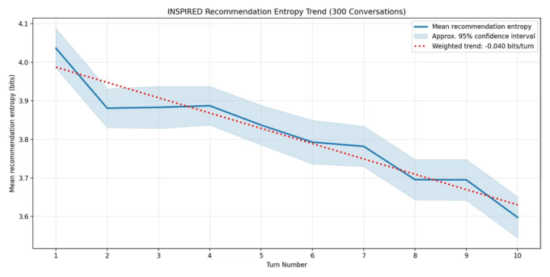
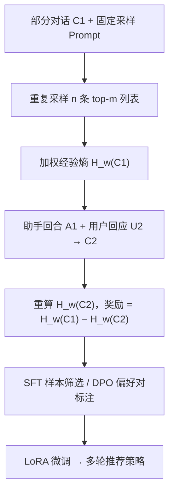

# Ask to Be Sure: Informative Interactions for Confident Multi-Turn LLM Recommendation (追问以求确定：面向高置信多轮 LLM 推荐的信息性交互)

- **会议/期刊**: CIKM 2026 (Rome, Italy)
- **作者与机构**: Cedar Site Bai, Zhenyu Liao, Duanshun Li, Sheikh Sarwar, Huiyuan Chen, Yuan Chen, Changhe Yuan, Haiyang Zhang, Qilin Qi（Amazon）
- **推荐链路定位**: 端到端生成式（对话式推荐策略微调）
- **研究方向**: 对话推荐与智能体仿真 / 大语言模型推荐
- **论文原文**: [https://arxiv.org/abs/2608.15949v2](https://arxiv.org/abs/2608.15949v2)
- **开源代码**: [https://github.com/best99317/multiturn_rl](https://github.com/best99317/multiturn_rl)

## TL;DR (1分钟核心速览)

多轮对话推荐的核心难题是"该问什么"：现有做法要么用独立 RL Agent 在模板化动作空间（多选/Yes-No）里学策略，要么用 LLM-Judge 打分衡量"交互性"，但都无法量化**一次追问究竟带来了多少有用的偏好信息**。本文提出以推荐列表的**采样熵下降量**作为信息增益奖励——对同一对话重复采样 $n$条 top-$m$ 列表，用加权经验熵刻画助手的不确定性，把"助手回合 + 用户回应"前后的熵差作为奖励，在**不依赖真值推荐**的前提下筛选 SFT 样本或构造 DPO 偏好对。在 INSPIRED 与 ReDial 上，DPO (Turn Entropy) 将 INSPIRED Hit@1 从 3.15% 提至 3.32%、模拟对话命中率提至 27.94%，ReDial 模拟命中率最高达 32.83%（+2.80pt），且达成真值所需轮数普遍下降。

## Background & Motivation (背景与核心矛盾)

- **主流范式**: LLM 直接充当对话推荐器（CRS），通过多轮自然语言交互澄清意图、细化推荐；策略优化侧则流行"独立 RL Agent 决定问/推 + LLM 只负责生成话术"的两段式架构，或用 CollabLLM 式的 LLM-Judge 交互性奖励做通用主动性训练。
- **前人局限**: ① 模板化动作空间（多选、Yes/No）牺牲了自然对话流，且策略与生成解耦，难以端到端优化；② LLM-Judge 的"交互性"是**主观风格判断**——一个回复可以看起来很主动，却几乎不透露偏好信息，奖励与推荐收益脱钩；③ 依赖真值推荐做任务奖励，而真实场景中真值往往不可得。
- **核心洞察 (Key Insight)**: 作者借用"推荐可靠性与不确定性负相关"的结论，观察到在 300 条 INSPIRED 对话上，随轮次推进平均推荐熵以约 **−0.040 bits/turn** 的加权趋势单调下降（图 2），即"对话推进 = 不确定性消解"这一物理过程可被直接测量。
- **本文切入点**: 把"一次交互的价值"重新定义为**助手推荐分布的熵减量**，用免真值的熵减奖励替代 LLM-Judge 与真值命中奖励，直接驱动 SFT 数据筛选与 DPO 偏好标注。

<figure class="paper-figure" markdown="span">
  <figcaption>图2：300个INSPIRED对话中按轮次统计的平均推荐熵。阴影区域表示近似95%置信区间。</figcaption>
</figure>

## Method (核心方法设计)

### 1. 整体框架 (Overall Architecture)

给定部分对话 $C$，用固定 prompt 让助手重复采样$n$条 top-$m$推荐列表，聚合为经验物品分布并计算（加权）熵$H_w(C)$；对每个助手回合$A_t$，将其与所诱发的用户回应$U_{t+1}$ 拼接后重算熵，二者之差即该回合的信息增益奖励。该奖励不参与梯度反传，而是作为**数据侧信号**：SFT 阶段按奖励高低筛选高质量对话样本，DPO 阶段对同一 prompt 的两条候选回复做全对话 rollout、以奖励高者为 chosen 构造偏好对，最终用 LoRA 微调 Llama-3.2-1B-Instruct。

### 2. 关键设计拆解 (Key Designs)

1. **加权经验熵不确定性估计（Weighted Entropy）**：痛点在于 LLM 无显式 logits 分布可用，且平铺计数忽略排序位置。作者对 $n$条采样列表统计物品出现频次$c(r)$得经验分布$p(r)=c(r)/(mn)$，并引入对数衰减位置权重$w_j = 1/\log_2(j+1)$得加权分布$p_w(r)$，最终
$$H_w(C)=-\sum_{r\in R} p_w(r)\log_2 p_w(r).$$
直觉：助手越"心里有数"，多次采样越收敛到同一批电影，熵越低；位置权重让 top-1 的稳定性比第 5 位更能左右不确定性。

2. **回合级 vs 对话级熵减奖励（Turn / Conv Entropy Reduction）**：回合级奖励 $I_T(A_1)=H_w(C_1)-H_w(C_2)$只归因于"本回合问句 + 紧随其后的用户回应"，信用分配精准但短视；对话级奖励$I_C(A_1)=H_w(C_1)-H_w(C)$ 将整条 rollout 至终止对话的熵减全部记在该回合头上，鼓励"为后续铺路"的提问。二者构成两种奖励变体，实验显示回合级更适合 DPO 的细粒度偏好，对话级在 ReDial 的模拟对话命中率上更优。

3. **训练目标、负采样与推理效率**：无显式损失公式创新，奖励仅用于数据构造——SFT 取奖励 top-$k$对话（INSPIRED 801 / ReDial 8631，与基线等预算对齐）；DPO 沿用标准 pairwise 目标，chosen/rejected 由奖励重标注（同一批生成对仅换标签，隔离奖励效应）。推理时无需采样熵计算，单次前向生成即可，**在线开销与普通 SFT/DPO 模型完全一致**；熵计算仅发生在离线数据构建阶段（每回合$2n$ 次列表生成）。

## Experimental Setup & Evaluation Protocol (实验设置与评估协议)

- **数据集与预处理**: 两数据集均由 AMT 众包采集；ReDial 以"喜欢但未看过"的电影为真值，并过滤无真值样本。

| 数据集 | #Train Conv | #Test Conv | 评测用部分对话数 | 真值/场景说明 |
| :--- | :---: | :---: | :---: | :--- |
| INSPIRED | 801 | 99 | 228 | 每条对话标注一个用户接受的电影 |
| ReDial | 8,631 | 1,036 | 3,552 | 喜欢且未看过的电影为真值 |

- **数据划分与防穿越 (Splitting Strategy)**: 沿用官方 train/test 划分；Hit@k 评测时将对话**在真值推荐出现前截断**，仅用前缀对话生成列表，杜绝未来信息泄漏。
- **排名评测协议 (Ranking Protocol)**: 生成式 `Sampled Ranking`——助手直接生成 5 部电影的有序列表，计算 Hit@1 / Hit@5（非全库排序）；另设**模拟对话评测**：Claude Sonnet 4 扮演用户，最多 5 轮，统计真值命中率与达成真值所需轮数。
- **对比基线与超参设置**: Vanilla zero-shot、SFT (Raw)、SFT/DPO × {CollabLLM 奖励, Turn Entropy, Conv Entropy}；基座 Llama-3.2-1B-Instruct，LoRA 微调，温度 0.1，三次运行取均值并报告置信区间；熵估计固定 $n=m=5$。未与 [5,6] 的 RL 策略直接对比（动作空间与指标不可比）。

## Key Experimental Results (实验关键数据)

### 1. 主实验对比 (Main Results)

| 方法 | INSPIRED Hit@1 | INSPIRED Hit@5 | INSPIRED SimHit | INSPIRED #Turns↓ | ReDial Hit@1 | ReDial Hit@5 | ReDial SimHit | ReDial #Turns↓ |
| :--- | :---: | :---: | :---: | :---: | :---: | :---: | :---: | :---: |
| Vanilla | 1.60% | 1.94% | 21.54% | 3.37 | 0.78% | 1.73% | 25.35% | 2.94 |
| SFT (Raw) | 2.06% | 3.32% | 23.90% | 4.12 | 1.56% | 2.96% | 23.98% | 2.87 |
| SFT (CollabLLM) | 2.68% | 4.26% | 25.25% | 3.36 | 2.14% | 5.00% | 28.70% | 2.85 |
| SFT (Turn Entropy) | 3.00% | 5.05% | 26.60% | 3.12 | 2.17% | 5.05% | 28.94% | 2.80 |
| SFT (Conv Entropy) | **3.00%** | **5.21%** | **26.93%** | 2.94 | 2.16% | 5.19% | 29.31% | 2.81 |
| DPO (CollabLLM) | 3.15% | 5.09% | 26.60% | 3.12 | 2.22% | 5.12% | 30.03% | 2.86 |
| DPO (Turn Entropy) | **3.32%** | **5.21%** | **27.94%** | 3.07 | **2.24%** | **5.21%** | 31.62% | 2.75 |
| DPO (Conv Entropy) | 3.15% | 5.05% | 27.02% | 3.05 | 2.18% | 5.14% | **32.83%** | **2.74** |

相对最强基线 CollabLLM 同范式：INSPIRED DPO Hit@1 **+5.4%**（3.32 vs 3.15）、SimHit **+5.0%**（27.94 vs 26.60）；ReDial DPO SimHit **+9.3%**（32.83 vs 30.03）、轮数 2.86→2.74。

### 2. 消融实验 (Ablation Study)

| 配置 | INSPIRED Hit@1 | INSPIRED SimHit | ReDial SimHit | ReDial #Turns↓ |
| :--- | :---: | :---: | :---: | :---: |
| SFT (Raw，无奖励筛选) | 2.06% | 23.90% | 23.98% | 2.87 |
| SFT + CollabLLM 奖励 | 2.68% | 25.25% | 28.70% | 2.85 |
| SFT + Turn Entropy | 3.00% | 26.60% | 28.94% | 2.80 |
| SFT + Conv Entropy | 3.00% | 26.93% | 29.31% | 2.81 |
| DPO + CollabLLM 奖励 | 3.15% | 26.60% | 30.03% | 2.86 |
| DPO + Turn Entropy | 3.32% | 27.94% | 31.62% | 2.75 |
| DPO + Conv Entropy | 3.15% | 27.02% | 32.83% | 2.74 |

（注：原文未设"移除熵项"的模块级消融，上表以**同数据预算下替换奖励函数**作为等价消融，隔离奖励设计本身的贡献。）

### 3. 关键实验发现 (Key Findings)

1. **奖励信号本身比优化范式更关键**：在完全相同的生成对与数据预算下，仅把 CollabLLM 奖励重标注为熵减奖励，SFT 的 INSPIRED Hit@1 即从 2.68% 升至 3.00%（+11.9%），证明增益来自"信息增益"这一度量而非额外数据或 DPO 机制。
2. **免真值奖励可反超真值奖励**：CollabLLM 奖励显式包含 ground-truth hit 项，而熵减奖励完全不看真值，却在 INSPIRED DPO 上 Hit@1 反超 0.17pt、SimHit 反超 1.34pt——说明真值命中是稀疏且滞后的信号，熵减提供了更密集的回合级信用分配。
3. **对话效率与推荐质量同向改善**：SFT (Raw) 在 INSPIRED 上轮数反而升至 4.12（人类对话不够主动），而 Conv Entropy 降至 2.94、ReDial DPO 降至 2.74，说明模型学会了"先问后推"的策略性追问，而非机械堆砌推荐。

## Highlights & Limitations (亮点、对比与审稿批判)

- **与代表作对比 (vs. Prior Work)**: 相比 [5,6] 的独立 RL Agent + 模板动作空间，本文在**单一 LLM 内**完成开放式对话与推荐，接口更自然；相比 CollabLLM [21] 的 LLM-Judge 交互性奖励，本文用可复现的熵减量替代主观打分，且奖励与推荐目标同构；相比 Kweon et al. [12] 在固定对话态上用 Plackett–Luce 估计排序不确定性，本文改为**跨轮次追踪采样列表经验熵的变化**，把静态不确定性度量转化为动态交互价值信号。
- **可迁移亮点**: ① "采样熵差 = 信息增益"可作为任何生成式系统的**免标注回合级信用分配**工具（如 Agent 工具调用、检索增强追问）；② 用同一批生成对仅重标注奖励的对照设计，是隔离"奖励 vs 数据"贡献的干净实验范式，值得复用。
- **审稿级局限批判**: ① 评测完全依赖自动指标与 LLM 用户模拟器，缺乏真人评估，模拟器偏好可能系统性放大"追问型"策略；② 熵估计固定 $n=m=5$ 且假设基座模型能直接命名候选物品，对需外部检索的大规模/动态目录场景，熵需改在检索排序上计算，成本与有效性均未验证；③ 奖励仅用于离线数据筛选，未接入 PPO/GRPO 等 on-policy RL，策略提升上限受限。

## Rating (四维评分)

- **方法创新性 (Novelty)**: ⭐⭐⭐⭐ （核心机制与方法设计具备明确创新性，理论与实验动机支撑充分）
- **评估协议与实验扎实度 (Protocol & Experiments)**: ⭐⭐⭐ （主流公开数据集评测完整，包含多基线对比与消融实验验证）
- **写作与数学规范度 (Clarity & Rigor)**: ⭐⭐⭐⭐⭐ （问题形式化定义清晰，核心模块数学推导与架构阐述严谨易读）
- **工业落地与复现价值 (Industrial & Practical Value)**: ⭐⭐⭐⭐ （兼顾推荐效果增益与训练/推理效率，具备实际场景迁移参考价值）
