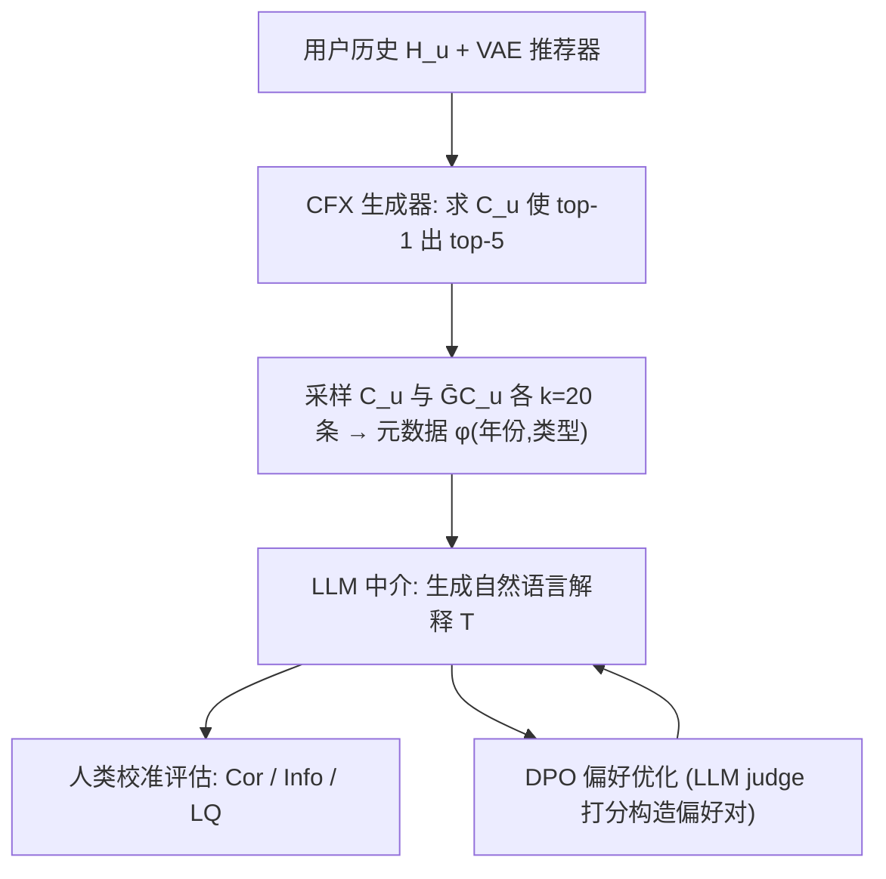
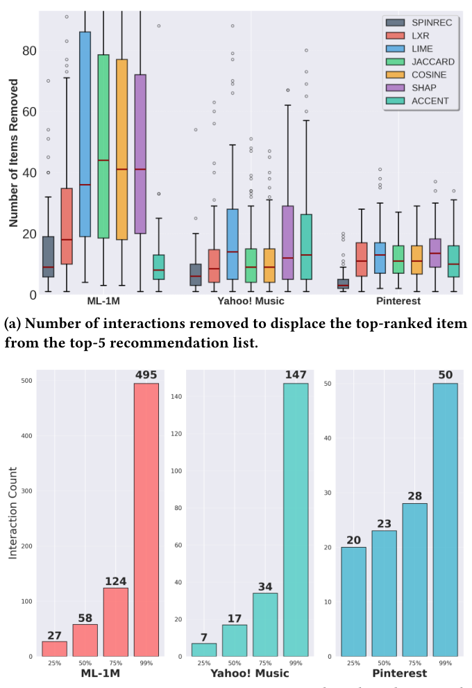

# From Counterfactual Edits to Human Narratives: LLM-Driven Interpretations for Recommender System Explanations (从反事实编辑到人类叙事：LLM 驱动的推荐系统解释)

- **会议/期刊**: CIKM 2026 (Rome, Italy)
- **作者与机构**: Vojtech Cahlik, Amir Reza Mohammadi, Rodrigo Alves, Pavel Kordik, Eva Zangerle (捷克技术大学 FIT / 因斯布鲁克大学)
- **推荐链路定位**: 重排后解释层（Post-hoc Explanation / 用户侧解释生成）
- **研究方向**: 对话推荐与智能体仿真 / 大语言模型推荐
- **论文原文**: [https://arxiv.org/abs/2611.13914v1](https://arxiv.org/abs/2611.13914v1)
- **开源代码**: [https://github.com/vcahlik/from-counterfactual-edits-to-human-narratives](https://github.com/vcahlik/from-counterfactual-edits-to-human-narratives)

## TL;DR (1分钟核心速览)

推荐系统的反事实解释（CFX）虽因果可靠，但在 ML-1M 上常需删除 10–20 条交互才能推翻 top-1 推荐，输出是低层物品列表，用户难以理解。本文提出 **LLM 中介层**：将 CFX 交互子集与用户其余历史（均转为年份+类型元数据）喂给 LLM，生成"因为你看了 90 年代喜剧"式高层偏好叙事，并用 DPO 以正确性/信息量/语言质量三信号优化。评估采用**人类校准的 ModernBERT 二分类器**（语言质量 acc 0.91、匹配 acc 0.92）替代 LLM 自评。在 ML-1M 上，ACCENT/SPINRec 等强 CFX 生成器配合 DPO 后正确性最高达 0.50、信息量 0.22，语言质量普遍 >0.80。

## Background & Motivation (背景与核心矛盾)

- **主流范式**: 可解释推荐分四类——模型内置/事后归因（LIME、SHAP、FIA、ACCENT）、反事实解释（CFX）、侧信息解释、自然语言解释（CAVIAR、FIRE）。CFX 因"最小编辑即翻转结果"被视为最具因果性与可操作性。
- **前人局限**: ① **算法最小性 ≠ 人类可解释性**——CFX 在优化目标下最小，但呈现为几十条"删除某电影"的低层扰动列表，用户被淹没（图 1 显示编辑量常占用户历史相当比例）；② **评估错位**——现有工作只看编辑数与成功率，几乎不检验解释是否连贯、可行动。
- **核心洞察 (Key Insight)**: 缺口不在"生成有效 CFX"，而在"**沟通模型行为**"——缺少以用户为中心的抽象层与定性评估。LLM 恰好擅长把结构化交互数据转写为自由文本，且不替代因果推理，只做"翻译"。
- **本文切入点**: 在 CFX 生成器与用户之间插入 LLM 中介层，把原始编辑列表摘要为保留反事实锚定的自然语言解释（NLE）。

## Method (核心方法设计)

### 1. 整体框架 (Overall Architecture)

四阶段流水线：① 用现有 CFX 方法（Jaccard/Cosine/LIME-RS/SHAP/ACCENT/LXR/SPINRec）在 VAE 推荐器上生成"将原 top-1 物品挤出 top-5"的交互编辑集 $C_u$；② 从 $C_u$ 与其余历史 $\bar{C}_u=H_u\setminus C_u$ 各均匀采样 $k_{gen}=20$ 条，映射为元数据 $\phi(\cdot)$（仅年份+类型，**刻意隐去片名**以防 LLM 依赖内部知识）；③ LLM 条件生成 NLE；④ 人类校准指标评估 + 可选 DPO 偏好优化。

<figure class="paper-figure" markdown="span">
  <figcaption>图1：我们的变分自编码器推荐系统在不同数据集上反事实解释的紧凑性分析。(a) 反事实解释通常由大量交互组成。(b) 这些交互通常占典型用户历史记录的很大一部分。</figcaption>
</figure>

### 2. 关键设计拆解 (Key Designs)

1. **LLM 中介生成算子（Counterfactual-Grounded Summarization）**：痛点是 CFX 输出为长列表、无高层语义。核心式为
   $$T=\text{LLM}_{gen}\big(\phi(C_{u,k_{gen}}),\ \phi(\bar{C}_{u,k_{gen}})\big)$$
   同时喂入"反事实集"与"非反事实集"是关键——只有对比两组，LLM 才能提炼出**区分性**偏好模式（如"90 年代喜剧"而非泛泛的"喜欢电影"），从而保证语义忠实而非泛化套话。

2. **信息量对比式指标（Contrastive Informativeness）**：痛点是"解释与 CFX 匹配度高"可能只是因为它对谁都匹配（过于笼统）。作者定义
   $$\text{Info}(T,C_u,\bar{C}_u)=\text{Cor}(T,C_u)-\frac{1}{|\bar{C}_{u,k_{eval}}|}\sum_{j\in\bar{C}_{u,k_{eval}}}\text{score}_{match}(T,\phi(j))$$
   取值 $[-1,1]$，接近 0 即"通用废话"。该设计把"忠实"与"有区分度"解耦，是本文评估层面最实质的增量。

3. **DPO 优化与人类校准评估分离**：训练期用 prompt 化 LLM judge（六维语言质量 rubric + 匹配打分）在留出用户上构造偏好对，随机搜索学习率与 $\beta$；**最终报告改用独立训练的 ModernBERT-large 二分类器**（各 100 条人工标注测试样本），避免"用优化信号当评测"的循环论证。总目标即标准 DPO 损失，无额外负采样；推理开销为单次 LLM 前向 + 一次分类器打分，离线可批量。

## Experimental Setup & Evaluation Protocol (实验设置与评估协议)

- **数据集与预处理**: 仅 ML-1M（稠密交互场景），物品特征裁剪为**年份 + 类型列表**，隐去片名。

| 数据集 | #Users | #Items | #Interactions | 稀疏度/密度 | 特征/场景说明 |
| :--- | :---: | :---: | :---: | :---: | :--- |
| ML-1M | 6,040 | 3,706 | ~1,000,209 | 密度 ≈4.5% | 电影；仅用年份+类型元数据 |

- **数据划分与防穿越**: 推荐器在**独立用户训练集**上训练，CFX 与解释在其余用户上生成；DPO 偏好对在验证用户上构造，最终 DPO 变体由留出验证用户的人类校准表现选定，测试用户完全隔离。
- **排名评测协议**: 非传统 Top-N 排序评测，而是**解释级评估**——CFX 成功定义为"原 top-1 被挤出 top-5"；$|C_u|>50$ 记为失败（CFX Success Rate），$|C_u|<3$ 记为 Simple CFX Rate（可直接陈述、无需摘要）。
- **对比基线与超参**: 7 个 CFX 生成器 × 3 个 LLM（Ministral 8B / Gemma 3 12B / Qwen 3 8B）× {Vanilla, DPO}；$k_{gen}=k_{eval}=20$；分类器准确率 0.91（语言质量）/0.92（匹配）。

## Key Experimental Results (实验关键数据)

### 1. 主实验对比 (Main Results)

ML-1M 上人类校准评估（节选代表性组合，均值±std）：

| CFX 生成器 | Success↑ | Size↓ | Simple↑ | LLM | Cor (Van/DPO)↑ | Info (Van/DPO)↑ | LQ (Van/DPO)↑ |
| :--- | :---: | :---: | :---: | :--- | :---: | :---: | :---: |
| Jaccard | 0.95 | 16.38 | 0.02 | Gemma 3 12B | 0.39 / **0.51** | 0.13 / 0.17 | 0.72 / **0.84** |
| Cosine | 0.96 | 16.20 | 0.02 | Ministral 8B | 0.34 / 0.40 | 0.16 / 0.17 | **0.91** / 0.78 |
| LIME-RS | 0.84 | 18.52 | 0.01 | Ministral 8B | 0.32 / **0.52** | 0.11 / 0.13 | 0.86 / 0.59 |
| SHAP | 0.76 | 20.83 | 0.01 | Ministral 8B | 0.29 / 0.32 | 0.09 / 0.09 | 0.87 / 0.86 |
| ACCENT | 0.99 | 10.36 | 0.07 | Gemma 3 12B | **0.43** / 0.49 | 0.16 / **0.21** | 0.72 / 0.72 |
| LXR | 0.93 | 15.91 | 0.00 | Gemma 3 12B | 0.40 / 0.48 | 0.12 / 0.13 | 0.66 / **0.84** |
| SPINRec | **1.00** | 12.25 | 0.05 | Qwen3 8B | 0.39 / **0.50** | 0.15 / **0.22** | 0.75 / 0.64 |

### 2. 消融实验 (Ablation Study)

本文无传统模块消融，核心对照为 **Vanilla vs. DPO** 与 **CFX 生成器质量** 两维：

| 对照维度 | Cor 变化 | Info 变化 | LQ 变化 |
| :--- | :---: | :---: | :---: |
| DPO（21 组中） | 20 组提升（+0.02~+0.20） | 多数提升（最高 +0.07，SPINRec+Qwen3） | 分化：Gemma/LXR 升，Ministral 多降 |
| 强 CFX（ACCENT/SPINRec）vs 弱 CFX（SHAP） | 0.43–0.50 vs 0.29–0.34 | 0.16–0.22 vs 0.07–0.10 | 无显著差异 |
| 移除对比集 $\bar{C}_u$（概念性） | — | 退化为 Cor，趋近通用解释 | — |

### 3. 关键实验发现 (Key Findings)

1. **CFX 质量是语义上限的决定因素**：ACCENT（Size 10.36、Success 0.99）与 SPINRec（Size 12.25、Success 1.00）的 DPO 正确性达 0.49–0.50、信息量 0.21–0.22，而 SHAP（Size 20.83、Success 0.76）仅 0.32/0.09——编辑集越紧凑、成功率越高，LLM 越容易提炼出区分性模式。
2. **DPO 几乎全面改善语义但会牺牲语言质量**：21 组中 20 组正确性提升，但 Ministral 8B 的语言质量从 0.91 掉到 0.78、LIME-RS 组合从 0.86 掉到 0.59，说明三目标存在张力，需在优化指标设计上做权衡。
3. **LLM judge 与人类校准存在系统性偏差**：表 2 中"drama films from 1960s to 1990s"LLM judge 给 LQ 0.89，人类校准却判 0.00；而"comedy and drama from 1990s"人类校准 LQ=1.00——证明用 LLM 自评作最终指标不可靠，人类校准层是必要设计。

## Highlights, Limitations & Rating (亮点、对比与审稿评价)

- **与代表作对比 (vs. Prior Work)**: 相比 CAVIAR（描述推荐物品图像扰动）与 FIRE（基于归因信号引导 LLM），本文起点是**因果反事实编辑**而非相关性归因，语义忠实性更强；相比 ACCENT/SPINRec 原论文只报编辑数与成功率，本文补上了"人能否读懂"这一环。
- **可迁移亮点**: ① "对比集 + 目标集"双路提示是让 LLM 输出**区分性**而非泛化解释的通用技巧，可迁移到任何特征归因摘要；② 训练用 LLM judge、评测用人类校准分类器的两段式协议，可直接复用到所有 LLM 生成式评估场景。
- **审稿级局限批判**: ① **单数据集单推荐器**（仅 ML-1M + VAE），且元数据被裁剪到年份+类型，结论对新闻/短视频等富文本场景的外推性未知；② 解释质量高度依赖 CFX 生成器，而 CFX 本身计算昂贵（需反复扰动重排），端到端延迟与在线可行性未讨论；③ 语言质量在 DPO 后普遍下滑，缺少多目标 Pareto 权衡分析。
- **四维评分**: 创新性 ⭐⭐⭐⭐ | 实验扎实度 ⭐⭐⭐ | 方法清晰度 ⭐⭐⭐⭐⭐ | 落地价值 ⭐⭐⭐⭐

