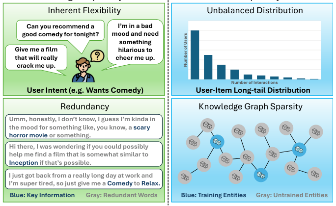
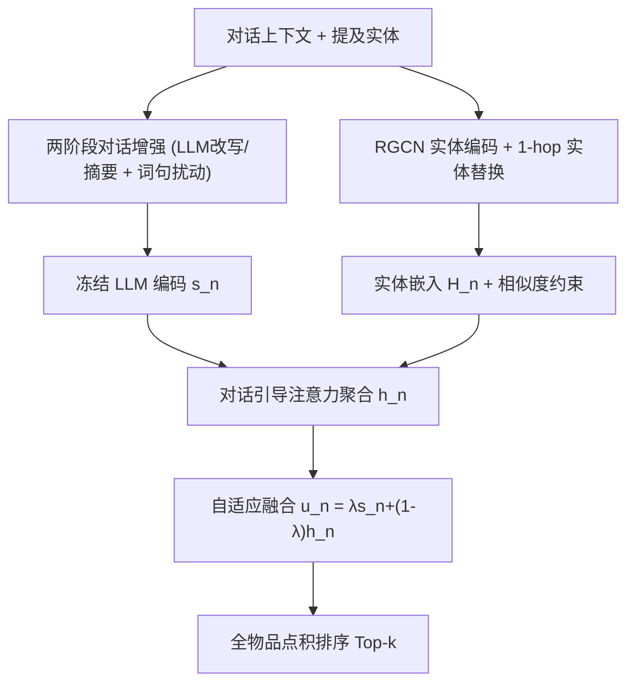
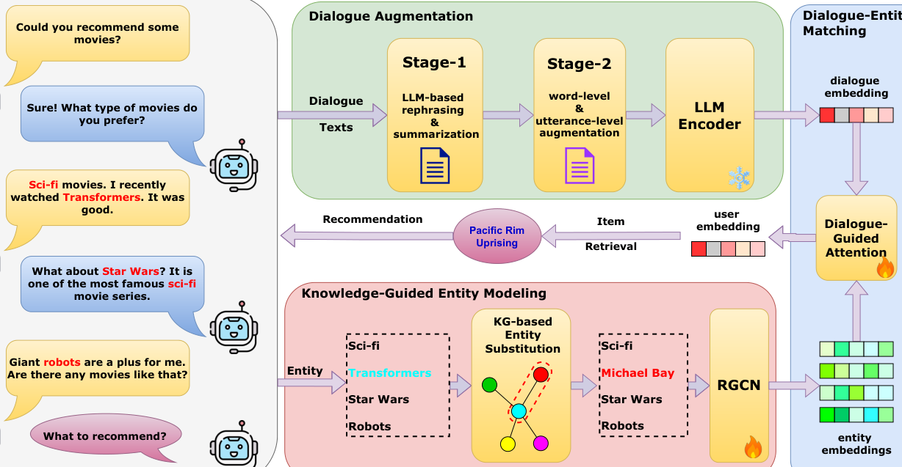

# On Mitigating Data Sparsity in Conversational Recommender Systems (缓解对话推荐系统数据稀疏性研究)

- **会议/期刊**: CIKM 2026
- **作者与机构**: Sixiao Zhang, Mingrui Liu, Wei Yuan, Hongzhi Yin, Cheng Long（南洋理工大学 NTU、昆士兰大学 UQ）
- **推荐链路定位**: 召回（对话驱动的物品检索）
- **研究方向**: 对话推荐与智能体仿真 / 冷启动与长尾推荐
- **论文原文**: [https://arxiv.org/abs/2507.00479v2](https://arxiv.org/abs/2507.00479v2)
- **开源代码**: [DACRS 仓库](https://github.com/RinneSz/DACRS-Dual-path-Augmentation-for-Conversational-)

## TL;DR (1分钟核心速览)

对话推荐（CRS）同时受困于**对话稀疏**（自然语言表达灵活、冗余）与**物品/实体稀疏**（长尾分布 + KG 中大量实体从未被训练，ReDial 仅 6,675/31,162 实体出现在训练语料）。DACRS 提出双路径增强：LLM 两阶段对话增强提升语言鲁棒性，KG 实体替换 + 实体相似度约束为稀疏/未见实体注入监督信号，再用对话引导注意力融合显式语义与隐式协同信号。在 ReDial / Inspired 全物品排序协议下，Recall@50 分别相对提升 11.46% 与 16.50%，且推理阶段零额外开销。

## Background & Motivation (背景与核心矛盾)

- **主流范式**: CRS 分两派——LM-as-recommender（LLM 直接重排或生成物品）与 expert CRS 模型（学习用户/物品嵌入做相似度检索，如 KGSF、UniCRS、STEP、MSCRS）。后者推荐精度更高，是当前 SOTA 主线。
- **前人局限**: ① 对话侧：语言表达高度灵活且冗余，多数工作只抽实体或把整段对话压成单一向量，用户表征表达力不足；② 实体侧：KG 与对话语料重叠极低，ReDial 平均节点度 4.84 但仅 2.47 个邻居被提及，测试集中 415/2,129 实体训练时从未出现，邻域聚合无法捕捉隐式实体相似性。
- **核心洞察 (Key Insight)**: 稀疏不是单点问题，而是"对话语义稀疏 + 实体监督稀疏"的双路径耦合；增强必须同时作用于两条路径，且增强只应在训练期发生，推理期保持轻量。
- **本文切入点**: 用 LLM 生成语义一致的对话变体 + 用 KG 结构为稀疏实体"借"监督信号，再以对话引导注意力把两路表征对齐融合。

<figure class="paper-figure" markdown="span">
  <figcaption>图1：CRSs中数据稀疏性的示意图。左图展示对话稀疏性，源于自然语言表达的高度灵活性和冗余性。右图展示物品稀疏性，表现为用户-物品交互高度不平衡以及包含大量未训练实体的稀疏知识图谱。</figcaption>
</figure>

## Method (核心方法设计)

### 1. 整体框架 (Overall Architecture)

输入为对话上下文 $\mathcal{U}_n$ 与其中提及实体集 $\mathcal{E}_n$。对话经两阶段增强（LLM 改写/摘要 → 词级/句级扰动）后由冻结的 GritLM-7B 编码为对话向量 $\mathbf{s}_n$；实体经 RGCN 在 DBpedia KG 上编码，训练期额外施加 1-hop 实体替换与实体相似度约束；最后以 $\mathbf{s}_n$ 为 Query 对提及实体嵌入做注意力聚合得 $\mathbf{h}_n$，与 $\mathbf{s}_n$ 自适应加权成用户向量 $\mathbf{u}_n$，与全部物品实体点积排序取 Top-k。增强模块仅在训练期激活，推理仅走匹配模块。

<figure class="paper-figure" markdown="span">
  <figcaption>图2：DACRS示意图。它由三个模块组成。(1) 对话增强。对话经过两阶段增强流程，并通过LLM编码器获得对话嵌入。(2) 知识引导的实体建模。提及的实体被替换为通过RGCN编码的知识图谱中的1跳邻居。(3) 对话-实体匹配。对话嵌入和实体嵌入通过对话引导的注意力网络融合，以获得用户嵌入并检索推荐。</figcaption>
</figure>

### 2. 关键设计拆解 (Key Designs)

1. **两阶段对话增强（Dialogue Augmentation）**：痛点是对同一意图存在无穷表达且大量 token 为噪声。Stage-1 用 Llama-3.2-3B 做改写（保留交互格式、换词换风格）或摘要（压缩为显式偏好陈述，如"用户偏好带巨型机器人的科幻片"）；Stage-2 在改写结果上施加词级（删除/交换/裁剪）与句级（删除/交换 utterance）扰动，若 Stage-1 用摘要则仅做词级。每阶段以等概率选择"不增强"，每 epoch 在线动态增强。直觉：改写扩充分布覆盖、摘要剥离冗余、扰动迫使模型对齐语义而非表面形式。

2. **知识引导实体建模（KGEM）**：痛点是 KG 邻居大多未被提及、远跳实体无监督。① 实体替换：以一定比例将提及实体随机替换为其 1-hop 邻居，使训练涉及实体数近乎翻倍，并随 RGCN 传播进一步扩散；② 实体相似度约束把 KG 邻接转化为对比式监督：

$$\mathcal{L}_{\text{entity},m}=-\sum_{j\in\mathcal{N}_m}\log\frac{e^{\mathbf{h}_m\cdot\mathbf{h}_j}}{\sum_{k=1}^{|\mathcal{E}|}e^{\mathbf{h}_m\cdot\mathbf{h}_k}}$$

即"相连实体应比不相连实体更近"，使零交互实体也能通过结构连接获得有意义嵌入（图 5 的 t-SNE 证实 test-only 实体从孤立簇融入主分布）。

3. **训练目标、负采样与推理效率**：推荐损失为对话-提及实体的全实体 softmax 交叉熵（分母遍历 $|\mathcal{E}|$，等价于全库负采样，无额外负采样策略）：

$$\mathcal{L}=\mathcal{L}_{\text{rec}}+\alpha\mathcal{L}_{\text{entity}},\quad \mathcal{L}_{\text{rec}}=\sum_{n}-\sum_{j\in\mathcal{E}_n}\log\frac{e^{\mathbf{u}_n\cdot\mathbf{e}_j}}{\sum_{k=1}^{|\mathcal{E}|}e^{\mathbf{u}_n\cdot\mathbf{e}_k}}$$

推理时增强与 KGEM 全部关闭，仅需一次 LLM 前向 + 一次注意力 + 全物品点积，与标准嵌入式推荐同阶开销。

## Experimental Setup & Evaluation Protocol (实验设置与评估协议)

- **数据集与预处理**: 沿用 KGSF/UniCRS 标准划分，KG 由 DBpedia 构建，物品及其关联实体为节点。

| 数据集 | #Dialogues | #Items | #Entities | #Interactions | 稀疏度/说明 |
| :--- | :---: | :---: | :---: | :---: | :--- |
| ReDial | 11,348 (训 10,006 / 测 1,342) | 6,281 | 31,162 | 60,072 | 交互密度 0.0956%，仅 6,675 实体入训 |
| Inspired | 999 (训 900 / 测 99) | 1,472 | 17,321 | 3,878 | 交互密度 0.2637%，训练样本极少 |

- **数据划分与防穿越 (Splitting Strategy)**: 按对话级比例划分（ReDial 10,006/1,342；Inspired 900/99），训练样本为"含至少一个实体的 utterance"，其前文对话与已提及实体为输入、当前 utterance 实体为目标，严格因果无穿越。
- **排名评测协议 (Ranking Protocol)**: 无偏 **Full-Ranking**——仅物品实体参与排序，对数据集中**全部物品实体**打分排序；仅评测含推荐物品的系统 utterance。作者明确指出 DCRS/STEP/MSCRS 原报告含用户 utterance，故复现数值与原论文略有差异，但所有基线在同一协议下重跑。
- **对比基线与超参设置**: 基线含 KGSF、MESE、UniCRS、DCRS、STEP、MSCRS 六类 SOTA；对话编码器 GritLM-7B（冻结，mean pooling），单层 RGCN，1 层多头注意力；AdamW，lr=0.001，weight decay=0.01，batch=128，50 epochs，单卡 RTX A5000；五次运行取均值，$p<0.05$ 显著性检验。

## Key Experimental Results (实验关键数据)

### 1. 主实验对比 (Main Results)

**ReDial（节选核心指标）**

| Method | R@10 | R@20 | R@50 | N@10 | M@10 | M@50 |
| :--- | :---: | :---: | :---: | :---: | :---: | :---: |
| KGSF | 0.179 | 0.262 | 0.364 | 0.096 | 0.071 | 0.079 |
| MESE | 0.210 | 0.294 | 0.413 | 0.112 | 0.083 | 0.092 |
| UniCRS | 0.215 | 0.296 | 0.418 | 0.119 | 0.090 | 0.100 |
| DCRS | 0.219 | 0.297 | 0.411 | 0.124 | 0.095 | 0.104 |
| STEP | 0.224 | 0.309 | 0.419 | 0.128 | 0.099 | 0.109 |
| MSCRS | 0.230 | 0.305 | 0.417 | 0.131 | 0.101 | 0.110 |
| **DACRS** | **0.255\*** | **0.335\*** | **0.467\*** | **0.138\*** | **0.110\*** | **0.113** |
| Improv. | +10.87% | +8.41% | +11.46% | +5.34% | +8.91% | +2.73% |

**Inspired（节选核心指标）**

| Method | R@10 | R@20 | R@50 | N@10 | M@10 | M@50 |
| :--- | :---: | :---: | :---: | :---: | :---: | :---: |
| KGSF | 0.152 | 0.178 | 0.223 | 0.100 | 0.083 | 0.086 |
| MESE | 0.142 | 0.207 | 0.317 | 0.089 | 0.072 | 0.081 |
| UniCRS | 0.238 | 0.309 | 0.406 | 0.160 | 0.136 | 0.144 |
| DCRS | 0.168 | 0.219 | 0.344 | 0.091 | 0.068 | 0.076 |
| STEP | 0.223 | 0.273 | 0.371 | 0.142 | 0.117 | 0.123 |
| MSCRS | 0.277 | 0.332 | 0.387 | 0.178 | 0.147 | 0.153 |
| **DACRS** | **0.308\*** | **0.348\*** | **0.473\*** | **0.185\*** | **0.151** | **0.158** |
| Improv. | +11.19% | +4.82% | +16.50% | +3.93% | +2.72% | +3.27% |

### 2. 消融实验 (Ablation Study)

| 变体 | ReDial R@10 | Inspired R@10 | 说明 |
| :--- | :---: | :---: | :--- |
| w/o DA | 下降 | 下降 | 去掉对话增强，用原始对话编码 |
| w/o KGEM | 降幅最大（保留对话的变体中） | 同左 | 去掉实体替换与相似度约束 |
| w/o DGAA | 明显下降 | 明显下降 | 注意力聚合退化为对话-物品直接点积 |
| w/o DE | 全部变体中最差 | 同左 | 仅用提及实体均值嵌入推荐 |
| w/o all | 最差 | 最差 | 三模块全移除 |
| **DACRS** | **0.255** | **0.308** | 完整模型 |

### 3. 关键实验发现 (Key Findings)

1. **对话语义是主信号，实体建模是最大增益杠杆**：w/o DE（完全丢弃对话）跌幅最大，说明对话上下文不可替代；而在保留对话的变体中 w/o KGEM 跌幅最大，证明实体稀疏才是限制 SOTA 上限的瓶颈——这与 ReDial 仅 21% 实体入训的统计事实直接对应。
2. **越稀疏收益越大**：Inspired 训练对话仅 900 条，DACRS 的 R@50 相对提升 16.50%（ReDial 为 11.46%），且 N@50 提升 8.91%，说明增强策略在低资源场景下边际收益更高。
3. **超参呈"适度最优"倒 U 型**：损失权重 $\alpha$ 在 0→0.5 区间性能上升、过大则过平滑掉判别性；实体替换率与对话增强率均在中度时最优，过度替换引入语义漂移、过度增强造成信息丢失——增强强度需与语义保真度权衡。

## Highlights, Limitations & Rating (亮点、对比与审稿评价)

- **与代表作对比 (vs. Prior Work)**: 相比 UniCRS（双空间双线性对齐）与 STEP（课程学习对齐对话-实体），DACRS 不改对齐算子而改**监督信号的供给方式**——训练期造数据而非推理期加结构；相比 CFCRS 仅做对话级实体增广，本文同时覆盖语言层与图结构层，且显式处理 test-only 实体。
- **可迁移亮点**: ① "增强仅训练期激活、推理零开销"的工程范式可直接搬到任何 LLM 编码 + 图编码的双塔召回；② 用 KG 邻接构造对比式相似度约束，是给零交互节点"借监督"的通用低成本技巧。
- **审稿级局限批判**: ① 对话增强依赖 Llama-3.2-3B 在线逐 epoch 生成，训练成本与 LLM 调用开销未量化，且增强质量对 prompt 敏感；② 实体替换为随机 1-hop 采样，未区分关系类型（如 `starring` 与 `genre` 语义差异大），可能引入与用户偏好无关的邻居；③ 仅两个电影域英文数据集，跨域（电商/音乐）与多语言泛化性未验证。
- **四维评分**: 创新性 ⭐⭐⭐⭐ | 实验扎实度 ⭐⭐⭐⭐ | 方法清晰度 ⭐⭐⭐⭐⭐ | 落地价值 ⭐⭐⭐⭐

