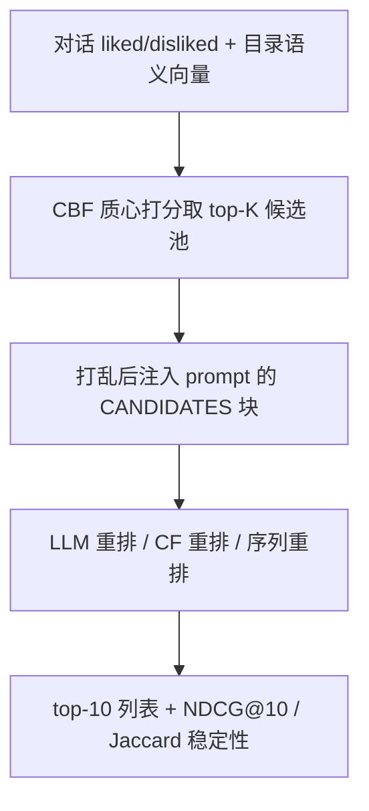

# Retrieval, Scoring, and Decoding Shape Performance and Stability in LLM-based Conversational Recommendation (检索、打分与解码如何塑造 LLM 对话推荐的效果与稳定性)

- **会议/期刊**: CIKM 2026 (short paper)
- **作者与机构**: Ante Kapetanovic, Tomislav Duricic, Andro Mercep, Emanuel Lacic (Infobip)
- **推荐链路定位**: 重排（retrieve-then-rerank 两阶段）
- **研究方向**: 对话推荐与智能体仿真 / 大语言模型推荐
- **论文原文**: [https://arxiv.org/abs/2609.00086v1](https://arxiv.org/abs/2609.00086v1)
- **开源代码**: [https://github.com/infobip/crs-](https://github.com/infobip/crs-)

## TL;DR (1分钟核心速览)

本文不做新模型，而是做一次"协议审计"：在 ReDial 上把候选池规模、一阶段检索器、打分策略与解码温度作为受控变量，比较闭源/开源/微调 LLM 重排器与 CF、序列基线。共享语义 top-250 候选池 + 严格候选感知打分下，最强闭源重排器 NDCG@10 达 0.1497（EASE 0.0939），但同一模型零样本生成可报 0.2925；把语义候选换成 EASE 候选，NDCG@10 提升 52–59%。结论：候选生成与解码配置应与模型选择同等对待。

## Background & Motivation (背景与核心矛盾)

- **主流范式**: LLM 作为 CRS 重排器已成标配，两阶段 retrieve-then-rerank 是标准骨架，近期工作在其上叠加用户偏好检索或图信号。
- **前人局限**: ① 候选生成几乎不被控制——候选池大小、一阶段检索器、是否允许生成目录外标题，各文各异，导致"同一模型可强可平庸"；② 随机解码带来的列表级不稳定性极少与准确率一同报告，而 LLM 输出对采样与候选顺序高度敏感。
- **核心洞察 (Key Insight)**: 在单一基准上，这些协议选择的效应量可超过头部系统之间的差距；因此"LLM 重排器优于 CF"这一结论在未对齐候选池时不可证伪。
- **本文切入点**: 固定候选池做 matched-pool 对照，逐一扫描候选规模（c0/c250/c500/c1000/cAll）、检索器（语义/EASE/SASRec）与温度（0/0.5/1.0/2.0），把协议变量升格为"必报字段"。

## Method (核心方法设计)

### 1. 整体框架 (Overall Architecture)

统一两阶段管线：一阶段候选生成器为对话 $u$产出候选池$C_K^u$，二阶段重排器对池内物品排序并输出 top-10。主实验用内容过滤（CBF）作生成器：以 all-mpnet-base-v2 编码目录物品并 L2 归一化得$\mathbf{e}_i$，由对话中 liked 集$L_u$与 disliked 集$D_u$构造正负质心，按$\lambda_+=1,\lambda_-=0.5$加权打分取 top-$K$，候选在注入 prompt 前打乱以抑制位置偏置。同一批候选同时喂给 LLM、CF 与序列重排器，实现 matched-pool 对照；LLM 侧另设 c0（无候选、零样本生成）与 cAll（全目录 6,924 条塞入单 prompt）两个极端。

### 2. 关键设计拆解 (Key Designs)

1. **候选感知打分策略 (candidate-aware scoring)**：痛点是零样本生成可输出任意目录标题，与受限候选池不可比。本文定义严格口径——prompt 要求只从候选列表选，生成列表外标题即使命中目录也不给分；标题经 Unicode 归一化、小写化、去尾标点后匹配。这一口径把"候选可得性"与"重排能力"分离，是全文所有对比的前提。
2. **检索器替换实验 (first-stage swap)**：固定 $K=250$ 与重排器，仅换一阶段为 EASE（CF）或 SASRec（序列）。语义池 CandRecall@250 仅 0.2877、Oracle NDCG@10 0.3165，而 EASE 为 0.4862/0.5222、SASRec 为 0.5093/0.5423。直觉：语义检索按元数据相似度召回，与"用户实际接受"的协同信号错位，重排器再强也无法弥补池内缺失的目标。
3. **温度稳定性度量与训练配置**：在固定 30 条 prompt 子集上每温度采样 20 次，用 Jaccard distance@10 与 position disagreement@10 刻画列表一致性；微调基线 Qwen2.5-7B-Instruct 用 LoRA（rank 16, $\alpha=32$, 3 epochs, lr$2\times10^{-5}$）在 c250 训练 prompt 上适配。该设计把"准确率均值"与"部署可复现性"拆成两条正交轴。

## Experimental Setup & Evaluation Protocol (实验设置与评估协议)

- **数据集与预处理**: ReDial 标准测试集（1,025 段对话）与 6,924 部电影目录；对话中被接受的推荐被掩码作为 ground-truth，liked 电影构成 CF/序列模型的隐式历史，序列模型按 liked 在前、accepted 在后的顺序展开为 RecBole 预增强格式。

| 数据集 | #Dialogues(Test) | #Items | 目标定义 | 场景说明 |
| :--- | :---: | :---: | :---: | :--- |
| ReDial | 1,025 | 6,924 | 被接受推荐（掩码） | 电影域 seeker–recommender 对话，偏好须从对话推断 |

- **数据划分与防穿越 (Splitting Strategy)**: 沿用 ReDial 官方标准划分；accepted 推荐在输入侧掩码，仅作验证/测试目标，避免标签泄漏。
- **排名评测协议 (Ranking Protocol)**: 非全库排序，而是**候选池内排序**——主表为语义 top-250 池内严格候选感知打分；另设 c0 零样本与 cAll 全目录两个极端口径。指标为二值相关性 NDCG@10（主）、Hit@10、Cov.@10、Pop.@10；置信区间用对话级 bootstrap，主对比对 EASE 做配对 Wilcoxon 符号秩检验 + Holm 校正（$p<0.05$）。
- **对比基线与超参设置**: 闭源 5 个（Claude Opus/Sonnet 4.6、GPT-5.2、GPT-4.1、GPT-4.1 Mini）、开源 5 个（Llama-3.3-70B、Gemma-2-9B、Llama-3.1-8B、Qwen2.5-7B、Llama-3.2-3B）+ 微调 Qwen2.5-7B-FT；CF 基线 EASE/ItemKNN/LightGCN/BPR；序列基线 SASRec/GRU4Rec/NARM/SRGNN；另含语义排序与流行度基线。主重排实验温度 0、top-$p$=1.0。

## Key Experimental Results (实验关键数据)

### 1. 主实验对比 (Main Results)

ReDial 上 c250 严格候选感知打分（c0 为零样本口径，仅列关键行）：

| 重排器 | NDCG@10 (c0) | NDCG@10 (c250) | Hit@10 (c250) | Cov.@10 | Pop.@10 |
| :--- | :---: | :---: | :---: | :---: | :---: |
| Claude Opus 4.6 | 0.2925* | **0.1497*** | **0.2713** | 0.2639 | 42.80 |
| GPT-5.2 | 0.2427* | 0.1335* | 0.2523 | 0.2858 | 36.64 |
| Claude Sonnet 4.6 | 0.2207* | 0.1325* | 0.2462 | 0.2754 | 37.79 |
| GPT-4.1 | 0.1983* | 0.1283* | 0.2322 | 0.3037 | 34.22 |
| GPT-4.1 Mini | 0.1937* | 0.1021 | 0.1912 | 0.3033 | 32.69 |
| Qwen2.5-7B-FT | – | 0.0792 | 0.1502 | 0.2711 | 23.22 |
| Llama-3.3-70B | 0.1154 | 0.0770 | 0.1602 | 0.2607 | 33.69 |
| EASE (CF) | – | 0.0939 | 0.2072 | 0.2370 | 59.99 |
| SASRec (序列) | – | 0.0705 | 0.1802 | 0.1592 | 67.96 |
| Pop | – | 0.0388 | 0.1061 | 0.0477 | 107.68 |

`*` 表示相对 EASE c250 显著（Holm 校正后 $p<0.05$）。最强闭源相对 EASE 提升 **+59.4%**（0.1497 vs 0.0939）；所有开源重排器均低于 EASE。

一阶段检索器替换（固定 top-250 池）：

| 检索器 | CandR@250 | Oracle NDCG@10 | Claude Opus 4.6 | Llama-3.3-70B |
| :--- | :---: | :---: | :---: | :---: |
| Semantic | 0.2877 | 0.3165 | 0.1497 | 0.0770 |
| EASE | 0.4862 | 0.5222 | **0.2277** (+52%) | **0.1223** (+59%) |
| SASRec | **0.5093** | **0.5423** | 0.2119 | 0.1180 |

### 2. 消融实验 (Ablation Study)

本文无传统模块消融，其"消融"即协议变量的逐项剥离，下表汇总各受控变量的边际效应：

| 受控变量 | 设置变化 | 观测效应 |
| :--- | :--- | :--- |
| 候选池规模 | c250 → cAll | 闭源 NDCG@10 提升 57%（GPT-4.1 Mini）至 89%（GPT-5.2） |
| 打分策略 | c250 严格 → c0 零样本 | Opus 0.1497 → 0.2925（近 2×），但两因素混杂不可单独归因 |
| 一阶段检索器 | Semantic → EASE | Opus +52%、Llama-3.3-70B +59% |
| 一阶段检索器 | Semantic → SASRec | 召回更高但 NDCG 低于 EASE（0.2119 < 0.2277） |
| 解码温度 | $T$: 0 → 1.0 | Opus Jaccard 0.0900 → 0.1240，NDCG 基本持平 |
| 解码温度 | $T$: 0 → 2.0 | Llama-3.3-70B Jaccard 0.0230 → 0.7600，NDCG 0.0750 → 0.0490 |

### 3. 关键实验发现 (Key Findings)

1. **候选池规模是"隐形超参"**：闭源模型从 c250 扩到 cAll 增益 57–89%，远超模型间差距（0.1283–0.1497 区间仅约 17%），说明未对齐候选池的横向比较基本无效。
2. **召回高 ≠ 下游好**：SASRec 池 CandRecall@250（0.5093）与 Oracle（0.5423）均高于 EASE，但两个重排器在其上的 NDCG 都更低，表明候选组成与重排器的"池兼容性"独立于召回上限起作用。
3. **稳定性与准确率解耦**：Opus 在 $T$=0→1.0 时 Jaccard 从 0.0900 升至 0.1240 而 NDCG 几乎不变，即"同样准但推荐的东西不同"；Llama-3.3-70B 则同时崩坏（Jaccard 0.7600、NDCG 0.0490），弱模型对温度更敏感，仅报均值 NDCG 会掩盖部署风险。

## Highlights & Limitations (亮点、对比与审稿批判)

- **与代表作对比 (vs. Prior Work)**: 相较在 retrieve-then-rerank 上叠加偏好检索或图信号的 LLM 重排工作（如 [28,31]），本文不新增模块，而是首次把候选生成、池规模、打分口径、解码配置作为受控变量系统剥离；相较常规 CRS 复现研究，本文额外引入列表级 Jaccard 稳定性这一正交评价轴。
- **可迁移亮点**: ① "严格候选感知打分 + 打乱候选"可直接作为 LLM 重排评测的标准口径；② 用 Oracle NDCG@10 与 CandRecall 诊断"瓶颈在召回还是在重排"，可迁移到任意两阶段推荐系统的归因分析。
- **审稿级局限批判**: ① 仅 ReDial 单域、6,924 物品的小目录，cAll 塞入单 prompt 的做法在工业级目录不可行，结论外推性存疑；② 未系统测量成本与延迟，而全目录 prompt 的 token 开销恰是落地关键；③ c0 与 c250 同时改变候选可得性与打分策略，作者亦承认无法单独归因；④ matched-pool 下 LLM 用原始对话与预训练知识、CF 用交互历史，属"系统级"而非"同信息"比较。

## Rating (四维评分)

- **方法创新性 (Novelty)**: ⭐⭐⭐ （无新模型，但把"协议即变量"做成受控实验设计，问题意识有价值）
- **评估协议与实验扎实度 (Protocol & Experiments)**: ⭐⭐⭐⭐ （matched-pool、bootstrap CI、Wilcoxon+Holm、20 次采样稳定性，协议严谨；受限于单数据集）
- **写作与数学规范度 (Clarity & Rigor)**: ⭐⭐⭐⭐ （RQ 驱动、口径定义清晰、局限自陈充分；公式极简，理论深度有限）
- **工业落地与复现价值 (Industrial & Practical Value)**: ⭐⭐⭐⭐ （代码/prompt/输出全开源，提出的"必报字段"清单对工业评测规范有直接借鉴意义）
