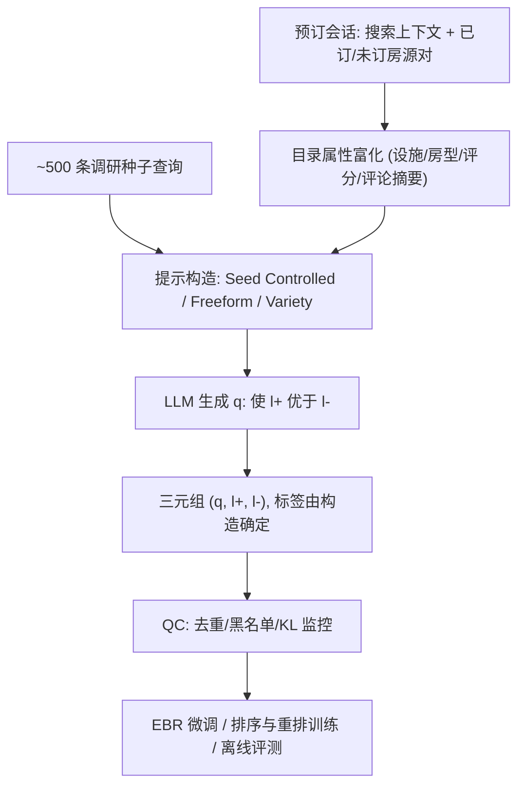
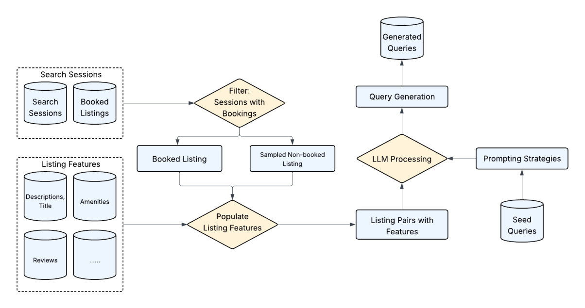

# CASTLE: Contrastive and Seed-Guided Training for Cold-Start Natural Language Search (对比式与种子引导的冷启动自然语言搜索训练)

- **会议/期刊**: CIKM 2026
- **作者与机构**: Wendy Ran Wei, Hao Li, Weiwei Guo, Xiaowei Liu, Xueyin Chen, Chun How Tan, Malay Haldar, Soumyadip Banerjee, Kedar Bellare, Huiji Gao, Stephanie Moyerman, Sanjeev Katariya（Airbnb）
- **推荐链路定位**: 召回（EBR 嵌入检索）+ 精排（first-pass ranker / LLM reranker）训练数据供给
- **研究方向**: 冷启动与长尾推荐 / 大语言模型推荐
- **论文原文**: [https://arxiv.org/abs/2605.21812v2](https://arxiv.org/abs/2605.21812v2)
- **开源代码**: 暂未开源

## TL;DR (1分钟核心速览)

自然语言搜索上线前既无真实查询、也无相关性标签，构成双重冷启动。CASTLE 用去标识预订会话中的「已订 vs 未订」房源对作为对比锚点，配合约 500 条用户调研种子查询，让 LLM 生成「使 $l^+$ 比 $l^-$ 更相关」的查询，从而**同时产出查询与构造式标签**（无需 LLM 事后判定）。在 Airbnb 结构化目录数据上，查询长度分布对真实用户的 KL 从最优基线 9.33 降至 1.01（9.2×），属性类型 KL 0.08 甚至优于调研种子本身（0.09）；200 组三元组人工标注一致率 91–93%，合成数据微调使 EBR 成对准确率 +17.7pp、LLM 重排 +26.4pp。

## Background & Motivation (背景与核心矛盾)

- **主流范式**: 结构化筛选（目的地/日期/人数/设施）精确但无法表达开放式偏好；LLM 使自然语言搜索可行，但上线前无流量可训练。
- **前人局限**: ① InPars/Promptagator 类方法在**无结构 passage** 上生成查询，无法产出排序训练所需的相关性标签，且易幻觉出不存在的设施；② LLM-as-judge 打标存在**自偏好偏差**（GPT 判 GPT 生成对准确率虚高至 98–99%）；③ 规则系统与跨域迁移受限于领域漂移（passage 基准 vs 富特征目录实体）。
- **核心洞察 (Key Insight)**: 预订会话天然给出「同一搜索上下文下谁被订、谁没被订」的对比对——它既能**锚定查询生成于真实平台行为**，又能让相关性标签**由构造决定**（LLM 被要求生成使 $l^+$ 胜出的查询，标签即输入而非判定）。
- **本文切入点**: 把「查询生成」与「标签生成」耦合成一个联合生成框架，用少量种子查询控制语言真实性，用对比对控制标签保真度。

## Method (核心方法设计)

### 1. 整体框架 (Overall Architecture)

从去标识预订会话采样搜索上下文（地点/日期/人数），取已订/高互动房源为 $l^+$、同搜索低互动房源为 $l^-$，用目录属性（设施、房型、位置、评分、评论摘要）富化两者；再从约 500 条调研种子中抽一条作语言模板，按三种提示变体构造 prompt，令 LLM 输出「使 $l^+$ 主题上优于 $l^-$」的查询 $q$，三元组 $(q,l^+,l^-)$ 的标签由构造保证。生成结果经去重/黑名单/一致性校验入库，日更约 1 万条，供 EBR 与排序模型微调及离线评测。

<figure class="paper-figure" markdown="span">
  <figcaption>图1：对比式查询生成流程。左：输入源（带预订日志的搜索会话；房源特征）。中：提取已预订与未预订房源对，并用目录属性进行丰富。右：LLM 将房源对与种子查询及提示策略结合，生成合成查询，并通过构造方式附带主题性标签。</figcaption>
</figure>

### 2. 关键设计拆解 (Key Designs)

1. **对比式联合生成（标签由构造，而非判定）**：痛点是无标签且 LLM 判定有偏。核心是把相关性变成生成约束——prompt 明示「Listing 1 主题上更相关，请找出使之为真的查询」，于是 $l^+ \succ l^-$ 是确定性输入。形式化目标为最小化合成与真实查询分布的 KL：
$$\min_\theta \; D_{\mathrm{KL}}\big(P_{\text{true}}(q)\,\|\,P_{\text{synth}}(q)\big),\quad P_{\text{synth}}(q)=\mathbb{E}_{t\sim P(t),\,e\sim P(e)}\big[P_{\text{LLM}}(q\mid t,e)\big]$$
将查询分解为语言模板 $t$（种子）与目录实体 $e$（对比对）两个可独立优化的因子。直觉：模板管「像人话」，实体管「有据可查」，二者解耦后各自可单独调优，且属性 grounding 从构造上杜绝了 passage 方法「编造设施」的假阳性。

2. **三种提示变体 + 显式多样性机制（防查询坍缩）**：单一 prompt 无法同时满足真实/多样/可扩展。Seed Controlled 严格套用种子句式保真实；Seed Freeform 把种子当风格示例放词汇变化；Variety 放宽约束、提高温度探索多意图与罕见属性组合。生产用 80/20 混合。配套护栏：平台术语黑名单（"entire home"/"superhost"）、上下文去具体化（城市名→"near Eiffel Tower"、人数→"large group"）、JSON 结构化输出（含 justification 与 key_attributes）。效果：长度标准差从无种子基线的 0.99 拉到 2.48，覆盖全部三个词数桶。

3. **训练目标、标签分工与推理开销**：训练用**对比标签**（高保真、零自偏好风险），评测用 **Virtual Judge**（属性锚定 CoT：先逐条比对设施是否匹配，再给二值判定，覆盖更广）。四条偏差缓解：属性 grounding、人工校准（92% 一致）、训练/评测标签源分离、生成与评测用不同模型版本。成本上每次调用约 500–800 输入 token / 100–150 输出 token，1 万条查询端到端 <2 小时，房源特征预缓存复用。

## Experimental Setup & Evaluation Protocol (实验设置与评估协议)

- **数据集与预处理**: Airbnb 结构化房源目录 + 去标识预订会话；种子集 500 条（五类行程场景调研，过滤平台术语/非英文/含确切地名），真实用户参照集 7,165 条。

| 数据集 | #Queries | 平均长度 | 长度 $\sigma$ | 说明 |
| :--- | :---: | :---: | :---: | :--- |
| InPars-style | 14,972 | 6.04 | 0.99 | 房源字段拼成伪 passage |
| Promptagator | 28,738 | 6.01 | 0.98 | 种子 few-shot，无对比锚定 |
| Contrastive-Only | 4,911 | 16.41 | 5.28 | 有对比对、无种子 |
| CASTLE | 14,447 | 6.17 | 2.48 | 对比 + 调研种子 |
| CASTLE-R | 13,244 | 5.50 | 2.14 | 对比 + 真实查询种子 |
| Survey Seed | 500 | 7.19 | 6.23 | 调研种子本身 |
| Real Users | 7,165 | 4.40 | 3.93 | 真实流量参照 |

- **数据划分与防穿越 (Splitting Strategy)**: 微调评测采用合成评估集 **10% 留出划分**（与训练同分布）；查询分布评测以真实用户查询为外部参照，不涉及训练泄漏。
- **排名评测协议 (Ranking Protocol)**: 主指标为**分布对齐**（词数桶与属性类型上的 KL 散度，95% bootstrap CI，$B=10{,}000$）与**成对准确率**（2-candidate pairwise accuracy，非全库 Full-Ranking）；标签质量用 200 组三元组、每组 3 名标注者的一致率。
- **对比基线与超参设置**: InPars-style / Promptagator / Contrastive-Only 三类；生产模型为 Qwen3 EBR、first-pass ranker、LLM reranker；批量生成用中档模型、VJ 用大模型仅跑日度抽检。

## Key Experimental Results (实验关键数据)

### 1. 主实验对比 (Main Results)

查询分布对齐（KL 越低越好，括号为 95% CI）：

| 方法 | 长度 $\sigma$ | %1–2 词 | %9+ 词 | KL vs. Real ↓ | KL vs. Seed ↓ | 属性类型 KL ↓ |
| :--- | :---: | :---: | :---: | :---: | :---: | :---: |
| InPars-style | 0.99 | 0.0 | 1.1 | 9.51 [7.20,10.51] | 7.49 | 0.42 |
| Promptagator | 0.98 | 0.0 | 2.8 | 9.33 [7.17,10.47] | 7.35 | 0.39 |
| Contrastive-Only | 5.28 | 0.0 | 97.7 | 12.91 [11.34,14.19] | 8.63 | 0.12 |
| **CASTLE** | **2.48** | **3.9** | **10.8** | **1.01** [0.69,2.55] | **0.55** | **0.08** |
| CASTLE-R | 2.14 | 8.1 | 5.2 | 0.75 [0.50,1.13] | 0.94 | 0.12 |
| Survey Seed | 6.23 | 15.6 | 27.6 | 0.15 | – | 0.09 |
| Real Users | 3.93 | 34.9 | 10.0 | – | 0.15 | – |

模型微调（合成数据单独训练，成对准确率）：

| 模型 | Baseline | Fine-tuned | Δ |
| :--- | :---: | :---: | :---: |
| Qwen3 EBR | 0.790 | **0.967** | +17.7 pp |
| First-pass Ranker | 0.570 | **0.705** | +13.5 pp |
| LLM Reranker | 0.620 | **0.884** | +26.4 pp |

### 2. 消融实验 (Ablation Study)

| 配置 | 种子引导 | 对比锚定 | KL vs. Real ↓ | 属性类型 KL ↓ | 可产标签 |
| :--- | :---: | :---: | :---: | :---: | :---: |
| InPars-style | ✗ | ✗ | 9.51 | 0.42 | ✗ |
| Promptagator | ✓ | ✗ | 9.33 | 0.39 | ✗ |
| Contrastive-Only | ✗ | ✓ | 12.91 | 0.12 | ✓ |
| **CASTLE** | ✓ | ✓ | **1.01** | **0.08** | ✓ |

规模消融（LLM Reranker，纯合成训练）：1K→5K 评估准确率 0.755→0.869（+11.4pp），10K/20K 停滞于 0.869，50K 仅 0.884（+1.5pp）。

### 3. 关键实验发现 (Key Findings)

1. **两个组件缺一不可且互补**：Promptagator 有种子无对比锚定，KL 仍高达 9.33；Contrastive-Only 有锚定无种子，长度 $\sigma$ 5.28 但 97.7% 查询 ≥9 词，KL 反恶化到 12.91。只有 CASTLE 同时把 KL 压到 1.01，且属性类型 KL 0.08 低于调研种子自身 0.09——组合收益超过任一单组件，说明「语言真实性」与「实体 grounding」作用于不同分布维度。
2. **质量主导规模，而非数量**：5K 之后评估准确率在 10K/20K 完全持平（0.869），50K 仅再涨 1.5pp，训练准确率早已饱和在 0.90。这直接论证了作者把工程投入放在生成保真度（种子引导、对比 grounding、难负例）而非扩量上的合理性。
3. **标签保真度经得起人工检验，但 LLM 自评不可信**：GPT-4/4o/5 在 GPT 生成对上准确率 0.994/0.988/0.990，而人工一致率仅 91–93%，6–8pp 的落差量化了自偏好偏差；对比标签因「由构造确定」在设计上不可能错，故训练用对比标签、评测才用 VJ 的分工是必要的。

## Highlights, Limitations & Rating (亮点、对比与审稿评价)

- **与代表作对比 (vs. Prior Work)**: InPars/Promptagator 在单文档 passage 上生成查询，**结构上无法产出排序标签**；LLM-as-judge 路线先有查询再打标，受自偏好污染。CASTLE 的本质差异是把「查询」与「标签」合并为一次受约束的生成，标签成为输入而非输出，从而绕开判定环节。
- **可迁移亮点**: ① 「让 LLM 生成使 A 优于 B 成立的查询」这一构造式打标范式，可直接迁移到电商图文匹配、短视频冷启动等有隐式偏好对（点击 vs 曝光未点）的场景；② 训练/评测标签源分离 + 属性锚定 CoT，是抑制 LLM 自偏好的低成本工程手段。
- **审稿级局限批判**: ① 评测以**分布 KL 与 2-candidate 成对准确率**为主，缺少全库 Full-Ranking 的 NDCG/Recall 与线上 A/B，合成数据对真实排序收益的因果证据偏弱；② 对比对采样自预订会话，系统性偏向高转化房源，作者自承对新房源/冷门市场存在公平性风险；③ 三类失败模式（多意图、1–2 词极短查询、vibe 体验型）尚未解决，短查询占比 3.9% vs. 真实 34.9% 的差距仍显著。
- **四维评分**: 创新性 ⭐⭐⭐⭐ | 实验扎实度 ⭐⭐⭐⭐ | 方法清晰度 ⭐⭐⭐⭐⭐ | 落地价值 ⭐⭐⭐⭐⭐

