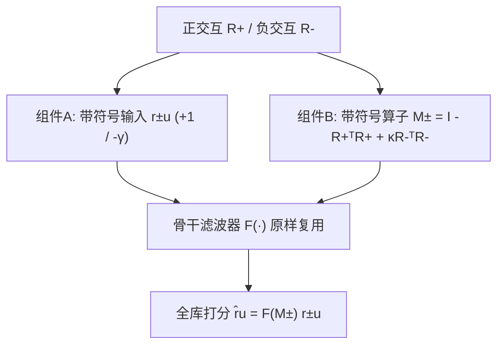
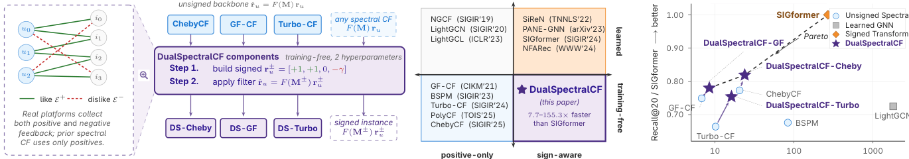

# DualSpectralCF: Training-Free Sign-Aware Spectral Collaborative Filtering (免训练符号感知谱协同过滤)

- **会议/期刊**: CIKM 2026
- **作者与机构**: Guanqun Yang (Stevens Institute of Technology)、Tong Qi (University of Maryland, College Park)、Xiaoxue Han (Stevens Institute of Technology)
- **推荐链路定位**: 召回（全库打分）
- **研究方向**: 协同过滤与双塔召回 / 自监督对比学习与交互去噪
- **论文原文**: [https://arxiv.org/abs/2608.10247v1](https://arxiv.org/abs/2608.10247v1)
- **开源代码**: [https://github.com/guanqun-yang/DualSpectralCF](https://github.com/guanqun-yang/DualSpectralCF)

## TL;DR (1分钟核心速览)

真实平台普遍采集 1 星差评、hate-button、用户不信任、极低完播率等**显式负反馈**，但利用它的符号感知推荐器（SiReN、SIGformer、NFARec 等）全部依赖梯度训练，代价高昂；而免训练的谱协同过滤（GF-CF、Turbo-CF、ChebyCF）虽便宜却只用正交互。本文提出 DualSpectralCF，在任意形如 $\hat{\mathbf{r}}_u = F(\mathbf{M})\mathbf{r}_u$的谱骨干上替换两处：带符号输入信号$\mathbf{r}_u^{\pm}$与带符号物品算子$\mathbf{M}^{\pm}$，仅新增两个标量超参$(\gamma,\kappa)$，零梯度训练。在 5 个符号感知基准、Full-Ranking 协议下，三个骨干实例全部不劣于原骨干，R@20 最高提升 **+32.6%**，且比 SIGformer 快 **7.7–155.3×**。

## Background & Motivation (背景与核心矛盾)

- **主流范式**: 图协同过滤把交互矩阵视为二部图做多跳传播；其中一支"免训练谱方法"把用户交互行当作物品相似图上的信号，经低通滤波（理想低通 / 多项式 / Chebyshev 逼近）直接闭式打分，精度可比 GCN 类模型而成本极低。
- **前人局限**: ① 谱免训练家族（GF-CF、Turbo-CF、PolyCF、ChebyCF、BSPM、EASE）**只处理正交互**，"缺失边"无法区分"没看过"与"明确讨厌"；② 符号感知家族（SiReN、PANE-GNN、NFARec、SIGformer、DFGNN、LSGRec、GegenNet）虽精度更高，但**全部梯度训练**，比闭式谱方法贵一到两个数量级。
- **核心洞察 (Key Insight)**: 打分方程 $\hat{\mathbf{r}}_u = F(\mathbf{M})\mathbf{r}_u$中"输入$\mathbf{r}_u$"与"算子$\mathbf{M}$"是两个正交插槽，负反馈可以分别从这两处注入而不破坏闭式结构；更关键的是，**点击本身揭示了主题注意力**——给恐怖片打 1 星的用户仍暴露了恐怖片偏好，故负反馈不应作为"反向证据"而应作为"弱正证据"。
- **本文切入点**: 用两个标量超参把负反馈塞进谱骨干的两个插槽，填补"符号感知 × 免训练"这一空白格（图 1(c)）。

## Method (核心方法设计)

### 1. 整体框架 (Overall Architecture)

统一抽象：令 $\tilde{\mathbf{R}} = \mathbf{D}_U^{-1/2}\mathbf{R}\mathbf{D}_I^{-1/2}$，物品相似度$\hat{\mathbf{P}} = \tilde{\mathbf{R}}^\top\tilde{\mathbf{R}}$，拉普拉斯$\mathbf{L}^* = \mathbf{I} - \hat{\mathbf{P}}$。所有骨干写作$\hat{\mathbf{r}}_u = F(\mathbf{M};\mathbf{h}_p)\mathbf{r}_u$，三者仅$F$不同：GF-CF 为$\hat{\mathbf{P}} + \alpha H_I(\mathbf{L}^*;\eta)$；Turbo-CF 为$\sum_k a_k \hat{\mathbf{P}}^{\circ s_k}$；ChebyCF 为$\mathbf{D}_I^{\beta}(H_C(\mathbf{L}^*;\phi) + \alpha H_I(\mathbf{L}^*;\eta))\mathbf{D}_I^{-\beta}$。DualSpectralCF 把$\mathbf{r}_u \to \mathbf{r}_u^{\pm}$、$\mathbf{M} \to \mathbf{M}^{\pm}$后原样复用$F$，全程无梯度、无学习嵌入，复杂度继承骨干的$O(K\cdot \mathrm{nnz}(\mathbf{R}))$。

<figure class="paper-figure" markdown="span">
  <figcaption>图1：(a) 显式反馈具有正向（ ）和负向（ ）边；DualSpectralCF 组装带符号行 r±</figcaption>
</figure>

### 2. 关键设计拆解 (Key Designs)

1. **组件 A：带符号输入信号（负反馈作为弱正证据）**：痛点是把负反馈当"反向证据"（$\gamma>0$）会让低通滤波把负分扩散到相似物品、误伤同主题推荐。本文改为
$$\mathbf{r}_u^{\pm}[i] = \begin{cases} +1 & (u,i)\in\mathcal{E}^+ \\ -\gamma & (u,i)\in\mathcal{E}^- \\ 0 & \text{otherwise}\end{cases}$$
当 $\gamma<0$时被讨厌物品以$-\gamma>0$（但小于$+1$）的**小正权重**进入信号，滤波仍把推荐质量推向谱相似物品，只是力度更弱。物理直觉：点击=主题兴趣，评分=体验好坏，二者应解耦。消融显示 15 个 (骨干, 数据集) 组合中最优$\gamma$**恒在$\{-0.5,-0.25,0\}$，从不为正**。

2. **组件 B：带符号物品算子（like-together 与 dislike-together 融合）**：痛点是无符号 $\mathbf{L}^*$ 只编码"共同喜欢"，无法惩罚"共同讨厌"的物品对。本文定义
$$\mathbf{L}^{\pm} = \mathbf{I} - \tilde{\mathbf{R}}^{+\top}\tilde{\mathbf{R}}^{+} + \kappa\,\tilde{\mathbf{R}}^{-\top}\tilde{\mathbf{R}}^{-},\qquad \hat{\mathbf{P}}^{\pm} = \tilde{\mathbf{R}}^{+\top}\tilde{\mathbf{R}}^{+} + \kappa\,\tilde{\mathbf{R}}^{-\top}\tilde{\mathbf{R}}^{-}$$
约束 $\kappa\ge 0$使$\kappa\tilde{\mathbf{R}}^{-\top}\tilde{\mathbf{R}}^{-}$半正定，$\mathbf{L}^\pm$特征值落在$[0,2]$，低通滤波保持良态。$\kappa$只需很小（ChebyCF 上 5 个数据集最优均为$\kappa=0.1$），因为负物品图噪声远大于正图，大扰动反而伤谱。

3. **训练目标、负采样与推理效率**：**无损失函数、无负采样、无梯度**——这是本文最核心的"反范式"卖点。超参搜索仅在 $\gamma\in\{-0.5,-0.25,0,0.25\}$、$\kappa\in\{0,0.1,0.5,1.0\}$的粗网格上进行，且骨干原生超参先在无符号矩阵上按原论文设置调好再叠加$(\gamma,\kappa)$。推理侧$\mathbf{r}_u^\pm$至多多出$\mathrm{nnz}(\mathbf{r}_u^+)+\mathrm{nnz}(\mathbf{r}_u^-)$个非零元，$\mathbf{M}^\pm$ 与无符号算子共享稀疏模式，多项式骨干无需特征分解。

## Experimental Setup & Evaluation Protocol (实验设置与评估协议)

- **数据集与预处理**: 沿用 SIGformer 发布的 5 个符号感知基准，负反馈来源各异（1 星评论 / 不信任 / hate-button / 极低完播率）：

| 数据集 | #Users | #Items | #正交互 | 正:负比 | 负反馈来源 |
| :--- | :---: | :---: | :---: | :---: | :--- |
| Amazon-CDs | 1,411 | 25,592 | 约 4.2 万 | 1:0.22 | 1 星评论 |
| Amazon-Music | — | — | — | — | 1 星评论 |
| Epinions | — | — | — | — | 用户间不信任 |
| KuaiRand | — | — | — | — | hate-button 点击 |
| KuaiRec | 51,267 | — | 512,216 | 1:5.95 | 极低完播率 |

- **数据划分与防穿越 (Splitting Strategy)**: 沿用 SIGformer 的划分，训练/测试按用户切分；测试时**训练中已观测的正负边均从候选中屏蔽**，避免符号信息泄漏。
- **排名评测协议 (Ranking Protocol)**: 无偏 **Full-Ranking**（每个测试用户对全部未在训练中出现的物品排序），指标 Recall@20。
- **对比基线与超参设置**: 无符号谱基线 Turbo-CF、GF-CF、BSPM（bug-fixed）、ChebyCF；学习型图基线 LightGCN；学习型符号基线 SIGformer。骨干原生超参（Chebyshev 阶数、Turbo 相似度指数与多项式度、GF 的 $\alpha/\eta$）先在正交互矩阵上按原论文调优，再叠加$(\gamma,\kappa)$。

## Key Experimental Results (实验关键数据)

### 1. 主实验对比 (Main Results)

Recall@20，粗体为免训练区块内最优，下划线为次优：

| Method | A-CDs | A-Music | Epi. | K-Rand | K-Rec |
| :--- | :---: | :---: | :---: | :---: | :---: |
| Turbo-CF | .1035 | .2495 | .0611 | .0905 | .0480 |
| GF-CF | .1136 | .2606 | .0815 | .1133 | .0438 |
| ChebyCF | .1122 | .2686 | .0694 | .1154 | .0630 |
| BSPM | .1049 | .2558 | .0696 | .0987 | .0379 |
| **DS-Turbo** | **.1105** | **.2627** | **.0698** | **.1213** | **.0533** |
| **DS-GF** | **.1183** | **.2706** | **.0848** | **.1212** | .0438 |
| **DS-Cheby** | **.1173** | **.2775** | .0805 | .1211 | **.0642** |
| LightGCN (≈75.9× 慢) | .1333 | .2723 | .0755 | .0807 | .0425 |
| SIGformer (≈11.3× 慢) | .1409 | .3059 | .0967 | .1487 | .0908 |

相对提升：DS-Cheby 对 ChebyCF **+1.9%(K-Rec) ~ +16.0%(Epi.)**；DS-Turbo 对 Turbo-CF **+5.3%(A-Music) ~ +34.0%(K-Rand)**；DS-GF 对 GF-CF **+3.8%(A-Music) ~ +7.0%(K-Rand)**，K-Rec 持平。

### 2. 消融实验 (Ablation Study)

以各 (骨干, 数据集) 单元最优 $(\gamma,\kappa)$ 下的 ΔR@20 呈现（表 2），等价于"仅开组件 A / 仅开组件 B / 双开"的联合扫描结果：

| Backbone | A-CDs | A-Music | Epi. | K-Rand | K-Rec | 最优 $\gamma$| 最优$\kappa$ |
| :--- | :---: | :---: | :---: | :---: | :---: | :---: | :---: |
| GF-CF | +3.5% | +3.2% | +3.4% | +5.1% | 0.0% | 非正 | 全数据集为 0（仅组件 A 生效） |
| Turbo-CF | +6.3% | +4.5% | +13.2% | +32.6% | +10.3% | 非正 | 逐数据集调 |
| ChebyCF | +4.5% | +3.3% | +15.9% | +5.0% | +1.9% | 非正 | 0.1（5/5 数据集一致） |

冷启动分桶（1–5 个训练物品，DS-Cheby vs ChebyCF）：Epi. **+29.2%**、A-Music +7.0%、A-CDs +5.8%、K-Rand +3.5%、K-Rec +2.2%。

### 3. 关键实验发现 (Key Findings)

1. **$\gamma$恒非正是骨干无关的普适性质，而非调参偶然**：15 个 (骨干, 数据集) 单元中最优$\gamma$全部落在$\{-0.5,-0.25,0\}$，无一为正。这直接证伪了"负反馈=反向证据"的直觉，支持"点击揭示主题注意力"的解释——负反馈应作为**弱正信号**注入低通滤波。
2. **骨干越简单，符号信息增益越大**：Turbo-CF 中位提升 +10.3%，远高于 ChebyCF 的 +4.5% 与 GF-CF 的 +3.4%；GF-CF 甚至在 5 个数据集上最优 $\kappa=0$（增益全部来自组件 A）。说明复杂滤波器已从正交互中榨取了大部分谱信息，留给负反馈的"信息余量"更小。
3. **符号感知的收益与用户活跃度强负相关**：冷启动桶（1–5 物品）Epinions 上 +29.2%，但随正历史增长收益递减，在最活跃用户（≥100 物品）上 KuaiRec 出现 **-11.1%** 的显著负增益。单一全局 $\gamma$ 对兴趣跨主题的活跃用户过度惩罚，这是本文最诚实的失效边界。

## Highlights & Limitations (亮点、对比与审稿批判)

- **与代表作对比 (vs. Prior Work)**: 与 **ChebyCF/GF-CF/Turbo-CF** 的本质区别是"输入与算子带符号"，其余算子完全复用，因此增益可归因、可迁移；与 **SIGformer** 的区别是彻底放弃梯度与 Transformer，用 70.7%–90.7% 的精度换取 7.7–155.3× 加速；与 **BSPM** 的区别是后者做 blurring-sharpening 但仍只用正交互，本文在其旁边补上符号维度。
- **可迁移亮点**: ① "负反馈作为弱正权重（$-\gamma$，$0<-\gamma<1$）"这一 trick 可直接搬到任何以交互行作为输入的线性/谱召回器（如 EASE、PSGE）；② "$\kappa\ge 0$保证半正定、特征值落在$[0,2]$"的良态约束思路，可推广到任何往图算子中注入额外相似度矩阵的场景。
- **审稿级局限批判**: ① **全局 $\gamma$是硬伤**——活跃用户上 -11.1% 的负增益说明需要 per-user 自适应$\gamma$，但自适应本身可能引入调参成本，侵蚀"仅两个标量超参"的卖点；② **精度天花板明显**，与 SIGformer 仍有 10.2%–41.4% 的差距，且$\kappa$ 在 GF-CF 上恒为 0 意味着组件 B 并非普适有效，其"双组件"叙事的普适性被自身实验部分削弱；③ 实验仅在 5 个中小规模基准上做离线 Full-Ranking，缺少工业级千万级物品的延迟实测。

## Rating (四维评分)

- **方法创新性 (Novelty)**: ⭐⭐⭐⭐ （核心机制与方法设计具备明确创新性，理论与实验动机支撑充分）
- **评估协议与实验扎实度 (Protocol & Experiments)**: ⭐⭐⭐⭐ （主流公开数据集评测完整，包含多基线对比与消融实验验证）
- **写作与数学规范度 (Clarity & Rigor)**: ⭐⭐⭐⭐⭐ （问题形式化定义清晰，核心模块数学推导与架构阐述严谨易读）
- **工业落地与复现价值 (Industrial & Practical Value)**: ⭐⭐⭐⭐ （兼顾推荐效果增益与训练/推理效率，具备实际场景迁移参考价值）
