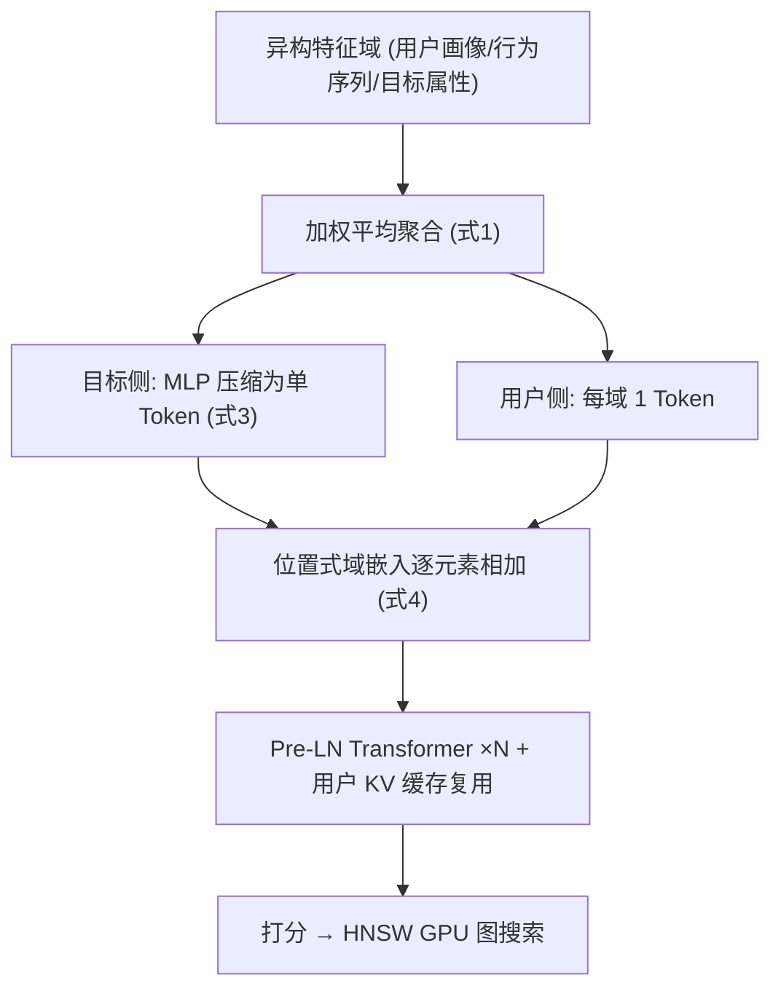
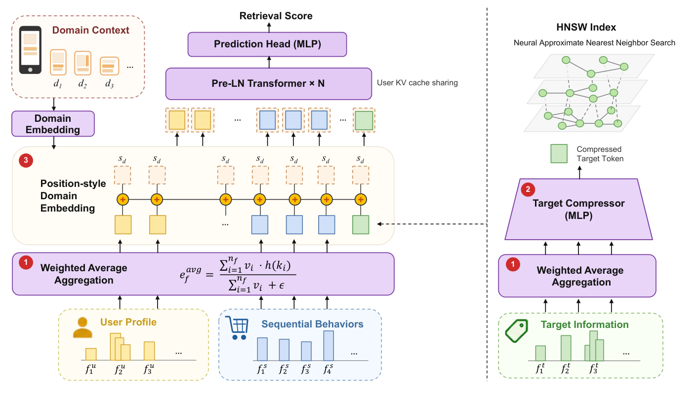

# TransRetrieval: Scaling Up Transformer-Based Retrieval for Industrial Recommendation (面向工业推荐的Transformer召回规模化)

- **会议/期刊**: CIKM 2026
- **作者与机构**: Zhifei Zheng, Yunfei Liu, Bin Liu, Qiren Zhu, Hanbing Liu, Ziru Xu, Han Zhu, Jian Xu, Qi Qi, Bo Zheng（中国人民大学高瓴人工智能学院 & 阿里巴巴淘天集团）
- **推荐链路定位**: 召回（Model-based Retrieval / NANN 范式）
- **研究方向**: 协同过滤与双塔召回 / 跨域与多场景推荐
- **论文原文**: [https://arxiv.org/abs/2608.25528v1](https://arxiv.org/abs/2608.25528v1)
- **开源代码**: 暂未开源

## TL;DR (1分钟核心速览)

推荐召回阶段长期无法复现 LLM 式的 Scaling Law：异构特征直接映射为 token 会产生严重的 token-norm 失配，堆叠 Transformer 层收益递减。本文提出 TransRetrieval，以**加权平均聚合**恢复同质 token 假设、以**目标 Token 压缩**将每候选 FLOPs 降 85%、以**位置式域嵌入**零成本统一 4 个业务域。在 400 亿交互工业数据集与 KuaiRand 上，算力从 0.1 增至 2 MFLOPs/target 带来 +19.3/+22.2 pt Recall@2000（对数线性拟合 $R^2=0.82/0.88$），线上 A/B 在同 P99 延迟下提升平台收入 2.53%。

## Background & Motivation (背景与核心矛盾)

- **主流范式**: 召回采用 NANN 式 model-based retrieval——DNN 打分函数驱动 HNSW 图上的 beam search，仅对语料中比例 $\rho\approx0.08\%$ 的候选做前向打分；打分网络因每候选一次前向的成本约束而被迫保持浅小（生产基线 BAR 仅 0.69 MFLOPs/target）。
- **前人局限**: ① HSTU/RankMixer/MARM/Climber/MTGR 等 Scaling 工作全部聚焦**精排**，且通过"拍平"或"预分组"特征**绕过**而非解决异构性；② 双塔内积（KuaiFormer）把交互限制在内积形式，扩大编码器几乎无收益（64D→128D 仅 0.485→0.495）；③ MMoE/PLE 的门控软路由使稀疏域梯度被隐式切分，STAR 的星型拓扑亦未证明能带来跨域迁移。
- **核心洞察 (Key Insight)**: 作者 profiling 发现，加权求和聚合的输出范数随特征基数 $n_f$ 增长，用户侧 token 范数可达目标侧的 **10 倍**，注意力权重被高范数 token 支配——这才是 Transformer 在推荐上"堆层无效"的根因，而非架构容量不足。
- **本文切入点**: 不改架构，先用一行无参算子修复输入条件（token 同质性），再把省下的算力重新投资到深度与宽度上。

## Method (核心方法设计)

### 1. 整体框架 (Overall Architecture)

输入侧每个特征域 $f$ 表示为 $(k_i,v_i)$ 键值对集合，先经加权平均聚合为单 token；目标侧所有聚合后的域嵌入经 3 层 MLP 压缩为**一个** $D$ 维 token，用户侧每域保留 1 token；随后一个可学习域嵌入以逐元素加法注入所有 token；最终进入 $N_{layer}$ 层 Pre-LN Transformer（ReLU FFN），用户侧 KV 在一次请求内只算一次并被全部候选复用，压缩后的单 token 直接作为 HNSW 索引向量，打分与图搜索统一在 GPU 上完成。

<figure class="paper-figure" markdown="span">
  <figcaption>图1：TransRetrieval 的整体架构。三个支柱均为轻量级设计：(i) 异构特征首先通过加权平均进行聚合。(ii) 目标特征通过 MLP 压缩为单个 token。(iii) 领域上下文通过位置式嵌入注入（添加到所有 token 上）。随后，共享 Transformer 针对一个用户侧 KV 缓存对请求的每个候选进行打分，该缓存仅计算一次并在所有目标间复用。</figcaption>
</figure>

### 2. 关键设计拆解 (Key Designs)

1. **加权平均聚合 (Weighted Average Aggregation)**：痛点是用户侧多值特征在加权求和下范数随 $n_f$ 累积，破坏同质 token 假设。改为除以权重和：
$$\tilde{e}_f=\frac{\sum_{i=1}^{n_f}v_i\cdot h(k_i)}{\sum_{i=1}^{n_f}v_i+\epsilon}$$
分母同时抵消了 $n_f$ 相关的累加与异质权重幅度，使输出范数仅由嵌入表分布界定、与域基数无关。作者明确排除 Max Pooling（$O(\sqrt{\ln n_f})$ 极值偏置、丢弃多数信息）与 Post-LayerNorm（中心化/重缩放抹掉了区分异构域所依赖的**逐域幅度信号**）。

2. **目标 Token 压缩 (Target Token Compression)**：由 FLOPs 分解
$$\text{FLOPs}_{total}\approx4D\cdot N_{target}\cdot L_t\cdot(4D+L_u)\cdot N_{layer}$$
可知 $D,N_{layer}$ 是待放大的 Scaling 参数、$N_{target}=\rho N$ 已被 HNSW 削减、$L_u$ 被 $4D$ 项支配，唯有目标 token 数 $L_t$ 有压缩空间。用 3 层 MLP（隐层 $[8D,4D,D]$、PReLU、层间 LayerNorm）将全部目标域嵌入拼接映射为单 token $t=\text{MLP}(\tilde{e}_{f_1},\dots,\tilde{e}_{f_M})\in\mathbb{R}^D$。关键立场是**压缩即重分配**：省下的 85% FLOPs 反投到 $D$ 与 $N_{layer}$，用冗余的逐候选 token 换取更丰富的跨特征交互。

3. **位置式域嵌入与训练/推理效率**：追加域 token 会把注意力从 $O(L^2)$ 抬到 $O((L+N_t)^2)$，故改为 $\tilde{e}_f=e_f+s_d$ 逐元素相加，序列长度与注意力复杂度均不变。其深层价值在于：域信息只经加法进入，**所有注意力头与 FFN 参数无条件跨域共享**，每个域的样本都向同一组参数贡献梯度，稀疏域不再数据饥饿——这与 MMoE/PLE 的门控梯度分割形成本质对立。训练沿用生产基线的 pairwise LTR 损失，负采样比按数据规模差异化设置（工业 5:1，KuaiRand 200:1）。推理侧三项工程优化：expand 算子广播单份用户 KV 缓存（免拷贝，单次前向 −30%）、多候选打包批算 + 算子融合（前向延迟较朴素实现降 11×）、检索全算子迁至 GPU（检索延迟降 89%，索引量化使并发 ×3）。

## Experimental Setup & Evaluation Protocol (实验设置与评估协议)

- **数据集与预处理**:

| 数据集 | #Users | #Items | #Interactions | 稀疏度/密度 | 特征/场景说明 |
| :--- | :---: | :---: | :---: | :---: | :--- |
| Industrial | 250M | 52M | 40B | 极稀疏 | 4 域（A/B/C/D 占比 32/20/26/22%），75 用户特征 + 87 目标特征，序列长 100；域 C 内含多个异质子域 |
| KuaiRand | 24,943 | 536,491 | 152M | 稀疏 | 4 域（11.7/84.8/3.32/0.13%），37 用户特征 + 63 目标特征；Tab 3 为极端稀疏域；用户过滤阈值 1000 点击、物品 100 曝光 |

- **数据划分与防穿越**: 两数据集均采用**全局时间戳切分**（历史训练、未来交互评估），杜绝穿越。
- **排名评测协议**: 指标为 **Recall@2000**，在 HNSW 实际访问的候选集上计算（工业约 4×10⁴ 候选 / 52M 语料，$\rho\approx0.08\%$），Overall 按各域评估交互占比加权。
- **对比基线与超参**: 基线含 Production Baseline (BAR)、KuaiFormer、HSTU、RankMixer，全部在同一预处理管线内复现并保留各自特征处理设计；统一 AdamW、lr=1e-3、weight decay=3e-5、pairwise LTR 损失；配置记法 $xD$-$yL$。

## Key Experimental Results (实验关键数据)

### 1. 主实验对比 (Main Results)

| 方法 | Industrial Overall | KuaiRand Overall | MFLOPs′ |
| :--- | :---: | :---: | :---: |
| KuaiFormer-128D5L | 0.495 | 0.409 | 0.011 |
| Production Baseline | 0.576 | 0.378 | 0.69 |
| HSTU-128D5L | 0.527 | 0.382 | 1.72 |
| RankMixer-128D8T | 0.452 | 0.364 | 2.10 |
| TransRetrieval-64D3L | 0.603 | 0.419 | 0.45 |
| **TransRetrieval-128D5L** | **0.657** | **0.473** | 1.91 |
| Improv. vs 最优基线 | **+8.1 pt** | **+6.4 pt** | — |

分域看，工业域 A/B/C/D 分别为 0.644/0.641/0.634/0.719，全面领先；KuaiRand 的 Tab 3 稀疏域上 HSTU 达 0.611 而 TransRetrieval 为 0.537，是唯一失手的格子。

### 2. 消融实验 (Ablation Study)

| 消融维度 | 配置 | R@2000 | MFLOPs′ |
| :--- | :--- | :---: | :---: |
| 聚合算子 (64D-5L) | **Weighted Average** | **0.618** | — |
| | Weighted Sum | 0.608 | — |
| | LN + Weighted Sum | 0.593 | — |
| | Max Pooling | 0.571 | — |
| 目标压缩 (64D-3L) | 8 tokens | 0.624 | 3.04 |
| | 4 tokens | 0.615 | 1.55 |
| | **1 token** | 0.603 | **0.45** |
| 多域建模 (64D-3L) | 单域独立训练 | 0.579 | 41.3 |
| | 0 Domain Token | 0.265 | 41.3 |
| | 1 Domain Token | 0.337 | 41.8 |
| | 20 Domain Tokens | 0.452 | 49.8 |
| | **位置式域嵌入** | **0.603** | **41.3** |

### 3. 关键实验发现 (Key Findings)

1. **压缩后放大严格优于"多 token + 小骨干"**：64D-3L 从 8 token 压到 1 token 仅掉 2.1 pt（0.624→0.603）却省 85% FLOPs；把省下的预算投到 128D-5L 后，以 **1.91 < 3.04 MFLOPs′** 的成本拿到 **0.657 > 0.624** 的召回，证明"压缩即重分配"是净赚而非折衷。
2. **Scaling 效率差近两个数量级**：128D-5L（1.91 MFLOPs′）在工业集上比 RankMixer-768D-16T（150.99 MFLOPs′）高 **12.6 pt**；而 KuaiFormer 维度翻倍仅 0.485→0.495，说明双塔内积瓶颈无法靠扩大编码器突破，Scaling 收益来自"允许任意跨特征交互"的 model-based 范式本身。
3. **域信号注入方式决定多域是资产还是负债**：无域信号直接混训灾难性崩塌（0.579→0.265），追加 20 个域 token 虽回升至 0.452 却付出 49.8 MFLOPs 代价；位置式嵌入以与 0-token 完全相同的 41.3 MFLOPs 取得 0.603，且显著超过单域独立训练的 0.579，验证了跨域迁移对稀疏域的正向增益。线上 5% 流量、为期一月的 A/B 中，域 C 收入提升最高（5.39%），整体收入 **+2.53%**（95% CI [2.22%, 2.70%]，p<0.0001），RPM +1.28%，广告主 ROI 持平（+0.06%），P99 延迟 <40 ms 与基线一致。

## Highlights, Limitations & Rating (亮点、对比与审稿评价)

- **与代表作对比 (vs. Prior Work)**: 与 HSTU/RankMixer 的本质区别在于——后者通过拍平或预分组**回避**特征异构性且只做精排，本文用无参加权平均**正面消除**范数失配并把 Scaling 推进到 $10^8$ 量级语料的召回阶段；与 Climber 相比，本文的输入 token 来自异构嵌入表而非同一张行为表，难度更高；与 MMoE/PLE 相比，本文以加法替代门控，实现梯度的无条件全域共享。
- **可迁移亮点**: ① "先修输入条件、再改架构"的诊断式思路——聚合前后的 token 范数分布应作为 Scaling 前的必查体检项；② 压缩-再放大的算力重分配范式，可直接迁移到精排/重排中任何"每候选前向"的昂贵打分器。
- **审稿级局限批判**: ① 每引擎 QPS 从 300 降至 230（1.91 vs 0.69 MFLOPs′），收益依赖横向扩容吸收，算力总账未在文中给出；② KuaiRand 极端稀疏域 Tab 3（0.13%）上不及 HSTU（0.537 vs 0.611），说明无条件参数共享在极度长尾域仍可能被主流域梯度淹没，跨域共享的"负迁移边界"缺乏理论刻画；③ 评测仅用单一 Recall@2000，缺少 NDCG 等序敏感指标与冷启动分桶分析。
- **四维评分**: 创新性 ⭐⭐⭐⭐ | 实验扎实度 ⭐⭐⭐⭐⭐ | 方法清晰度 ⭐⭐⭐⭐⭐ | 落地价值 ⭐⭐⭐⭐⭐

