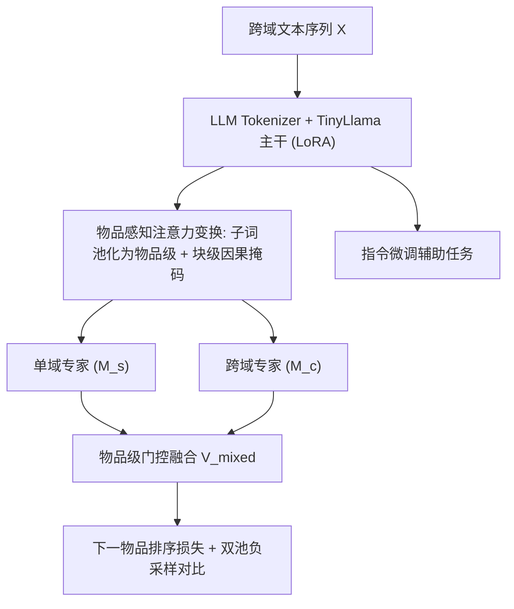
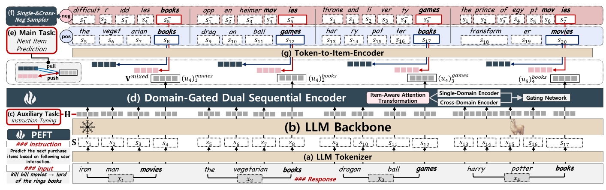

# A Dual-Expert Strategy Integrating LLMs to Mitigate Negative Transfer in Cross-Domain Sequential Recommendation (域门控双专家 LLM 跨域序列推荐)

- **会议/期刊**: CIKM 2026
- **作者与机构**: Hyeongjun Yun, Kihyuk Song, Jaegul Choo, Chung Park (SK Telecom / KAIST)
- **推荐链路定位**: 召回（ID-free 文本检索式 next-item 预测）
- **研究方向**: 跨域与多场景推荐 / 大语言模型推荐
- **论文原文**: [https://arxiv.org/abs/2608.23131v1](https://arxiv.org/abs/2608.23131v1)
- **开源代码**: [https://github.com/cpark88/DuELRec](https://github.com/cpark88/DuELRec)

## TL;DR (1分钟核心速览)

LLMRec 在跨域序列推荐中只建模 token 级自回归模式，丢失物品级协同信号，导致跨域知识迁移失真（负迁移），且比 IDRec 更严重。本文提出 DuELRec：用物品感知注意力变换把子词聚合为物品级序列，构造单域/跨域两个并行专家（不同块级因果掩码），再用物品级门控自适应融合，并配合单域+跨域双池随机负采样的 token-to-item 对比学习。在 Amazon 五域与 Telco 五域（共 10 域）上以 Leave-One-Out + 1:99 采样排序评测，全面超越 26 个 SOTA 基线，线上 A/B 的 CTR 从 0.90% 提升至 1.33%（相对 +47.6%）。

## Background & Motivation (背景与核心矛盾)

- **主流范式**: CDSR 分两支——IDRec（CGRec/SyNCRec 用 ID 嵌入表 + 域权重/互信息抑制负迁移）与 LLMRec（RecFormer/SAID/CALRec 把物品文本喂入 LLM 做生成或检索）。
- **前人局限**: ① LLMRec 只在子词级自回归上建模，无法刻画物品共现的协同信号，与推荐目标语义错位；② 多域场景下这种错位信号跨域传播，造成比 IDRec 更严重的负迁移（图 1：Books 与 Jewelry/Toys/Outdoors/Games 联合训练时 LLMRec 掉点显著大于 IDRec）；③ 现有 CDSR 多为两两配对域，扩展性差。
- **核心洞察 (Key Insight)**: 单域序列的协同信号"纯净"无负迁移但无正迁移收益；跨域序列含正负混合迁移。二者应被显式分离建模，再按"可靠性"逐物品加权。
- **本文切入点**: 用双专家 + 门控把"单域信号作为正则项"来压制跨域噪声，并用跨域负采样把协同信号注入 token 级 LLM。

## Method (核心方法设计)

### 1. 整体框架 (Overall Architecture)

输入为用户跨域交互序列的文本拼接（如 `iron man-action movie`），经 LLM tokenizer 得到子词序列 $S$（长度$L=\sum_i l_{x_i}$），送入冻结的 TinyLlama-1.1B 主干（LoRA/PEFT）得到隐表示$H\in\mathbb{R}^{L\times m}$。在$H$之上并联两个浅层 Transformer 专家：单域专家用块级掩码$M_s$只允许同域物品间因果注意力，跨域专家用$M_c$允许全物品因果注意力；取每个物品最后一个子词的表示作为物品级向量$V_s,V_c\in\mathbb{R}^{n\times m}$，经物品级门控融合为$V_{mixed}$。主任务用下一物品 pairwise 排序损失，辅以指令微调辅助任务；推理时用最后位置表示与候选物品嵌入做内积检索。

<figure class="paper-figure" markdown="span">
  <figcaption>图 2：我们以 Movies、Books 和 Games 三个域来说明我们的模型。物品级序列的总长度为 𝑛= 4，而子词级序列的长度为 𝐿= 17。</figcaption>
</figure>

### 2. 关键设计拆解 (Key Designs)

1. **物品感知注意力变换 + 双专家（Item-Aware Attention Transformation）**：痛点在于 LLM 的子词注意力粒度与"物品共现"目标错位。做法是把同一物品的子词视为一个块，掩码在块级重定义：单域专家 $M_s$仅允许同域历史物品可见，跨域专家$M_c$允许所有域历史物品可见；块内子词全互见以保留语义。物品表示取块内末位子词$u_{l_{x_i}}$。直觉：把注意力作用域从"子词"抬升到"物品"，让 LLM 直接建模物品级依赖，同时保留子词语义。

2. **物品级门控网络（Item-Wise Gating）**：痛点是如何在"无偏但无迁移"的单域专家与"有迁移但含噪"的跨域专家间取舍。门控逐物品计算：
$$V_{mixed}=g([V_s+V_c])_{[:,0]}V_s+g([V_s+V_c])_{[:,1]}V_c,\quad g(Y)=\text{softmax}\big(W_1Y+(\text{StdNorm}*\text{SoftPlus}(W_2Y))\big)$$
作者给出偏差-方差解释：设跨域专家含干扰项 $b_i$，则最优门控权重$g_i^\star=\frac{\|b_i\|^2+\sigma_c^2}{\sigma_s^2+\|b_i\|^2+\sigma_c^2}$——跨域偏差越大，权重越偏向单域专家。这为"用单域信号压制负迁移"提供了理论依据（图 4 显示 Jewelry 域强烈偏向单域专家，Web-View 域偏向跨域专家）。

3. **双池负采样 token-to-item 对比学习 + 训练目标**：痛点在于传统 CDSR 只从同域采负样本，学不到跨域判别力。做法是物品级嵌入 `ItemEmb(x)` 取 LLM 对物品子词序列的末位表示，负样本以概率 $p$从跨域池$\mathcal{V}\setminus\mathcal{V}_d$采样、否则从同域池$\mathcal{V}_d$ 采样：
$$x^-\sim\begin{cases}\mathcal{U}(\mathcal{V}_d), & \alpha>p\\ \mathcal{U}(\mathcal{V}\setminus\mathcal{V}_d), & \alpha\le p\end{cases}$$
总损失 $\mathcal{L}=\eta\mathcal{L}_{inst}+(1-\eta)\mathcal{L}_{nip}$，其中$\mathcal{L}_{nip}$为下一物品 pairwise sigmoid 排序损失，$\eta=0.5$、$p=0.4$。推理为对候选集$\mathcal{V}_d$ 的内积 top-k 检索，天然规避生成式幻觉。

## Experimental Setup & Evaluation Protocol (实验设置与评估协议)

- **数据集与预处理**:

| 数据集 | #Users | #Items | #Interactions | 稀疏度 | 特征/场景说明 |
| :--- | :---: | :---: | :---: | :---: | :--- |
| Amazon-Books | 105,364 | 425,985 | 1,422,676 | 99.98% | 五域联合（Books/Games/Jewelry/Outdoors/Toys） |
| Amazon-Games | — | 29,013 | 292,891 | 99.97% | 同上 |
| Amazon-Jewelry | — | 290,804 | 947,417 | 99.98% | 同上 |
| Amazon-Outdoors | — | 133,066 | 541,717 | 99.99% | 同上 |
| Amazon-Toys | — | 121,559 | 575,449 | 99.98% | 同上 |
| Telco-Web-View | 99,936 | 9,192 | 36,716,069 | 96.01% | 电信五域（Web-View/Call-Log/PoI/Benefits/Shopping） |
| Telco-Call-Log | — | 3,301 | 3,038,385 | 99.08% | 同上 |
| Telco-PoI | — | 549 | 1,892,868 | 96.44% | 同上 |
| Telco-Benefits | — | 72 | 401,065 | 92.08% | 同上 |
| Telco-Shopping | — | 714 | 230,233 | 99.60% | 同上 |

- **数据划分与防穿越**: `Leave-One-Out`——每用户序列末位为测试、倒数第二位为验证、其余训练；按测试物品所属域分域评测。
- **排名评测协议**: `Sampled Ranking`，1 个正样本 + 99 个用户未交互随机负样本；指标 HR@5/@10、NDCG@5/@10、MRR@10。
- **对比基线与超参**: 26 个基线分三类——IDRec-SDSR（GRU4Rec/SASRec/BERT4Rec/S3Rec/NextItNet/SINE/STAMP/TransRec/LightSANs）、IDRec-CDSR（BiTGCF/DTCDR/CMF/CLFM/DeepAPF/MoSE/CGRec/SyNCRec）、LLMRec（UniSRec/E4SRec/HLLM/RecFormer/SAID/CALRec/ReLLa/Lite-LLMRec/LLMEmb）。主干 TinyLlama-1.1B（hidden 2048、22 层、32 头），专家 hidden 2048、16 头、2 层；batch=4、epoch=25、AdamW、4×A100 40GB。

## Key Experimental Results (实验关键数据)

### 1. 主实验对比 (Main Results)

Amazon 五域 HR@5 / NDCG@5（节选代表性基线，完整见原文表 2）：

| 类型 | 模型 | Books HR@5 | Games HR@5 | Jewelry HR@5 | Outdoors HR@5 | Toys HR@5 |
| :--- | :--- | :---: | :---: | :---: | :---: | :---: |
| IDRec-SDSR | SASRec | 0.268 | 0.560 | 0.262 | 0.322 | 0.328 |
| IDRec-SDSR | SINE | 0.265 | 0.661 | 0.277 | 0.352 | 0.361 |
| IDRec-CDSR | CGRec | 0.258 | 0.632 | 0.298 | 0.351 | 0.354 |
| IDRec-CDSR | SyNCRec | 0.228 | 0.641 | 0.301 | 0.353 | 0.338 |
| LLMRec | RecFormer | 0.136 | **0.682** | 0.186 | 0.207 | 0.266 |
| LLMRec | E4SRec | 0.159 | 0.668 | 0.189 | 0.231 | 0.276 |
| LLMRec | LLMEmb | 0.262 | 0.654 | 0.270 | 0.311 | 0.351 |
| LLMRec | **Ours** | **0.300** | 0.609 | **0.363** | **0.359** | **0.400** |
| — | Improv.% | +3.81% | −10.7% | +20.6% | +1.70% | +10.8% |

Telco 五域 HR@5（节选）：

| 模型 | Web-View | Call-Log | PoI | Benefits | Shopping |
| :--- | :---: | :---: | :---: | :---: | :---: |
| SASRec | 0.944 | 0.707 | 0.893 | 0.892 | 0.391 |
| SyNCRec | 0.942 | 0.695 | 0.906 | 0.883 | 0.325 |
| RecFormer | 0.910 | 0.581 | 0.835 | 0.866 | 0.261 |
| LLMEmb | 0.926 | 0.491 | 0.851 | 0.823 | 0.315 |
| **Ours** | **0.950** | **0.747** | **0.916** | **0.913** | **0.423** |
| Improv.% | +0.11% | +4.33% | +1.10% | +1.33% | +2.92% |

### 2. 消融实验 (Ablation Study)

MRR 相对本文模型的变化（负值=掉点，原文表 5，节选 5 域）：

| 变体 | Books | Games | Jewelry | Outdoors | Toys | Call-Log | Shopping |
| :--- | :---: | :---: | :---: | :---: | :---: | :---: | :---: |
| (A) w/o DGDE（换普通 Transformer） | +1.87% | −0.23% | −22.2% | −11.3% | −8.00% | −49.0% | −36.4% |
| (B) w/o 单域专家 | −17.9% | −10.4% | −6.51% | −2.59% | −5.40% | −2.84% | −6.05% |
| (C) w/o 跨域专家 | −5.15% | −1.85% | +0.94% | −1.94% | −0.33% | −2.19% | −3.29% |
| (D) w/o SSCN（改同域均匀采样） | −0.48% | +9.94% | −35.4% | −13.3% | −10.1% | −53.3% | −41.5% |
| (E) w/ IDEmb（去 LLM 换 ID） | −20.4% | +3.01% | −31.2% | +0.56% | −29.3% | −59.9% | −233.6% |

### 3. 关键实验发现 (Key Findings)

1. **负迁移被显著逆转**：表 4 显示除本文外所有 CDSR 模型在多数域上相对 SASRec 单域训练掉点（如 CALRec 在 Jewelry HR@5 −41.2%、Shopping −53.5%），而 DuELRec 在全部 10 域均为正增益（Jewelry +10.2%、Toys +29.1%、Shopping +14.7%），证明门控确实把跨域噪声压回单域信号。
2. **双专家与双池采样缺一不可，且跨域负采样是"放大器"**：去掉 DGDE 在 Call-Log 掉 49.0%、Jewelry 掉 22.2%；去掉 SSCN 在 Call-Log 掉 53.3%、Shopping 掉 41.5%，说明仅靠同域负样本（$p=0$）无法学到跨域判别边界；$p$从 0 增至 0.5 性能单调上升，$p=0.4$ 为最优折中。
3. **冷/暖物品与冷用户双赢**：LLMRec 普遍冷物品强、暖物品弱于 IDRec，而 DuELRec 在冷、暖物品上均超 IDRec（图 5）；冷用户（交互长度后 1%）场景下亦全面领先（图 6），说明物品级协同信号与 LLM 语义表征互补。线上 A/B（2025.1–3，约 500 万用户 14 域）CTR 0.90%→1.33%（$p<0.01$），代价是推理延迟 105ms→242ms。

## Highlights & Limitations (亮点、对比与审稿批判)

- **与代表作对比 (vs. Prior Work)**: 相比 CGRec/SyNCRec 用域权重或互信息"事后惩罚"负迁移，本文在注意力掩码层面"事前隔离"单/跨域信号；相比 RecFormer/SAID 等 LLMRec 只做子词级建模或两阶段 ID 对齐，本文首次实现 ID-free、单模型支持 >3 域的物品级协同建模。
- **可迁移亮点**: ① 块级因果掩码把任意 token 级 LLM 改造成"物品级序列建模器"，可迁移到多行为/多场景序列；② 双池负采样（同域+跨域）是低成本提升跨域判别力的通用技巧；③ 门控的偏差-方差最优权重给出了"何时信单域、何时信跨域"的可解释判据。
- **审稿级局限批判**: ① 推理延迟 242ms/call，约为 SASRec 变体的 2.3 倍，对高并发召回不友好；② 评测采用 1:99 采样排序而非 Full-Ranking，绝对数值可能偏乐观，且 Telco-Benefits 仅 72 个物品，域间规模极不均衡；③ 门控权重与 $p$ 需逐数据集调参，跨域数量增至 14 域时的扩展性仅由线上实验间接佐证。

## Rating (四维评分)

- **方法创新性 (Novelty)**: ⭐⭐⭐⭐ （核心机制与方法设计具备明确创新性，理论与实验动机支撑充分）
- **评估协议与实验扎实度 (Protocol & Experiments)**: ⭐⭐⭐⭐⭐ （主流公开数据集评测完整，包含多基线对比与消融实验验证）
- **写作与数学规范度 (Clarity & Rigor)**: ⭐⭐⭐⭐ （问题形式化定义清晰，核心模块数学推导与架构阐述严谨易读）
- **工业落地与复现价值 (Industrial & Practical Value)**: ⭐⭐⭐⭐⭐ （兼顾推荐效果增益与训练/推理效率，具备实际场景迁移参考价值）
