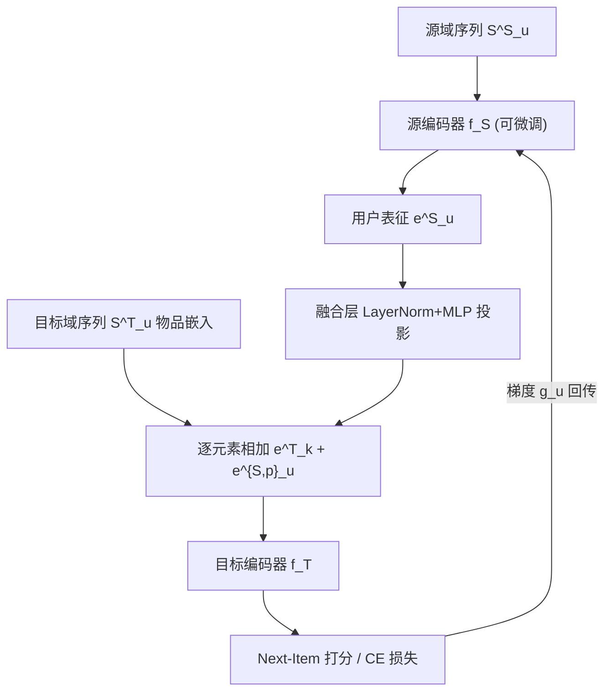
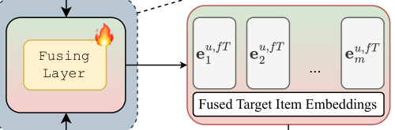

# Cross-Domain Sequential Recommendation with Representation-Level User Transfer (基于表征级用户迁移的跨域序列推荐)

- **会议/期刊**: CIKM 2026 (Full Paper Track)
- **作者与机构**: Abdulaziz Samra, Nikita Sukhorukov, Alexey Grishanov, Alexey Vasilev, Evgeny Frolov (Skoltech / HSE / Sber AI Lab)
- **推荐链路定位**: 召回（Next-Item 序列召回）
- **研究方向**: 跨域与多场景推荐 / 序列推荐
- **论文原文**: [https://arxiv.org/abs/2610.35550v1](https://arxiv.org/abs/2610.35550v1)
- **开源代码**: [https://github.com/aa-samra/fladrec](https://github.com/aa-samra/fladrec)

## TL;DR (1分钟核心速览)

现有跨域序列推荐（CDSR）依赖合并原始交互序列、共享物品空间或全用户重叠假设，在业务数据隔离与用户部分重叠的真实场景下难以落地。本文提出 FLADRec：源域编码器输出定长用户表征，经 LayerNorm+MLP 投影后**逐元素加到目标域每个物品嵌入**上作为全局用户上下文，全程不交换原始序列与物品 ID；源编码器通过纵向联邦（VFL）梯度桥接按目标域损失微调。在 Amazon 三对基准（采样 999 负例）与 TenRec、Zvuk&MegaMarket 两个工业级数据集（全库排序、严格时间切分、50% 用户重叠）上，NDCG@10 相对 SASRec 提升 7.4%–24.1%，且无源域历史的用户同样获益。

## Background & Motivation (背景与核心矛盾)

- **主流范式**: CDSR 通过共享物品空间、合并双域序列联合训练（C2DSR、DREAM、MGCL）或参数迁移（ABXI 的 task-guided LoRA）将源域知识注入目标域。
- **前人局限**: 其一，这些方法默认可访问双域原始交互序列或需跨域用户/物品对齐，与数据所有权隔离的现实冲突；其二，普遍假设用户完全重叠，而真实平台重叠率往往仅 50% 左右，非重叠用户被直接丢弃。
- **核心洞察 (Key Insight)**: 参数迁移在分布差异大时易负迁移/灾难遗忘；而**用户级定长表征**既不含物品 ID 也不含原始序列，是天然满足 VFL 约束的最小可交换信息单元。
- **本文切入点**: 只迁移"源域编码器输出的用户向量"，用轻量融合层把它变成目标序列的条件上下文；源编码器用目标域回传梯度微调，使表征对齐下游任务而非源域任务。

## Method (核心方法设计)

### 1. 整体框架 (Overall Architecture)

双流并行：源域流用（可微调的）源编码器把源序列 $\mathcal{S}^S_u$压成用户表征$\mathbf{e}^S_u$；目标域流把目标序列嵌入送入目标编码器。融合层对$\mathbf{e}^S_u$做 LayerNorm + MLP 投影到目标嵌入空间得$\mathbf{e}^{S,p}_u$，逐元素加到每个目标物品嵌入上，形成"被源域偏好条件化"的序列再编码，输出$\mathbf{e}^T_u$做 next-item 预测。无源域历史的用户跳过融合，退化为标准单域 SASRec，但仍与共享用户联合训练。训练采用 VFL：目标侧算出对迁移表征的梯度$g_u$ 回传源编码器，双域参数用独立优化器更新。

<figure class="paper-figure" markdown="span">
  <figcaption>图1：FLADRec 架构。源域（绿色，上方）和目标域（红色，下方）流并行处理用户序列。融合层将源序列表示 e𝑆 映射</figcaption>
</figure>

### 2. 关键设计拆解 (Key Designs)

1. **表征级条件融合（Fusing Layer）**：痛点是不许交换序列、也不许共享物品嵌入，跨域信号无处注入。做法是把源用户向量投影后**加性广播**到目标序列每个位置：$\mathbf{e}^f_{T_k}=\mathbf{e}_{u,T_k}+\mathbf{e}^{S,p}_u,\ k=1,\dots,m$。相比拼接或交叉注意力，加性注入不引入额外序列长度与跨域 token 对齐问题，且天然支持"缺失即跳过"——这是它能同时服务共享/非共享用户的结构性原因。
2. **VFL 梯度桥接微调源编码器**：源表征原本为源域 next-item 任务优化，直接投影存在语义错位。目标侧先算 $g_u=\partial\mathcal{L}_T/\partial \mathbf{e}^S_u$，再按链式法则$\nabla_{\theta_S}\mathcal{L}_T=g_u\cdot\partial f_S(\mathcal{S}^S_u;\theta_S)/\partial\theta_S$ 回传，使源编码器**直接对目标域目标函数**优化，而原始交互与物品 ID 始终不出域。
3. **训练目标与效率**：目标损失为 next-item 交叉熵 $\mathcal{L}_T=\mathcal{L}(f_T(\mathcal{S}^T_u,\mathbf{e}^S_u;\theta_T))$；基准数据集用全 softmax CE，工业级大词表用 Scalable CE（近似版）以控制开销。无负采样设计（CE 隐式全库竞争），推理时仅需一次源编码前向 + 一次目标编码前向，融合层为单层 MLP，开销可忽略。

## Experimental Setup & Evaluation Protocol (实验设置与评估协议)

- **数据集与预处理**:

| 数据集 | #Users | #Items | #Interactions | 稀疏度/密度 | 特征/场景说明 |
| :--- | :---: | :---: | :---: | :---: | :--- |
| Food→Kitchen | 7,144 | 11,837 / 89,885 | 83,663 | 0.098% | Amazon 类目对，5-core，序列截断 50，100% 重叠 |
| Beauty→Electronics | 4,474 | 10,379 / 63,800 | 50,329 | 0.108% | 同上，Amazon 类目对 |
| Movie→Book | 28,350 | 35,712 / 403,147 | 347,650 | 0.034% | 同上，规模最大基准对 |
| QK-Article→QK-Video (TenRec) | 449,288 | 180,951 / 694,609 | 14.9M / 11.8M | — | 真实跨平台，50% 重叠，≥10 交互过滤 |
| Zvuk→MegaMarket | 95,952 | 822,274 / 453,367 | 38.7M / 4.75M | — | 音乐流媒体→电商，50% 重叠 |

- **数据划分与防穿越**: Amazon 基准沿用 ABXI 协议——`Leave-One-Out`（最后一条测试、倒数第二条验证）；Zvuk&MM 采用**全局时间戳切分**（最后一周测试、倒数第二周验证），严格防穿越；TenRec 无绝对时间戳，采用用户内 80/10/10 顺序划分。
- **排名评测协议**: Amazon 基准为 `Sampled Ranking`（每正例 999 负例，与 ABXI 对齐）；工业级数据集为无偏 `Full-Ranking`（全库排序，无负采样），并额外报告 Coverage@K。
- **对比基线与超参**: 单域 SASRec/BERT4Rec（ST 与 DT 两种调参口径）；跨域 CD-SASRec、FedDCSR、CD-ASR（受限数据组）与 MGCL、C2DSR、DREAM、ABXI（池化数据组）。骨干为 SASRec，源/目标编码器均由最佳单域 SASRec 初始化，AdamW、batch 256、patience 10（按验证 NDCG@10 早停），Optuna 30 次调参。

## Key Experimental Results (实验关键数据)

### 1. 主实验对比 (Main Results)

受限数据组（不与源域共享原始交互，FLADRec 所属赛道），NDCG@10 / HR@10：

| 域对 | SASRec-1 | BERT4Rec-1 | CD-SASRec | FedDCSR | CD-ASR | **FLADRec** | Improv. (vs 最强基线) |
| :--- | :---: | :---: | :---: | :---: | :---: | :---: | :---: |
| Food | 0.1561 | 0.1462 | 0.1421 | 0.1214 | 0.1616 | **0.1851** | +14.5% (vs CD-ASR) |
| Kitchen | 0.1040 | 0.0926 | 0.0946 | 0.0754 | 0.1107 | **0.1926** | +74.0% (vs CD-ASR) |
| Beauty | 0.1523 | 0.1404 | 0.1380 | 0.1061 | 0.1424 | **0.2135** | +49.9% (vs CD-ASR) |
| Electronics | 0.1111 | 0.1053 | 0.1069 | 0.0939 | 0.1122 | **0.1776** | +58.3% (vs CD-ASR) |
| Movie | 0.1647 | 0.1927 | 0.1940 | 0.1866 | 0.1956 | **0.2260** | +15.5% (vs CD-ASR) |
| Book | 0.1007 | 0.1378 | 0.1434 | 0.1030 | 0.1372 | **0.1716** | +19.7% (vs CD-SASRec) |

池化数据组（可混合原始数据）中，FLADRec 在 Kitchen（0.1926 vs ABXI 0.1415）、Electronics（0.1776 vs 0.1385）、Book（0.1716 vs 0.1669）反超 ABXI，Food/Beauty/Movie 略低于 ABXI（如 Food 0.1851 vs 0.1973），但后者享有数据池化特权。

工业级全库排序（vs SASRec 单域）：

| 数据集 | NDCG@10 | NDCG@100 | HR@10 | HR@50 | COV@10 |
| :--- | :---: | :---: | :---: | :---: | :---: |
| TenRec (QK) | 0.0283 (+24.1%) | 0.0569 (+21.3%) | 0.0532 (+25.8%) | 0.1395 (+20.8%) | 0.1794 (+6.6%) |
| Zvuk&MM | 0.0626 (+7.4%) | 0.0781 (+9.8%) | 0.1063 (+18.5%) | 0.1573 (+20.4%) | 0.1320 (0.0%) |

训练效率：FLADRec 四阶段总耗时较 ABXI 加速 **3.68×–11.57×**（如 Food 3.63 min vs 42.0 min）。

### 2. 消融实验 (Ablation Study)

TenRec 上按用户子集拆分的 NDCG@10（ALL / Shared / Unshared）：

| 配置 | ALL | Shared | Unshared |
| :--- | :---: | :---: | :---: |
| SASRec 基线 | 0.02248 | 0.00976 | 0.01272 |
| FLADRec 源微调 + full transfer | **0.02832** (+26.0%) | **0.01231** (+26.3%) | **0.01601** (+25.8%) |
| 源微调 + random 注入 | 0.02790 (+24.5%) | 0.01226 (+25.7%) | 0.01564 (+23.0%) |
| 源微调 + no transfer | 0.02814 (+25.2%) | 0.01213 (+24.4%) | 0.01601 (+25.8%) |
| 源冻结 + full transfer | 0.02689 (+19.6%) | 0.01158 (+18.8%) | 0.01531 (+20.3%) |
| 源冻结 + random 注入 | 0.02621 (+16.6%) | 0.01133 (+16.2%) | 0.01488 (+17.0%) |

### 3. 关键实验发现 (Key Findings)

1. **增益主要来自联合训练而非显式迁移**：源微调下 `no transfer` 已达 +25.2%，与 `full transfer` 的 +26.0% 仅差 0.8 个点；说明目标编码器在混合"融合/未融合"序列的训练中获得的隐式正则化是主因，显式注入是锦上添花。
2. **源编码器微调不可省**：冻结源编码器后 full transfer 从 0.02832 掉到 0.02689（−5.0%），且 random 注入（0.02621）反而劣于 no transfer（0.02689）——固定表征空间无法吸收注入扰动，验证 VFL 梯度桥接的必要性。
3. **非共享用户同样显著受益**：unshared 子集 +25.8%，与 shared 的 +26.3% 几乎持平，直接反驳"跨域只服务重叠用户"的常见质疑；同时 COV@10 在 TenRec 上 +6.6%，但 COV@100 下降 5.3%，说明精度提升伴随长列表多样性收缩，需在工业部署中权衡。

## Highlights & Limitations (亮点、对比与审稿批判)

- **与代表作对比 (vs. Prior Work)**: 相比 C2DSR/DREAM 的对比学习需双域序列共现、ABXI 的 LoRA 需池化原始数据，FLADRec 只交换一个定长向量，隐私约束最严却仍具竞争力；相比 FedDCSR 的解耦序列表征，本文不做序列级解耦，而以"加性条件注入"换取对缺失源域的自然鲁棒性。
- **可迁移亮点**: ①"投影后加性广播到序列每个位置"是一种极低成本的条件化手段，可迁移到任意 side-information 注入场景（如用户画像、上下文特征）；②按 shared/unshared 子集拆分报告指标，应成为 CDR 论文的标准消融口径。
- **审稿级局限批判**: ①隐私论证偏弱——作者自承无防重构攻击机制，梯度回传仍需 DP 等加固；②基准实验仍是 999 负例采样排序且 Amazon 类目对为"伪跨域"，与工业全库排序结论存在口径落差；③融合层仅为加性注入，未与注意力/门控融合做对照，且源域仅支持单源，多源扩展留作未来工作。

## Rating (四维评分)

- **方法创新性 (Novelty)**: ⭐⭐⭐ （融合算子本身极简、近乎"投影+广播"，创新度中等，但"表征级最小交换单元 + 缺失即退化"的问题建模视角有实用价值）
- **评估协议与实验扎实度 (Protocol & Experiments)**: ⭐⭐⭐⭐ （双轨评估设计出色：既对齐旧基准又补全库排序+时间切分+50% 重叠的工业设定，并按用户子集拆分消融；扣分在于基准侧仍用采样指标）
- **写作与数学规范度 (Clarity & Rigor)**: ⭐⭐⭐⭐ （公式简洁、VFL 梯度推导清晰，第 7.2 节对 CDR 评测五大陷阱的批判颇具参考价值；融合机制的理论分析偏直觉化）
- **工业落地与复现价值 (Industrial & Practical Value)**: ⭐⭐⭐⭐⭐ （代码开源、训练较 ABXI 加速 3.68–11.57×、仅传定长向量即可跨子公司部署，工程可落地性是该文最强项）
