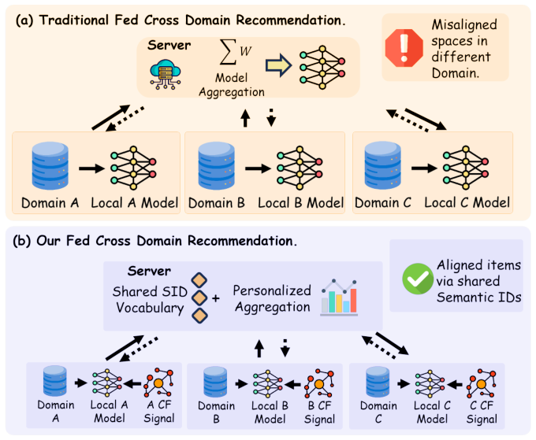
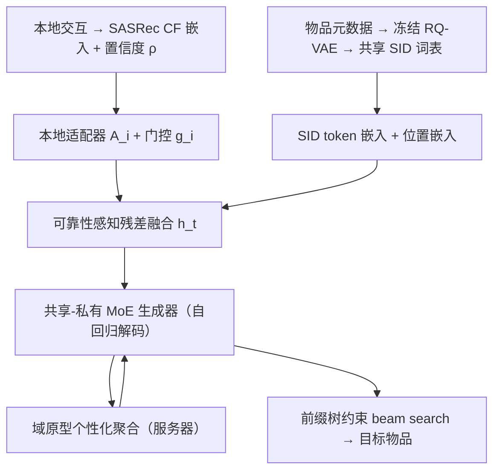

# FedCGR: Federated Cross-Domain Generative Recommendation (联邦跨域生成式推荐)

- **会议/期刊**: CIKM 2026
- **作者与机构**: Zhuodong Liu, Hugen Lv (北京交通大学); Xiangyu Li (上海交通大学); Bohan Guo (马来亚大学); Peiyu Hu (西交利物浦大学)
- **推荐链路定位**: 端到端生成式（SID 自回归生成召回）
- **研究方向**: 跨域与多场景推荐 / 生成式推荐
- **论文原文**: [https://arxiv.org/abs/2608.10929v1](https://arxiv.org/abs/2608.10929v1)
- **开源代码**: [https://github.com/ZhuodLiu/FedCGR](https://github.com/ZhuodLiu/FedCGR)

## TL;DR (1分钟核心速览)

联邦跨域推荐的核心矛盾在于：对齐物品空间所依赖的重叠用户与共享交互信号，在联邦隔离下恰恰稀疏、不可得或隐私敏感。FedCGR 将联邦 CDR 重构为「稳定语义物品语言上的生成」——用公开物品元数据训练固定 RQ-VAE 分词器，以共享 SID 词表天然诱导跨域对齐；再以可靠性感知 CF 残差注入本地协同信号、以原型个性化聚合抑制域异构负迁移。在 6 个 Amazon 跨域场景、全库排序协议下，GKBS Grocery N@10 相对 TIGER+FedProx 提升 19.4%，999 负采样下全面超越 FedDCSR。

## Background & Motivation (背景与核心矛盾)

- **主流范式**: 联邦 CDR 以判别式模型为主（FedSASRec、FedDCSR 等），在各自域特定的连续表征空间中打分，跨域迁移依赖"把私有空间变得可比"。
- **前人局限**: ① 对齐锚点（重叠用户、共现图）在联邦隔离下稀疏甚至缺失，隐私约束与对齐效果强耦合；② 标准 FedAvg 在域异构下产生负迁移，判别式与生成式皆然（GKBS 上 LocalSASRec 0.144 → FedSASRec 0.129）。
- **核心洞察 (Key Insight)**: SID 生成式推荐把物品表示为公开元数据导出的离散 token 序列，跨域对齐可由**共享词表**天然诱导，无需交换私有交互；但分词器必须冻结以保 token 一致性，由此产生"纯语义瓶颈"，且自回归多级 token 决策会放大早期分布扰动、加剧负迁移。
- **本文切入点**: 保持物品语言稳定（冻结 SID 词表），把适配显式化——在稳定接口上注入可靠本地证据，并按域相关性选择性共享参数。

<figure class="paper-figure" markdown="span">
  <figcaption>图 1：(a) 传统联邦 CDR 中，各客户端的领域特定表示未对齐；(b) 我们的方法通过共享 SID 词表与个性化聚合对齐物品，同时各客户端利用保持私有的本地 CF 信号丰富表示。</figcaption>
</figure>

## Method (核心方法设计)

### 1. 整体框架 (Overall Architecture)

物品侧元数据经 BGE 编码后由 RQ-VAE 量化为 3 级 SID，分词器训练完即冻结，形成跨客户端一致的离散词表。各客户端用私有交互本地训练 SASRec 提取 CF 物品嵌入并计算物品级置信度，经客户端本地适配器与门控以残差形式注入 SID token 表征；生成器为编码-解码 Transformer，FFN 替换为共享-私有 MoE。联邦训练中仅上传共享生成器参数与低维域原型，服务器按原型余弦相似度构造个性化聚合权重下发；推理时用目标域前缀树约束 beam search 解码。

### 2. 关键设计拆解 (Key Designs)

1. **可靠性感知语义接口（Reliability-Aware Semantic Interface）**：冻结分词器导致 CF 信号无法进入 token 空间，且各客户端独立训练的 CF 嵌入坐标系不可比、质量不均。本文不改分词器，而是在输入表征上做残差融合：
$$h_t=\sum_{l=1}^{L}E^{l}_{\text{sid}}(c^{l}_{v_t})+E_{\text{pos}}(t)+\rho_{v_t,i}\cdot g_i\cdot A_i(e^{\text{cf}}_{v_t,i})$$
其中 $\rho_{v,i}=\frac{\log(1+n_{v,i})}{\epsilon+\max_{v'}\log(1+n_{v',i})}$ 为物品级置信度，$g_i=\sigma(\alpha_i)$ 为客户端本地门控。直觉：头部物品 CF 可信、长尾物品 CF 噪声大，用频次置信度做软抑制，门控再校准域级贡献强度；适配器 $A_i$ 与 CF 嵌入均不上传，规避坐标系对齐问题。

2. **原型个性化联邦生成器（Prototype-Personalized Generator）**：均匀 FedAvg 在域异构下负迁移，且自回归 SID 的早期 token 扰动会沿前缀树级联。本文在 FFN 处引入共享-私有 MoE（$N_s$ 个共享专家 + 1 个本地私有专家，top-$k$ 路由），并让服务器按域原型相似度加权聚合：
$$\omega_{ij}=\frac{n_j\exp(\cos(p_i,p_j)/\tau_a)}{\sum_k n_k\exp(\cos(p_i,p_k)/\tau_a)},\quad \bar{W}_{i,\text{sh}}=\sum_{j}\omega_{ij}W_{j,\text{sh}}$$
原型 $p_i$ 由编码器物品位置记忆池化后 EMA 更新并 L2 归一化。$\tau_a\to\infty$ 时退化为 FedAvg，故该式是 FedAvg 的严格推广；行为相近的域获得更强参数共享，异构域自动降权。

3. **训练目标、负采样与推理效率**：本地损失
$$\mathcal{L}_i=\mathcal{L}_{\text{sid}}+\lambda_d\mathcal{L}_{\text{dense}}+\lambda_a\mathcal{L}_{\text{aux}}+\frac{\mu}{2}\|W_{i,\text{sh}}-\bar{W}^{(t)}_{i,\text{sh}}\|_2^2$$
其中 $\mathcal{L}_{\text{dense}}$ 为置信度加权、仅用客户端本地 in-batch 负样本的 InfoNCE（目标为本地 CF 嵌入，stop-gradient），$\mathcal{L}_{\text{aux}}$ 为 MoE 负载均衡损失，近端项仅作用于共享参数。SID 生成本身免负采样。推理用域前缀树 + beam size 50，稠密辅助头训练后丢弃；每轮上传 5.1M 参数（20.6 MB），比 FedAvg 基线多约 18%，但收敛更快。

## Experimental Setup & Evaluation Protocol (实验设置与评估协议)

- **数据集与预处理**: Amazon Review 五域，均做 `5-core` 过滤：

| 数据集 | #Users | #Items | #Interactions | 密度 | 场景说明 |
| :--- | :---: | :---: | :---: | :---: | :--- |
| Food | 9,215 | 3,742 | 98,866 | 0.29% | FK 高相关 |
| Kitchen | 7,536 | 4,116 | 78,589 | 0.25% | FK/FKB/GKBS |
| Grocery | 6,423 | 2,911 | 63,812 | 0.34% | GB/GS/GBS/GKBS |
| Beauty | 8,159 | 4,727 | 82,438 | 0.21% | GB/FKB/GBS/GKBS |
| Sports | 7,102 | 5,166 | 68,747 | 0.19% | GS/GBS/GKBS |

  六场景：FK（高相关）、GB（中）、GS（低）、FKB/GBS（三域）、GKBS（四域，重叠用户仅 0.3%）。
- **数据划分与防穿越**: 每用户序列 `Leave-One-Out`——末位测试、倒数第二位验证、其余训练。
- **排名评测协议**: 主评测为**全库 Full-Ranking**（对目标域全量物品排序）；另按前作惯例补充 **999 负采样 Sampled Ranking**（每用户负样本集固定、跨方法共享，seed 42，三次运行取均值）。
- **对比基线与超参设置**: 全库组含 GRU4Rec/SASRec（单域判别）、TIGER（单域生成）、TIGER+FedAvg/FedProx（联邦生成）；999-neg 组含 LocalSASRec/CL4SRec/DuoRec、FedSASRec/FedCL4SRec/FedDCSR。SID 维度 $L=3$、码本 256，$d_{\text{model}}=256$，$d_{\text{cf}}=128$，$\lambda_d=0.1$、$\tau_a$ 验证集调优、40 轮联邦、3 seeds（标准差 < 0.003）。

## Key Experimental Results (实验关键数据)

### 1. 主实验对比 (Main Results)

全库排序（节选代表性域，H@10 / N@10）：

| 场景-域 | 指标 | GRU4Rec | SASRec | TIGER | +FedAvg | +FedProx | **FedCGR** | Improv. |
| :--- | :---: | :---: | :---: | :---: | :---: | :---: | :---: | :---: |
| FK-Food | H@10 | 0.104 | 0.107 | 0.114 | 0.119 | 0.122 | **0.179** | +46.7% |
| FK-Kitchen | H@10 | 0.053 | 0.055 | 0.033 | 0.033 | 0.034 | **0.061** | +79.4% |
| GS-Grocery | H@10 | 0.144 | 0.164 | 0.145 | 0.159 | 0.167 | **0.175** | +4.8% |
| GS-Sports | N@10 | 0.110 | 0.081 | 0.079 | 0.081 | 0.089 | **0.119** | +33.7% |
| GBS-Beauty | N@10 | 0.113 | 0.111 | 0.055 | 0.076 | 0.062 | **0.098** | +28.9% |
| GKBS-Grocery | N@10 | 0.054 | 0.059 | 0.055 | 0.059 | 0.062 | **0.074** | +19.4% |
| GKBS-Kitchen | H@10 | 0.039 | 0.047 | 0.051 | 0.056 | 0.071 | **0.079** | +11.3% |

999 负采样（场景宏平均）：

| 方法 | FK | GS | GB | FKB | GBS | GKBS |
| :--- | :---: | :---: | :---: | :---: | :---: | :---: |
| LocalSASRec | .130 | .153 | .175 | .151 | .162 | .144 |
| FedSASRec | .127 | .149 | .167 | .142 | .148 | .129 |
| FedDCSR | .179 | .170 | .194 | .187 | .177 | .180 |
| **FedCGR** | **.187** | **.208** | **.207** | **.200** | **.191** | **.186** |

### 2. 消融实验 (Ablation Study)

N@10 场景宏平均（FK / GKBS / 平均相对变化）：

| 变体 | FK | GKBS | Δavg |
| :--- | :---: | :---: | :---: |
| FedCGR full | 0.048 | 0.092 | — |
| w/o CF residual (SID only) | 0.042 | 0.080 | −12.8% |
| w/o 物品置信度 $\rho_v$ | 0.044 | 0.085 | −8.0% |
| w/o 域门控 $g_i$ | 0.045 | 0.086 | −6.4% |
| w/o 稠密头 | 0.046 | 0.089 | −3.7% |
| FedAvg 聚合 | 0.044 | 0.079 | −11.2% |
| w/o 原型权重（$\tau_a\to\infty$） | 0.044 | 0.081 | −10.1% |
| w/o 共享-私有拆分 | 0.045 | 0.084 | −7.5% |
| w/o CF + FedAvg | 0.041 | 0.078 | −14.9% |

### 3. 关键实验发现 (Key Findings)

1. **交叉效应揭示两机制的适用边界**：高相关 FK 上移除 CF 残差（−12.5%）比换回 FedAvg（−8.3%）更伤，瓶颈在恢复域内协同行为；异构 GKBS 上反转（FedAvg −14.1% vs. CF −13.0%），负迁移成为主导约束。这为"何时该加本地证据、何时该改聚合"提供了可操作的判据。
2. **冷启动增益主要来自稳定 SID 词表，CF 残差随活跃度递增**：冷用户组 FedCGR 与 SID-only 均优于 TIGER+FedProx，说明语义词表是冷启动底座；而 Full 与 SID-only 的差距从 cold 到 active 逐步拉大，验证了 $\rho_v$ 门控"可信才启用"的设计——不靠噪声 CF 硬撑冷启动。
3. **个性化聚合的收益随异构度单调放大，且转化为通信节省**：$\tau_a=0.10$ 与 $\tau_a=\infty$ 的差距在四域 GKBS 上达 14.8%（GB 仅 11.0%）；尽管每轮多传 18% 参数，达到同等 N@10 目标的总上传量在 GBS 降 34%、GKBS 降 45%，说明收敛加速足以抵消单轮开销。

## Highlights, Limitations & Rating (亮点、对比与审稿评价)

- **与代表作对比 (vs. Prior Work)**: 相比 FedDCSR 等判别式联邦 CDR，本文把对齐从"私有连续空间的额外目标"变为"共享离散词表的天然属性"，解耦了隐私与对齐；相比 TIGER+FedProx，本文指出冻结分词器造成的语义瓶颈与自回归级联负迁移是生成式联邦特有的两个约束，并分别用可靠性残差与原型聚合对症下药；相比集中式 GenCDR，本文在交互不出域的前提下复现了统一语义分词的收益。
- **可迁移亮点**: ① "冻结离散词表 + 本地残差注入"可作为任何需要跨方共享 token 空间（如跨平台生成式召回）的通用接口范式；② 用编码器记忆池化的域原型做聚合权重，仅上传 <1 KB 即可实现个性化联邦，成本极低。
- **审稿级局限批判**: ① 未提供形式化差分隐私保证，原型与共享梯度仍可能泄露域级分布信息，作者亦承认 secure aggregation 为未来工作；② 全库排序下在交互稠密域（GBS-Beauty：SASRec 0.191 vs. FedCGR 0.162）仍逊于判别式模型，生成式范式在强协同信号场景的劣势未被完全消解；③ 每域需一次性 8 分钟本地 CF 预训练，且 $\lambda_d$、$\tau_a$ 均在 0.10 附近呈尖峰最优，超参敏感度对落地调参提出要求。
- **四维评分**: 创新性 ⭐⭐⭐⭐ | 实验扎实度 ⭐⭐⭐⭐⭐ | 方法清晰度 ⭐⭐⭐⭐ | 落地价值 ⭐⭐⭐⭐

