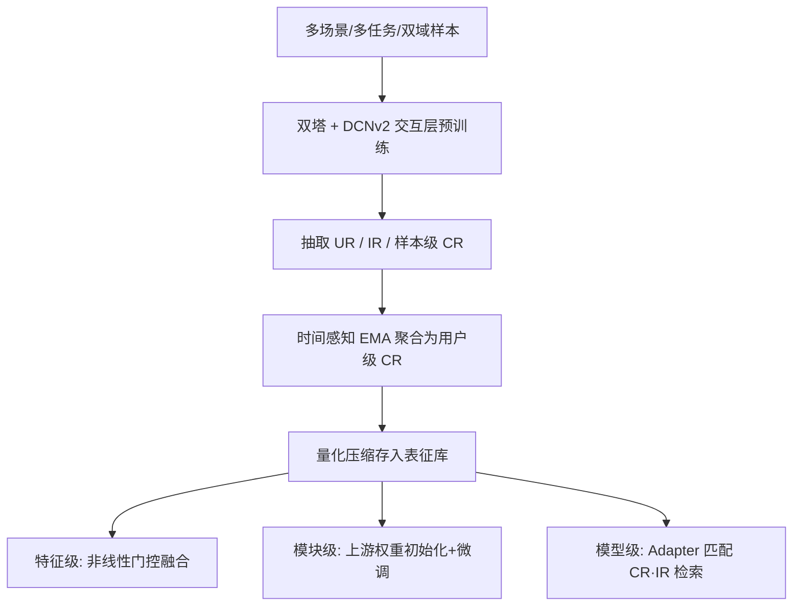
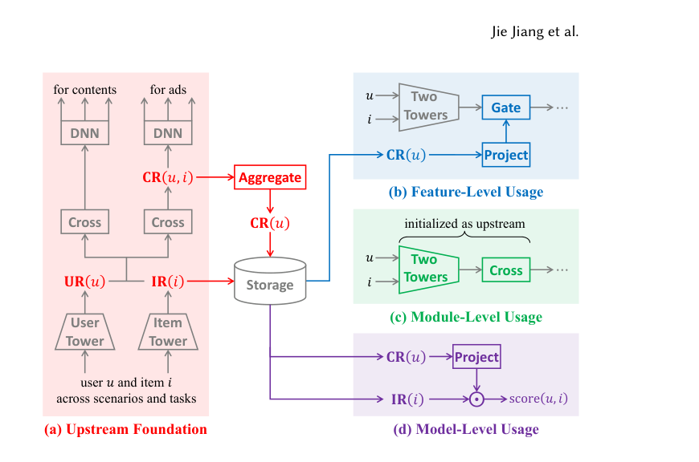

# LFM4Ads: Large Foundation Model for Ads Recommendation (面向广告推荐的大基础模型)

- **会议/期刊**: CIKM 2026
- **作者与机构**: Jie Jiang, Shangyu Zhang, Shijie Quan, Junwei Pan 等（腾讯 + 清华大学深圳国际研究生院）
- **推荐链路定位**: 精排 / 召回（模型级检索）
- **研究方向**: 跨域与多场景推荐 / CTR 预估与特征交叉
- **论文原文**: [https://arxiv.org/abs/2508.14948v2](https://arxiv.org/abs/2508.14948v2)
- **开源代码**: [https://github.com/ZhuangQu/LFM4Ads](https://github.com/ZhuangQu/LFM4Ads)

## TL;DR (1分钟核心速览)

现有预训练-迁移范式只迁移用户表征 (UR) 与物品表征 (IR)，浪费了深层交互层产生的用户-物品交叉表征 (CR)；而迁移 TAE 又需上游实时推理，工程开销大。LFM4Ads 用时间感知 EMA 将样本级 CR 聚合为用户级 CR，彻底解耦上下游在线推理，并提出特征级门控、模块级微调、模型级检索三种粒度复用。KuaiRand-1K 八场景加权平均 AUC 上，模型级检索较 TwoTower 提升 0.0189，线上平台 GMV 提升 2.45%。

## Background & Motivation (背景与核心矛盾)

- **主流范式**: 多场景/多任务联合建模易受负迁移与跷跷板效应困扰，且单一大模型难以满足线上延迟与成本约束，因此业界转向「上游大模型预训练 + 下游小模型迁移」的两段式架构。
- **前人局限**: 其一，多数方法只迁移 UR/IR，忽略了深层交互层蕴含的细粒度用户-物品相关性；其二，TAE 类方法需上游 FM 与下游同步实时推理，带来额外工程复杂度与算力开销。
- **核心洞察 (Key Insight)**: CR 是样本级表征，粒度太细且无法为所有用户-物品对预先计算存储；但若按用户聚合，CR 即可离线化、可复用，且天然携带比 UR 更细的交互信号。
- **本文切入点**: 用时间感知 EMA 把样本级 CR 压成用户级 CR 并离线存储，再以「特征→模块→模型」由细到粗的三级粒度设计下游复用方式。

## Method (核心方法设计)

### 1. 整体框架 (Overall Architecture)

上游采用双塔 + DCNv2 交互层结构，在内容域与广告域、多场景多任务样本上联合预训练（双分支以适配内容/广告分布差异），输出 UR、IR 与 CR 三类表征。离线阶段回放训练/验证样本，抽取各交互层的样本级 CR 并按用户做时间感知 EMA 聚合，压缩后存入表征库。下游按需选择三种用法：特征级将 CR 门控注入下游 embedding；模块级用上游权重初始化同构下游模型并微调；模型级仅训练一个轻量 Adapter 做 CR 与 IR 的内积检索。在线服务时下游直接读库，上游异步推理并更新表征，实现推理解耦。

<figure class="paper-figure" markdown="span">
  <figcaption>图1：概览。(a) LFM4Ads 在跨场景和任务的内容与广告样本上进行预训练，并将表示迁移至下游模型。(b) 通过门控融合交叉表示以用于特征级使用。(c) 对产生交叉表示的模块进行微调以用于模块级使用。(d) 将交叉表示与物品表示进行匹配以用于模型级使用。</figcaption>
</figure>

### 2. 关键设计拆解 (Key Designs)

1. **时间感知指数滑动平均 (Time-aware EMA)**：痛点在于 CR 是样本级、无法穷举存储，且用户兴趣存在分布漂移。核心算子为
$$\mathrm{CR}(u) \leftarrow \beta(t)\cdot \mathrm{CR}(u) + \big(1-\beta(t)\big)\cdot \mathrm{CR}(u,i)$$
其中 $t$ 为距上次更新的时间间隔，$\beta:\mathbb{R}^+\to[0,1]$ 为递减函数。直觉是：不活跃用户 $t$ 大、$\beta(t)\approx 0$，优先吸收当前交互以抗漂移；活跃用户 $t$ 小、$\beta(t)\approx 1$，保留更多历史交互。该设计使 CR 可离线聚合、在线零上游推理。

2. **非线性门控融合 (Non-linear Gating)**：直接 concat 会把语义错位的上游 CR 与下游 embedding 硬拼，且抬高后续层维度。改为
$$E' = E \odot \sigma(M\cdot \mathrm{CR}(u))$$
$M$ 将 CR 投影到与 $E$ 同长，$\sigma$ 提供非线性。门控充当非线性编码器构造新表征，缓解维度坍缩与表征冗余，同时不增加下游维度。作者实测对齐损失等方案在线上 A/B 均无收益，唯门控有效。

3. **三级粒度复用与训练目标**：特征级（细粒度、兼容成熟系统）、模块级（同构初始化+全层微调，加速收敛、利好长尾）、模型级（仅训 Adapter，$\text{score}(u,i)=\mathrm{CR}^T(u)\cdot W\cdot \mathrm{IR}(i)$，用 BCE 或 InfoNCE 优化）。总损失均为 BCE，优化器 AdamW（lr=0.001, wd=0.01），batch=10000，按时间戳排序；模型级免去双塔训练，下游参数量大幅缩减。核心主张：**基础模型越强，下游模型越薄**。

## Experimental Setup & Evaluation Protocol (实验设置与评估协议)

- **数据集与预处理**: KuaiRand-1K，保留 27 个用户侧 + 9 个物品侧类别特征，丢弃连续特征，以点击为标签构造 pCTR 任务。

| 数据集 | #Users | #Items | #Interactions | 稀疏度/密度 | 特征/场景说明 |
| :--- | :---: | :---: | :---: | :---: | :--- |
| KuaiRand-1K | 1,000 | 4,369,953 | 11,713,045 | 极稀疏 | 15 场景 / 31 天，27+9 类别特征 |

- **数据划分与防穿越 (Splitting Strategy)**: 全局时间戳切分——前 25 天训练、随后 3 天验证、最后 3 天测试；上游在 15 场景并集上预训练，下游各场景独立训练（模拟跨场景预训练-迁移）。
- **排名评测协议 (Ranking Protocol)**: 报告各下游场景测试 AUC，100 次独立「上游+下游」模型对取平均；无负采样排序，属全样本 AUC 评估。
- **对比基线与超参设置**: 特征级对比 SUM（concat 融合 UR）；模块级对比 Vanilla（全随机初始化）；模型级对比 TwoTower（下游自训双塔）与 UR&IR。上游 DCNv2 含 3 个 cross 层 + 3 层 DNN，embedding 长度 10，隐层 360×360，输出 15 个场景 logit。

## Key Experimental Results (实验关键数据)

### 1. 主实验对比 (Main Results)

八场景加权平均 AUC（CR 特征级取 Cross3、模型级取 DNN2、模块级全层微调）：

| 用法 | 方法 | 加权平均 AUC | 相对基线 |
| :--- | :--- | :---: | :---: |
| 特征级 | SUM | 0.7275 | – |
| 特征级 | concat CR | 0.7291 | +0.0016 |
| 特征级 | **gating CR** | **0.7300** | **+0.0025** |
| 模块级 | Vanilla | 0.7273 | – |
| 模块级 | **CR′ 微调** | **0.7288** | **+0.0016** |
| 模型级 | TwoTower | 0.6821 | – |
| 模型级 | UR & IR | 0.6395 | −0.0426 |
| 模型级 | **CR & IR** | **0.7010** | **+0.0189** |

线上 A/B（部分）：微信朋友圈 pCVR 特征级 **GMV +2.53%**；模块级多 pCVR 模型整体 **+1.88%**；视频号召回模型级 **GMV +1.17%**（CTR +1.83%、CTCVR +3.34%、停留时长 +1.66%、快滑率 −0.36%）；平台整体 **GMV +2.45%**。

### 2. 消融实验 (Ablation Study)

线上消融（微信朋友圈下游，AUC / GMV）：

| 配置 | AUC | GMV |
| :--- | :---: | :---: |
| Baseline | 0.8515 | – |
| UR 单分支 concat | 0.8501 | 负向 |
| UR 双分支 concat | 0.8520 | +0.79% |
| CR, $\beta=0$（去历史聚合） | 0.8513 | 负向 |
| CR, $\sigma=\text{id}$（去非线性） | 0.8521 | 负向 |
| **CR 双分支 gating (完整)** | **0.8525** | **+1.35%** |

上游域消融（视频号 pCTR，AUC 增益）：静态特征 0 → +内容序列 +0.031 → +广告序列 +0.042 → **+双域序列 +0.052**。

### 3. 关键实验发现 (Key Findings)

1. **CR 层级存在「精炼-特化」权衡**：特征级最优层为中间层（场景 1 在 Cross3、场景 4 在 DNN1），过浅未充分加工、过深过度特化于上游任务；而模型级因仅训 Adapter，单调受益于最深 DNN2 层，说明下游可训练容量越小、越依赖上游精炼知识。
2. **长尾场景收益远超头部**：场景 3/8/5 合计仅占 0.6% 样本，但特征级在场景 3 提升 0.0284、模块级在场景 8 提升 0.0233、模型级在场景 5 提升 0.0450，远高于加权平均增益，印证全场景预训练对少样本场景的补益。
3. **历史聚合与非线性门控缺一不可**：$\beta=0$ 使 AUC 掉 0.0012 且 GMV 转负，$\sigma=\text{id}$ 虽 AUC 略高于 baseline 但 GMV 仍负向，说明 EMA 抗漂移与门控抗维度坍缩在业务指标上均有实质贡献；双域序列联合迁移比单域分别多 0.010/0.021，内容行为对广告预测具互补性。

## Highlights, Limitations & Rating (亮点、对比与审稿评价)

- **与代表作对比 (vs. Prior Work)**: 相比 SUM 仅 concat 迁移 UR，本文迁移更细粒度的 CR 并用门控避免语义错位；相比 TAE 需上游实时推理，本文以 EMA 聚合实现离线解耦，工程可落地性显著更强；相比纯 TwoTower 检索，CR&IR 用极轻 Adapter 即超越自训双塔 0.0189。
- **可迁移亮点**: ①「样本级表征 → 用户级 EMA 聚合」可推广到任意需要离线化细粒度交互信号的迁移场景；②门控融合替代 concat 以规避维度膨胀与语义错位，是低成本高收益的通用技巧。
- **审稿级局限批判**: ①离线仅在 KuaiRand-1K（1000 用户）上验证，缺乏公开大规模跨域基准，泛化性证据偏弱；②模块级要求上下游架构同构，灵活性受限，且头部场景部分迁移出现负效果，迁移深度需按场景规模调参；③$\beta(t)$ 的具体函数形式与量化压缩（4KB→1KB）对精度的损失未做敏感性分析。
- **四维评分**: 创新性 ⭐⭐⭐⭐ | 实验扎实度 ⭐⭐⭐⭐ | 方法清晰度 ⭐⭐⭐⭐⭐ | 落地价值 ⭐⭐⭐⭐⭐

