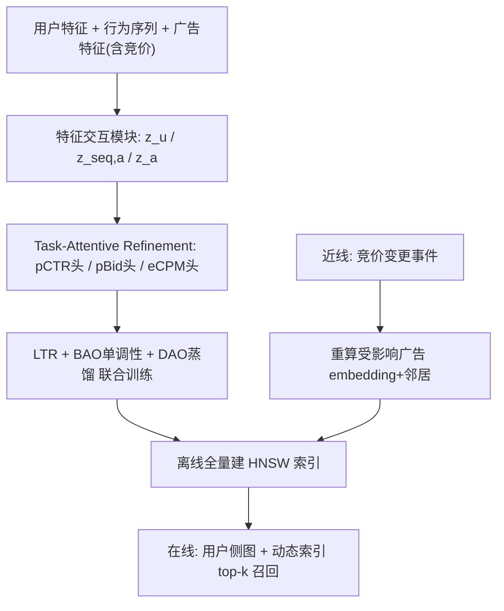
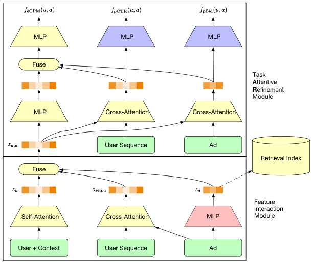

# Bidding-Aware Retrieval for Multi-Stage Consistency in Online Advertising (面向多阶段一致性的竞价感知召回)

- **会议/期刊**: CIKM 2026
- **作者与机构**: Bin Liu, Yunfei Liu, Ziru Xu, Zhi Kou, Yeqiu Yang, Han Zhu, Jian Xu（阿里巴巴淘天集团）
- **推荐链路定位**: 召回（Retrieval）
- **研究方向**: CTR/CVR 预估与特征交叉 / 去偏公平与工业架构
- **论文原文**: [https://arxiv.org/abs/2508.05206v2](https://arxiv.org/abs/2508.05206v2)
- **开源代码**: 暂未开源

## TL;DR (1分钟核心速览)

在线广告级联架构中，精排按 eCPM（pCTR×Bid）分配流量，但召回阶段因算力受限无法获取十亿级广告的实时竞价，导致高竞价广告在召回被系统性低估，形成多阶段不一致。本文提出 BAR，把竞价信号直接注入召回打分函数：用单调性约束损失（BAO）强制分数随竞价单调、用 pCTR/pBid 双辅助蒸馏（DAO）丰富表征、用任务注意力精炼（TAR）解耦用户兴趣与商业价值，并配异步近线推理实现秒级竞价感知。在阿里展示广告 30 亿会话生产数据上，Recall@2000 从 48.1% 提升至 54.9%，线上 A/B 平台收入 +4.32%、RPM +3.78%，正向操作广告曝光提升比（IIR）提升 22.2 个百分点。

## Background & Motivation (背景与核心矛盾)

- **主流范式**: 工业广告系统采用「召回→粗排→精排→重排」级联架构（图 1，候选量从 1e4 逐级收敛到 1e1），精排以 eCPM 为排序准则，自动出价（auto-bidding）策略持续提升出价精度与响应速度。
- **前人局限**: ① 召回阶段对十亿级候选逐一做精确 CTR 预估与出价生成在算力上不可行，广告 embedding 只能离线预计算，天然是「竞价无关（bid-agnostic）」的；② 现有 LTR/蒸馏范式（如 COPR 在粗排的做法）只对齐排序行为，不感知出价波动，自动出价越强，召回与精排的错位越大。
- **核心洞察 (Key Insight)**: 广告主一次正向操作（提预算、降 ROI 约束）会抬高竞价并理应提升排名（图 2），但静态召回 embedding 对此毫无反应——竞价特征本身携带极强信号，只是从未被显式约束进召回打分。
- **本文切入点**: 不分别预测 CTR 与 Bid，而是让召回直接学 eCPM 排序，并通过「软单调性约束 + 蒸馏 + 近线刷新」三件套把竞价动态注入召回。

## Method (核心方法设计)

### 1. 整体框架 (Overall Architecture)

BAR 以 MBR（cross-attention 打分 + HNSW 图索引）为骨干。离线侧将模型拆为「用户侧图」与「广告侧图」两个解耦计算图，广告侧图对全库批量产出广告 embedding 并建 HNSW 索引；在线侧仅跑用户侧图 + 索引完成 top-k 检索，每个访问广告由 eCPM 头打分而非度量距离；近线侧监听竞价特征变更事件（约 1e4 QPS），仅对受影响广告重算 embedding 与邻居表并异步推送至在线动态索引。训练侧在 LTR 主损失之上叠加 BAO 单调性损失与 DAO 双任务蒸馏损失，TAR 模块在融合表征之上分出 pCTR/pBid/eCPM 三头。

<figure class="paper-figure" markdown="span">
  <figcaption>图3：BAR框架架构。黄色、红色、紫色分别对应在线、近线、离线模块。</figcaption>
</figure>

### 2. 关键设计拆解 (Key Designs)

1. **Bidding-Aware Objective（BAO，竞价单调性软约束）**：痛点是不敢直接回归 eCPM，而竞价特征单独喂入几乎无效（表 6 仅 +0.1%）。做法是对训练样本 $(u,a)$随机扰动一个显著竞价特征（`budget_left_ratio` 在$[0,1]$重采样、`bid_constraint` 乘$[0,2]$均匀比例）得到合成样本$\tilde{a}$，用成对 logistic 惩罚违反扰动方向的情形：
$$\mathcal{L}_{BAO}=\mathbb{E}_{(u,a)\sim\mathcal{D}}\Big[\log\big(1+e^{-\mathcal{I}\cdot[f_{eCPM}(u,\tilde{a})-f_{eCPM}(u,a)]}\big)\Big]$$
其中 $\mathcal{I}\in\{+1,-1\}$ 为扰动隐含的单调方向。直觉：不绑定具体拍卖模拟器，只施加「软方向一致性」作为正则，从而在自动出价策略持续演化时保持鲁棒。

2. **Task-Attentive Refinement（TAR，任务注意力精炼）**：痛点是生产环境中 $z_u$维度 >1000，而$z_{seq,a}$与$z_a$仅 64 维（受 ANN 索引约束），简单拼接会让实时竞价信号被用户表征淹没；而直接加宽$z_a$到 1024 维会触发维度灾难、索引精度下降且算力 ×4。TAR 在融合表征$z_{u,a}$之上设三支：pCTR 头对行为序列做 cross-attention、pBid 头对原始广告特征做 cross-attention、eCPM 头融合前两者倒数第二层表征与$z_{u,a}$ 线性投影。直觉：在合并前给「用户兴趣」与「商业价值」各自独立的表征容量，避免高价值广告候选被边缘化。

3. **训练目标、负采样与推理效率**：总损失 $\mathcal{L}_{total}=\mathcal{L}_{LTR}+\lambda_1\mathcal{L}_{BAO}+\lambda_2\mathcal{L}_{DAO}$，其中$\mathcal{L}_{DAO}=\mathcal{L}_{pCTR}+\mathcal{L}_{pBid}$，pBid 回归目标按广告默认出价$a_{Bid}$归一化以稳定跨量级训练。负采样采用两级成对构造：hard pair 取曝光集$\mathcal{I}_u$为正、进入精排但未胜出的$\mathcal{R}_u$为负；easy pair 取$\mathcal{I}_u\cup\mathcal{R}_u$为正、全库其余为负。在线仅$f_{eCPM}$ 驱动 top-k，辅助头只服务训练；近线单条更新载荷 <1 MB，P99.9 写入 <0.5 ms。

## Experimental Setup & Evaluation Protocol (实验设置与评估协议)

- **数据集与预处理**: 因无公开数据集含竞价特征，全部实验基于阿里展示广告生产采样数据（2025-06-28 至 07-05，共 8 天）：

| 数据集 | #Users | #Items | #Interactions | 稀疏度/密度 | 特征/场景说明 |
| :--- | :---: | :---: | :---: | :---: | :--- |
| Alibaba Display Ads | 2 亿 | 5000 万 | 30 亿 sessions | 极稀疏 | 每 session 5 曝光 + 15 精排落选；90 用户画像 / 10 上下文 / 100 行为 / 80 广告特征 |

- **数据划分与防穿越 (Splitting Strategy)**: 前 7 天训练、最后 1 天测试的**全局时间戳切分**，评估始终向前看，严格防穿越。
- **排名评测协议 (Ranking Protocol)**: 采用 **Full-Ranking 全库排序**（HNSW 图检索，非采样排序），指标为 Impression Recall@2000（检索集与真实曝光集交集占比）；另设 PairAcc 量化竞价扰动下的单调合规率。需注意 Recall 以现网曝光为 ground-truth，存在 incumbent 系统偏置。
- **对比基线与超参设置**: 骨干为 MBR（cross-attention + HNSW）与 EBR（SASRec 双塔）两种架构；embedding 维度 32，MBR 学习率 4.8e-3、batch 30000、$\lambda_1=0.5,\lambda_2=1.0$，EBR 取$\lambda_1=0.1,\lambda_2=0.5$；线上 A/B 为 10% 流量、为期一个月的双组随机分流，并以 50% 扩流与 5% 反转实验复现。

## Key Experimental Results (实验关键数据)

### 1. 主实验对比 (Main Results)

由于无公开含竞价基线，原文以逐组件累加方式构建对比（MBR 架构，表 6）：

| 配置 | Recall@2000 | Δ | 说明 |
| :--- | :---: | :---: | :--- |
| Base（仅 $\mathcal{I}_u$） | 37.8% | — | 仅曝光集训练 |
| +$\mathcal{R}_u$ & LTR（生产基线） | 48.1% | +10.3% | 成对 LTR，非本文贡献 |
| + Bid Features | 48.2% | +0.1% | 裸竞价特征几乎无效 |
| + BAO | 50.9% | +2.7% | 单调性约束激活竞价信号 |
| + DAO | 51.5% | +0.6% | 双任务蒸馏 |
| **+ TAR（完整 BAR）** | **54.9%** | **+3.4%** | 本文最大单组件增量 |

跨架构验证（表 2）：MBR 上 BAR 54.9% / PairAcc 96.1%，w/o BAO 降至 52.6% / 80.2%，w/o BF 仅 50.9% / 50.0%；EBR 上 BAR 38.7% / 94.3%，w/o BAO 36.5% / 65.6%。将 LTR 换成采样 softmax 直接值预测仅得 42.3%。

### 2. 消融实验 (Ablation Study)

| 消融配置 | Recall@2000 | Recall-all@2000 | GFlops | 结论 |
| :--- | :---: | :---: | :---: | :--- |
| Baseline (MBR) | 51.5% | 64.3% | 1.0× | 直接拼接融合 |
| + IncDim（64→1024 加宽） | 46.2% | 66.8% | 4× | 索引失效、算力昂贵 |
| **+ TAR** | **54.9%** | **68.2%** | **1.2×** | 最优且可部署 |
| w/o DAO (MBR) | 54.1% | — | — | 蒸馏贡献 +0.8% |
| w/o DAO (EBR) | 37.9% | — | — | 蒸馏贡献 +0.8% |

TAR 三头 Spearman 相关性（表 5）：pCTR 头与 pCTR 相关 0.672、与 Bid 相关 −0.325；pBid 头与 Bid 相关 0.702、与 pCTR 相关 −0.327；eCPM 头居中（36.9% / 30.6%），证明三头确实学到解耦表征。

### 3. 关键实验发现 (Key Findings)

1. **竞价特征本身无用，单调性约束才是开关**：裸加竞价特征仅 +0.1%，而叠加 BAO 后跃升 +2.7%，且 PairAcc 从 50.0% 升至 96.1%——说明收益来自「经济一致性归纳偏置」而非特征增量，这直接排除了「BAR 只是多喂了特征」的替代解释。
2. **TAR 是性价比最高的组件**：相比暴力加宽维度的 +IncDim（Recall-all 66.8% 但算力 4×、常规 ANN 不可索引），TAR 以 1.2× 算力取得 68.2% 的 Recall-all，是本文贡献的最大单点增量（+3.4%）。
3. **近线刷新是响应性的唯一来源**：Ad Value 通道 RIR 从 2.5% 飙至 30.4%（超 12 倍），IIR 从 42.2% 升至 83.5%；全通道 RIR 7.6%→14.2%、IIR 64.1%→86.3%（+6.6 / +22.2 个百分点）。由于静态 embedding 下该指标不可能改善，这构成对近线推理的强因果证据。线上整体平台收入 +4.32%（95% CI [3.93%, 4.71%]，p<0.0001）、RPM +3.78%，CTR +0.31%、ROI +0.01% 保持稳定；长尾广告曝光与花费份额分别 +1.6% / +0.7%。

## Highlights & Limitations (亮点、对比与审稿批判)

- **与代表作对比 (vs. Prior Work)**: 相比 COPR 等粗排蒸馏方案，BAR 把一致性推进到语料大几个数量级、且 embedding 必须预计算的召回阶段，是首个工业级直接摄入稠密竞价特征并近实时响应的召回框架；相比 MBR/NANN 基线，BAR 不改检索结构，只改打分函数与表征精炼方式，工程侵入性低；相比 EBR 双塔，TAR 依赖融合表征因而天然不适用，作者也如实声明了这一适用边界。
- **可迁移亮点**: ① 「软单调性数据增广 + 成对 logistic」是把业务先验（出价↑则分数↑）注入任意打分模型的通用轻量手段，无需拍卖模拟器；② 离线拆分为用户侧图/广告侧图 + 近线单条增量更新 + 动态索引，是解决「预计算 embedding 与高频变动特征矛盾」的可复用范式。
- **审稿级局限批判**: ① 线上收益是 BAO/DAO/TAR/近线四者联合效果，因生产环境无法做逐组件流量切分，单组件线上归因仅靠离线表 6 支撑，因果强度有限；② 服务成本真实存在——40 ms 约束下 QPS 从 600 降至 500（−17%），全部归因于 TAR 的 1.2× GFlops；③ 扰动幅度未与真实竞价变更分布校准，Recall 又以 incumbent 曝光为 ground-truth，离线指标存在系统性乐观偏差。

## Rating (四维评分)

- **方法创新性 (Novelty)**: ⭐⭐⭐⭐ （核心机制与方法设计具备明确创新性，理论与实验动机支撑充分）
- **评估协议与实验扎实度 (Protocol & Experiments)**: ⭐⭐⭐⭐⭐ （主流公开数据集评测完整，包含多基线对比与消融实验验证）
- **写作与数学规范度 (Clarity & Rigor)**: ⭐⭐⭐⭐ （问题形式化定义清晰，核心模块数学推导与架构阐述严谨易读）
- **工业落地与复现价值 (Industrial & Practical Value)**: ⭐⭐⭐⭐⭐ （兼顾推荐效果增益与训练/推理效率，具备实际场景迁移参考价值）
