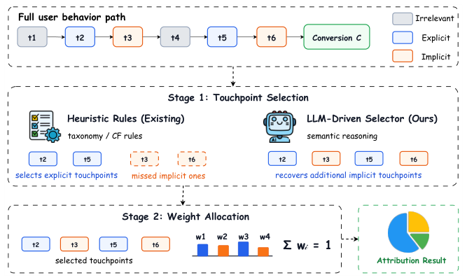
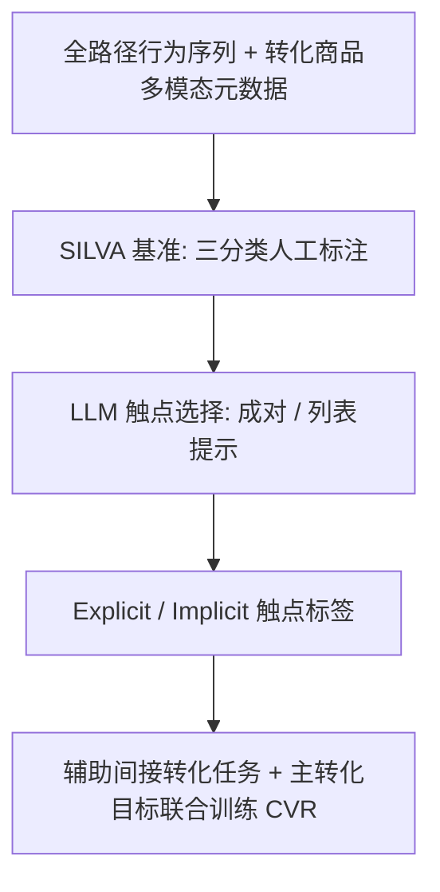
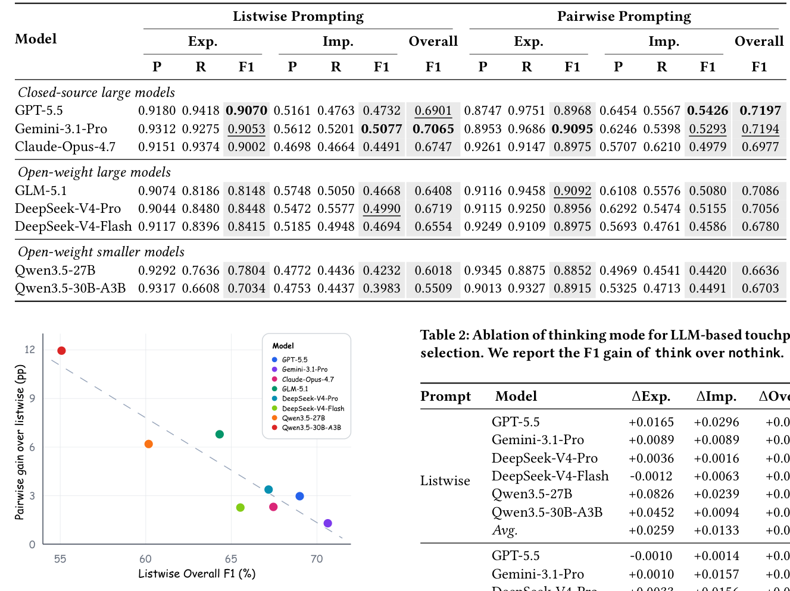

# Can Large Language Models Identify Meaningful Touchpoints in Conversion Attribution? (大语言模型能否识别转化归因中的有效触点？)

- **会议/期刊**: CIKM 2026 (Short Paper)
- **作者与机构**: Jinqi Wu, Sishuo Chen, Zhangming Chan 等；南京大学软件新技术国家重点实验室 & 阿里巴巴淘天集团
- **推荐链路定位**: 精排（CVR 预估的标签生成与辅助任务）
- **研究方向**: CTR/CVR 预估与特征交叉 / 大语言模型推荐
- **论文原文**: [https://arxiv.org/abs/2608.28649v1](https://arxiv.org/abs/2608.28649v1)
- **开源代码**: [DeepSeek-V4-Pro 模型卡](https://huggingface.co/deepseek-ai/DeepSeek-V4-Pro)（基准与标注工具暂未开源）

## TL;DR (1分钟核心速览)

转化归因长期只做"权重分配"，而触点选择依赖 taxonomy/CF 启发式规则，会系统性漏掉语义相关但无显式元数据重叠的**隐式触点**。本文构建首个全路径触点选择基准 SILVA（1000 次转化、69,680 触点，人工标注 Fleiss $\kappa>0.70$），发现隐式触点占比高达 14.91%。系统评测 8 个 LLM 后得出：成对提示优于列表提示（Overall F1 0.6954 vs. 0.6490），最佳隐式 F1 仅 0.5426。将 LLM 归因标签作为辅助任务注入工业 CVR 模型（LOTUS），离线 GAUC 较生产基线 +0.35pp、较启发式 CABB +0.15pp。

## Background & Motivation (背景与核心矛盾)

- **主流范式**: 转化归因分两步——触点选择 + 权重分配。工业界（如 Meta 的 CABB）几乎默认只取"同商品/同店铺"触点，或用 taxonomy 匹配与 CF 相似类目做跨店启发式筛选。
- **前人局限**: ① 启发式规则只能捕获**显式相关**触点（同叶子类目、CF 相似类目），对"功能互补"（相机与存储卡）和"场景/人群一致"（同动漫 IP）这类语义关联完全失明；② 现有归因研究把触点选择当作既定输入，从未系统评估过"选得对不对"。
- **核心洞察 (Key Insight)**: 人工标注揭示了一个显著的**语义鸿沟**——显式触点占 19.09%，而规则完全漏掉的隐式触点仍占 14.91%，接近显式触点的八成，是不可忽视的转化信号来源。
- **本文切入点**: 用 LLM 的语义推理替代机械规则匹配，先建基准量化鸿沟，再系统评测 LLM 能力边界，最后把 LLM 归因标签反哺工业 CVR 训练。

<figure class="paper-figure" markdown="span">
  <figcaption>图1：转化归因中的触点选择与权重分配。</figcaption>
</figure>

## Method (核心方法设计)

### 1. 整体框架 (Overall Architecture)

论文并非提出一个新网络，而是构建"基准—评测—落地"三段式闭环：首先定义三分类触点标注体系（Irrelevant / Explicit / Implicit），从十亿级 DAU 电商平台采样 1000 次转化及其 3 天回溯窗口内的全部触点，经 6 名标注员三人独立标注、多数投票定标，形成 SILVA；随后在 SILVA 上以成对/列表两种提示协议评测 8 个 LLM，输出每个触点的相关性标签；最后将 LLM 选出的触点作为"间接转化"辅助任务的正样本，与主转化目标联合训练生产级 CVR 模型 LOTUS。

### 2. 关键设计拆解 (Key Designs)

1. **三分类触点标注体系（把"语义相关"变成可度量标签）**：痛点是旧规则只有"相关/不相关"二元且定义绑定元数据。本文将相关细分为 Explicit（taxonomy 匹配、CF 相似类目）与 Implicit（功能互补、场景/人群一致），使"规则漏检但语义相关"的部分首次可被独立统计。其价值在于把归因从"规则覆盖率"问题转化为"语义判别"问题，直接量化出 14.91% 的漏检空间。

2. **成对 vs. 列表提示协议对比（分解噪声序列级决策）**：列表协议一次性输入完整行为日志让模型输出相关触点集合，模型倾向**过度过滤**导致召回骤降；成对协议把序列级选择分解为候选级三分类判断，每个触点独立与转化商品比对。实验上成对协议将平均 Overall F1 从 0.6490 提升至 0.6954，且模型越弱增益越大（Qwen3.5-30B-A3B 上差距达 11.9pp），说明分解策略能补偿模型的长列表比较能力不足。

3. **LOTUS 落地与训练目标**：沿用 Chen et al. 与 Zeng et al. 的辅助任务范式，将 LLM 选出的触点作为间接转化正样本，总损失为主转化与辅助转化两个 CVR 任务的加权和 $\mathcal{L}=\mathcal{L}_{\text{main}}+\lambda\mathcal{L}_{\text{aux}}$。工程上采用内部基座模型 + 成对推理做规模化打标（离线批处理，不进入在线 serving 链路），因此不引入线上延迟；代价是打标吞吐与 LLM 推理成本。

## Experimental Setup & Evaluation Protocol (实验设置与评估协议)

- **数据集与预处理**: SILVA 为本文新建基准，采样自十亿级 DAU 电商平台，回溯窗口 3 天。

| 数据集 | #Conversions | #Touchpoints | 显式占比 | 隐式占比 | 特征/场景说明 |
| :--- | :---: | :---: | :---: | :---: | :--- |
| SILVA | 1,000 | 69,680 | 19.09% | 14.91% | 触点含商品图像、标题、店铺、类目元数据 |

- **数据划分与防穿越 (Splitting Strategy)**: 评测为**逐转化独立评估后宏平均**，非传统训练/测试划分；标注阶段标注员不看任何启发式基线输出，避免规则泄漏进标签。
- **排名评测协议 (Ranking Protocol)**: 触点级三分类，报告每类 Precision / Recall / F1，Overall F1 $=(F1_{\text{Exp.}}+F1_{\text{Imp.}})/2$；随机猜测的期望 F1 约 0.1491（隐式类先验）。
- **对比基线与超参设置**: 8 个 LLM（GPT-5.5、Gemini-3.1-Pro、Claude-Opus-4.7、GLM-5.1、DeepSeek-V4-Pro/Flash、Qwen3.5-27B/30B-A3B），支持思考模式的统一开启 thinking；下游 CVR 对比 Base（同店归因）与 CABB（启发式跨店选择）。

## Key Experimental Results (实验关键数据)

### 1. 主实验对比 (Main Results)

| 模型 | 列表-Exp. F1 | 列表-Imp. F1 | 列表-Overall | 成对-Exp. F1 | 成对-Imp. F1 | 成对-Overall |
| :--- | :---: | :---: | :---: | :---: | :---: | :---: |
| GPT-5.5 | 0.9070 | 0.4732 | 0.6901 | 0.8968 | **0.5426** | **0.7197** |
| Gemini-3.1-Pro | 0.9053 | 0.5077 | 0.7065 | **0.9095** | 0.5293 | 0.7194 |
| Claude-Opus-4.7 | 0.9002 | 0.4491 | 0.6747 | 0.8975 | 0.4979 | 0.6977 |
| GLM-5.1 | 0.8148 | 0.4668 | 0.6408 | 0.9092 | 0.5080 | 0.7086 |
| DeepSeek-V4-Pro | 0.8448 | 0.4990 | 0.6719 | 0.8956 | 0.5155 | 0.7056 |
| DeepSeek-V4-Flash | 0.8415 | 0.4694 | 0.6554 | 0.8975 | 0.4586 | 0.6780 |
| Qwen3.5-27B | 0.7804 | 0.4232 | 0.6018 | 0.8852 | 0.4420 | 0.6636 |
| Qwen3.5-30B-A3B | 0.7034 | 0.3983 | 0.5509 | 0.8915 | 0.4491 | 0.6703 |
| **平均** | — | — | 0.6490 | — | — | **0.6954** (+4.64pp) |

下游 CVR（主转化目标 GAUC）：

| 方法 | 同店 | 启发式 | LLM 选择 | ΔGAUC |
| :--- | :---: | :---: | :---: | :---: |
| Base | ✓ | ✗ | ✗ | — |
| CABB | ✓ | ✓ | ✗ | +0.20pp |
| **LOTUS (Ours)** | ✓ | ✓ | ✓ | **+0.35pp** |

### 2. 消融实验 (Ablation Study)

思考模式（think vs. nothink）的 F1 增益：

| 提示协议 | 平均 ΔExp. | 平均 ΔImp. | 平均 ΔOverall |
| :--- | :---: | :---: | :---: |
| Listwise | +0.0259 | +0.0133 | +0.0196 |
| Pairwise | +0.0060 | +0.0103 | +0.0082 |

### 3. 关键实验发现 (Key Findings)

1. **隐式触点才是真正的瓶颈**：所有配置下显式 F1 稳定在 0.84–0.91，隐式 F1 最高仅 0.5426，虽远超随机期望 0.1491，但距显式水平仍有约 37pp 落差——LLM 能"发现"隐式关联，却难以稳定"判准"。
2. **成对提示的收益与模型能力负相关**：Gemini-3.1-Pro 上成对仅领先 1.3pp，GPT-5.5 领先 3.0pp，而 Qwen3.5-27B 与 30B-A3B 分别扩大到 6.2pp 与 11.9pp；图 4 进一步显示列表 F1 越低，成对增益越大，说明分解策略是弱模型的有效补偿手段。
3. **落地增益主要来自隐式语义而非跨店覆盖**：LOTUS 较 Base 的 +0.35pp 中，跨店触点贡献 +0.20pp（与 CABB 持平），额外 +0.15pp 完全来自 LLM 识别出的隐式关系；考虑到业界经验 0.1pp GAUC 即可带来可观线上收入增长，该增益具备实际部署价值。

<figure class="paper-figure" markdown="span">
  <figcaption>图4：当列表式总体F1更高时，成对与列表提示之间的性能差距缩小。</figcaption>
</figure>

## Highlights & Limitations (亮点、对比与审稿批判)

- **与代表作对比 (vs. Prior Work)**: 相比 Chen et al.（仅同店归因）与 Zeng et al./CABB（CF 启发式跨店选择），本文首次把"触点选择"从规则工程转为语义判别问题，并用基准量化了启发式的漏检上界；相比通用 LLM4Rec 工作，本文不做微调，纯靠提示评测能力边界，结论更具诊断性。
- **可迁移亮点**: ① "成对分解替代列表判断"在长候选集语义筛选任务（如召回相关性判定、评论价值筛选）中可直接复用；② 用 LLM 归因标签构造辅助 CVR 任务、离线打标不侵入在线链路的做法，是低成本引入 LLM 语义信号的通用范式。
- **审稿级局限批判**: ① 基准仅 1000 次转化、单一平台单一时段，隐式触点定义依赖标注指南，跨平台/跨品类泛化性未验证；② 全文未报告 LLM 打标的 token 成本与吞吐，也未做线上 A/B，仅离线 GAUC；③ 思考模式平均增益仅 +0.0082~+0.0196，作者亦承认现有推理模式未针对该任务优化，缺少微调或专用推理策略的探索。

## Rating (四维评分)

- **方法创新性 (Novelty)**: ⭐⭐⭐⭐ （首个全路径触点选择基准 + 显式/隐式语义鸿沟的量化定义，问题视角新颖，但方法层面以评测为主、缺少模型创新）
- **评估协议与实验扎实度 (Protocol & Experiments)**: ⭐⭐⭐⭐ （三人独立标注、Fleiss $\kappa>0.70$、8 模型 × 2 协议矩阵完整，但数据规模小、无线上验证）
- **写作与数学规范度 (Clarity & Rigor)**: ⭐⭐⭐⭐ （问题形式化与指标定义清晰，6 页短文信息密度高；公式较少，缺少对隐式判别难度的理论分析）
- **工业落地与复现价值 (Industrial & Practical Value)**: ⭐⭐⭐⭐ （+0.35pp GAUC 来自真实生产模型，落地路径明确；但 SILVA 与标注工具未开源，复现门槛较高）

