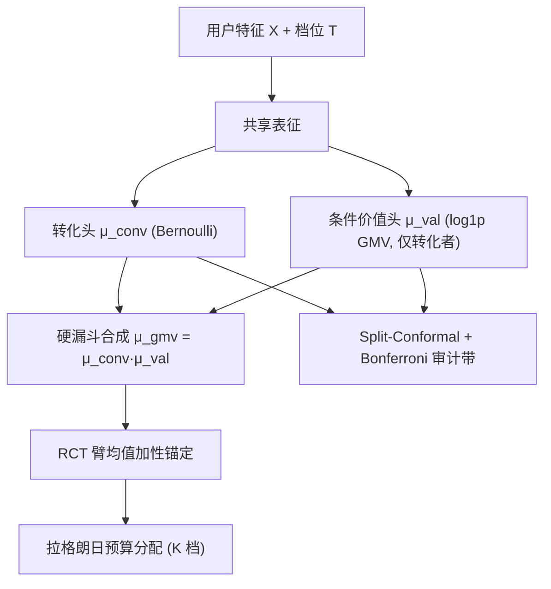

# FunnelCausalNet: Funnel-aware Joint Conversion-Revenue Uplift for Multi-tier Coupon Allocation (漏斗感知的转化-营收联合 Uplift 与多档优惠券分配)

- **会议/期刊**: CIKM 2026 (35th ACM International Conference on Information and Knowledge Management)
- **作者与机构**: Yu Zhang, Zhihan Wang, Guanlin Chen, Min Jiang, Shuai Li（阿里巴巴集团 高德 AMap）
- **推荐链路定位**: 精排（Uplift 增益建模）+ 预算约束下的多档券分配决策层
- **研究方向**: CTR/CVR 预估与特征交叉 / 强化学习与动态探索推荐（预算分配）
- **论文原文**: [https://arxiv.org/abs/2608.11675v1](https://arxiv.org/abs/2608.11675v1)
- **开源代码**: [scikit-uplift](https://github.com/maks-sh/scikit-uplift)（仅通用 uplift 工具库，本文模型未开源）

## TL;DR (1分钟核心速览)

优惠券营销需同时提升转化与营收，但 GMV 天然服从"转化→条件客单价"的确定性漏斗，且极度零膨胀、重尾。本文提出 FunnelCausalNet：用二元转化头与非负条件价值头经 $\mu_{\mathrm{gmv}}=\mu_{\mathrm{conv}}\mu_{\mathrm{val}}$ 硬耦合估计 uplift，并配 RCT 锚定的拉格朗日预算分配器与 Bonferroni 联合保形审计带。在半合成 Criteo-MT7 上 AUUC_GMV 与最强基线 EFIN 差距在一个种子标准差内（0.613 vs 0.615），但漏斗耦合使 GMV 效应误差较直接回归降低 **18–48%**；在约 4.9M 条工业酒店券 RCT 留出记录上，7/7 个 ΔGMV% 锚点的平均 ΔROI 均为最优。

## Background & Motivation (背景与核心矛盾)

- **主流范式**: 营销侧普遍用松耦合流水线——独立训练转化率模型与客单价模型，下游拼接做定向或预算分配；深度 uplift 侧则以 DESCN/EFIN/ECUP 等并行多头网络估计 CATE。
- **前人局限**: (i) 把 GMV 当无约束连续响应直接回归，在极端零膨胀下 HTE 估计被方差主导；(ii) 并行双头不施加 $\mu_{\mathrm{gmv}}=\mu_{\mathrm{conv}}\mu_{\mathrm{val}}$ 的代数一致性，且按转化 uplift 排序与按 GMV uplift 排序可能严重分歧，紧预算下直接损失增量 GMV；(iii) 多档券场景下不同券强度对转化弹性与条件消费弹性存在**量化差异**，二元 send-vs-control 框架无法回答"谁该拿哪一档"。
- **核心洞察 (Key Insight)**: 由全期望公式，$\mathbb{E}[Y_g(t)]=\mathbb{E}[Y_c(t)\cdot\mathbb{E}[Y_g(t)|Y_c(t)=1,X]]$，即 GMV 期望可分解为"转化质量 × 条件消费"，零质量部分被转化头显式吸收；在转化头达到参数速率、价值头非参估计的"速率差"下，漏斗组合的点态方差可严格小于直接回归。
- **本文切入点**: 把漏斗恒等式贯穿"估计—不确定性—分配"全栈，而非仅在预测层拼接。

## Method (核心方法设计)

### 1. 整体框架 (Overall Architecture)

输入用户特征 $X$ 与档位 $T\in\{0,\dots,K\}$，共享表征后分出转化头（Bernoulli）与条件价值头（在转化子样本上对 $\log(1+\mathrm{GMV})$ 做回归），推理时经 LogNormal 均值修正还原到货币尺度并按硬乘积合成 GMV 期望；随后用 RCT 臂均值做加性锚定修正系统性水平偏差，送入拉格朗日松弛分配器在预算约束下逐用户解耦求解档位；另设一条旁路：对两个结局的 CATE 摘要分别做 split-conformal 区间并以 Bonferroni 并集给出联合覆盖，配合 Top-$K$ 边界冲突筛查作为审计层（不进入分配器）。

### 2. 关键设计拆解 (Key Designs)

1. **硬漏斗组合与方差机制（Prop.1/Prop.2）**：痛点是零膨胀使直接回归的方差被 Bernoulli 切换项主导。方差分解为
$$\mathrm{Var}(Y_g|X{=}x,T{=}t)=p\sigma_v^2+p(1-p)\mu_v^2,$$
在 (A1) RCT 识别、(A2) 漏斗支撑、(A3) 转化头 $O_p(n^{-1/2})$、(A4) 价值头非参 $1/r_n$ 速率、(A5) 跨头协方差可控下，delta 方法给出理想化 MSE 比
$$\frac{\mathrm{MSE}(\hat\mu^{\text{funnel}}_g)}{\mathrm{MSE}(\hat\mu^{\text{direct}}_g)}\to\frac{1}{1+(1-p)\mu_v^2/\sigma_v^2}.$$
直觉：零质量 $(1-p)$ 越大或条件消费均值相对其波动越占优，漏斗组合越省方差——这正是 hurdle/two-part 结构在券场景的再表述。作者明确声明这只是**区域启发式**，共享神经表征下的相关误差不被覆盖。

2. **RCT 锚定 + 拉格朗日多档分配**：痛点是极端零膨胀下预测 GMV 水平存在系统偏差，直接喂给优化器会扭曲 ROI。做法是在 held-in 切片上用 RCT 各臂均值估计加性偏移，修正奖励后再解
$$\max_{\pi}\ \sum_i \hat\tau^{\pi(x_i)}_g(x_i)\quad \text{s.t.}\ \sum_i c(x_i,\pi(x_i))\le B,$$
对偶标量 $\lambda$ 更新使内层问题按用户解耦，$10^6$ 用户量级对偶更新仅约 0.13 s，而稠密 LP 在 $10^5$ 即超十秒并 OOM。

3. **训练目标、负采样与推理效率**：总损失
$$\mathcal{L}_{\text{total}}=\mathcal{L}_{\text{conv}}+\alpha\mathcal{L}_{\text{val}}+\beta\mathcal{L}_{\text{consist}}+\gamma\mathcal{L}_{\text{mono}},$$
其中 $\mathcal{L}_{\text{conv}}$ 为 BCE-with-logits、$\mathcal{L}_{\text{val}}$ 为转化者上的归一化 $\log(1+\mathrm{GMV})$ MSE；一致性/单调性项为可选软约束。作者指出该默认路径在固定 LogNormal 离散度时等价于分层 Bernoulli–LogNormal 模型的负对数似然（差一个常数）。软漏斗变体（大惩罚替代硬乘积）在标签异步缺失时更稳，但在本文 RCT 日志中硬组合全面占优。无负采样概念（回归/分类而非检索），推理开销为两次前向 + 一次对偶迭代。

## Experimental Setup & Evaluation Protocol (实验设置与评估协议)

- **数据集与预处理**:

| 数据集 | #Users | #Items/Arms | #Interactions | 稀疏度/密度 | 特征/场景说明 |
| :--- | :---: | :---: | :---: | :---: | :--- |
| Criteo-MT7 (半合成) | 10K 训练/评估 | 8 档 + 1 对照 | 10K–100K | 基线转化≈8% | 8 档 0%–14% 折扣，含 oracle ITE |
| Hillstrom (公开) | ≈64K | 二元（3 臂合并） | ≈64K | 正例稀疏 | 单一 send-vs-control，无档位轴 |
| OTA Hotel-Coupon (脱敏工业) | ≈2.79M 去重用户 | 多档 RCT | ≈4.98M 曝光 | 每种子 50K 训练 / ≈4.93M 留出 | 酒店券多臂 RCT，佣金率 $\gamma\in[0.2,0.3]$ |

- **数据划分与防穿越**: 训练/校准/测试三折不相交；保形分位数在独立校准折上估计；工业侧按记录级置换切分（作者自承重复用户可能跨折，属局限）。标准化统计量仅在训练切片拟合。
- **排名评测协议**: Criteo-MT7 用 oracle ITE 计算 PEHE 与 AUUC（全评估集）；工业侧采用 **EOM（expected-outcome metric）**，即在策略匹配子集上做 Hájek IPW，扫描对偶乘子 $\alpha$ 得到完整 $(\Delta\mathrm{GMV}\%,\Delta\mathrm{ROI})$ 前沿，而非单点。
- **对比基线与超参设置**: 11 个基线——S/T/X-Learner、Causal Forest、DualHeadNet、CFRNet、DragonNet、EFIN、DESCN-style、ECUP、RERUM；全部在统一 PyTorch 管线重实现，25 epoch（工业 30 epoch）、Adam、3 种子聚合。

## Key Experimental Results (实验关键数据)

### 1. 主实验对比 (Main Results)

**Criteo-MT7 估计质量（$N$=10K，三种子均值）**

| Method | AUUC_GMV↑ | PEHE_GMV↓ | PEHE_CVR↓ | ATE_err↓ |
| :--- | :---: | :---: | :---: | :---: |
| EFIN | **0.615** | **26.70** | 0.054 | 12.41 |
| FunnelCausalNet | 0.613 | 31.18 | 0.058 | 21.67 |
| DESCN-style | 0.605 | 30.91 | 0.054 | 20.88 |
| DragonNet | 0.593 | 27.96 | 0.056 | 14.47 |
| CFRNet | 0.568 | 29.29 | 0.064 | 14.06 |
| ECUP | 0.567 | 32.39 | 0.055 | 22.51 |
| RERUM | 0.562 | 39.17 | 0.072 | 28.75 |
| DualHeadNet | 0.514 | 32.44 | **0.048** | **7.43** |
| Causal Forest | 0.489 | 56.73 | 0.080 | 4.62 |

**工业 OTA 全留出 EOM（$\Delta$ROI 均值±std，3 置换种子，LP 分配器）**

| $\Delta$GMV% | ECUP | RERUM | CFRNet | DragonNet | EFIN | FunnelCausalNet |
| :---: | :---: | :---: | :---: | :---: | :---: | :---: |
| 10 | 4.13±0.62 | 4.77±0.39 | 4.11±0.08 | 3.13±n/a | 4.84±0.45 | **4.94±1.08** |
| 20 | 4.00±0.32 | 4.40±0.48 | 3.92±0.05 | 4.30±0.49 | 4.23±0.17 | **4.57±0.37** |
| 30 | 3.82±0.24 | 4.08±0.30 | 3.75±0.14 | 3.97±0.26 | 3.96±0.14 | **4.30±0.15** |
| 40 | 3.73±0.15 | 3.81±0.20 | 3.63±0.23 | 3.74±0.18 | 3.77±0.13 | **4.01±0.17** |
| 60 | 3.49±0.08 | 3.50±0.11 | 3.41±0.10 | 3.49±0.00 | 3.50±0.09 | **3.60±0.14** |

### 2. 消融实验 (Ablation Study)

**E2 漏斗消融（Criteo-MT7，PEHE_GMV↓ / 漏斗违背率%）**

| $N$ | A 直接回归 | B 软惩罚 | C 硬漏斗 | D ZILN 路径 |
| :---: | :---: | :---: | :---: | :---: |
| 10K | 25.94 / 62.4 | 26.12 / 1.2 | **20.26 / 0.0** | 38.02 / 0.0 |
| 20K | 25.48 / 64.0 | 25.91 / 1.3 | **15.29 / 0.0** | 23.23 / 0.0 |
| 100K | 25.80 / 71.2 | 25.43 / 1.2 | **15.97 / 0.0** | 17.67 / 0.0 |

**E2 扩展：零膨胀压力测试（$N$=20K，5 种子）**

| 生成器 $\mu_p$ | 观测 $\hat p$ | PEHE (A) | PEHE (C) | 收益 |
| :---: | :---: | :---: | :---: | :---: |
| −3.5 | 4.6% | 12.22±3.35 | 10.01±3.57 | +18.1% |
| −2.4 | 11.9% | 25.43±6.25 | 15.77±5.79 | +38.0% |
| −1.5 | 24.3% | 39.22±8.96 | 20.29±5.70 | **+48.3%** |
| −0.5 | 45.4% | 55.11±15.91 | 30.54±5.65 | +44.6% |

### 3. 关键实验发现 (Key Findings)

1. **漏斗耦合的收益随零膨胀单调放大**：在 $\hat p\in[4.6\%,45.4\%]$ 全程优于直接回归，峰值 +48.3% 出现在 $\hat p\approx24\%$；最极端 $\hat p=4.6\%$ 端收益回落至 +18.1%，与转化者样本过少导致价值头噪声的有限样本解释一致，方向与式 (8) 吻合。
2. **硬组合优于软惩罚与 ZILN 似然路径**：软惩罚虽把违背率从 62–71% 压到约 1.2%，但 PEHE 几乎无改善（25.94→26.12）；ZILN 在 100K 时逼近硬组合（17.67 vs 15.97，相对超出约 11%），但在 10K 时因转化者样本不足而崩坏（38.02），说明硬约束在中小样本下更稳健。
3. **半合成优势不迁移到工业前沿，但工业前沿全面领先**：EFIN 在 MT7 的 AUUC_GMV 最高（0.615）却在 OTA 上 LP 前沿右端最短（≈61.8% vs 本文 ≈90.4%），本文在 7/7 锚点均值最优、中高锚点领先次优 0.18–0.21 ROI 单位；但作者诚实指出锚点共享同一 LP 前沿、种子为同一 RCT 的置换切分，配对 bootstrap 95% CI 均含 0，故仅为描述性一致性而非独立显著性。

## Highlights, Limitations & Rating (亮点、对比与审稿评价)

- **与代表作对比 (vs. Prior Work)**: 相较 DESCN/EFIN/ECUP 等深度 uplift 网络，本文的差异不在多头结构本身，而在**强制代数一致性** $\mu_{\mathrm{gmv}}=\mu_{\mathrm{conv}}\mu_{\mathrm{val}}$ 并给出速率差下的方差区域判据；相较 RERUM 等营收排序方法，本文显式建模确定性零质量而非把 GMV 当无约束重尾响应；相较预算激励类工作（拉格朗日/背包），本文把 RCT 臂级重校准嵌入分配奖励，而非把效应估计当插件。
- **可迁移亮点**: (i) "硬乘积 + 加性 RCT 锚定"这一组合可直接迁移到任何"曝光→点击→转化→GMV"多级漏斗的增益建模，尤其适合零膨胀严重的场景；(ii) 把保形区间定位为**审计带而非优化器输入**的工程立场，避免了窄 $\alpha$ 下 LCB 策略退化为全对照的实践陷阱。
- **审稿级局限批判**: (i) 最强证据来自不可复现的私有工业 RCT，且记录级置换切分允许重复用户跨折，削弱 IID 与区间解释，需用户分组切分与聚类不确定性；(ii) Prop.2 依赖参数速率差与跨头协方差可控，共享神经表征下并不成立，作者自认为启发式；联合保形覆盖为边际且保守（超出名义 3–15 pp），窄 $\alpha$ 下 $\tau_g$ 区间宽度达 $10^4$ 货币单位量级，实际不可用；(iii) 档位为离散报价，未利用连续剂量上的平滑/单调性。
- **四维评分**: 创新性 ⭐⭐⭐⭐ | 实验扎实度 ⭐⭐⭐⭐ | 方法清晰度 ⭐⭐⭐⭐⭐ | 落地价值 ⭐⭐⭐⭐

