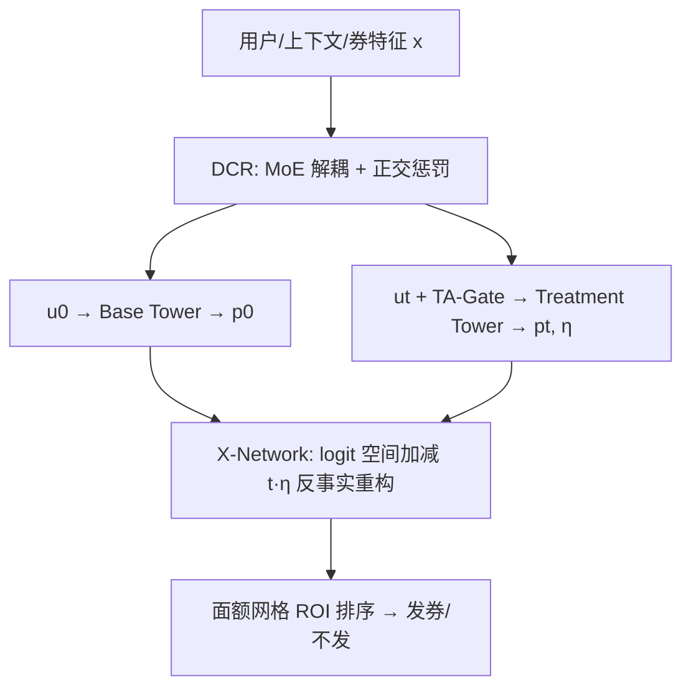
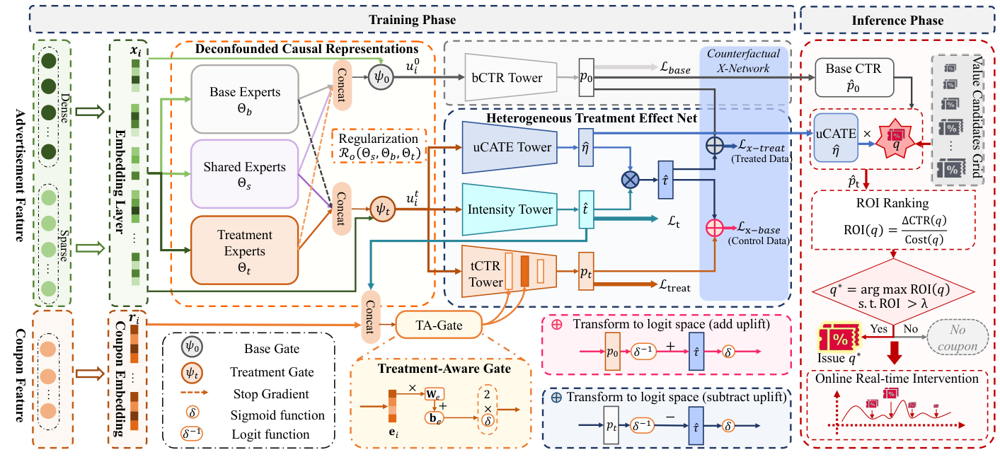

# Jointly Optimizing Debiased CTR and Uplift for Coupons Marketing: A Unified Causal Framework (面向优惠券营销的去偏 CTR 与 Uplift 联合优化：统一因果框架)

- **会议/期刊**: CIKM 2026
- **作者与机构**: Siyun Yang, Jian Wang, Di Fan, Kehe Cai, Jiaming Zhang, Wenjin Wu 等（快手科技）；Shixiao Yang, Haoyan Fu（北京理工大学）
- **推荐链路定位**: 精排（营销干预下的 CTR 校准与券面额分配）
- **研究方向**: CTR/CVR 预估与特征交叉 / 去偏公平与工业架构
- **论文原文**: [https://arxiv.org/abs/2602.12972v3](https://arxiv.org/abs/2602.12972v3)
- **开源代码**: 暂未开源

## TL;DR (1分钟核心速览)

线上发券使观测点击混杂了用户内在偏好与干预增益，导致 Base CTR 失准、下游排序与计费漂移；且券面额是**多值连续干预**，传统二值 Uplift 模型无法刻画强度-响应曲线。本文提出 UniMVT：用 MoE 解耦混淆/干预敏感表征（DCR 层），在 **logit 空间施加单调线性偏移假设** 定义强度无关的隐单元敏感度 uCATE $\eta(x)$，配合 X-Network 全空间反事实互正则，同时输出去偏 $p_0$ 与任意面额的 $\tau(x,t)$。合成 + 快手生产数据上 CS-Qini 大幅领先（如 Syn-1 从 38.12 提至 103.09），线上 A/B 券收入 +18.14%、ROI +8.80、券侧 PCOC 误差降 86.51%。

## Background & Motivation (背景与核心矛盾)

- **主流范式**: 工业界普遍采用「两阶段」——上游 CTR 模型（MMoE/PLE 类 MTL）预测点击，下游独立 Uplift 模型（S/T-Learner、CFRNet、DRNet、VCNet、DESCN）仅在 treated 样本上估计增量。
- **前人局限一（架构割裂与数据碎片化）**: Uplift 模块只用 treated 子集训练，上游 CTR 对干预"视而不见"，预测有偏；且窄子群训练加剧稀疏，表征学不扎实。
- **前人局限二（混杂偏置与校准漂移）**: 即便统一成 Shared-Bottom MTL，历史发券策略与用户特征强相关（高价值用户更易拿大额券），未显式解耦内在偏好与干预敏感响应，全空间校准漂移，$\Delta p \neq p_t - p_0$ 逻辑不自洽。
- **核心洞察 (Key Insight)**: 经济学边际效用递减 + 随机实验统计显示，干预强度对转化意愿的**绝对概率**影响非线性饱和，但在 **log-odds (logit) 空间近似为单调线性平移**，且平移斜率是用户固有属性、与面额大小无关。
- **本文切入点**: 把"强度无关的标量敏感度 $\eta(x)$"作为唯一待估因果量，用 logit 空间线性结构把连续多值干预降维成单标量回归，从而在一个全空间框架内同时拿到去偏 CTR 与可比较的 Uplift。

## Method (核心方法设计)

### 1. 整体框架 (Overall Architecture)

输入用户画像、直播间上下文与券描述（面额/样式）经 Embedding 层得 $x_i$；DCR 层用三组专家（Base/Shared/Treatment）+ 双门控 + Stop-Gradient 解耦出基线表征 $u_0$ 与干预敏感表征 $u_t$，并以正交惩罚强制专家参数空间不重叠。HTE 网络分两条塔：Base Tower 由 $u_0$ 估 $p_0(x)$；Treatment Tower 由 $u_t$ 与券嵌入（经 TA-Gate 逐层调制）估 $p_t(x,t)$ 与 $\eta(x)$。X-Network 在 logit 空间做"加/减 $\hat t \cdot \hat\eta$"的反事实重构，用 MSE 把 treated 监督传导到 control（反之亦然）。推理时对候选面额网格算 $\Delta\text{CTR}$ 与 ROI，取 $\arg\max$ 且过阈值 $\lambda$ 才发券。

<figure class="paper-figure" markdown="span">
  <figcaption>图2：UniMVT 概览，包括：(i) 通过 MoE 解耦处理敏感特征与混杂特征的 DCR 层；(ii) 用于联合估计基础 CTR、潜在 uCATE 和强度依赖提升的 HTE 网络。</figcaption>
</figure>

### 2. 关键设计拆解 (Key Designs)

1. **DCR 解耦层（MoE + Stop-Gradient + 正交惩罚）**：痛点是不解耦则混杂特征污染干预信号。做法是双门控分别聚合 $\text{CONCAT}(H_b, H_s, \text{SG}(H_t))$ 与 $\text{CONCAT}(\text{SG}(H_b), H_s, H_t)$，阻断冲突目标的梯度泄漏但保留共享混杂通路；再加 $\mathcal{R}_{orth}=\sum_l\sum_{(u,v)\in\{(b,s),(t,s),(b,t)\}}\|(\Theta^l_u)^\top\Theta^l_v\|_F^2$ 压低专家参数相关性。直觉：让"谁会被发券"与"谁对券敏感"在表征层就分开，从源头切断选择偏置。

2. **Latent Unit Sensitivity (uCATE) 与 logit 单调线性假设**：痛点是在 $[0,1]$ 概率尺度上直接线性建模会越界且无法表达饱和。本文改在 logit 空间设 $\text{logit}(p_t(x))-\text{logit}(p_0(x))=\eta(x)\cdot t,\ \eta(x)>0$，于是
$$\tau(x,t)=\sigma\big(\text{logit}(p_0(x))+\eta(x)\cdot t\big)-p_0(x).$$
$\eta$ 用 ReLU 保证非负（满足单调性），CATE 的饱和非线性由 sigmoid 自动生成。直觉：把"面额大小"与"用户敏感度"乘性分离，$\eta$ 成为跨面额可比的排序键，直接服务 ROI 约束下的分配。

3. **X-Network 反事实互正则 + 训练目标**：control 组无观测面额，故设辅助强度头 $\hat t=\sigma(\text{MLP}(\text{SG}(u_t)))\cdot(t_{\max}-t_{\min})+t_{\min}$，仅在 treated 上以 $\lambda_1$ MSE + $\lambda_2$ MAE 训练后外推到 control。反事实重构：treated 侧 $\hat p'_t=\sigma(\sigma^{-1}(\hat p_0)+t\hat\eta)$，control 侧 $\hat p'_0=\sigma(\sigma^{-1}(\hat p_t(\hat t))-\hat t\hat\eta)$，以 MSE 对齐真实标签。总损失
$$\mathcal{L}=\lambda_b\mathcal{L}_{base}+\lambda_t\mathcal{L}_{treat}+\lambda_t\mathcal{L}_{t}+\lambda_X\mathcal{L}_{X}+\lambda_o\mathcal{R}_{orth},$$
负样本即同 batch 内未点击曝光（BCE 隐式负采样），无额外 hard negative 挖掘；推理仅两次 MLP 前向 + 网格枚举，开销与常规精排同量级。

## Experimental Setup & Evaluation Protocol (实验设置与评估协议)

- **数据集与预处理**: 三个合成集（Syn-1/2/3，各 80k 训练 / 8k 测试，测试集**纯 RCT 无偏样本**；Syn-1/2 面额单峰分布、Syn-3 多峰模拟券档位；通过令 $T$ 与 $X$ 相关注入真实选择偏置）+ 快手直播券生产数据（含自然流量与多档干预流量）。

| 数据集 | #Train | #Test | 干预强度分布 | 场景说明 |
| :--- | :---: | :---: | :---: | :--- |
| Syn-1 | 80,000 | 8,000 | 单峰 | 已知因果真值，RCT 测试 |
| Syn-2 | 80,000 | 8,000 | 单峰 | 不同混杂强度 |
| Syn-3 | 80,000 | 8,000 | 多峰 | 模拟券档位 |
| Prod | 生产规模 | — | 多档 | 快手直播券真实流量 |

- **数据划分与防穿越**: 合成集固定训练/测试切分，测试集仅取 RCT 样本以保证无偏评估；生产集按时间切分离线验证。
- **排名评测协议**: Base CTR 用 AUC / LogLoss（control 无干预下的反事实转化概率）；Uplift 用 **CS-AUUC** 与 **CS-Qini**——按预测 $\hat\eta$ 排序取 top-$\phi$ 分桶，桶内对 $Y$ 关于 $T$ 回归得斜率 $\hat\beta(\phi)$，$\text{CS-AUUC}=\int_0^1\hat\beta(\phi)\cdot\phi N\,d\phi$，CS-Qini 再减全局斜率基线。属**全样本排序 + 分桶回归斜率**协议，非采样负例排序。
- **对比基线与超参**: S/T-Learner、CFRNet、FlexTENet、DRNet、VCNet、DESCN 共 7 个；二值干预基线统一以 $t$ 作输入、取 $t=1$ 折算单位 Uplift 以对齐比较。

## Key Experimental Results (实验关键数据)

### 1. 主实验对比 (Main Results)

| 方法 | Syn-1 AUC↑ | Syn-1 LogLoss↓ | Syn-1 CS-AUUC↑ | Syn-1 CS-Qini↑ | Syn-3 CS-Qini↑ | Prod AUC↑ | Prod LogLoss↓ | Prod CS-Qini↑ |
| :--- | :---: | :---: | :---: | :---: | :---: | :---: | :---: | :---: |
| S-Learner | 0.6937 | 0.3879 | 219.84 | 6.45 | 18.27 | 0.9011 | 0.2855 | 0.0001 |
| T-Learner | 0.6918 | 0.3892 | 245.05 | 31.66 | 56.61 | 0.9109 | 0.2678 | 0.0177 |
| CFRNet | 0.6936 | 0.3863 | 196.87 | -16.52 | -41.62 | 0.9097 | 0.2730 | 0.0178 |
| FlexTENet | 0.6938 | 0.3868 | 221.84 | 8.45 | -28.77 | 0.8870 | 0.2997 | 0.0166 |
| DESCN | 0.6851 | 0.3910 | 235.92 | 22.52 | 36.20 | 0.9394 | 0.2161 | 0.0170 |
| DRNet | 0.6944 | 0.3864 | 251.51 | 38.12 | -6.45 | 0.9374 | 0.2155 | -0.0003 |
| VCNet | 0.6942 | 0.3862 | 212.26 | -1.14 | -0.01 | 0.9401 | 0.2100 | 0.0005 |
| **UniMVT** | **0.6945** | 0.3865 | **316.48** | **103.09** | **100.34** | **0.9471** | **0.1776** | **0.0293** |
| Improv. | +0.01% | — | +25.8% | +170.4% | +77.3% | +0.74% | -15.4% | +64.6% |

### 2. 消融实验 (Ablation Study)

| 变体 | AUC↑ | LogLoss↓ | CS-Qini↑ |
| :--- | :---: | :---: | :---: |
| w/o Logit Space（非 logit 平移） | 0.9457 | 0.1812 | 0.0008 |
| Unconstrained Treatment（无单调约束） | 0.9401 | 0.1916 | 0.0004 |
| w/o Orthogonal Reg. | 0.9460 | 0.1791 | 0.0097 |
| w/o Shared Experts | 0.9432 | 0.1801 | 0.0132 |
| w/o Counterfactual Loss | 0.9444 | 0.1868 | 0.0042 |
| **UniMVT (Full)** | **0.9471** | **0.1776** | **0.0293** |

### 3. 关键实验发现 (Key Findings)

1. **Uplift 排序能力是主战场，CTR 只是"不退化"**：UniMVT 在 Prod 上 AUC 仅比 VCNet 高 0.74%，但 CS-Qini 从 0.0005 跃至 0.0293（约 58 倍）；说明传统模型被面额绝对值 $t$ 带偏，把"大额券"误当"高敏感用户"，而 $\eta(x)$ 的强度无关性才是排序增益来源。
2. **logit 线性假设是命门，去掉即崩塌**：w/o Logit Space 与 Unconstrained 两变体 AUC 仍高达 0.94+，CS-Qini 却跌到 0.0008/0.0004（近乎随机），证明深度网络在纯事实拟合下会过拟合观测偏置，结构因果先验不可替代。
3. **X-Network 与 DCR 各司其职、缺一不可**：去反事实损失使 CS-Qini 从 0.0293 掉到 0.0042（-86%），去正交正则掉到 0.0097，去 Shared Experts 掉到 0.0132；线上侧 UniMVT 相对两阶段基线券收入 +18.14%、ROI +8.80、券侧 PCOC 误差降 86.51%，校准改善与离线结论一致。

## Highlights, Limitations & Rating (亮点、对比与审稿评价)

- **与代表作对比 (vs. Prior Work)**: 相比 DRNet/VCNet 的分段或变系数曲线拟合，UniMVT 用单标量 $\eta$ + logit 线性把连续干预降维，参数更少、跨面额可比；相比 DESCN 的全空间交叉网络，本文额外引入显式表征解耦与反事实互正则，解决"统一模型仍被混杂污染"的问题；相比两阶段工业方案，消除了 $\Delta p \neq p_t-p_0$ 的逻辑不自洽。
- **可迁移亮点**: ① logit 空间乘性分离"干预强度 × 用户敏感度"的建模套路，可直接迁移到动态定价、补贴力度、推送频次等连续干预场景；② Stop-Gradient + 正交惩罚的 MoE 解耦，是处理"策略变量与用户特征强相关"的通用去混杂手段。
- **审稿级局限批判**: ① logit 线性单调假设较强，对存在"阈值效应/非单调反感"的品类的适用性未验证，且 $\eta>0$ 的 ReLU 约束排除了负向干预；② 合成集测试仅用 RCT 样本，离线 Uplift 评估仍依赖强假设，线上仅报告相对增益、缺置信区间与长期留存观察；③ 面额网格枚举 + ROI 阈值 $\lambda$ 的敏感性未做扫参分析。
- **四维评分**: 创新性 ⭐⭐⭐⭐ | 实验扎实度 ⭐⭐⭐⭐ | 方法清晰度 ⭐⭐⭐⭐⭐ | 落地价值 ⭐⭐⭐⭐⭐

