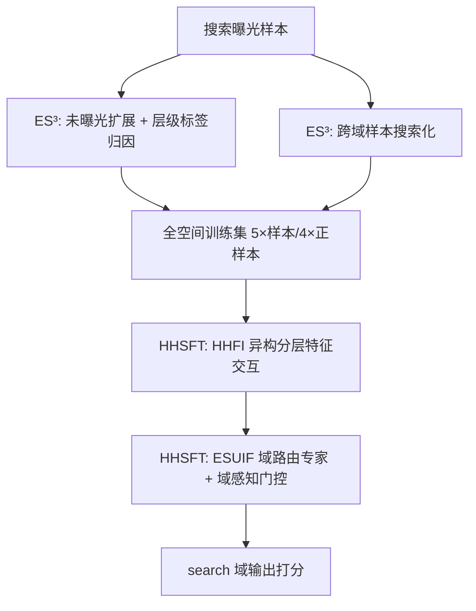
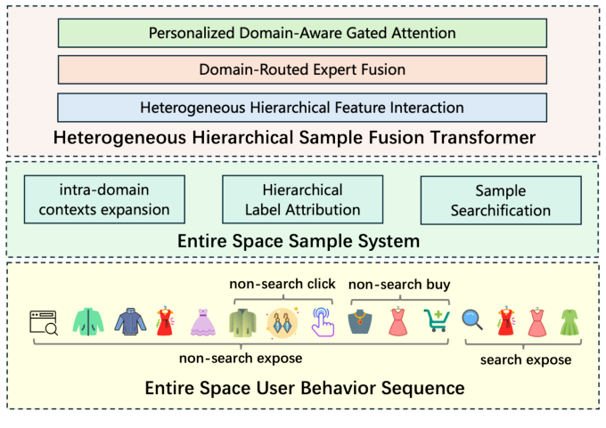

# UniScale: Synergistic Entire Space Data and Model Scaling for Search Ranking (面向搜索排序的全空间数据与模型协同缩放)

- **会议/期刊**: CIKM 2026
- **作者与机构**: Liren Yu, Caiyuan Li, Feiyi Dong, Tao Zhang 等，阿里巴巴淘天集团
- **推荐链路定位**: 精排 (Ranking)
- **研究方向**: CTR预估与特征交叉 / 跨域与多场景推荐
- **论文原文**: [arXiv:2603.24226v4](https://arxiv.org/abs/2603.24226v4)
- **开源代码**: 暂未开源

## TL;DR (1分钟核心速览)

工业排序模型单纯堆参数已出现边际收益递减，作者指出瓶颈本质是**数据瓶颈**而非建模瓶颈：固定数据量下再强的模型也无法兑现潜力。UniScale 提出数据-架构协同设计：ES³ 通过域内未曝光样本扩展、层级标签归因与跨域样本"搜索化"将训练样本扩至 5×、正样本扩至 4×；HHSFT 用 token 专属投影的异构注意力 + 域路由专家 + 域感知门控注意力吸收异构分布。离线 AUC 相对 DLRM-MLP 提升 1.14%，线上淘宝搜索购买 +1.70%、GMV +2.04%。

## Background & Motivation (背景与核心矛盾)

- **主流范式**: 受 LLM 缩放定律启发，工业界（HSTU、Wukong、RankMixer、OneTrans）主要通过加深 Transformer 层级、扩大参数预算来提升排序模型容量。
- **前人局限**: ① 纯参数缩放边际收益递减，40M→300M 参数下增益趋平；② 复杂异构数据分布带来的性能退化**无法仅靠模型结构设计挽回**——同一份扩展数据在标准骨干上导致 −0.43% AUC，在协同设计架构上却带来 +0.32%。
- **核心洞察 (Key Insight)**: 搜索数据与全空间数据的 AUC 差距随模型规模**单调扩大**（40M 时 +0.12% → 300M 时 +0.32%），说明数据与参数必须联合增长，数据构成本身是模型缩放的一阶约束。
- **本文切入点**: 先构造高质量全空间训练集（ES³），再设计能结构化吸收该异构分布的分层 Transformer（HHSFT），二者协同突破纯结构调优的天花板。

## Method (核心方法设计)

### 1. 整体框架 (Overall Architecture)

UniScale 分两段闭环：训练前，ES³ 离线（日级调度）从搜索曝光样本出发，经域内未曝光采样与层级标签归因扩充样本与正标签，再将非搜索域交互经负样本生成与特征对齐"搜索化"为 schema 一致的伪搜索样本，形成 5× 样本、4× 正样本的全空间训练集；训练时，HHSFT 先以异构分层特征交互（HFA + GFA）建模字段级语义与高阶交叉，再以全空间用户兴趣融合（DREF + DAPGA）解耦共享/域特有知识并做目标域中心的知识迁移；推理仅部署 search 域输出，ES³ 不引入任何在线计算。

<figure class="paper-figure" markdown="span">
  <figcaption>图1：所提出的 UniScale 的整体架构，该架构结合了用于高质量数据缩放的全空间样本系统（ES3）和用于充分融合全空间用户行为所表达的用户兴趣的异构分层样本融合 Transformer（HHSFT）。</figcaption>
</figure>

### 2. 关键设计拆解 (Key Designs)

1. **ES³ 层级标签归因（修正曝光偏差而非引入新偏差）**：传统"未曝光=不感兴趣"标签本身是历史排序决策的产物，形成自我强化的反馈闭环。作者按统一优先级传播跨域信号——跨域点击优先归因于搜索曝光样本、次之未曝光样本；跨域转化优先归因于搜索点击、次之曝光未点击、再次未曝光样本。直觉在于：详情页当日购买等跨域转化产生于搜索曝光机制之外，是用户兴趣的**独立测量**，将其回填可把隐式负例伪影替换为真实正例，同时为长尾物品提供监督（正标签 2×）。

2. **HHSFT 异构分层特征交互（HFA + GFA）**：标准 Transformer 全 token 共享 $W_Q,W_K,W_V$，而电商搜索中类目 ID、连续价格、行为序列来自截然不同的语义空间，共享投影导致语义混淆。HFA 为每个 token 配备专属投影与 FFN：

$$q_i^{(l)}=h_i^{(l)}W_i^Q,\quad k_i^{(l)}=h_i^{(l)}W_i^K,\quad v_i^{(l)}=h_i^{(l)}W_i^V,\quad h_i^{(l+1)}=\text{FFN}_i(a_i^{(l)})$$

随后 GFA 用复合投影 $\tilde{k}_j=\text{concat}([h_1^{L_H},\dots,h_n^{L_H}])\tilde{W}_j^K$ 在拼接 token 上做全局多头注意力，捕获跨字段高阶交互。物理直觉：先保字段分布、再融全局语义，避免"一刀切"投影抹平异构性。

3. **ESUIF 域路由专家 + 域感知门控（负迁移的结构化吸收）**：朴素混合跨域样本会引发严重负迁移。DREF 引入**样本路由约束**：共享专家 $f_s$ 接收全部样本，域专家 $f_d$ 仅接收本域样本梯度，在优化层面隔离跨域噪声，门控按 $[\alpha_s,\alpha_d]=\text{softmax}(g_{moe}(z))$ 融合。DAPGA 进一步做"前向可见、后向隔离"的跨域注意力：目标域输出作 query，各域输出经梯度停止 $\text{sg}(\cdot)$ 后作 K/V，并以用户/域特征生成 sigmoid 门控 $\gamma$ 做逐元素调制 $\hat{o}=\gamma\odot\tilde{o}$。总损失为各域 BCE 之和 $\mathcal{L}=-\sum_d\sum_{(x,y)\in S_d}[y\log\hat{y}^{(d)}+(1-y)\log(1-\hat{y}^{(d)})]$，无额外负采样，推理仅走 search 域分支。

## Experimental Setup & Evaluation Protocol (实验设置与评估协议)

- **数据集与预处理**: 淘宝电商十亿级交互数据，以搜索曝光样本为基线，经 ES³ 逐级扩展：

| 阶段 | Requests | Samples | Click Pos. |
| :--- | :---: | :---: | :---: |
| Baseline（仅搜索曝光） | 1.0× | 1.0× | 1.0× |
| + 未曝光扩展 | 1.0× | 3.0×↑ | 1.0× |
| + 层级标签归因 | 1.0× | 3.0× | 2.0×↑ |
| + 跨域搜索化 | 2.0×↑ | 5.0×↑ | 4.0×↑ |

- **数据划分与防穿越**: 工业留出集，测试集**仅含 search 域样本**以对齐线上部署语境；ES³ 归因管线离线日级运行，跨域转化采用当日购买等高置信信号，避免未来信息泄漏。
- **排名评测协议**: 工业级留出评估，指标为 AUC、GAUC（user-query 分组）与 HR@5；业界经验 0.05% 提升即视为置信改进。线上采用 10 天 5% 流量 A/B，以购买与 GMV 为业务指标。
- **对比基线与超参设置**: DLRM-MLP（15M）、DCNv2（24M）、AutoInt（150M）、HiFormer（170M）、Wukong（32M）、RankMixer（140M）；HHSFT 稠密参数 300M、1.22 TFLOPs。为隔离数据贡献，所有基线与 HHSFT 单行均训练于同一搜索曝光数据。

## Key Experimental Results (实验关键数据)

### 1. 主实验对比 (Main Results)

| Model | AUC | GAUC | Params(M) | TFLOPs |
| :--- | :---: | :---: | :---: | :---: |
| DLRM-MLP (base) | - | - | 15 | 0.42 |
| DCNv2 | +0.08% | +0.01% | 24 | 0.65 |
| AutoInt | +0.26% | +0.14% | 150 | 1.19 |
| HiFormer | +0.54% | +0.49% | 170 | 1.98 |
| Wukong | +0.21% | +0.13% | 32 | 0.94 |
| RankMixer | +0.38% | +0.32% | 140 | 1.93 |
| **HHSFT** | **+0.82%** | **+0.62%** | 300 | 1.22 |
| **HHSFT + ES³** | **+1.14%** | **+0.86%** | 300 | 1.22 |

### 2. 消融实验 (Ablation Study)

| 设置 | AUC | GAUC | HR@5 |
| :--- | :---: | :---: | :---: |
| MLP → Transformer 骨干 | +0.17% | - | - |
| + 异构注意力 (token 专属 QKV/FFN) | +0.41% | - | - |
| + 全局特征注意力 (HHFI 完整) | +0.80% | - | - |
| HHFI + ES³ 数据（无融合模块） | **−0.43%** | −0.24% | −4.76% |
| HHFI + DREF | +0.19% | +0.25% | +0.39% |
| HHFI + DAPGA | +0.22% | +0.18% | +0.17% |
| HHFI + DREF + DAPGA | +0.32% | +0.26% | +0.44% |

### 3. 关键实验发现 (Key Findings)

1. **数据扩展是"双刃剑"，架构决定符号**：同一份 ES³ 全空间数据在 HHFI 骨干上直接混合导致 −0.43% AUC、HR@5 暴跌 4.76%，而加上 DREF+DAPGA 后翻转为 +0.32%/+0.44%，证明负迁移必须靠结构化解耦吸收，而非标签级容噪。
2. **容量应优先分配给高阶融合层**：固定搜索域数据下，扩 GFA 维度 $d_G$ 的收益（+0.30% ΔAUC@300M）显著高于扩 HFA 维度 $d_H$（+0.17%），说明分层设计把参数预算精准投向了跨字段高阶交互。
3. **协同缩放推远收益递减点**：HHSFT+Search 曲线在 100M→300M 明显趋平，而 HHSFT+ES³ 保持正斜率，二者差距从 40M 的 +0.12% 扩大到 300M 的 +0.32%；线上 10 天 A/B 中购买 +1.70%、GMV +2.04%，且工程优化使 GPU 推理成本降约 55%、训练开销降约 40%。

## Highlights, Limitations & Rating (亮点、对比与审稿评价)

- **与代表作对比 (vs. Prior Work)**: 与 Wukong/RankMixer 等纯结构缩放路线不同，本文把数据构成视为缩放的一阶变量；与 ESMM/STAR/PEPNet 等全空间建模相比，本文不止于共享底层或软门控，而是先扩数据再用硬路由 + 梯度停止做"前向可见、后向隔离"的迁移；与 MMoE/PLE 相比，DREF 的样本路由约束在优化层面而非仅门控层面隔离域噪声。
- **可迁移亮点**: ① 层级标签归因的"优先级传播"逻辑可直接迁移到任何多阶段漏斗系统，用于修正曝光偏差闭环；② 跨域样本"搜索化"（相似性感知负采样 + 历史 query 复用/共现/ANN 三级对齐）是把非目标域行为注入目标域训练集的通用范式。
- **审稿级局限批判**: ① 实验仅限淘宝单一平台与 search 单目标域，跨域收益高度依赖辅助域行为丰富度，泛化性缺乏公开数据集验证；② 300M 参数仅做 7× 受控扫描，作者自认不足以拟合幂律，"scaling law" 表述偏弱；③ ES³ 依赖离线日级管线与多层质量护栏，工程复现成本高，且归因传播引入的分布差异被完全推给架构吸收，缺乏对标签噪声上界的理论分析。
- **四维评分**: 创新性 ⭐⭐⭐⭐ | 实验扎实度 ⭐⭐⭐⭐⭐ | 方法清晰度 ⭐⭐⭐⭐ | 落地价值 ⭐⭐⭐⭐⭐

