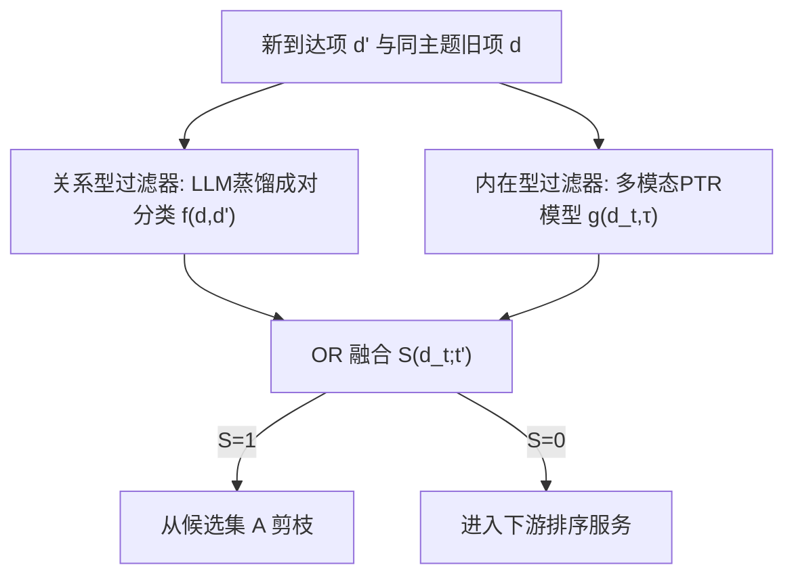
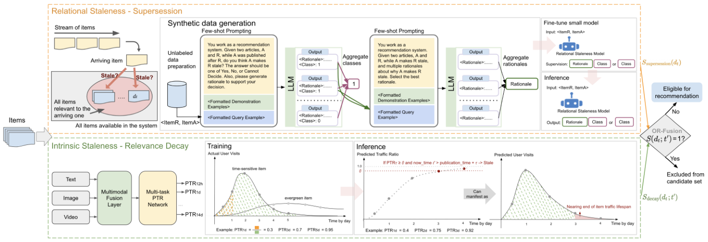

# Decomposing Staleness in Recommender Systems: A Dual-Filter Framework for Supersession and Decay (推荐系统过时性解耦：取代与衰减的双过滤器框架)

- **会议/期刊**: CIKM 2026 (Applied Research Track)
- **作者与机构**: Di Bai, Feng Han, Zhenwei Tang, Jintao Liu, Luoshu Wang, Jialu Liu (Google LLC)
- **推荐链路定位**: 召回前候选过滤（上游 pruning，先于重排序）
- **研究方向**: 去偏公平与工业架构 / 大语言模型推荐
- **论文原文**: [论文原文链接](https://arxiv.org/abs/2608.15780v1)
- **开源代码**: 暂未开源

## TL;DR (1分钟核心速览)

工业推荐长期用“年龄截断 + 互动阈值”粗粒度代理处理过时内容，既误杀常青内容又滞后于真实失效。本文提出 SDF，把过时性拆为**取代（supersession，关系型）**与**衰减（decay，内在型）**两种机制：前者用 LLM 教师合成标注 + 知识蒸馏训练成对分类学生模型，后者用多模态早融合网络从内容预测各时间窗的“预测流量比 PTR”。两过滤器以 OR 融合在上游剪枝。Google Discover 两年部署使过时举报下降 54.9%（取代 64.0%、衰减 34.4%），并节省约 8.7% 服务算力。

## Background & Motivation (背景与核心矛盾)

- **主流范式**: 工业界普遍用发布时间截断（age cutoff）与互动量/CTR 下限（engagement cliff）管理内容新鲜度，如 YouTube 新鲜内容栈、Kuaishou 冷启动门控、Twitter/X 后置启发式过滤。
- **前人局限**: ① 年龄截断是粗粒度代理，长截断仍放过过时项、短截断误杀常青内容；② 互动启发式存在结构性滞后——系统必须先反复曝光劣质内容才能“学到”它已过时；③ 学术界的流行度衰减建模（TimeSVD++、生命周期曲线）依赖已观测互动，且多为类目级而非单条内容级。
- **核心洞察 (Key Insight)**: 过时性并非单一现象。**取代**的信号是关系型的（只有新到达项与旧项构成矛盾/推进关系时才使旧项过时），**衰减**的信号是内在型的（由内容自身预期寿命决定，与任何新项无关）。二者检测方式本质不同，必须解耦建模。
- **本文切入点**: 用两个互补的、均为 item 级（非个性化）的学习型过滤器分别覆盖两种机制，OR 融合后在上游剪枝，既提升体验又降低下游算力。

## Method (核心方法设计)

### 1. 整体框架 (Overall Architecture)

SDF 维护候选集 $\mathcal{A}$，新项到达即入池，被任一过滤器判定过时即移出，下游排序器只消费$\mathcal{A}$。关系型过滤器对每个新到达项$d'$与同主题旧项$d$做成对判定$f(d,d')\in\{0,1\}$；内在型过滤器对项$d_t$在决策时刻$t'$用内容预测其已累积的寿命流量份额$g(d_t,\tau)$。两者输出经 OR 融合为$S(d_t;t')$，为 1 则剪枝。由于两个模型都不依赖请求用户与上下文，可完全离线计算并缓存，服务时仅按时间戳查表，**零在线推理开销**。

<figure class="paper-figure" markdown="span">
  <figcaption>图2：SDF端到端工作流。候选内容项𝑑𝑡（在时间𝑡到达）被并行评估。上：用于取代的关系型过时过滤器。学生模型预测成对过时性，得到𝑆supersession(𝑑𝑡)。下：用于相关性衰减的内在过时过滤器。多模态模型根据内容项的内容预测各时间范围的流量比率，得到决策时间𝑡′的𝑆decay(𝑑𝑡;𝑡′)。两个输出经OR融合为𝑆(𝑑𝑡;𝑡′)；被标记的项（𝑆(𝑑𝑡;𝑡′)=1）被过滤，其余项仍可推荐并进入下游服务。</figcaption>
</figure>

### 2. 关键设计拆解 (Key Designs)

1. **关系型过时检测：LLM 教师 + 理由监督蒸馏**：人工成对标注成本不可行，故用 PaLM 2-L 做教师。采样是关键难点——正例只存在于“中等相似度窄带”（太相似是近重复、太不相似则关系平凡），且热点话题易产生冗余对。算法先聚类、按簇规模比例抽代表项、跨簇成对，再按相似度分桶加权采样以过采样正例。标注时每对抽 7 次独立样本，做**两阶段多数投票**：先投票类别，再对胜出类别下的理由做二次 LLM 投票（理由可能对而类别错，反之亦然）。学生模型（T5-11B）以“{RATIONALE}. Therefore, {CLASS}”格式做 CoT 式监督，并引入 NLI 辅助任务——NLI 的“假设-前提”关系判定与“新项是否取代旧项”结构同构，可提供独立人工策划的分布外泛化信号。
2. **内在型过时检测：预测流量比 PTR**：以项的生命周期访问分布作为相关性衰减的自然代理，定义 $\mathrm{PTR}_\tau(d_t)=\frac{\#\text{visits in }[t,t+\tau]}{\#\text{visits over full lifespan}}$，训练$g(d_t,\tau)\approx\mathrm{PTR}_\tau(d_t)$。工程上分母取固定 30 天参考窗，$\tau\in\{12h,1d,3d,5d,7d,10d,14d\}$ 对齐突发新闻/日报/周更/慢衰减内容的熟悉生命周期。标签用**搜索点击**而非原始浏览日志——后者被发布方推广污染，难以分离时效与常青分布。架构为文本/图像/视频 token 早融合进共享多模态编码器，再接各时间窗独立稠密头，单次前向输出全部 horizon，MSE 损失跨窗求和。
3. **离散化决策规则与推理效率**：$g$只在离散窗集$\mathcal{T}$ 上训练，故式 (4) 特化为取“已流逝的最大训练窗”的预测值：
$$S_{\text{decay}}(d_t;t')=\mathbb{I}\Big[\max_{\tau\in\mathcal{T}}\big(g(d_t,\tau)\cdot\mathbb{I}[t'>t+\tau]\big)\geq\theta\Big]$$
内层示性函数屏蔽未流逝窗，外层 max 隔离最大已流逝窗。关系型过滤器分两模式：online 模式近实时标注时效项（轻量预过滤丢简单负例 + 跨时间桶邻居检索防近重复主导），batch 模式回填长尾并把过时标签扩散到同簇项以扩覆盖。

## Experimental Setup & Evaluation Protocol (实验设置与评估协议)

- **数据集与预处理**（关系型过滤器）：PaLM 2-L 标注 1,100,133 对（train/val/test = 880,027 / 109,951 / 110,155），另设 300 对人工开发金标集用于 prompt 调优（与 few-shot 示例不相交），以及 550 对人工评级的留出金标测试集（Discover 采样、正负均衡）。PTR 侧用多语言多格式内容 + 匿名搜索点击日志，过滤低于最小流量下限的项。

| 数据集 | #Users | #Items | #Interactions | 稀疏度/密度 | 特征/场景说明 |
| :--- | :---: | :---: | :---: | :---: | :--- |
| 关系型蒸馏集 | — | — | 1,100,133 对 | 正负均衡 | 成对过时判定，含理由标注 |
| 关系型金标测试 | — | — | 550 对 | 均衡 | 人工评级，与训练不相交 |
| PTR 训练集 | — | 多语言多格式 | 搜索点击流量 | 长尾过滤 | 7 个 horizon 的流量比标签 |

- **数据划分与防穿越 (Splitting Strategy)**: 关系型按 80/10/10 比例划分 train/val/test；PTR 标签按 30 天参考窗计算，horizon 标签构造上对 $\tau$ 单调非减，避免未来信息泄漏。
- **排名评测协议 (Ranking Protocol)**: 非传统 Top-N 排序评测。关系型用 Acc./Prec./Rec./F1（F1 为主指标）；PTR 用**过时项二分类**（阈值 $\theta=0.9$，从$\{0.85,0.9,0.95,0.98\}$ 中按高精度+足够覆盖选出），并按 5 位标注者一致度分三档（≥3/5、≥4/5、5/5）扫描。
- **对比基线与超参设置**: 关系型消融 Disc（仅类别监督）/ Gen（CoT 理由监督）× NLI 辅助；PTR 对比晚融合 vs 早融合。学生 T5-11B，batch 128，lr $1e^{-3}$，20k steps，1k warmup。线上用**连续流行度差值框架**：每周从 A/B 两臂按 view delta 采样项，5 人独立评级、≥3/5 判过时，计算$\Delta_{\text{stale}}=r_{\text{promoted}}-r_{\text{demoted}}$，负值且显著即实验臂降低过时。

## Key Experimental Results (实验关键数据)

### 1. 主实验对比 (Main Results)

线上 A/B（初始 locale，配置调至互动中性，避免激进剪枝换取虚假过时下降）：

| 过滤器 | Promoted 过时率 | Demoted 过时率 | $\Delta_{\text{stale}}$ |
| :--- | :---: | :---: | :---: |
| Baseline（年龄截断+互动悬崖） | 4.00±0.86% | 4.10±0.87% | −0.10±1.22% |
| Relational 单开 | 1.68±0.81% | 5.87±2.11% | −4.19±2.25% |
| Intrinsic 单开 | 7.90±1.67% | 11.00±1.94% | −3.10±2.56% |
| **SDF 全量** | 4.33±0.89% | 11.24±2.04% | **−6.91±2.23%** |

两年部署监控（28 天滚动为官方指标）：总过时举报 **−54.9%**，取代类 **−64.0%**，衰减类 **−34.4%**。两月联合 holdback：用户 dismiss 率 −0.16±0.07%，feed 多样性 +0.13±0.04%，正向互动 +0.26±0.18%。算力：关系型省 4.76% CPU/TPU 小时，内在型再省 3.98%。

### 2. 消融实验 (Ablation Study)

| 配置 | Acc. | Prec. | Rec. | F1 |
| :--- | :---: | :---: | :---: | :---: |
| Disc（仅类别） | 83.71 | 83.68 | 85.15 | 84.41 |
| Disc + NLI | 83.86 | 84.25 | 84.65 | 84.45 |
| Gen（CoT 理由） | 83.37 | 81.31 | **88.14** | 84.59 |
| **Gen + NLI（部署）** | **84.16** | **84.31** | 85.28 | **84.79** |
| PTR 晚融合 | — | — | — | 76%（时敏分类 Acc.） |
| **PTR 早融合（部署）** | — | — | — | **80%** |

PTR 一致度扫描：F1 从 Majority(3/5) 的 78.07% 升至 Unanimous(5/5) 的 87.50%，各档精度均 >88%。

### 3. 关键实验发现 (Key Findings)

1. **两过滤器覆盖的是近乎正交的机制**：单开时 $\Delta_{\text{stale}}$ 分别为 −4.19 与 −3.10，全量达 −6.91，接近两者之和而非取较优者，证明取代与衰减的过时项集合重叠很小，解耦建模是收益来源而非冗余。
2. **理由监督的收益体现在召回而非精度**：Gen 相比 Disc 召回从 85.15 升至 88.14 但精度降至 81.31，说明 CoT 式理由监督让模型更敢判“过时”；叠加 NLI 后精度回补至 84.31，F1 达最优 84.79，二者互补。
3. **早融合对多模态衰减预测有实质增益**：80% vs 76% 的时敏分类准确率差距表明，文本/图像/视频 token 在共享编码器内联合建模优于各模态独立编码后拼接，对“流星雨指南”这类需图文共同判断寿命的内容尤为关键。

## Highlights & Limitations (亮点、对比与审稿批判)

- **与代表作对比 (vs. Prior Work)**: 相比 TimeSVD++ 与流行度衰减曲线类工作，PTR 在**互动被观测之前**就由内容预测寿命流量比，消除滞后；相比文档级新颖性检测（判断新文档是否为语料增信息），本文关系型过滤器解的是**逆问题**——新项是否使旧项过时；相比 YouTube/Kuaishou/Twitter 的阈值式候选管理，本文用学习型 item 级模型替代手工代理。
- **可迁移亮点**: ① “两阶段多数投票”（先类别后理由）可直接迁移到任何 LLM 合成标注管线，低成本修正“类别对但理由错”的隐性噪声；② 用搜索点击替代浏览日志构造衰减标签，是剥离发布方推广偏差的实用技巧；③ 离线缓存 + 服务时查表的设计，使重模型也能零在线延迟落地。
- **审稿级局限批判**: ① 关系型过滤器在政治评论等“观点与事实混杂”内容上成对判定天然歧义，且 batch 模式把过时标签扩散到同簇项可能引入簇级误伤；② PTR 对缓慢衰减的长尾项系统性漏检（预测流量比始终不达阈值），且相当比例残留举报实为“用户已看过”的重复曝光问题，根本不在 SDF 的取代/衰减语义范围内；③ 线上评估依赖 5 人小样本人工评级与 view-delta 加权采样，统计功效有限，且全部实验在单一平台单一产品内完成，跨平台泛化性未验证。

## Rating (四维评分)

- **方法创新性 (Novelty)**: ⭐⭐⭐⭐ （“取代 vs 衰减”的机制解耦是清晰且有解释力的概念贡献，但两个组件本身均为成熟技术——LLM 蒸馏与多模态多任务回归——的组合应用）
- **评估协议与实验扎实度 (Protocol & Experiments)**: ⭐⭐⭐⭐ （离线消融 + 互动中性约束的 A/B + 两月 holdback + 两年部署监控四层证据链完整，但人工评级样本量与单平台局限削弱统计强度）
- **写作与数学规范度 (Clarity & Rigor)**: ⭐⭐⭐⭐ （问题形式化与式 (7) 的离散化推导干净利落，工业细节交代充分；PTR 的阈值 $\theta$ 与 horizon 集选择缺少敏感性分析）
- **工业落地与复现价值 (Industrial & Practical Value)**: ⭐⭐⭐⭐⭐ （十亿级月活产品两年全量部署、举报降 54.9%、省近 9% 算力且零在线推理开销，是罕见的端到端工业验证；但未开源、依赖内部多模态骨干，复现门槛高）
