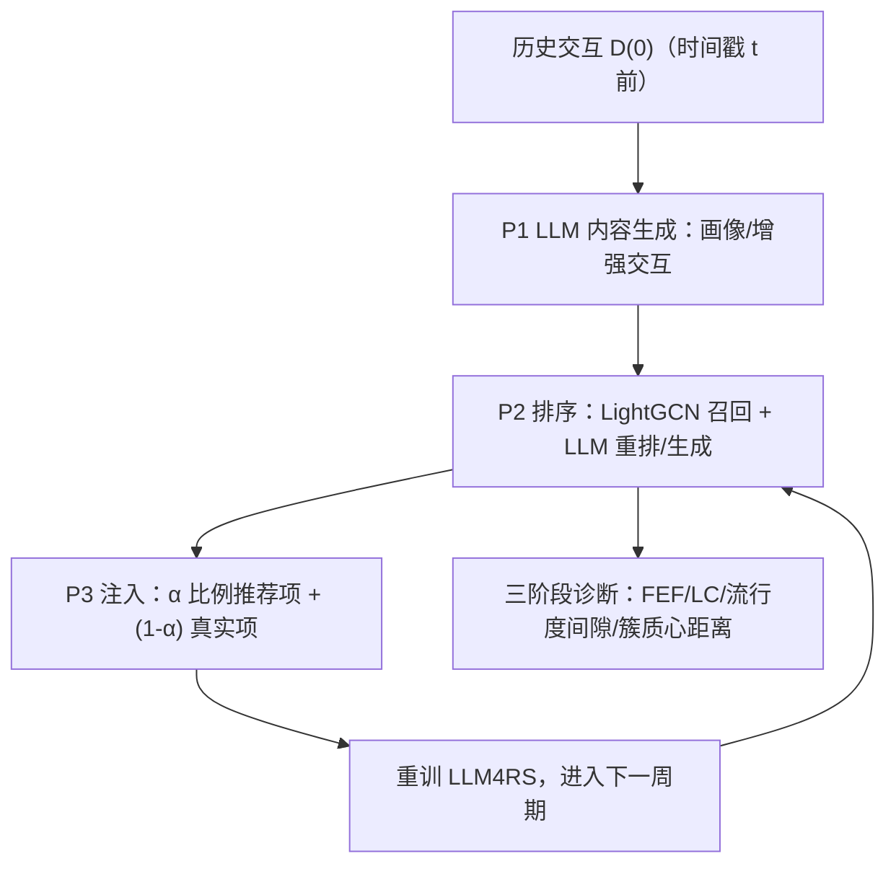

# EchoTrace: Diagnosing Recursive Risks in LLM-Powered Recommender Systems (诊断 LLM 驱动推荐系统中的递归风险)

- **会议/期刊**: CIKM 2026
- **作者与机构**: Donguk Park, Yeon-Chang Lee (UNIST); Dongwon Lee (Penn State)
- **推荐链路定位**: 端到端生成式（覆盖内容生成 → 排序 → 反馈回路全链路）
- **研究方向**: 去偏公平、可信隐私与工业架构 / 大语言模型推荐
- **论文原文**: [https://arxiv.org/abs/2602.07442v3](https://arxiv.org/abs/2602.07442v3)
- **开源代码**: [https://github.com/DongUk-Park/EchoTrace](https://github.com/DongUk-Park/EchoTrace)

## TL;DR (1分钟核心速览)

LLM4RS 把 LLM 当作增强器、画像器与推荐器，但 LLM 固有的偏见与幻觉会随"推荐→注入→重训"的反馈回路递归放大，而现有综述只谈架构与应用、缺乏纵向风险追踪。本文提出 EchoTrace：先基于 116 篇顶会工作建立五角色功能分类，再设计带混合系数 $\alpha$ 的受控反馈回路仿真与三阶段（LLMGC / 排序 / 反馈回路）诊断协议。在 ML-1M、A-Books、Yelp 上以时间戳切分 + 全库排序诊断发现：画像属性 FEF 率高达 93.16%、排序幻觉率 4.07%–13.14%、用户簇质心距离从 3.73 增至 9.29，且 86%–92% 用户的高注意力历史项为 LLM 注入项。

## Background & Motivation (背景与核心矛盾)

- **主流范式**: LLM4RS 通过五种功能角色介入推荐管线——Augmenter（造交互）、Representer（造画像/表征）、Recommender（直接生成或重排）、XAI（生成解释）、RecAgent（智能体编排），其中前三类直接改写训练信号或曝光结果。
- **前人局限**: 现有 LLM4RS 综述聚焦模型架构、数据集与应用场景，对"LLM 信号如何跨周期传播"零覆盖；而传统 RS 反馈回路研究（如 popularity bias 放大）假设信号源自人类行为，无法刻画 LLM 幻觉这类"非人类来源"的注入信号。
- **核心洞察 (Key Insight)**: LLM 幻觉/偏见不是孤立噪声——一旦推荐结果被当作观测交互回灌训练集，系统会从"建模人类偏好"漂移为"强化 LLM 自身信号"，并在表征空间形成与偏好、流行度均无关的结构性分裂。
- **本文切入点**: 不做新模型，而是造一个可控反事实沙盒：用混合系数 $\alpha$ 解耦 LLM 驱动与人类驱动交互，配合三阶段指标做纵向诊断。

## Method (核心方法设计)

### 1. 整体框架 (Overall Architecture)

EchoTrace 沿 LLM4RS 生命周期串起三阶段闭环：P1 内容生成阶段，Augmenter/Representer 把历史交互转为画像与合成交互，诊断其分布偏斜与幻觉；P2 排序阶段，Recommender 对 LightGCN 召回候选重排或开放式生成，诊断流行度间隙与无效项；P3 反馈回路阶段，把推荐项按 $\alpha$ 比例注入训练集并重训，跨 $N$ 个周期追踪偏见累积、表征分离与注意力自强化。三阶段共享同一套 bias / hallucination 度量，使早期失真可被追溯到后期生态效应。

### 2. 关键设计拆解 (Key Designs)

1. **带混合系数的受控反馈回路（Controlled Feedback-Loop Pipeline）**：传统回路仿真无法区分"LLM 造成"与"用户本来就会消费"，本文用时间戳 $t$ 切出 $\mathcal{D}^{(0)}$ 与 $\mathcal{D}_{gt}$，把 $t$ 后时间轴等分为 $N$ 段，仅对真实活跃用户 $u\in\mathcal{U}_n$ 生成 $K_u$ 条推荐（$K_u$ 对齐其真实消费量以保持活跃度分布），再按 $\alpha$ 注入：
$$\mathcal{D}^{(n)}=\mathcal{D}^{(n-1)}\cup\{(u,i,\tau_n)\mid u\in\mathcal{U}_n,\ i\in\tilde{\mathcal{R}}_n(u)\cup\tilde{\mathcal{G}}_n(u)\},\quad |\tilde{\mathcal{R}}_n(u)|=\lfloor\alpha K_u\rfloor$$
$\alpha=1$ 是纯 LLM 驱动的压力测试，$\alpha=0.5$ 模拟人机混合消费。直觉：$\alpha$ 是唯一可调的反事实旋钮，让"LLM 信号占比"成为可控自变量而非混淆项。

2. **双维度幻觉度量（FEF + LC）**：LLM 幻觉在推荐里既表现为"编造不存在的实体"，也表现为"同输入不同输出"，单一指标会漏诊。本文定义事实错误率与逻辑矛盾率：
$$\text{FEF}=1-\frac{|\mathcal{O}_{LLM}\cap\mathcal{O}_{gt}|}{|\mathcal{O}_{LLM}|},\qquad \text{LC}=\frac{\mathbb{I}[\mathcal{O}^{(1)}_{LLM}\neq\mathcal{O}^{(2)}_{LLM}]}{|\mathcal{O}_{gt}|}$$
前者捕捉"film critic"这类数据集中不存在的职业标签，后者用两次独立采样捕捉生成不稳定性。两者互补：FEF 高说明知识接地失败，LC 高说明解码随机性未被约束。

3. **结构性分离的归因诊断（Separation Attribution）**：仅看簇距离无法区分"LLM 造成"还是"偏好/流行度造成"。本文在末周期做 $k$-means（$k=2$，轮廓系数最优）并回溯追踪同一批用户/物品，同时检验三条替代解释：交互长度是否均衡、簇间 genre 分布是否可分、head/mid/tail 曝光是否可分；再用注意力分析统计"最高注意力历史项为注入项"的用户占比。若三条人类驱动解释均不成立而注意力占比高，则分离归因于 LLM 信号自强化。

**训练目标、负采样与推理效率**：本文为诊断框架而非新模型，沿用各基线原训练协议（LightGCN 的 BPR 损失、A-LLMRec 的生成式微调），不引入新负采样策略。主要开销在 LLM 调用：每周期 gpt-4o 成本约 \$13.8–\$122.4（Representer 在 A-Books 最贵），Recommender 用 facebook/opt-6.7b 零成本；$N=5$ 周期意味着成本随周期线性增长，这是该框架落地的主要瓶颈。

## Experimental Setup & Evaluation Protocol (实验设置与评估协议)

- **数据集与预处理**: 三个 LLM4RS 常用基准，未做 5-core 过滤，保留原始时间跨度：

| 数据集 | #Users | #Items | #Train Interactions | #GT Interactions | 特征/场景说明 |
| :--- | :---: | :---: | :---: | :---: | :--- |
| ML-1M | 5,400 | 3,693 | 800,167 | 200,042 | 含显式用户属性（年龄/性别/职业）与电影类型 |
| A-Books | 34,375 | 25,882 | 473,266 | 473,265 | 仅物品属性（标题/品牌/类目），用户属性稀缺 |
| Yelp | 12,025 | 11,233 | 80,217 | 52,027 | 商户类目与地理位置，用户属性稀缺 |

- **数据划分与防穿越 (Splitting Strategy)**: 全局时间戳切分——截止时间 $t$ 前为初始训练集 $\mathcal{D}^{(0)}$，$t$ 后为 ground-truth 活动集 $\mathcal{D}_{gt}$；$t$ 后时间轴再等分为 $N=5$ 个周期。ML-1M 用 $t=0.8$（1,143 共同用户），A-Books/Yelp 用 $t=0.5$（31,445 / 9,102 共同用户），以保证跨周期活跃用户充足。
- **排名评测协议 (Ranking Protocol)**: 非传统 Top-K 精度评测，而是诊断式度量——流行度间隙（推荐项平均流行度减真实消费项平均流行度）、FEF/LC 率、簇质心欧氏距离、注意力占比。推荐列表长度 $K_u$ 对齐用户真实消费量，属"活跃度保持"的受控设定而非全库排序。
- **对比基线与超参设置**: 三条基线对应三种角色——Cold-Item Aug（Augmenter，gpt-4o）、LLMRec（Representer，gpt-4o）、A-LLMRec（Recommender，opt-6.7b）；另加 LightGCN 作为传统 CF 对照组以隔离"LLM 特有"效应。主实验 $\alpha=1.0$，扩展实验 $\alpha=0.5$；鲁棒性检验换用 Claude-Haiku-4-5 与 Qwen3-14B。

## Key Experimental Results (实验关键数据)

### 1. 主实验对比 (Main Results)

原文以诊断指标而非精度指标呈现，下表汇总三阶段核心数值（LightGCN 为传统 CF 对照）：

| 阶段 / 指标 | 数据集 | Cold-Item Aug | LLMRec | A-LLMRec | LightGCN | 诊断结论 |
| :--- | :--- | :---: | :---: | :---: | :---: | :--- |
| P1 画像 FEF (%) | ML-1M Occupation | — | **93.16** | — | — | 知识接地严重失败 |
| P1 画像 FEF (%) | ML-1M Age / Gender | — | **73.68 / 25.35** | — | — | 属性越细幻觉越重 |
| P1 画像 LC (%) | ML-1M Age | — | **21.09** | — | — | 同输入输出不稳定 |
| P1 画像 LC (%) | A-Books Age / Yelp 类目 | — | **15.05 / 17.72** | — | — | 跨数据集一致存在 |
| P2 排序 FEF (%) | ML-1M / A-Books / Yelp | — | — | **4.07 / 7.40 / 13.14** | — | 开放式生成编造物品 |
| P2 流行度间隙 | 三数据集 | 增大 | 增大 | 持平或略降 | — | 幻觉"伪装"成多样性 |
| P3 用户簇质心距离 | ML-1M ($n$=1→5) | — | — | **3.73 → 9.29** | 无明显分离 | LLM 特有结构分裂 |
| P3 高注意力注入项占比 | ML-1M ($\alpha$=1) | — | — | **86%–92%** | — | 自强化回路成立 |
| P3 Recall 变化 ($n$=1→5) | ML-1M ($\alpha$=1) | — | — | **−6.19%** | — | 递归反馈致性能退化 |
| P3 Recall 变化 ($n$=1→5) | ML-1M ($\alpha$=0.5) | — | — | **+23.74%** | — | 保留真实交互可逆转 |

### 2. 消融实验 (Ablation Study)

本文无传统模块消融，以"设定替换"作为等价消融：

| 配置变体 | 关键指标变化 | 说明 |
| :--- | :--- | :--- |
| $\alpha=1.0$（纯 LLM 驱动） | 注意力注入项占比 86%–92%；Recall −6.19% | 默认压力测试设定 |
| $\alpha=0.5$（人机混合） | 注意力占比降至 45%–65%；Recall +23.74% | 真实交互起"锚定"作用 |
| 换 Claude-Haiku-4-5 | 性别分布更偏斜，仍产出分类外职业 | 风险非单一 backbone 伪影 |
| 换 Qwen3-14B | 偏斜程度较轻但同类型错误复现 | 风险形态跨模型一致 |
| 对照组 LightGCN | 簇分离弱/无，簇间 genre 与 head/mid/tail 可分 | 传统 CF 分离由人类因素解释 |

### 3. 关键实验发现 (Key Findings)

1. **幻觉在内容层远比排序层严重，且被"多样性"掩盖**：画像职业 FEF 达 93.16%，而排序层 FEF 仅 4.07%–13.14%；但 A-LLMRec 的流行度间隙反而持平或下降，说明开放式生成用"编造的新物品"制造了虚假多样性——若只看流行度指标会误判为"更公平"。
2. **LLM4RS 的结构分离无法用传统因素解释**：A-LLMRec 两用户簇交互长度相当、genre 分布几乎重合、head/mid/tail 曝光构成相似，却质心距离从 3.73 涨到 9.29；而 LightGCN 在同样回路下簇间 genre 与流行度构成清晰可分。这证明分离源于对注入信号的递归依赖，而非偏好分化或流行度集中。
3. **$\alpha$ 是风险与收益的开关**：$\alpha=1$ 时 Recall 五周期退化 6.19%，$\alpha=0.5$ 时反升 23.74%，注意力占比同步从 86%–92% 降至 45%–65%。即保留一半真实交互即可把回路从"自我强化"拉回"人类锚定"，这为工业部署提供了可操作的配比约束。

## Highlights, Limitations & Rating (亮点、对比与审稿评价)

- **与代表作对比 (vs. Prior Work)**: 相比 LLMRec、Cold-Item Aug、A-LLMRec 这类"提性能"的 LLM4RS 工作，本文不追求精度而追问长期副作用；相比传统反馈回路研究（如 popularity bias 放大），本文首次把"LLM 幻觉"作为独立注入信号源纳入回路建模，并用注意力占比给出自强化的直接证据而非仅相关性。
- **可迁移亮点**: (1) 混合系数 $\alpha$ 的反事实注入机制可直接移植到任何"合成数据回灌"场景（如扩散生成推荐、仿真数据增广）做风险压力测试；(2) FEF + LC 双指标组合可低成本嵌入线上监控，尤其 LC 只需双次采样即可量化生成不稳定性。
- **审稿级局限批判**: (1) 成本随周期线性膨胀，Representer 在 A-Books 单周期即达 \$122.4，$N=5$ 的纵向诊断难以在工业规模复现；(2) 仅覆盖 bias 与 hallucination 两维，prompt 敏感性与 sycophancy 被明确排除，而这两者在对话式推荐中可能更致命；(3) $k=2$ 的聚类选择虽以轮廓系数支撑，但二簇划分可能掩盖更细粒度的多群体极化。
- **四维评分**: 创新性 ⭐⭐⭐⭐ | 实验扎实度 ⭐⭐⭐⭐ | 方法清晰度 ⭐⭐⭐⭐⭐ | 落地价值 ⭐⭐⭐⭐

