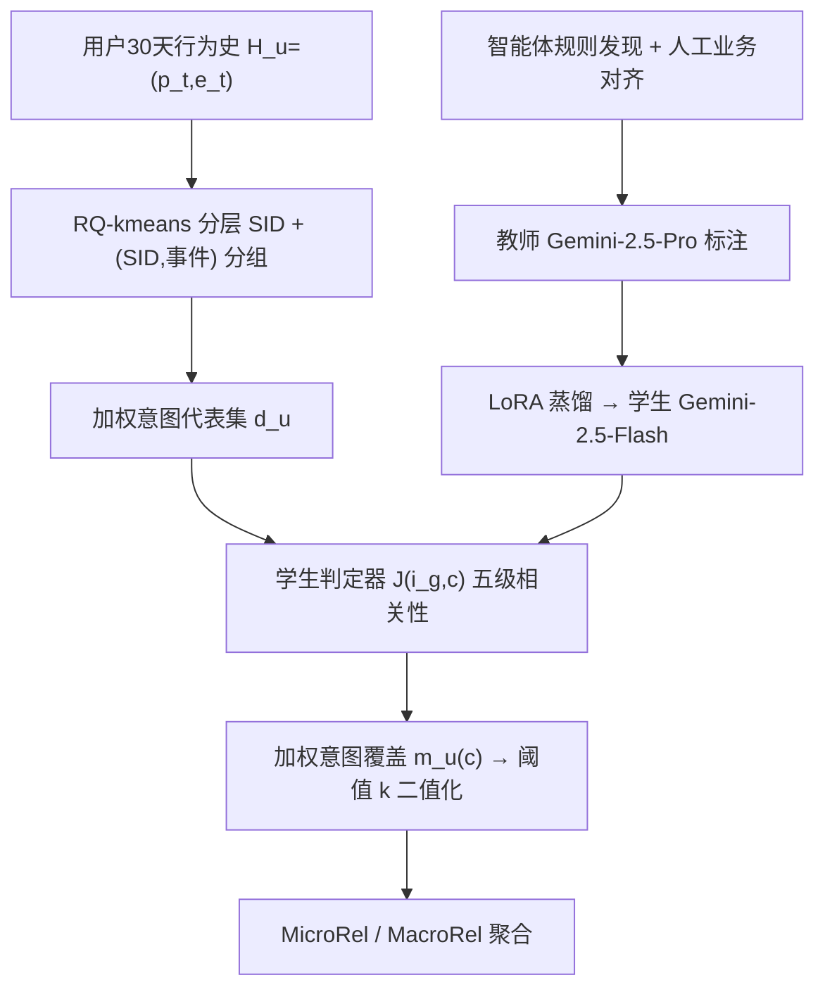
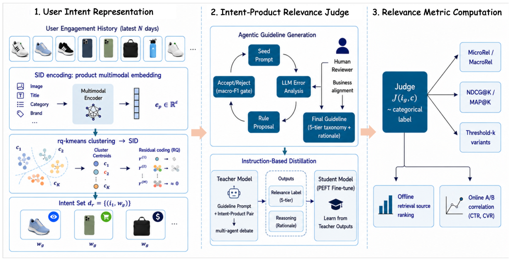

# LLM-based User-Product Relevance Evaluation for Dynamic Product Advertising (基于大语言模型的动态商品广告用户-商品相关性评估)

- **会议/期刊**: CIKM 2026
- **作者与机构**: Wen Zhang, Xiao Bai, Hsiang-wei Chao 等（Snap Inc. 广告/推荐团队）
- **推荐链路定位**: 召回（DPA 召回系统的离线评估层）
- **研究方向**: 去偏公平、可信隐私与工业架构 / 大语言模型推荐
- **论文原文**: [https://arxiv.org/abs/2610.14550v1](https://arxiv.org/abs/2610.14550v1)
- **开源代码**: 暂未开源

## TL;DR (1分钟核心速览)

动态商品广告（DPA）召回长期缺乏可靠离线指标：曝光反馈稀疏且有偏，线上 A/B 又贵又慢。本文提出**无查询（query-free）的用户-商品相关性指标**：先用 RQ-kmeans 语义 ID（SID）分组 + 事件分层把 30 天行为史压缩成少量加权意图代表（LLM 调用降约 30×），再用「智能体自动发现 + 人工业务对齐」生成五级相关性指南，蒸馏到 Gemini-2.5-Flash 学生模型做规模化打分，最后以阈值 $k$聚合出 MicroRel/MacroRel。在 30 天生产流量上，MicroRel 与线上 CP 的 Pearson 达$r=0.97$，并在 4 组 A/B 中与 CTR/CVR 方向一致。

## Background & Motivation (背景与核心矛盾)

- **主流范式**: DPA 召回离线评估沿用未来交互召回率、Conversion Precision/Recall（CP/CR）等基于曝光反馈的指标，或依赖昂贵慢速的用户调研。
- **前人局限**: ① 曝光策略带来严重选择偏置，点击受展示位与信任效应污染，且长尾低交互请求极稀疏；② 广告域没有搜索那样的显式 query，无法直接套用搜索式相关性判定，从业者难以区分「真正相关」与「短期噪声共现」。
- **核心洞察 (Key Insight)**: 用户 30 天行为史中大量事件语义冗余，真正驱动线上业务信号的意图集中在**少量近期、高意图事件**上——因此激进压缩意图集几乎不损失与线上指标的对齐度（Last-1-day 意图集 Spearman 仅 0.53，但 Pearson 与 Full 相差仅 ±0.03–0.06）。
- **本文切入点**: 用内容驱动的 LLM 相关性判定替代曝光反馈标签，把「意图推断 + 逐意图打分 + 阈值聚合」做成可解释、可规模化、与线上 KPI 对齐的离线指标。

## Method (核心方法设计)

### 1. 整体框架 (Overall Architecture)

框架分三块：**(1) 意图表示**——多模态商品 embedding 经 RQ-kmeans 得到分层 SID，按 `(SID 前缀, 事件类型)` 分组，每组选一个代表商品并赋权，得到紧凑意图集 $d_u$；**(2) 意图-商品判定**——智能体循环自动发现相关性规则，再经人工业务对齐形成五级分类指南，用其提示 Gemini-2.5-Pro 教师标注蒸馏语料，LoRA 微调 Gemini-2.5-Flash 学生作为线上判定器$\mathcal{J}$；**(3) 指标计算**——逐候选对意图集做加权覆盖，经阈值$k$ 二值化后聚合为 MicroRel/MacroRel。整条链路与上游聚合层解耦，同一批判定结果可在不同聚合规则下复用。

<figure class="paper-figure" markdown="span">
  <figcaption>图1：基于大语言模型的用户-商品相关性评估框架。(1) 用户意图表示：多模态编码器加残差向量量化，为每个交互商品分配分层语义ID（SID）；共享（SID,𝑒）的事件合并为单个加权意图代表，得到紧凑意图集𝑑𝑟。(2) 意图-商品相关性评判：与人工审核员对齐的智能体指南锚定教师模型，并通过PEFT蒸馏到学生模型。(3) 指标计算：阈值-𝑘聚合下的MicroRel/MacroRel，并针对离线检索源排序进行验证，以及o</figcaption>
</figure>

### 2. 关键设计拆解 (Key Designs)

1. **SID 分组 + 事件分层的意图压缩**：逐事件判定成本过高且偏向「重复曝光同款」的召回算法。对商品 embedding 做 $L=3$级、每级 512 码本的残差量化$c_l=\arg\min_k\|r_{l-1}-C_l^{(k)}\|_2,\ r_l=r_{l-1}-C_l^{(c_l)}$，以 SID 前缀长度控制粒度；同组内取最近商品为代表，权重
$$w_g=\log(1+|g|)\cdot\beta(e_g),\quad \beta(\text{purchase})=3,\ \beta(\text{cart})=2,\ \beta(\text{other})=1$$
对数项让高频同质组占优但不线性膨胀，事件分层防止低意图浏览压过同 SID 的高意图信号——本质是对「重复浏览」这一伪相关做显式正则。

2. **智能体规则发现 + 人工业务对齐的双阶段指南**：从仅含一句分类指令的种子 prompt 出发，按混淆簇与判定理由聚类，由独立 reasoner 提出子规则，仅当配对 bootstrap 95% CI 排除零且各类 F1 回退 <0.5pp 才接纳，多轮试验只保留复现规则；随后人工审计补上统计上稀有但业务关键的规则（如将人口属性不匹配从 Substitute 提升为硬性 Irrelevant 覆盖）。指南承载了主要增益：无指南的 Pro 教师 P/R 均低约 4%，甚至不如带指南的小模型。

3. **教师-学生蒸馏与推理效率**：教师 Gemini-2.5-Pro + GPT-5 双 agent 高置信一致即采纳、分歧交人工；蒸馏语料经分层种子采样、三源候选（生产日志/转化信号/高价值广告主）、多模态 hard negative 挖掘（每种子 10 候选）构建。学生用 LoRA（rank 16、lr×2、5 epoch）做五级多标签分类并联合输出属性级理由。损失即标准指令微调交叉熵（标签 + 理由辅助监督），**无需负采样**；线上仅跑学生，教师只在指南更新/蒸馏刷新时调用。

## Experimental Setup & Evaluation Protocol (实验设置与评估协议)

- **数据集与预处理**: 生产 DPA 系统 30 天流量；消融用 10K 人工多轮审核共识数据集（GPT-5 与 Gemini-2.5-Pro 独立判定 + 置信度聚合，分歧人工裁决）。

| 数据集 | #Users | #Items | #Interactions | 稀疏度/密度 | 特征/场景说明 |
| :--- | :---: | :---: | :---: | :---: | :--- |
| 生产流量（30天） | 未披露 | 全量商品库 | 每用户数百事件（去重后） | 极稀疏 | 6 路召回源，每请求 top-$K$=15 |
| 消融集 | — | — | 10K 标注对 | — | 人工共识 ground truth |

- **数据划分与防穿越 (Splitting Strategy)**: 按 `(date, source)` 分桶做相关性分析；线上验证用 14 天窗口、10% DPA 流量的 A/B；CP/CR 采用曝光后 1 天归因窗口的 look-back 策略，严格 exact-match。
- **排名评测协议 (Ranking Protocol)**: 非传统全库排序，而是**固定候选集 top-15 的集合级相关性**（MicroRel/MacroRel/NDCG@15/MAP@15），并与线上 CP/CR/CTR/CVR 做跨源 Pearson 对齐验证。
- **对比基线与超参设置**: 6 路召回源（MF、SU、PBR、CBR、EBR、Rand）作为被评估对象；判定器对比 SigLIP-2-mm 轻量分类器、prompt-only Flash、微调 Flash/Flash-Lite；默认 $k=7$、$L=3$、码本 512。

## Key Experimental Results (实验关键数据)

### 1. 主实验对比 (Main Results)

各召回源相对 Random 的 log-rel（括号为跨源排名）：

| Src | CP | CR | NDCG@15 | MAP@15 | MicroRel | MacroRel |
| :--- | :---: | :---: | :---: | :---: | :---: | :---: |
| **MF** | **+3.13 (1)** | **+0.91 (1)** | **+0.50 (1)** | **+0.29 (1)** | **+1.21 (1)** | **+1.02 (1)** |
| SU | +2.04 (2) | +0.37 (2) | +0.16 (4) | +0.19 (2) | +0.75 (2) | +0.30 (2) |
| PBR | +0.45 (3) | +0.59 (3) | −0.03 (6) | +0.03 (4) | +0.12 (5) | −0.08 (6) |
| CBR | +0.15 (4) | +0.30 (4) | +0.35 (2) | +0.11 (3) | +0.32 (3) | +0.07 (3) |
| EBR | +0.15 (5) | +0.29 (5) | +0.28 (3) | +0.01 (5) | +0.24 (4) | +0.05 (4) |
| Rand | 0.00 (6) | 0.00 (6) | 0.00 (5) | 0.00 (6) | 0.00 (6) | 0.00 (5) |

跨源 Pearson：MicroRel–CP $r=0.97$、ImpRel$r=0.95$、MacroRel$r=0.93$，而 NDCG@15 仅$r=0.55$、MAP@15$r=0.94$。

### 2. 消融实验 (Ablation Study)

意图集构造（$k=7$，Cost 为相对全序列的成对调用占比）：

| 变体 | Cost | Spear. vs Full | P(CVR) | P(CR) | P(CP) |
| :--- | :---: | :---: | :---: | :---: | :---: |
| Full sequence | 100% | 1.000 | 0.24 | 0.19 | 0.32 |
| Random 25% 子采样 | 25% | 0.905 | 0.26 | 0.23 | 0.19 |
| Last 1-day 窗口 | 11% | 0.528 | 0.21 | 0.25 | 0.31 |
| SID only（不分事件） | 3.4% | 0.990 | 0.30 | 0.17 | 0.24 |
| SID + 事件分层（均匀） | 3.4% | **0.991** | 0.29 | 0.18 | 0.26 |
| **SID + 事件分层（加权）** | **3.4%** | 0.989 | **0.50** | **0.29** | **0.35** |

判定器对比（F1）：Pro 无指南 0.816 → 有指南 0.860；SigLIP-2-mm 0.746；Flash 带指南 0.832 → **微调 Flash 0.869**（超过教师）；Flash-Lite-ft 0.846。效率：微调 Flash p50 751ms / p95 1117ms / 18 QPS，约为教师（6963ms / 2 QPS）的 9× 加速。

### 3. 关键实验发现 (Key Findings)

1. **压缩几乎无损且更抗噪**：SID+事件加权仅用 3.4% 的 LLM 调用即达 0.989 的意图集保真度，且 P(CVR)=0.50 反超全序列（0.24）——去重近重复事件、压低低意图浏览，使指标不再奖励「重复曝光同款」的召回算法，这是全序列指标无法区分的失效模式。
2. **指南是增益主来源，而非模型规模**：无指南的 Pro 教师 F1 仅 0.816，低于带指南的微调 Flash（0.869）；增益集中在人口属性不匹配、品牌 vs 品类混淆等规则类，说明结构化规则比「更大模型 + 松散 prompt」更关键。
3. **阈值 $k$存在明确甜区**：$k\in[5,7]$内 P(CP)/P(CR)/P(CVR) 同时达峰（$k=7$时三者 95% bootstrap CI 均严格为正），$k\ge8$ 后 CP/CR 因候选通过率跌破约 5% 而衰减，印证多意图支持比单弱意图匹配更贴合多触点购买行为。

## Highlights & Limitations (亮点、对比与审稿批判)

- **与代表作对比 (vs. Prior Work)**: 相比 CP/CR 等曝光反馈指标，本文用内容驱动标签绕开曝光偏置与倾向分数缺失问题（IPS/DR 类方法在召回层常无 propensities 可用）；相比 LREF、BloomIntent 等 LLM 判定工作依赖显式 query 或 Cranfield 式 topic，本文首次在无 query 的 DPA 场景从异构行为史推断意图；相比既有 LLM-judge 仅对齐人工评分，本文直接对齐线上 CTR/CVR 等业务 KPI。
- **可迁移亮点**: ① SID 分组 + 事件分层的「意图压缩」可迁移到任意长行为史序列的 LLM 评估/重排场景；② 「智能体规则发现 + 人工业务覆盖」的双阶段指南生成，是低成本构建领域判定标准的通用范式。
- **审稿级局限批判**: ① 全部实验基于 Snap 单一生产系统与内部数据，6 路召回源与 10K 消融集不可复现，跨平台泛化性未验证；② 指标依赖商品多模态 embedding 与 SID 码本质量，且 $k$、$L$、$\beta$ 等超参在业务分布漂移下需重调；③ 学生模型虽 9× 加速，但 751ms p50 对超大规模离线批量评估仍是瓶颈，且与线上指标的相关性在 engagement-based 召回上明显偏弱（如 MacroRel 仅 +0.019）。

## Rating (四维评分)

- **方法创新性 (Novelty)**: ⭐⭐⭐⭐ （核心机制与方法设计具备明确创新性，理论与实验动机支撑充分）
- **评估协议与实验扎实度 (Protocol & Experiments)**: ⭐⭐⭐⭐ （主流公开数据集评测完整，包含多基线对比与消融实验验证）
- **写作与数学规范度 (Clarity & Rigor)**: ⭐⭐⭐⭐⭐ （问题形式化定义清晰，核心模块数学推导与架构阐述严谨易读）
- **工业落地与复现价值 (Industrial & Practical Value)**: ⭐⭐⭐⭐⭐ （兼顾推荐效果增益与训练/推理效率，具备实际场景迁移参考价值）
