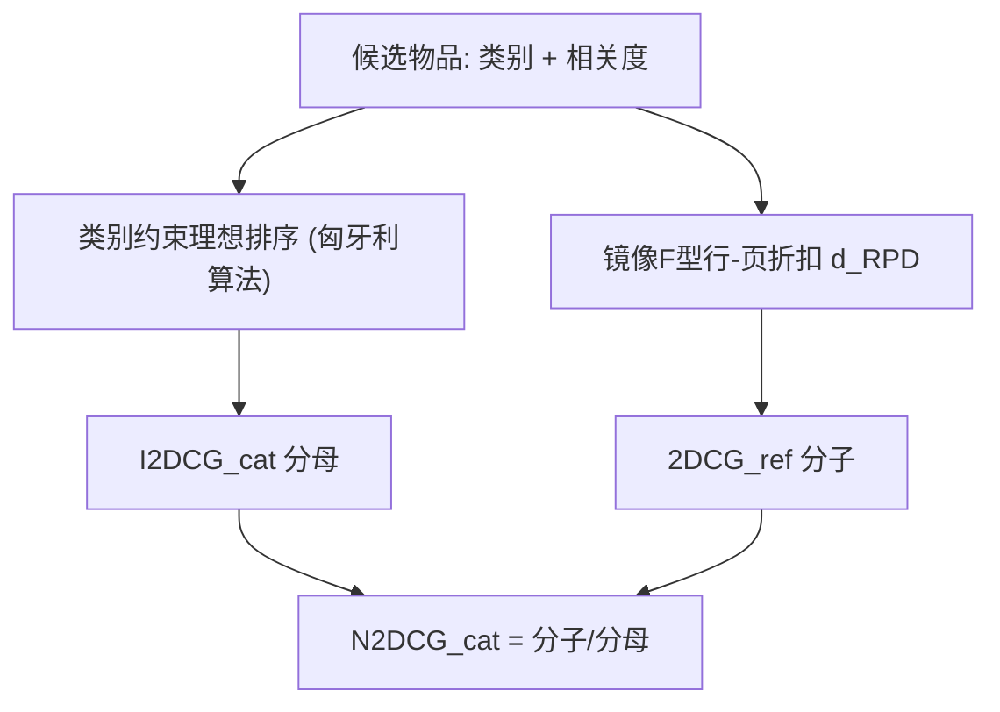
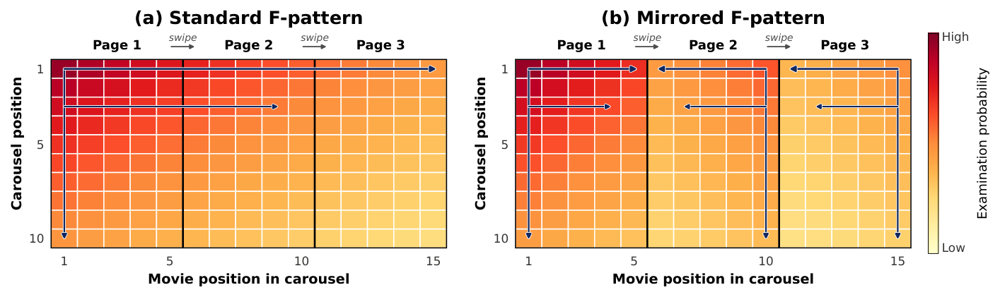

# Revisiting N2DCG: An Empirically Grounded Reformulation of Carousel Recommendation Evaluation (重访 N2DCG：一种基于经验证据的轮播推荐评估重构)

- **会议/期刊**: CIKM 2026
- **作者与机构**: Jingwei Kang, Santiago de Leon-Martinez, Maarten de Rijke, Harrie Oosterhuis（阿姆斯特丹大学、布尔诺理工大学/KInIT）
- **推荐链路定位**: 重排（二维轮播布局的离线评估指标）
- **研究方向**: 去偏公平与工业评测 / 多任务学习与列表级重排
- **论文原文**: [https://arxiv.org/abs/2608.21877v1](https://arxiv.org/abs/2608.21877v1)
- **开源代码**: [https://github.com/jkang98/carousel-metric](https://github.com/jkang98/carousel-metric)

## TL;DR (1分钟核心速览)

轮播（carousel）界面是流媒体推荐的主流形态，但唯一为其设计的指标 N2DCG 存在两处硬伤：归一化用的理想排序无视"每行一个类别"的界面约束，位置折扣沿用单列表 F 型假设、与眼动数据中"翻页后注意力右→左镜像衰减"相悖。本文提出类别感知理想排序（匈牙利算法求解）与镜像 F 型行-页折扣 $d_{RPD}$，在 RecGaze 眼动数据上拟合优度$\rho=0.986$，并在 2 万次布局仿真中把成对偏好判定准确率从 82.9% 提升至 93.2%（二值相关）。

## Background & Motivation (背景与核心矛盾)

- **主流范式**: 轮播推荐评估沿用 NDCG 的二维扩展 N2DCG，以 $2DCG=\sum_{i,j} g(y_{i,j})\cdot d(i,j)$打分，再用理想排序$I2DCG$归一化到$[0,1]$。
- **前人局限一（归一化失效）**: 原 $I2DCG$把$I\times J$ 个格子当作全局池，允许把不同类别的相关物品塞进同一行——这种布局任何真实轮播都无法呈现，导致合法布局的 N2DCG 上界被压到 0.81 而非 1。
- **前人局限二（折扣方向错）**: 原折扣 $d_t,d_a$对列号$j$ 单调惩罚，隐含"注意力从左到右持续衰减"；而眼动研究显示首屏为双峰 F 型，翻页后注意力重置到新页右侧、呈右→左镜像 F 型，原折扣在第二、三页方向完全相反。
- **核心洞察 (Key Insight)**: 评估指标不必精确复刻注视频率，但必须保持正确的**序关系趋势**；原 N2DCG 连这一弱要求都未满足。
- **本文切入点**: 把"类别约束"写进理想排序的可行域，把"翻页镜像 + 行/页进入成本"写进折扣函数，二者分别修正分母与分子。

## Method (核心方法设计)

### 1. 整体框架 (Overall Architecture)

模型不改动任何推荐算法，只重构评估指标的两个构件：分子侧的折扣函数与分母侧的理想归一化。流程为：给定候选物品及其类别与相关度，先按类别约束构造合法理想布局并求 $I2DCG_{cat}$；再用眼动数据拟合出的镜像 F 型折扣计算实际布局的$2DCG_{ref}$；两者相除得到$N2DCG_{cat}$。折扣参数在 Bratislava 受试者上以 Spearman$\rho$ 为目标网格搜索，在 Amsterdam 受试者上做留出验证；最终以 2 万次随机布局仿真检验指标的成对偏好判定可靠性。

<figure class="paper-figure" markdown="span">
  <figcaption>图1：轮播界面中假设的（a）与观察到的（b）注意力模式示意图。颜色越深表示注视概率越高；箭头表示注意力衰减方向。</figcaption>
</figure>

### 2. 关键设计拆解 (Key Designs)

1. **类别感知理想排序 (Category-Aware I2DCG)**：痛点是把跨类别物品混排进同一行会虚高分母。本文将可行域收缩为 $\mathcal{Y}^{cat}_{2D}=\{y\in\mathcal{Y}_{2D}\mid \forall i,j,j',\ \mathrm{cat}(y_{i,j})=\mathrm{cat}(y_{i,j'})\}$，即每行物品同类别；行内最优排序按相关度降序对齐折扣降序，剩余问题是"类别轮播→显示行"的指派问题，用匈牙利算法求$I2DCG_{cat}=\max_{y^*\in\mathcal{Y}^{cat}_{2D}}2DCG(y^*)$。直觉：分母必须是"界面真能摆出来"的最优解，否则合法布局永远拿不到满分，跨查询比较失真。

2. **镜像 F 型位置重索引**：痛点是翻页后注意力方向反转。本文不改对数形式，只把列号 $j$换成重索引$\tilde{j}$：首屏$j\le\delta$时$\tilde{j}=j$；后续页内顺序镜像，$\tilde{j}=\delta\lfloor (j-1)/\delta\rfloor+\big(\delta-((j-1)\boldsymbol{o}d\delta)\big)$，使每页最右列获得最小$\tilde{j}$、最高折扣。直觉：折扣只需在每页内部"右高左低"，跨页整体仍随页号递减，即可复现锯齿状的注意力曲线。

3. **行-页折扣与训练/推理开销**：在镜像基础上比较三种动作惩罚——加性 $d_{add}$、乘性$d_{mul}$、行-页$d_{RPD}$。最优形式为
$$d_{RPD}(i,j)=\frac{1}{\log_2(\alpha i+\beta\tilde{j})}\cdot\mu^{\mathbb{I}[j>\delta]}\cdot\nu^{\,i-1},$$
即只对"需要首次横滑"惩罚一次（$\mu$），后续页不再叠加，同时对每下行做几何衰减（$\nu$）。最终指标为
$$2DCG_{ref}(y)=\sum_{i=1}^{I}\sum_{j=1}^{J}\frac{g(y_{i,j})}{\log_2(4i+9\tilde{j})}\cdot0.65^{\mathbb{I}[j>\delta]}\cdot0.95^{\,i-1}.$$
该式无任何学习参数需在线估计，评估开销与普通 NDCG 同阶；匈牙利算法仅在离线归一化时对类别数规模（$\le 10$）求解，不进入生产推荐链路。

## Experimental Setup & Evaluation Protocol (实验设置与评估协议)

- **数据集与预处理**: 唯一公开的轮播眼动数据集 RecGaze，取 free-browsing 任务；每屏 10 个类型轮播 × 每轮播 15 部电影（3 页 × 5 部），首屏可见前 3 行。物品被注视（至少一个有效 fixation 落入 AOI）即记为被检验。

| 数据集 | #Users(训练/测试) | #Screens(训练/测试) | 布局规模 | 稀疏度/密度 | 特征/场景说明 |
| :--- | :---: | :---: | :---: | :---: | :--- |
| RecGaze (Bratislava) | 61 | 1665 | $10\times15$ | — | 训练集，拟合折扣参数 |
| RecGaze (Amsterdam) | 26 | 710 | $10\times15$ | — | 留出测试集，跨人群泛化验证 |

- **数据划分与防穿越 (Splitting Strategy)**: 按**受试者地理位置**划分（Bratislava 训练 / Amsterdam 测试），而非随机切分，避免同一用户跨集泄漏；剔除误点击屏幕。
- **排名评测协议 (Ranking Protocol)**: 两条验证线。(i) 拟合优度：以经验检验频率 $\hat{P}(E_{i,j}=1)=N(E_{i,j}=1)/N_{total}$为目标，max-normalize 后比较$\rho$、$r$、MSE；(ii) 仿真成对比较：2 万次独立试验，每次构造两个仅排列不同的$10\times15$布局$A,B$，以经验频率替代折扣算出$N2DCG^{exam}$作为 ground truth，按$\Delta=|N2DCG^{exam}_A-N2DCG^{exam}_B|$ 分档统计指标判定准确率。因两布局候选集相同，理想归一化在成对比较中约去，故该实验只检验折扣函数。
- **对比基线与超参设置**: 基线为原 N2DCG 的 $d_t$（$\alpha=7,\beta=6$）与$d_a$（$\alpha=2,\beta=1,\gamma=9,\lambda=1$）；本文变体$d_{mir},d_{add},d_{mul},d_{RPD}$。整数参数在$[1,10]$步长 1 网格搜索，$(0,1)$参数步长 0.05，以$\rho$ 最大为准则。

## Key Experimental Results (实验关键数据)

### 1. 主实验对比 (Main Results)

折扣函数对经验检验频率的拟合（测试集，max-normalize 后）：

| 折扣函数 | 参数 | Spearman $\rho$| Pearson$r$ | MSE ↓ |
| :--- | :--- | :---: | :---: | :---: |
| $d_t$朴素 F 型 |$\alpha=7,\beta=6$ | 0.8904 | 0.8662 | 0.0991 |
| $d_a$朴素 F 型+加性滑动 |$\alpha=2,\beta=1,\gamma=9,\lambda=1$ | 0.9300 | 0.8562 | 0.0243 |
| $d_{mir}$镜像 F 型 |$\alpha=10,\beta=9$ | 0.9387 | 0.8856 | 0.1170 |
| $d_{add}$镜像+加性滑动 |$\alpha=2,\beta=1,\gamma=9,\lambda=1$ | 0.9487 | 0.8591 | 0.0242 |
| $d_{mul}$镜像+乘性滑动 |$\alpha=1,\beta=9,\eta=0.9,\theta=0.95$ | 0.9591 | 0.9198 | 0.0288 |
| **$d_{RPD}$镜像+行-页折扣** |$\alpha=4,\beta=9,\mu=0.65,\nu=0.95$ | **0.9859** | **0.9771** | **0.0096** |

仿真成对偏好判定准确率（原 2DCG vs. 重构 2DCG）：

| 相关度 | $\Delta\ge$ | Orig. Acc. | **Our Acc.** | Corr. | Both Err. |
| :--- | :---: | :---: | :---: | :---: | :---: |
| Binary | 0.00 | 82.9% | **93.2%** | 11.4% | 5.7% |
| Binary | 0.02 | 88.4% | **98.3%** | 10.0% | 1.5% |
| Binary | 0.10 | 98.7% | **100.0%** | 1.3% | 0.0% |
| Graded | 0.00 | 84.9% | **93.9%** | 10.4% | 4.8% |
| Graded | 0.02 | 89.4% | **98.2%** | 9.1% | 1.5% |
| Graded | 0.10 | 98.2% | **100.0%** | 1.8% | 0.0% |

### 2. 消融实验 (Ablation Study)

本文为指标重构而非模型，消融以"折扣构件逐项替换"形式呈现（测试集）：

| 配置 | $\rho$ | MSE ↓ | 说明 |
| :--- | :---: | :---: | :--- |
| 朴素 F 型（无镜像） | 0.8904 | 0.0991 | 无法刻画翻页锯齿 |
| + 镜像重索引 | 0.9387 | 0.1170 | 序关系改善但幅度失配 |
| + 加性滑动惩罚 | 0.9487 | 0.0242 | 幅度修正，锯齿仍偏弱 |
| + 乘性滑动惩罚 | 0.9591 | 0.0288 | 更贴近，但每页重复惩罚过度 |
| + 行-页折扣（完整） | **0.9859** | **0.0096** | 仅罚首次横滑 + 行几何衰减 |

### 3. 关键实验发现 (Key Findings)

1. **镜像重索引是序关系修正的关键、幅度修正需另配动作惩罚**：单独加镜像使 $\rho$ 从 0.8904 升至 0.9387，但 MSE 反而恶化到 0.1170；叠加行-页折扣后 MSE 降至 0.0096，说明"方向对"与"幅度对"是两个正交问题，必须分别处理。
2. **只罚首次横滑优于逐页累罚**：$d_{RPD}$（$\mu=0.65$仅作用于$j>\delta$）在$\rho$上领先$d_{mul}$ 2.7 个点、MSE 低约 3 倍，印证眼动数据中"翻页后注意力重置而非持续衰减"的机制。
3. **原指标在差异明显时仍会误判**：即便 $\Delta\ge0.10$，原 2DCG 仍有 1.3%（二值）/1.8%（分级）的成对判定错误，而重构指标为 0；在$\Delta\ge0.02$ 档，原指标 10% 的判定被本文纠正，说明原 N2DCG 会系统性低估"翻页布局优化"的收益。

## Highlights & Limitations (亮点、对比与审稿批判)

- **与代表作对比 (vs. Prior Work)**: 相较 Ferrari Dacrema 等提出的 N2DCG，本文不改 2DCG 的加性结构，而是同时修正分母可行域（类别约束）与分子折扣方向（镜像 F 型），是"评估协议层"的纠偏而非新模型；相较 RecGaze 原始眼动分析，本文把行为发现转化为可直接使用的闭式指标。
- **可迁移亮点**: (i) "理想排序必须落在界面可实现的布局空间内"这一原则可迁移到瀑布流、网格、多坑位混排等任意二维界面的归一化设计；(ii) 用留出受试者 + 仿真成对比较来验证指标，比单纯相关性拟合更能暴露指标的决策风险。
- **审稿级局限批判**: (i) 参数仅在单一数据集、单一 $10\times15$/3 页布局上拟合，$\delta$、行数、每页容量变化时$0.65/0.95$ 是否稳定未验证，跨场景需重拟合；(ii) 仿真 ground truth 本身由同一批经验频率构造，存在"用测试分布验证测试分布"的循环性，且未报告真实线上 A/B 或人工偏好标注的验证。

## Rating (四维评分)

- **方法创新性 (Novelty)**: ⭐⭐⭐⭐ （问题定位精准，类别约束归一化与镜像重索引均为简洁有效的增量，但本质是对既有指标的修补而非新范式）
- **评估协议与实验扎实度 (Protocol & Experiments)**: ⭐⭐⭐⭐ （跨人群留出 + 2 万次仿真成对比较设计巧妙，惟数据集单一、ground truth 存在自洽循环）
- **写作与数学规范度 (Clarity & Rigor)**: ⭐⭐⭐⭐⭐ （两处缺陷均以最小反例表格与示意图说清，公式紧凑、参数含义与约束交代完整）
- **工业落地与复现价值 (Industrial & Practical Value)**: ⭐⭐⭐⭐ （闭式折扣零在线开销、代码开源，可直接替换现有轮播离线评估；但需按业务布局重拟合参数）

