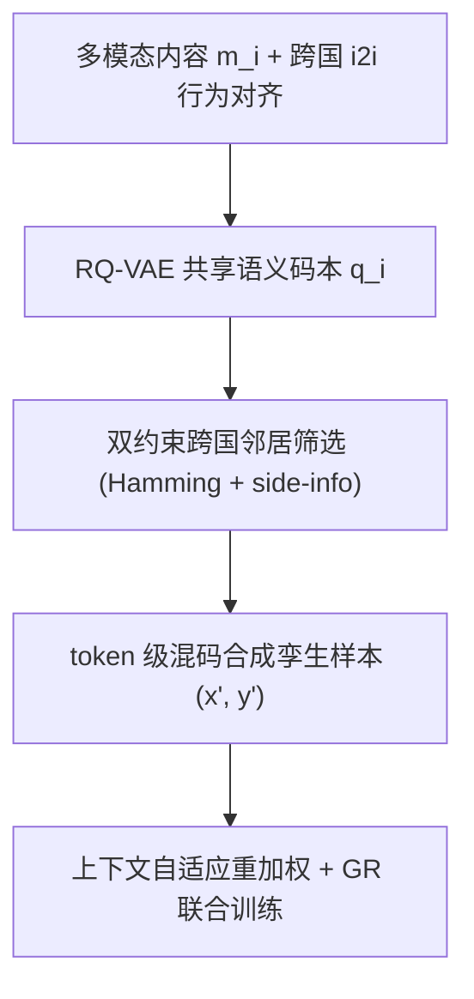
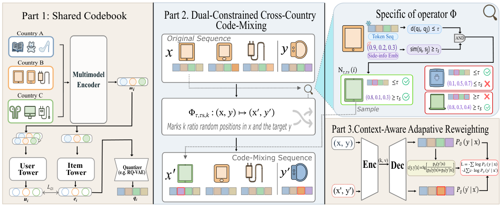

# Cross-Country Code-Mixing for Generative Recommendation (面向生成式推荐的跨国混码)

- **会议/期刊**: CIKM 2026 (Short Paper)
- **作者与机构**: Yuan Gao, Hao Deng, Haibo Xing, Yi Xu, Lingyu Mu, Jinxin Hu, Yu Zhang, Xiaoyi Zeng（阿里巴巴国际数字商业集团）
- **推荐链路定位**: 端到端生成式（召回/排序一体）
- **研究方向**: 生成式推荐 / 跨域与多场景推荐
- **论文原文**: [https://arxiv.org/abs/2609.28972v1](https://arxiv.org/abs/2609.28972v1)
- **开源代码**: 暂未开源

## TL;DR (1分钟核心速览)

跨国电商的用户与物品 ID 空间完全不相交，传统跨域迁移依赖的共享锚点消失；现有生成式推荐（GR）虽把物品映射到共享 token 空间，但行为序列仍严格按国家切分，知识迁移只停留在**参数级**、缺失**数据级**监督。CMRec 借鉴 NLP 的 code-switching，先学多模态+行为共现的共享语义码本，再在 token 级做**静态内容+动态市场属性双约束**的跨国替换合成混合序列，最后用**上下文自适应重加权**抑制噪声替换。在工业 6 国数据与 Amazon M2 上，Full-Ranking 协议下小国 Recall@100 相对提升最高达 +6.96%/+7.82%，线上 A/B 广告收入 +1.77%、订单 +2.64%。

## Background & Motivation (背景与核心矛盾)

- **主流范式**: 跨国推荐按国家独立部署，ID 与序列完全隔离；GR（TIGER/GenCDR/REG4Rec）通过共享 token 空间与统一 backbone 实现参数级迁移。
- **前人局限**: ① 序列仍按国家切分，跨国物品从不出现在他国上下文中，数据级强化信号缺失，大国信号无法惠及小国；② 现有替换式增广（SRA-CL、CoSeRec 类）仅按内容或协同单信号匹配，忽略价格/受众/流行度等市场信号，且粒度停留在物品对，无法感知用户当前意图（如 Apple 序列中换入"看起来像"的 Android 平板）。
- **核心洞察 (Key Insight)**: 多语言 NLP 靠 code-switched 语料获得跨语言对齐；跨国 GR 同理需要"混码序列"，但该语料不存在，必须**合成**，而合成的关键是定义"何为合法替换"。
- **本文切入点**: 把替换从物品 ID 级下沉到**语义 token 级**，用双约束过滤候选、用模型自身置信度对合成样本重加权。

## Method (核心方法设计)

### 1. 整体框架 (Overall Architecture)

CMRec 分三段闭环：Part 1 用 Qwen-VL 编码物品多模态内容得 $m_i$，再以跨国共享负样本池训练 i2i 双塔得行为增强嵌入 $e_i$，经 RQ-VAE 量化为长度 $L=4$ 的共享 token 序列 $q_i$，该码本同时充当 GR tokenizer 与跨国替换的公共语义空间；Part 2 以码本 Hamming 距离 + 动态 side-info 余弦相似度双约束筛选跨国邻居，按比例 $k$ 替换序列与目标槽位，对 $p$ 比例样本生成孪生样本 $(x',y')$；Part 3 用 GR 模型在原始上下文下对 $y'$ 的相对似然作为权重，与原监督联合训练。

<figure class="paper-figure" markdown="span">
  <figcaption>图2：CMRec 概览。第1部分从多模态内容和行为 i2i 共现中学习共享语义码本，生成供 GR 模型使用的 token 序列 q𝑖。第2部分利用码本及辅助信息选择跨国邻居，并将其嫁接至用户序列，生成代码混合孪生样本 (x′,𝑦′)。第3部分让 GR 模型根据每个孪生样本在原始上下文下的合理性重新加权，在训练中降低噪声替换的权重。</figcaption>
</figure>

### 2. 关键设计拆解 (Key Designs)

1. **行为-内容双 grounding 共享码本**：纯内容码本无法反映物品在各国的真实角色（同图不同流行度）。在 $m_i$ 之上训练跨国联合 i2i 双塔，负样本池 $\mathcal{N}_i$ 跨国家共享：
$$\mathcal{L}_{i2i}=-\sum_i \log\frac{\exp(u_i^\top e_{i^+})}{\exp(u_i^\top e_{i^+})+\sum_{j\in\mathcal{N}_i}\exp(u_i^\top e_j)}$$
使 $e_i$ 同时对齐内容相似与行为共现相似，码本因此成为跨国可比的"共同锚点"。

2. **双约束跨国混码算子 $\Phi_{\tau,\tau_s,k}$**：码本更新稀疏、无法捕捉折扣/流行度/受众等快变属性，故引入按国家分位数分桶的 side-info 嵌入 $s_i$，候选集为
$$\hat{\mathcal{N}}_{\tau,\tau_s}(i)=\{j\in\textstyle\bigcup_{c'\neq c}\mathcal{I}^{(c')}\mid d(q_i,q_j)\le\tau\ \wedge\ \mathrm{sim}(s_i,s_j)\ge\tau_s\}$$
静态约束保证语义同层，动态约束保证市场可互换；替换作用于 token 序列而非 ID，粒度更细且天然跨语言。

3. **上下文自适应重加权与训练目标**：物品级过滤对上下文盲视，故令 GR 自评替换合理性
$$w(y,y'|x)=\mathrm{sg}\Big[\frac{P_\theta(y'|x)}{P_\theta(y|x)+P_\theta(y'|x)}\Big]\in[0,1]$$
刻意在**原始** $x$ 而非混合 $x'$ 下评估（$P_\theta$ 在观测分布上校准更好，避免早期 OOD 抖动），stop-gradient 使其只调权重不回传梯度。总损失
$$\mathcal{L}=-\sum_{(x,y)\in\mathcal{D}}\log P_\theta(y|x)-\lambda\sum_{(x',y')\in\mathcal{D}'}w(y,y'|x)\log P_\theta(y'|x')$$
训练采用 in-batch/采样 softmax 负采样（i2i 阶段），GR 阶段为序列生成式 softmax，无需额外难负样本挖掘；推理与标准 GR 一致，无额外开销。

## Experimental Setup & Evaluation Protocol (实验设置与评估协议)

- **数据集与预处理**:

| 数据集 | #Users | #Items | #Interactions | 稀疏度/密度 | 特征/场景说明 |
| :--- | :---: | :---: | :---: | :---: | :--- |
| Industrial | 19M | 25M 广告 | >1B | 极稀疏 | 6 国 (A–F)，最大国训练交互约为最小国 10×，ID 完全不相交 |
| Amazon M2 | — | — | KDD Cup 2023 多语种会话 | 长尾 | 6 locale：UK/DE/JP 高资源（约 91% 会话），IT/FR/ES 低资源 |

- **数据划分与防穿越 (Splitting Strategy)**: 按会话/序列的下一物品预测（Next-Item）划分，训练/验证/测试按平台标准会话切分，测试目标物品不出现在输入序列中。
- **排名评测协议 (Ranking Protocol)**: 无偏 **Full-Ranking**（全库未交互物品排序），指标 Recall@10/100、NDCG@10/100，报告 6 国平均 (Avg6) 与三个代表国（大/中/小量级）。
- **对比基线与超参设置**: SASRec、HSTU（ID 基）、TIGER、REG4Rec、GenCDR（GR 基），以及单信号增广变体 GenCDR+Cont（内容）与 GenCDR+CF（协同），增广比例与采样预算对齐 CMRec。内容嵌入 64 维（Qwen-VL-32B），RQ-VAE token 长度 $L=4$，$p=0.1$、$k=0.1$、$\lambda=0.5$、$\tau=1$、$\tau_s=0.8$。

## Key Experimental Results (实验关键数据)

### 1. 主实验对比 (Main Results)

Industrial（6 国，节选 Avg6 与大国 A / 中国 B / 小国 C）:

| Method | R@10 Avg6 | R@10 C^S | R@100 Avg6 | R@100 C^S | NDCG@100 Avg6 | NDCG@100 C^S |
| :--- | :---: | :---: | :---: | :---: | :---: | :---: |
| SASRec | 0.1882 | 0.1705 | 0.2648 | 0.2404 | 0.1458 | 0.1322 |
| HSTU | 0.2117 | 0.1929 | 0.2983 | 0.2725 | 0.1642 | 0.1498 |
| TIGER | 0.2261 | 0.2062 | 0.3187 | 0.2909 | 0.1753 | 0.1600 |
| REG4Rec | 0.2372 | 0.2163 | 0.3342 | 0.3057 | 0.1838 | 0.1681 |
| GenCDR | 0.2423 | 0.2247 | 0.3413 | 0.3168 | 0.1877 | 0.1743 |
| GenCDR+Cont | 0.2404 | 0.2311 | 0.3432 | 0.3248 | 0.1891 | 0.1793 |
| GenCDR+CF | 0.2384 | 0.2256 | 0.3412 | 0.3179 | 0.1871 | 0.1768 |
| **CMRec** | **0.2496** | **0.2434** | **0.3613** | **0.3474** | **0.1972** | **0.1919** |
| Improv. | +3.01% | +5.32% | +5.27% | +6.96% | +4.28% | +7.03% |

Amazon M2（Avg6 与 UK^L / FR^S / ES^S）:

| Method | R@10 Avg6 | R@10 FR^S | R@100 Avg6 | R@100 ES^S | NDCG@100 Avg6 | NDCG@100 ES^S |
| :--- | :---: | :---: | :---: | :---: | :---: | :---: |
| SASRec | 0.2774 | 0.3028 | 0.4823 | 0.5389 | 0.2653 | 0.2963 |
| HSTU | 0.3212 | 0.3506 | 0.5584 | 0.6236 | 0.3070 | 0.3428 |
| TIGER | 0.3406 | 0.3719 | 0.5926 | 0.6616 | 0.3258 | 0.3638 |
| REG4Rec | 0.3523 | 0.3846 | 0.6124 | 0.6843 | 0.3369 | 0.3764 |
| GenCDR | 0.3603 | 0.3928 | 0.6266 | 0.6994 | 0.3446 | 0.3848 |
| GenCDR+Cont | 0.3579 | 0.3907 | 0.6291 | 0.7063 | 0.3463 | 0.3884 |
| GenCDR+CF | 0.3559 | 0.3884 | 0.6271 | 0.7035 | 0.3443 | 0.3865 |
| **CMRec** | **0.3748** | **0.4137** | **0.6671** | **0.7588** | **0.3637** | **0.4136** |
| Improv. | +4.02% | +5.32% | +6.04% | +7.43% | +5.03% | +6.49% |

### 2. 消融实验 (Ablation Study)

Industrial 6 国平均：

| Variant | Recall@100 | NDCG@100 |
| :--- | :---: | :---: |
| CMRec (Full) | **0.3613** | **0.1972** |
| w/o Token-level distance constraint | 0.3447 (−4.59%) | 0.1894 (−3.96%) |
| w/o Side-info similarity constraint | 0.3573 (−1.11%) | 0.1947 (−1.27%) |
| w/o Context-aware reweighting | 0.3531 (−2.27%) | 0.1928 (−2.23%) |

### 3. 关键实验发现 (Key Findings)

1. **增益随数据量递减而放大**：Industrial 上大国 A 的 R@100 仅 +2.71%，小国 C 达 +6.96%；Amazon M2 上高资源 UK 为 +3.48%，低资源 FR/ES 达 +7.82%/+7.43%——证明数据级跨国监督确实把大国信号定向输送给小国，且不牺牲大国（A 国 R@10 仍 +1.54%）。
2. **双约束中静态 token 距离是主贡献，动态 side-info 是精修**：去掉 Hamming 约束掉 4.59% R@100，远大于 side-info 的 1.11%，说明码本邻近性承载了跨国行为结构迁移的主体；但 side-info 单独移除仍稳定掉点，验证价格/受众等快变市场信号不可由稀疏更新的码本替代。
3. **上下文重加权是"防噪阀门"而非"增益引擎"**：移除后掉 2.27%，且单信号增广基线（GenCDR+Cont/CF）在部分国家出现负增益（如 Industrial 大国 A 的 R@10 从 0.2493 降至 0.2456/0.2528 波动），说明物品级过滤无法剔除的上下文冲突样本正是 CMRec 相对单信号增广的一致性优势来源；$(p,k)$ 在 0–30% 全域均优于基线，默认 (10%,10%) 近最优，对 backbone 亦鲁棒。

## Highlights, Limitations & Rating (亮点、对比与审稿评价)

- **与代表作对比 (vs. Prior Work)**: 与 GenCDR/GMC 的本质区别在于迁移层级——前者仅靠共享 backbone 做参数级迁移，CMRec 额外构造数据级跨国共现；与 SRA-CL/CoSeRec 类替换增广的区别在于替换粒度（token vs. 物品）与约束维度（静态+动态双约束 + 上下文重加权），后者仅单信号物品对匹配。
- **可迁移亮点**: ① "模型自评替换合理性 + stop-gradient 重加权"可零成本移植到任何合成增广/去噪训练管线；② 按国家分位数分桶对齐 side-info 的做法，是异构市场间属性可比化的通用技巧。
- **审稿级局限批判**: ① 短论文仅 6 页，缺少对 $w$ 权重分布随训练演化的可视化，也未分析替换引入的分布偏移对生成式解码（beam/trie 约束）的影响；② 双约束阈值 $\tau,\tau_s$ 与 $p,k$ 需按国家量级调参，小国样本少时 side-info 分位数分桶本身估计不稳，冷启动国家的适用性存疑；③ 线上仅报告聚合指标，未披露分国家 A/B 明细。
- **四维评分**: 创新性 ⭐⭐⭐⭐ | 实验扎实度 ⭐⭐⭐⭐ | 方法清晰度 ⭐⭐⭐⭐⭐ | 落地价值 ⭐⭐⭐⭐⭐

