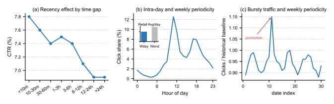
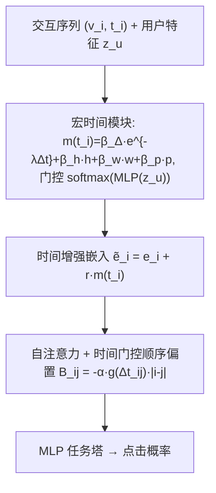
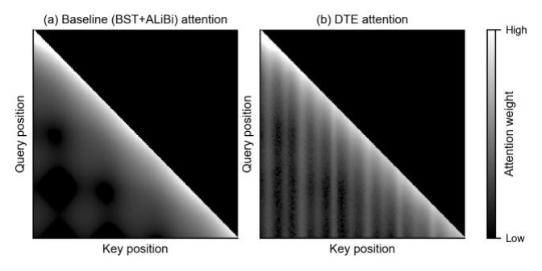

# Decoupled Temporal Encoding for Generative Recommendation (生成式推荐中的解耦时间编码)

- **会议/期刊**: CIKM 2026
- **作者与机构**: Pengfei Jia, Jingjian Wang, Jingmao Li, Ge Zhang, Feng Shi（Rajax 网络科技 / 淘宝闪购·阿里巴巴；Yale 生物统计系）
- **推荐链路定位**: 精排（生成式排序骨干中的位置编码层）
- **研究方向**: 生成式推荐 / 序列推荐
- **论文原文**: [https://arxiv.org/abs/2608.16274v2](https://arxiv.org/abs/2608.16274v2)
- **开源代码**: [https://github.com/AlibabaResearch/DecoupledTemporalEncoding](https://github.com/AlibabaResearch/DecoupledTemporalEncoding)

## TL;DR (1分钟核心速览)

生成式推荐沿用 LLM 的正弦/RoPE/ALiBi 位置编码，只表达离散顺序，而外卖与即时零售场景中"近因衰减、餐点周期、工作日-周末切换、促销爆发"等多级时间规律同样塑造物品关系；已有时间感知方法（BST/TiSASRec/RAB）把异质时间信号塞进单一表征或单一通路，难以区分宏观时间动态与局部顺序线索。本文提出 DTE，用"个性化宏时间模块（输入层注入紧凑时间原语）+ 时间门控微序列模块（注意力层按时间间隔选择性激活相对顺序偏置）"在架构上解耦二者。在淘宝闪购工业数据集上 GAUC 由 0.6982 提升至 0.7098（+1.16pt），KuaiRand 上 0.9110→0.9243；线上 A/B 三周 CTR +1.8%、RPM +3.0%，服务延迟仅 +0.3%（15.4→15.5 ms），已于 2026 年 1 月全量上线。

## Background & Motivation (背景与核心矛盾)

- **主流范式**: 生成式推荐（HSTU 式 decoder-only Transformer）把用户历史建模为自回归物品序列，位置编码直接继承 LLM 的正弦嵌入、RoPE、ALiBi 等离散顺序编码。
- **前人局限**: ① 时间感知方法（BST 时间特征、TiSASRec 时间桶嵌入、RAB 相对注意力偏置）把近因、周期、爆发等异质效应压缩进**统一表征或单一通路**，宏观时间动态与局部顺序线索相互纠缠；② 大间隔嵌入表（TiSASRec 5,120 桶需 327,680 参数 / 640 KB）带来稀疏与维护成本，重参数化的成对时间偏置也难以嵌入既有排序管线。
- **核心洞察 (Key Insight)**: 工业数据（图 2）显示 CTR 随交互间隔单调衰减、点击在午晚餐时段成峰、店铺流量呈周模式并在促销期爆发——时间戳不是辅助特征而是意图的主载体；但当多次交互落在极短时间窗内时，时间戳分辨率不足，**相对顺序**才是消歧关键。二者互补而非替代。
- **本文切入点**: 在架构层面而非表征层面解耦——宏观时间走输入层、微观顺序走注意力层，且后者仅在时间稠密时被门控激活。

<figure class="paper-figure" markdown="span">
  <figcaption>图2：工业数据集的时间特征。(a) CTR 随交互间隔衰减，表明存在近因效应。(b) 点击量在用餐时间达到峰值，并在工作日与周末之间变化。(c) 店铺流量呈现周模式，并在促销或活动期间出现爆发。</figcaption>
</figure>

## Method (核心方法设计)

### 1. 整体框架 (Overall Architecture)

输入为用户按时间排序的交互序列 $S_u=\{(v_1,t_1),\dots,(v_T,t_T)\}$。物品基础嵌入$\boldsymbol{e}_i$先经宏时间模块加上时间信号得到$\tilde{\boldsymbol{e}}_i$；该序列送入单层 decoder-only Transformer，自注意力分数在标准点积之上叠加时间门控的相对顺序偏置$B_{ij}$；输出经轻量 MLP 任务塔（16-8-1）与目标物品匹配，做曝光级点击二分类。训练与推理全程因果：所有时间特征（间隔、周期、爆发统计）均只取当前曝光时刻之前的信息，避免穿越。整个框架仅新增 238 个可训练参数，可即插即用地替换现有位置编码层。

### 2. 关键设计拆解 (Key Designs)

1. **个性化宏时间模块（Macro-Temporal Encoding）**：痛点是用大间隔嵌入表建模多级时间效应既稀疏又昂贵。本文改为**标量时间信号 + 单一投影向量**的紧凑参数化：$\tilde{\boldsymbol{e}}_i=\boldsymbol{e}_i+\boldsymbol{r}\,m(t_i)$，其中$m(t_i)=\beta_\Delta e^{-\lambda\Delta t_i}+\beta_h h(t_i)+\beta_w w(t_i)+\beta_p p(t_i)$，四项分别为近因指数衰减、日内正弦周期$h=\sin(2\pi\,\text{hour}/24)$、周周期$w=\sin(2\pi\,\text{weekday}/7)$与爆发敏感项$p=\log(1+\text{ReLU}((x_{t_i}-\bar{x}_{t_i})/(\bar{x}_{t_i}+\epsilon)))$（当日同时段流量相对 30 日均值的偏离）。混合权重由用户历史嵌入均值池化后经 MLP 生成：$[\beta_\Delta,\beta_h,\beta_w,\beta_p]=\text{softmax}(\text{MLP}(\boldsymbol{z}_u))$。直觉：不同作息用户（规律午晚餐 vs. 偶发近期下单）应获得不同的时间原语配比，而共享的$\boldsymbol{r}$ 保证时间效应与物品嵌入空间对齐，参数量与用户数无关。

2. **时间门控微序列模块（Micro-Sequential Encoding）**：痛点是稠密交互中时间戳无法区分先后，而无条件注入顺序偏置又会污染稀疏序列。本文在注意力分数上加一个**软门控**的相对顺序偏置：$B_{ij}=-\alpha\,g(\Delta t_{ij})\,|i-j|$，$g(\Delta t_{ij})=\sigma((\tau-\Delta t_{ij})/\gamma)$，$\hat{A}_{ij}=\tilde{A}_{ij}+B_{ij}$。当两交互间隔小于可学习阈值$\tau$时门控趋近 1、顺序惩罚生效；间隔拉大后门控衰减至 0，退化为纯时间编码。这是一种"保守"设计：顺序只作补充信息，且$\alpha,\tau$ 与模型联合学习，无需人工设定时间桶边界。

3. **训练目标与效率**：损失为曝光级二元交叉熵 $\mathcal{L}=-\frac{1}{N}\sum[y\log\hat{y}+(1-y)\log(1-\hat{y})]$，无负采样环节（pointwise 点击预估而非全库排序）。新增参数仅 238 个（0.47 KB FP16），离线推理 3.02 ms，低于 BST（3.18 ms）与 TiSASRec（3.76 ms），与 RAB（3.09 ms）持平。

## Experimental Setup & Evaluation Protocol (实验设置与评估协议)

- **数据集与预处理**:

| 数据集 | #Users | #Items | #Interactions | 稀疏度/密度 | 特征/场景说明 |
| :--- | :---: | :---: | :---: | :---: | :--- |
| Industrial（淘宝闪购） | 400 M | 5 M | 2.5 B | 极稀疏 | 外卖+即时零售曝光日志，二值点击标签，历史窗口 1 年，最大序列长 150 |
| KuaiRand-1K | 1 K | 4.4 M | 11.7 M | 稀疏 | 公开短视频一个月交互日志，曝光级点击标签 |

- **数据划分与防穿越 (Splitting Strategy)**: 两数据集均按**曝光时间戳全局时间切分**，最早 85% 训练、最近 15% 评估；历史序列严格由曝光时刻之前的交互构造，时间间隔、周期、爆发统计全部因果计算。
- **排名评测协议 (Ranking Protocol)**: 非全库排序任务，采用**曝光级点击预估**协议，指标为 GAUC（用户分组 AUC 加权）与 Logloss；所有基线共享同一 decoder-only 骨干（1 层、8 头、$d=64$）、同一序列构造与打分框架，以隔离位置编码本身的贡献。
- **对比基线与超参设置**: 四组基线——纯顺序编码（Sinusoidal、RoPE、ALiBi）、时间感知模型（BST、TiSASRec、RAB）、生产基线 BST+ALiBi、内部消融变体。Adam 优化，batch 1024，学习率 1e-4，$\gamma=10$，$\lambda$与$\tau$联合学习；线上 A/B 采用用户级随机化、20% 实验桶 vs. 20% 对照桶、持续三周覆盖完整周周期，双侧检验$p<0.01$。

## Key Experimental Results (实验关键数据)

### 1. 主实验对比 (Main Results)

| 方法 | Industrial GAUC | Industrial Logloss | KuaiRand GAUC | KuaiRand Logloss |
| :--- | :---: | :---: | :---: | :---: |
| Sinusoidal | 0.6892 | 0.2628 | 0.8956 | 0.3016 |
| RoPE | 0.6837 | 0.2634 | 0.9001 | 0.3008 |
| ALiBi | 0.6861 | 0.2629 | 0.8994 | 0.3009 |
| BST | 0.6956 | 0.2597 | 0.9096 | 0.2985 |
| TiSASRec | 0.6970 | 0.2591 | 0.9094 | 0.2986 |
| RAB | 0.6978 | 0.2593 | 0.9113 | 0.2981 |
| BST+ALiBi（生产基线） | 0.6982 | 0.2589 | 0.9110 | 0.2979 |
| **DTE (Ours)** | **0.7098** | **0.2578** | **0.9243** | **0.2972** |
| Improv. vs. 生产基线 | +1.16 pt | −0.0011 | +1.33 pt | −0.0007 |

### 2. 消融实验 (Ablation Study)

| 变体 | Industrial GAUC | KuaiRand GAUC | ΔGAUC (Ind.) |
| :--- | :---: | :---: | :---: |
| Full DTE | **0.7098** | **0.9243** | — |
| w/o Macro | 0.6852 | 0.8990 | −2.46 pt |
| w/o Micro | 0.7006 | 0.9101 | −0.92 pt |
| w/o Recency | 0.6991 | 0.9106 | −1.07 pt |
| w/o Periodicity | 0.6975 | 0.9088 | −1.23 pt |
| w/o Burst | 0.7017 | 0.9239 | −0.81 pt（KuaiRand 仅 −0.04 pt） |
| w/o Soft Gate | 0.6987 | 0.9108 | −1.11 pt |

### 3. 关键实验发现 (Key Findings)

1. **宏时间模块是收益主引擎，但两模块互补**：移除宏模块掉 2.46 pt，移除微模块掉 0.92 pt，而单独去掉软门控（保留偏置但无条件激活）也掉 1.11 pt——说明顺序偏置的价值恰恰来自"选择性激活"，无条件注入反而接近把微模块整体废掉。
2. **爆发项是场景特化组件**：去掉 $p(t_i)$ 在工业集掉 0.81 pt，在 KuaiRand 仅掉 0.04 pt，与两场景实体级流量偏离强度差异一致，作者据此将其定位为可选组件而非通用模块。
3. **增益与设计动机严格对齐**：按平均交互间隔分桶，稠密序列增益最大并随间隔增大递减（验证微模块）；按日内+周周期强度分桶，"双强"用户增益最大（验证宏模块与式 (5) 的用户自适应加权）；不同历史长度下增益稳定。注意力可视化（图 4）进一步显示 DTE 在保留因果近因对角结构的同时，在周期性位置出现重复增强。

<figure class="paper-figure" markdown="span">
  <figcaption>图4：掩码自注意力可视化（越浅表示权重越高）。(a) 基线呈现平滑的近因衰减，集中在对角线附近。(b) DTE 在保持因果近因的同时增强了周期性位置的注意力。</figcaption>
</figure>

## Highlights & Limitations (亮点、对比与审稿批判)

- **与代表作对比 (vs. Prior Work)**: 与 TiSASRec 的本质区别在于后者用离散时间桶嵌入表（640 KB）把时间压进单一表征，DTE 用 4 个标量原语 + 1 个投影向量（0.47 KB）实现同等甚至更强的时间表达；与 RAB/HSTU 的偏置方案相比，DTE 的偏置带时间门控，只在稠密区间生效，且额外叠加了输入层的宏时间通路；与 DSIN/SIM/TWIN 等序列级解耦工作相比，DTE 把解耦原则下沉到**编码层**，粒度更细、侵入性更小。
- **可迁移亮点**: ① "标量时间信号 × 共享投影向量"是替代大嵌入表的通用低成本手段，可直接迁移到任何带时间戳的 CTR/序列模型；② 软门控思想可推广到其他"条件性有用"的偏置（如位置偏置、流行度偏置），避免全局注入带来的噪声。
- **审稿级局限批判**: ① 评估仅用 GAUC/Logloss 的曝光级点击协议，未做全库排序或生成式 beam search 解码下的 Recall@K/N@K 评测，"生成式推荐"的定位与实验协议之间存在一定错位；② 宏模块的周期项采用固定正弦基，对非整周期节律（如双周促销、月末效应）表达受限，且爆发项依赖目标侧历史流量统计，冷启动实体上不可用；③ 消融缺少"宏+微但共享同一表征"的对照，未能直接量化"解耦"相对于"合并建模"的净收益。

## Rating (四维评分)

- **方法创新性 (Novelty)**: ⭐⭐⭐ （解耦思路清晰且工程直觉扎实，但两个模块各自均为已有技术的轻量组合，理论新颖度中等）
- **评估协议与实验扎实度 (Protocol & Experiments)**: ⭐⭐⭐⭐ （公开+工业双数据集、完整消融、密度/周期性/长度三维修敏感性分析、三周线上 A/B 与全量上线，唯缺全库排序指标）
- **写作与数学规范度 (Clarity & Rigor)**: ⭐⭐⭐⭐ （公式紧凑、符号一致、动机-设计-验证三段闭环清晰，但爆发项定义中 $x_{t_i}$与$\bar{x}_{t_i}$ 记号重复易混淆）
- **工业落地与复现价值 (Industrial & Practical Value)**: ⭐⭐⭐⭐⭐ （238 参数 / 0.47 KB / +0.3% 延迟，已全量上线淘宝闪购，代码开源，即插即用价值极高）
