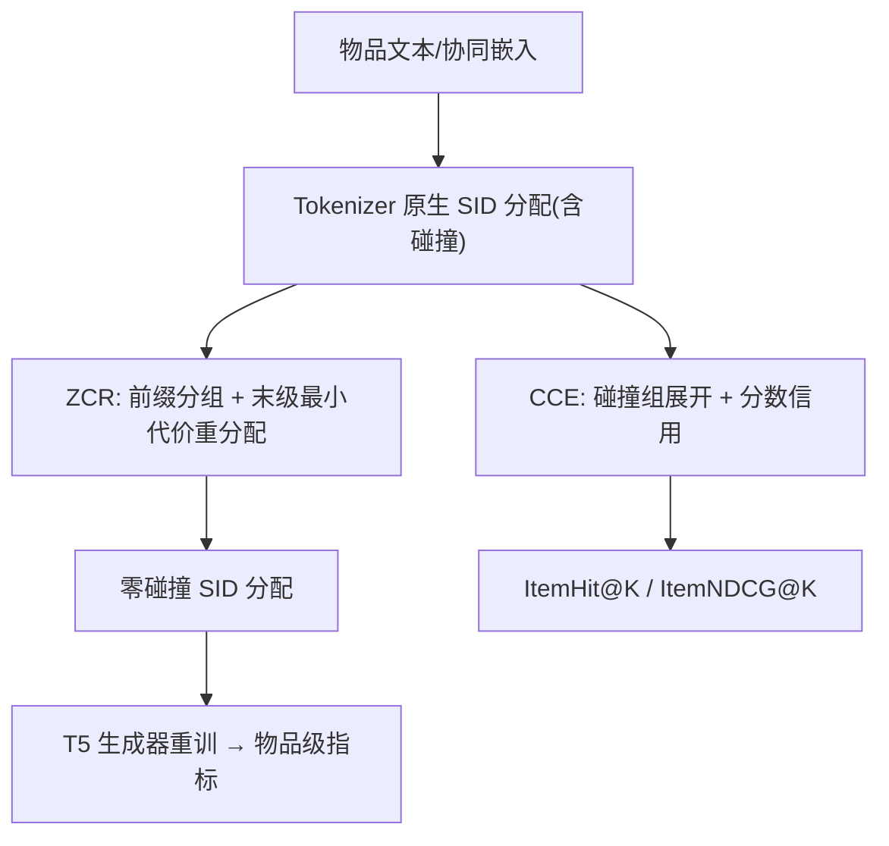
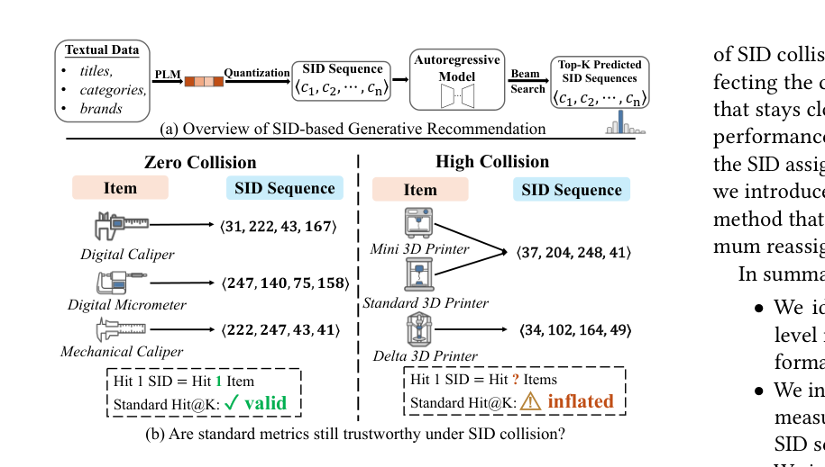

# Faithful Evaluation of Semantic-ID Tokenizers for Generative Recommendation (面向生成式推荐的语义ID分词器忠实评估)

- **会议/期刊**: CIKM 2026 (Full Research Paper)
- **作者与机构**: Qian Zhang, Lech Szymanski, Jeremiah D. Deng (University of Otago); Haibo Zhang (UNSW)
- **推荐链路定位**: 端到端生成式（Tokenizer 评估协议层）
- **研究方向**: 生成式推荐与离散语义ID / 评测基准与可信评估
- **论文原文**: [https://arxiv.org/abs/2605.25330v2](https://arxiv.org/abs/2605.25330v2)
- **开源代码**: [https://github.com/Nishikata97/CollisionGenRec](https://github.com/Nishikata97/CollisionGenRec)

## TL;DR (1分钟核心速览)

SID 生成式推荐惯用「生成序列是否命中目标 SID 序列」来算 Hit@K，但该协议隐含「SID 序列唯一标识物品」的假设；实测 5 个 Tokenizer × 4 数据集碰撞率高达 30.52%，SID 级 Hit@10 相对物品级虚高最多 103.36%，足以**翻转 Tokenizer 两两排序**。本文提出 CCE（按碰撞组大小分摊物品级信用，免重训）与 ZCR（仅改末级码字的最小代价重分配，匈牙利算法求解），在 4 数据集 5 Tokenizer 上给出首个忠实物品级对比。

## Background & Motivation (背景与核心矛盾)

- **主流范式**: TIGER/RQ-VAE 系将物品量化为长度 $L$、码本 $V$ 的离散 SID 序列，自回归生成 beam 候选后，用「目标 SID 是否出现在 Top-K」计算 Hit@K/NDCG@K。
- **前人局限**: ① 向量量化本质是**多对一压缩**，相似物品共享码字形成 SID 碰撞（Coll.% 8.52%–30.52%，最大碰撞组达 65 个物品），命中 SID 只等于命中「碰撞组」而非目标物品；② 各 Tokenizer 碰撞率差异巨大（RK-Means 恒高于 RQ-VAE），导致跨 Tokenizer 比较被不同强度的虚高污染。
- **核心洞察 (Key Insight)**: 虚高幅度与碰撞率单调正相关；且碰撞根源是**纯文本语义空间把交互模式不同的物品合并**（t-SNE 显示碰撞组在 Qwen3 文本空间近乎重叠，在 PPMI+SVD 协同空间可分）。
- **本文切入点**: 不改 Tokenizer、不重训生成器，从「度量修正（CCE）」与「分配修正（ZCR）」两侧同时闭合评估缺口。

## Method (核心方法设计)

### 1. 整体框架 (Overall Architecture)

输入为已训练 Tokenizer 的原生 SID 分配与 beam 输出。CCE 分支把每条预测 SID 按其碰撞组 $\mathcal{C}(\mathbf{s})=\{i:\mathbf{s}_i=\mathbf{s}\}$ 展开为物品序列，在展开后的物品级 Top-K 上分摊信用；ZCR 分支在量化完成后、生成器训练前，按 $(L{-}1)$ 前缀分组、仅重分配末级码字构造零碰撞分配，再以同一 T5 生成器重训评估。二者互补：CCE 修正任意碰撞率下的度量，ZCR 提供无碰撞的公平比较底座。

<figure class="paper-figure" markdown="span">
  <figcaption>图1：(a) 基于SID的生成式推荐概览。(b) 在零碰撞下，每个SID序列标识一个物品；在SID碰撞下，同一SID序列映射到多个物品，从而高估物品级性能。</figcaption>
</figure>

### 2. 关键设计拆解 (Key Designs)

1. **CCE 碰撞校正评估（把 SID 命中折算为物品级期望命中）**：痛点是把组命中当物品命中。设目标 SID 在 beam 中排名 $r$、目标组大小 $g=|\mathcal{C}(\mathbf{s}_{i_{t+1}})|$，展开后目标组起始位置 $p=1+\sum_{q<r}|\mathcal{C}(\mathbf{s}^{(q)})|$，落入 Top-K 的组内物品数 $m=\min(g,\max\{0,K-p+1\})$，则
$$\text{ItemHit}@K=\frac{m}{g},\qquad \text{ItemNDCG}@K=\frac{1}{g}\sum_{e=1}^{m}\frac{1}{\log_2(p+e)}$$
直觉：SID 无法区分组内物品，故对 $g$ 个可能位置取均匀期望；$g=1$ 时严格退化为标准 Hit/NDCG，单目标场景下 IDCG=1 无需归一化。

2. **ZCR 零碰撞重分配（保前缀、只动末级、全局最小代价）**：痛点在于 TIGER 追加无语义码会拉长 SID、MQL4GRec 贪心重分配改动过大。ZCR 固定前 $L{-}1$ 位，使碰撞分解为各前缀组 $\mathcal{P}(\mathbf{p})$ 内独立子问题，最少改动数 $\rho_\mathbf{p}=|\mathcal{P}(\mathbf{p})|-|\{s_i^{(L)}\}|$，再解约束二分匹配：
$$\min_{\{\hat s_i^{(L)}\}}\sum_{i\in\mathcal{P}(\mathbf{p})}\big[D[i,\hat s_i^{(L)}]-D[i,s_i^{(L)}]\big],\ \ D[i,c]=\|\mathbf{r}_i^{(L-1)}-\mathbf{e}_c^{(L)}\|^2$$
约束为恰有 $\rho_\mathbf{p}$ 个物品改码且组内码字互异，用匈牙利算法在 $O(|\mathcal{P}|^2V)$ 内求解。只动末级的关键理由：残差量化是顺序的，改前级会改变后续残差空间，代价不再可比；容量条件 $\max_\mathbf{p}|\mathcal{P}(\mathbf{p})|\le V$ 在全部实验中成立（最大 91 < 256）。

3. **训练目标、负采样与推理效率**：本文不引入新损失，生成器统一为 4 层 T5（$d_{model}=128$、6 头、dropout 0.1），以标准下一 SID 交叉熵训练，beam width=20，**无负采样**（全库 beam 生成即隐式全排序）。ZCR 开销为距离矩阵 $O(NVd)$（FAISS 批算）+ 分组匹配，$N\le5\times10^4$、$V=256$ 时相对 Tokenizer 训练可忽略。

## Experimental Setup & Evaluation Protocol (实验设置与评估协议)

- **数据集与预处理**（Amazon 三域 + Yelp，均 `5-core` 过滤）：

| 数据集 | #Users | #Items | #Interactions | 稀疏度 | 特征/场景说明 |
| :--- | :---: | :---: | :---: | :---: | :--- |
| Scientific | 8,317 | 4,344 | 58,492 | 99.84% | 工业与科学品，title/desc/brand/category |
| Cell | 154,778 | 47,593 | 1,109,257 | 99.98% | 手机配件，规模最大 |
| Beauty | 22,363 | 12,101 | 198,502 | 99.93% | 美妆 |
| Yelp | 30,431 | 20,033 | 316,354 | 99.95% | 本地商业，仅店名+类目，文本最弱 |

- **数据划分与防穿越**: `Leave-One-Out`（末位测试、倒数第二验证、其余训练）；协同嵌入的 PPMI 窗口仅用训练段并留出每用户末 2 物品防泄漏。
- **排名评测协议**: 无偏 `Full-Ranking`（beam 生成 SID 序列后全库展开排序），主指标为 CCE 的 ItemHit@K / ItemNDCG@K（K∈{5,10}），并保留 SID 级 H@10 作对照。
- **对比基线与超参**: 5 个 Tokenizer——RK-Means、RQ-VAE(TIGER)、LETTER、QuaSID（官方未开源，按论文复现）、MQL4GRec（内置零碰撞参照）；统一 $L=4$、$V=256$、Qwen3-Embedding-8B（$d_t=4096$）文本嵌入、同一 T5 生成器；3 个随机种子（42/123/2026）取均值，逐格标准差 0.0001–0.0032。

## Key Experimental Results (实验关键数据)

### 1. 主实验对比 (Main Results)

原生 Tokenizer 的碰撞率与虚高（表 4 核心列，H@10 为 SID 级、IH@10 为物品级）：

| 数据集 | Tokenizer | Coll.% | H@10 | IH@10 | Infl.% |
| :--- | :--- | :---: | :---: | :---: | :---: |
| Scientific | RK-Means | 30.52 | **0.1330** | 0.0654 | **103.36** |
| Scientific | RQ-VAE | 20.42 | 0.1147 | 0.0665 | 72.48 |
| Scientific | LETTER | 1.24 | 0.0804 | **0.0767** | 4.82 |
| Scientific | QuaSID | 5.41 | 0.0768 | 0.0749 | 2.54 |
| Cell | RK-Means | 28.52 | **0.0830** | 0.0524 | 58.40 |
| Cell | RQ-VAE | 14.04 | 0.0702 | 0.0574 | 22.30 |
| Cell | LETTER | 3.39 | 0.0673 | 0.0628 | 7.17 |
| Cell | QuaSID | 3.25 | 0.0684 | **0.0656** | 4.27 |
| Beauty | RK-Means | 21.58 | **0.0818** | 0.0547 | 49.54 |
| Beauty | RQ-VAE | 8.52 | 0.0693 | 0.0576 | 20.31 |
| Beauty | LETTER | 1.07 | 0.0664 | 0.0610 | 8.85 |
| Beauty | QuaSID | 0.59 | 0.0663 | **0.0644** | 2.95 |
| Yelp | RK-Means | 15.73 | 0.0415 | 0.0313 | 32.59 |
| Yelp | RQ-VAE | 9.05 | 0.0393 | 0.0340 | 15.59 |
| Yelp | LETTER | 8.59 | **0.0457** | **0.0405** | 12.84 |
| Yelp | QuaSID | 6.23 | 0.0400 | 0.0369 | 8.40 |

ZCR 后物品级提升（表 3 摘录，ItemHit@10）：

| Tokenizer | Scientific | Cell | Beauty | Yelp |
| :--- | :---: | :---: | :---: | :---: |
| RK-Means native → +ZCR | 0.0654 → **0.0812** (↑24.1%) | 0.0524 → **0.0694** (↑32.4%) | 0.0547 → **0.0662** (↑21.1%) | 0.0313 → **0.0347** (↑11.1%) |
| RQ-VAE native → +ZCR | 0.0665 → **0.0800** (↑20.4%) | 0.0574 → **0.0657** (↑14.4%) | 0.0576 → **0.0608** (↑5.6%) | 0.0340 → **0.0361** (↑6.0%) |
| LETTER native → +ZCR | 0.0767 → **0.0791** (↑3.1%) | 0.0628 → **0.0660** (↑5.0%) | 0.0610 → **0.0625** (↑2.5%) | 0.0405 → **0.0442** (↑9.0%) |
| QuaSID native → +ZCR | 0.0749 → **0.0789** (↑5.3%) | 0.0656 → **0.0663** (↑1.0%) | 0.0644 → **0.0645** (↑0.2%) | 0.0369 → **0.0381** (↑3.2%) |
| MQL4GRec (内置零碰撞) | 0.0606 | 0.0596 | 0.0570 | 0.0353 |

### 2. 消融实验 (Ablation Study)

| 配置 | 关键指标 | 说明 |
| :--- | :--- | :--- |
| RK-Means + ZCR（纯文本） | Yelp IH@10 = 0.0347 | 文本弱时落后 LETTER+ZCR (0.0442) |
| LETTER + ZCR（含协同对齐正则） | Yelp IH@10 = 0.0442 | 协同信号经正则注入 |
| RK-Means + ZCR + CF（PPMI+SVD 前置融合，$\alpha$=0.5） | Yelp IH@10 = **0.0566** | 四数据集均最优，较 LETTER+ZCR 高 4.6%–26.2% |
| 贪心重分配 vs. ZCR（RK-Means/Beauty） | $\sum\Delta D$ 63,409 → **55,678** | 代价降 12.19%（RQ-VAE 降 12.95%–18.80%） |

### 3. 关键实验发现 (Key Findings)

1. **虚高与碰撞率强单调**：RK-Means 在 Scientific 上 Coll.%=30.52 对应 Infl.%=103.36，而 QuaSID 在 Beauty 上 Coll.%=0.59 仅 2.95%，说明 SID 级榜单本质是「碰撞率排行榜」而非「Tokenizer 质量排行榜」。
2. **排序翻转是实质性的**：Scientific/Cell/Beauty 三域上 RK-Means 按 H@10 居首、按 IH@10 垫底；RQ-VAE 在 H@10 上压过 LETTER，校正后反被 LETTER 超越——即前作结论可能整体反向。
3. **ZCR 增益与原生碰撞率成正比**：RK-Means 提升 11.1%–32.4%，QuaSID 仅 0.2%–5.3%；且 ZCR 后 RK-Means+CF 反超 LETTER+ZCR，证明「文本语义合并 + 协同信号可分」是碰撞主因，前置融合比事后修补更有效。

## Highlights, Limitations & Rating (亮点、对比与审稿评价)

- **与代表作对比 (vs. Prior Work)**: 与 TIGER（追加无语义尾码，拉长 SID）、MQL4GRec（贪心重分配，局部最优且改动大）、QuaSID（训练期施加分离约束，需重训 Tokenizer）不同，CCE 零成本修正度量、ZCR 保长度且全局最小代价，二者正交可叠加。
- **可迁移亮点**: ① 「组展开 + 分数信用」的度量修正范式可迁移到任何多对一离散标识评估（如物品聚类召回、层级码本检索）；② 末级-only 重分配 + 匈牙利算法是保语义前缀的通用去重后处理模板。
- **审稿级局限批判**: ① CCE 对组内物品给均匀信用，忽略流行度/上下文，组内排序信息被抹平；② ZCR 最优性依赖 $\max_\mathbf{p}|\mathcal{P}(\mathbf{p})|\le V$，小码本或大量近重复物品（如 Yelp 的 65 家同名 Starbucks）时失效；③ 仅单一 T5 生成器与公开数据集，工业规模下虚高幅度与排序翻转是否同构仍待验证。
- **四维评分**: 创新性 ⭐⭐⭐⭐ | 实验扎实度 ⭐⭐⭐⭐ | 方法清晰度 ⭐⭐⭐⭐⭐ | 落地价值 ⭐⭐⭐⭐

