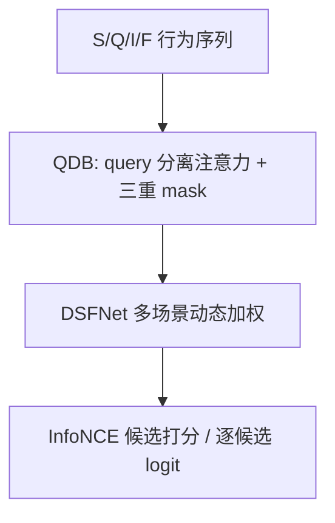

# IntSR: An Integrated Generative Framework for Search and Recommendation (面向搜索与推荐一体化的生成式框架)

- **会议/期刊**: CIKM 2026
- **作者与机构**: Huimin Yan, Longfei Xu, Junjie Sun, Ni Ou, Wei Luo, Xing Tan, Ran Cheng, Kaikui Liu, Xiangxiang Chu（阿里巴巴高德 / AMAP）
- **推荐链路定位**: 端到端生成式（召回 + 排序一体）
- **研究方向**: 生成式推荐 / 序列推荐
- **论文原文**: [https://arxiv.org/abs/2509.21179v2](https://arxiv.org/abs/2509.21179v2)
- **开源代码**: 暂未开源

## TL;DR (1分钟核心速览)

现有生成式推荐只统一了「召回+排序」，却把搜索与推荐（S&R）割裂建模。IntSR 的核心洞察是：**任务差异本质在于 query 的模态**——搜索用显式自然语言 query，推荐用隐式兴趣（通用 token），排序则把目标物品本身当 query。据此把四类子任务统一为条件生成，并用 Query-Driven Block（QDB）把排序阶段复杂度从 $O(c'N^2)$降到$O(c'J(N+1))$；同时首次形式化「时变词表错位」问题，用时间对齐负采样修正。在 Amazon/KuaiSAR 上 HR@1 相对最强基线 UniSAR 提升约 6%–13%，Amap 线上 GMV +9.34%、CTR +2.76%、ACC +7.04%。

## Background & Motivation (背景与核心矛盾)

- **主流范式**: 工业界 S&R 多为两套独立深度学习系统，近年生成式框架（HSTU、TIGER 类）已能统一召回与排序，但 S&R 联合建模仍主要停留在传统 DL 特征工程范式（JSR/USER/UnifiedSSR）。
- **前人局限**: ①传统联合模型依赖海量人工特征、算力扩展性差；②生成式框架聚合全部 S&R 行为后自回归训练开销爆炸，且排序阶段需对每个候选重复前向，$O(c'N^2)$ 不可接受。
- **核心洞察 (Key Insight)**: 作者指出 S&R 的差别不在模型结构，而在 **query 如何形成**；召回与排序的差别则在于 **query 是否就是目标物品本身**。因此 query 是统一四任务的中心枢纽。
- **本文切入点**: 用 query 占位符（Q token）承载不同模态条件，把四任务写成统一条件生成；再用定制 mask + KV-Cache 摊薄计算，用时间对齐负采样消除「物品生命周期」导致的假负样本。

## Method (核心方法设计)

### 1. 整体框架 (Overall Architecture)

输入序列由四类 token 构成：场景 token $S$（geohash 位置 + 离散时间）、query 占位符$Q$、物品 token$I$（多模态稠密融合）、反馈 token$F$（点击/购买等）。四类子任务被统一为条件概率：推荐召回$P(i_{n+1}|A_u,s_{n+1})$、推荐排序$P(a_{n+1}|A_u,s_{n+1},i_{n+1})$、搜索召回$P(i_{n+1}|A_u,s_{n+1},q_{n+1})$、搜索排序$P(a_{n+1}|A_u,s_{n+1},i_{n+1},q_{n+1})$。序列先经 QDB 编码（query 与主序列分离注意力），再过 DSFNet 做多场景动态加权，最后以 InfoNCE 对候选打分。训练用流式时间片，推理时 Q 位置替换为候选物品 token 逐位算 logit。

### 2. 关键设计拆解 (Key Designs)

1. **Query 模态统一四任务**：搜索 query 用冻结 Qwen3-0.6B 编码后加到 query embedding 上；排序 query 填入候选物品信息；推荐召回用跨用户共享的通用 token。为提升泛化，构造包含原始 query、物品名/类目/IP、描述改写、关键词、仿用户表达的五类候选池，非搜索触发的交互以概率 $\beta$ 从池中采样填充 Q。直觉：让模型学会「同一行为序列在不同 query 条件下生成不同目标」，从而一套参数服务多场景。

2. **Query-Driven Block 与三重 Mask**：QDB 将注意力拆成主序列 $X_1$与 query 序列$X_2$两路，$A_1=M_1\odot\text{SiLU}(Q_1K_1^\top+rab_{pos}+rab_{time})$，$A_{2,k}=M_{2,k}\odot\text{SiLU}(Q_2K_k^\top+rab_{pos}+rab_{time})$，输出$Y_2=\text{MLP}_2(\text{Norm}(A_{2,1}V_1+A_{2,2}V_2)\odot W_2)$。mask$M$由因果 mask、**会话级 mask**（同 session 内物品互不可见，保证「页面访问即预测购买」的线上线下一致）与**无效 Q mask**（非用户 query 的 Q 只作 query 不作 key/value）复合而成。复杂度从$O(c'N^2)$降至$O(c'J(N+1))$，因需学习的 Q 数$J\ll N$。

3. **时变词表对齐负采样**：痛点在于物品有上下线生命周期，长周期训练中把「当时尚不存在」的物品当负样本会教出错误模式。做法是把采样概率约束在交互时刻的可用集合 $\mathcal{I}_{t_a}$上：$\text{prob}_{i,t}=\text{prob}_i$若$i\in\mathcal{I}_t$，否则为 0；损失为$\mathcal{L}=-\frac{1}{|\mathcal{A}|}\sum_u\sum_a\delta_{u,a}\log\frac{\exp(z_{u,a,i^+})}{\sum_{i\in\mathcal{I}_{t_a}}\exp(z_{u,a,i})}$。该约束可即插即用地叠加到 RNS/PNS/HNS 上，无需改模型结构。

## Experimental Setup & Evaluation Protocol (实验设置与评估协议)

- **数据集与预处理**: 公开集 KuaiSAR、Amazon（Kindle Store），工业集 Amap Digital Assets（含物品生命周期显式信息，支持全候选集评估）。

| 数据集 | 场景说明 | 过滤/特点 |
| :--- | :--- | :--- |
| Amazon | 电商 S&R | 搜索行为为推荐行为重复，需 mask 防标签泄漏 |
| KuaiSAR | 短视频+搜索 | 5-core 过滤后搜索行为稀疏，先推荐 loss 再搜索 loss 微调 |
| Amap Digital Assets | 导航语音包/车标/主题 | 含物品上下线时间，可做时间对齐全库评估 |

- **数据划分与防穿越 (Splitting Strategy)**: 沿用 UniSAR 开源仓库设定，按时间序构造序列（流式时间片训练），并对 Amazon 的重复行为加 mask 防穿越。
- **排名评测协议 (Ranking Protocol)**: 公开集采用 **Sampled Ranking**，每正样本配 99 个用户未交互负样本；工业集采用**时间对齐的全候选集评估**（仅用交互时刻可用物品），负采样数 20。
- **对比基线与超参设置**: 基线含 DIN/SASRec/BERT4Rec/FMLP/HSTU 及联合模型 JSR/USER/UnifiedSSR/UniSAR；3 层 QDB，$d=32$，历史窗口 30，学习率$1\times10^{-3}$，batch 32。

## Key Experimental Results (实验关键数据)

### 1. 主实验对比 (Main Results)

搜索任务（Amazon / KuaiSAR，节选）：

| 数据集 | 模型 | HR@1 | HR@10 | N@5 | N@10 |
| :--- | :--- | :---: | :---: | :---: | :---: |
| Amazon | TEM | 0.4090 | **0.9051** | 0.6303 | 0.6587 |
| Amazon | UniSAR | 0.5343 | 0.8977 | 0.6875 | 0.7132 |
| Amazon | **IntSR** | **0.5678** | 0.8920 | **0.7091** | **0.7305** |
| KuaiSAR | UniSAR | 0.5282 | 0.8369 | 0.6417 | 0.6708 |
| KuaiSAR | **IntSR** | **0.5685** | **0.8516** | **0.6945** | **0.7128** |

推荐任务（节选）：

| 数据集 | 模型 | HR@1 | HR@10 | N@5 | N@10 |
| :--- | :--- | :---: | :---: | :---: | :---: |
| Amazon | HSTU | 0.3446 | 0.7278 | 0.4908 | 0.5256 |
| Amazon | UniSAR | 0.3010 | 0.7020 | 0.4513 | 0.4885 |
| Amazon | **IntSR** | **0.3740** | **0.7574** | **0.5242** | **0.5570** |
| KuaiSAR | UniSAR | 0.1990 | 0.6792 | 0.3632 | 0.4158 |
| KuaiSAR | **IntSR** | **0.2179** | **0.7248** | **0.3815** | **0.4421** |

相对最强基线 UniSAR：Amazon 推荐 HR@1 +24.3%、N@10 +14.0%；KuaiSAR 搜索 HR@1 +7.6%、推荐 HR@1 +9.5%。

### 2. 消融实验 (Ablation Study)

Amazon 上移除各模块（HR@1 / N@10）：

| 变体 | 搜索 HR@1 | 搜索 N@10 | 推荐 HR@1 | 推荐 N@10 |
| :--- | :---: | :---: | :---: | :---: |
| w/o S | 0.5516 | 0.7189 | 0.3311 | 0.5131 |
| w/o search queries | 0.4023 | 0.5624 | 0.3325 | 0.5096 |
| w/o session mask | 0.2024 | 0.3369 | 0.2864 | 0.4486 |
| w/o DSFNet | 0.5560 | 0.7196 | 0.3584 | 0.5386 |
| w/o relative bias | 0.5050 | 0.6823 | 0.3574 | 0.5421 |
| **IntSR** | **0.5678** | **0.7305** | **0.3740** | **0.5570** |

负采样对齐（Amap Digital Assets，HR@1 / N@10）：

| 策略 | HR@1 | N@10 |
| :--- | :---: | :---: |
| RNS | 0.1426 | 0.3012 |
| RNS (aligned) | 0.1810 | 0.3497 |
| PNS (best) | 0.1430 | 0.2983 |
| PNS (best, aligned) | 0.1760 | 0.3264 |
| HNS | 0.1569 | 0.3173 |
| HNS (aligned) | **0.1842** | **0.3533** |

### 3. 关键实验发现 (Key Findings)

1. **会话级 mask 是最大贡献项**：移除后搜索 HR@1 从 0.5678 崩到 0.2024（-64%），推荐从 0.3740 跌到 0.2864，说明「同 session 物品互不可见」对消除线上线下不一致至关重要，远胜其他模块。
2. **搜索 query 反哺推荐**：去掉 search queries 后推荐 HR@1 从 0.3740 降至 0.3325，直接证明联合建模 S&R 存在正向迁移，而非仅共享参数。
3. **时间对齐对所有采样策略普适增益**：RNS/PNS/HNS 对齐后 HR@1 分别 +26.9%/+23.1%/+17.4%，HNS 对齐后绝对最优（0.1842），说明「假负样本」是长周期训练的主要噪声源，且与采样强度正交。

## Highlights & Limitations (亮点、对比与审稿批判)

- **与代表作对比 (vs. Prior Work)**: 相比 HSTU（只统一召回+排序、无 query 概念），IntSR 用 query 模态把搜索纳入同一生成框架；相比 UniSAR（传统 DL 联合 S&R、依赖人工特征），IntSR 是纯生成式且计算可扩展；相比 TIGER 类语义 ID 生成，本文不做物品量化，而是以 query 条件化统一多任务。
- **可迁移亮点**: ①「会话级 mask 保证线上线下一致」可直接迁移到任何流式训练的生成式推荐；②时间对齐负采样是零成本即插即用模块，对生命周期明显的电商/本地生活场景普适。
- **审稿级局限批判**: ①公开集仅两个、且 Amazon 搜索行为是推荐重复，S&R 联合增益的外部有效性存疑；②QDB 的 $J\ll N$假设依赖流式时间片切分，离线全量训练时加速比可能退化；③query 候选池构造与$\beta$ 采样属工程启发式，缺少敏感性分析。

## Rating (四维评分)

- **方法创新性 (Novelty)**: ⭐⭐⭐⭐ （以 query 模态统一四任务是清晰且少见的视角，时变词表错位问题首次形式化）
- **评估协议与实验扎实度 (Protocol & Experiments)**: ⭐⭐⭐⭐ （公开集+工业集+线上 A/B 三层验证完整，但公开集仅两个且采样排序为主）
- **写作与数学规范度 (Clarity & Rigor)**: ⭐⭐⭐⭐ （四任务条件概率与 QDB 公式定义清晰，复杂度分析到位，部分实现细节下放附录）
- **工业落地与复现价值 (Industrial & Practical Value)**: ⭐⭐⭐⭐⭐ （亿级 DAU 线上部署超半年，GMV/CTR/ACC 三项硬指标提升，工程价值极高；可惜未开源）

