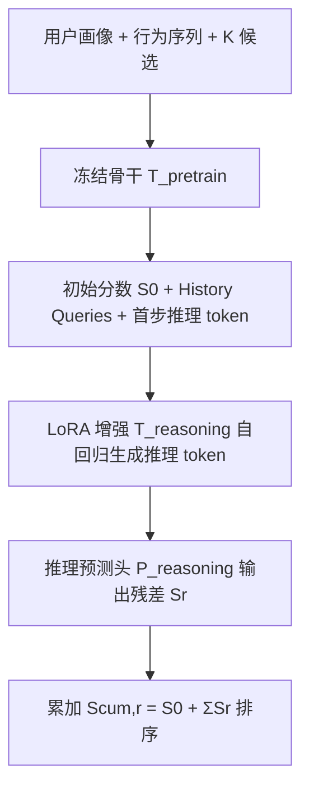
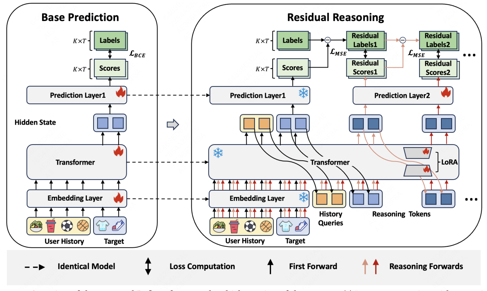
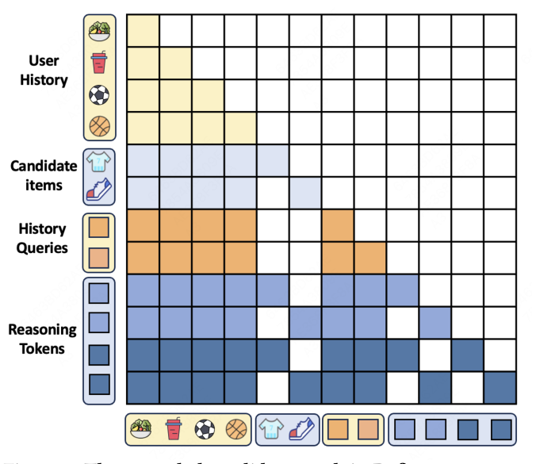

# Latent Residual Reasoning for Ranking in Generative Recommendation (生成式推荐排序中的隐空间残差推理)

- **会议/期刊**: CIKM 2026
- **作者与机构**: Haihan Shi, Wenjie Wang, Fuli Feng, Xiangnan He 等（中国科学技术大学、美团、中国人民大学、香港理工大学）
- **推荐链路定位**: 精排（Ranking）
- **研究方向**: 生成式推荐与离散语义ID / CTR 预估与特征交叉
- **论文原文**: [arXiv:2610.36890v1](https://arxiv.org/abs/2610.36890v1)
- **开源代码**: 暂未开源

## TL;DR (1分钟核心速览)

生成式排序（GR）模型普遍采用"快思考"式一次性打分，而排序任务恰恰需要细粒度候选区分。本文提出 **Refiner**：在冻结的 MTGR/SASRec-ranking 骨干上，通过 LoRA + 专用推理预测头，让模型在隐空间自回归地产生多步**加性残差修正**，逐步精化候选分数；同时引入 **History Queries** 为候选专属推理补充全局用户上下文。在 Steam/MovieLens10M 上 GAUC 相对提升 2.7%/4.3%，工业离线 CTR GAUC +1.6‰，线上 7 天 A/B 中 PV-CTR +0.75%、GMV +0.46%。

## Background & Motivation (背景与核心矛盾)

- **主流范式**: GR 排序模型（MTGR、OneRec 类）把用户上下文与 K 个显式候选拼成单一 token 序列，用 candidate mask 屏蔽候选间注意力，一次前向并行输出全部候选分数，训练/推理效率极高。
- **前人局限**: ① 该范式是"一次性预测"，排序所需的细粒度分数差异无法通过额外推理算力换取；② 已有的推理增强工作要么依赖 LLM 在**文本空间**显式 CoT（开销大、且不适用于广泛部署的非文本 ID 模型），要么面向**语义 ID 生成 / next-item 召回**（ReaRec、CaLR），其任务接口与"显式候选联合编码打分"根本不同。
- **核心洞察 (Key Insight)**: 排序场景下分数只需**小幅精确调整**即可改变候选次序，因此推理步不必从零重预测，而应建模为对初始分数的**累积加性修正**；同时候选专属推理天然缺乏全局用户视角，需要一条"压缩的用户行为旁路"。
- **本文切入点**: 把隐空间推理重构成"残差打分精化 + 历史查询上下文 + 冻结骨干的轻量适配"三件套，使推理与排序目标严格对齐且不破坏已上线系统。

## Method (核心方法设计)

### 1. 整体框架 (Overall Architecture)

输入序列由用户画像 $E_U$、行为序列$E_S$、K 个候选$E_I$组成，经冻结骨干得到初始分数$S_0$与首步推理 token；随后每步把上一步输出的最后 K 个隐状态作为新推理 token 追加进序列，连同固定的 History Queries 一起送入 LoRA 增强的 Transformer，由专用推理头输出残差$S_r$，累加得$S_{\text{cum},r}=S_0+\sum_{i\le r}S_i$。训练仅更新 LoRA 与推理头，推理时按步数$R_{\text{steps}}$ 自回归展开。

<figure class="paper-figure" markdown="span">
  <figcaption>图 2：所提出的 Refiner 框架概览，包含三个阶段：(a) 使用推理 token 和历史查询构建输入，(b) 使用冻结的基础模型并添加 LoRA/预测模块进行参数高效微调，(c) 通过自回归步骤逐步细化预测分数的残差推理。</figcaption>
</figure>

### 2. 关键设计拆解 (Key Designs)

1. **残差推理机制（Residual Reasoning）**：痛点是每步重预测全分数会让深层步数收益迅速饱和且训练信号冲突。本文令推理头只输出**连续加性修正**，并以累积分数的 MSE 监督每一步：
$$\mathcal{L}_{\text{reasoning}}=\sum_{r=1}^{R_{\text{steps}}}\frac{1}{KT}\sum_{i,j}\left(S_{\text{cum},r,i,j}-L_{i,j}\right)^2$$
直觉上每步只需拟合"剩余误差"，天然形成由粗到细的课程式优化，且与排序目标（分数序）直接对齐，而非 BCE 式的独立重分类。

2. **History Queries（历史查询）**：痛点是候选专属推理 token 只能看到自身候选与用户侧信息，缺乏对全局兴趣的"压缩摘要"。作者从初始序列 $H_0=T(X_0,M_0)$中取行为序列段末$N_{HQ}$个位置的隐状态作为固定查询$E_{HQ}$，在所有推理步复用；掩码上$E_{HQ}$段内部保持因果掩码、对外可见全部用户历史。这样以极少量 token（$N_{HQ}=2\sim4$）为每个候选的推理注入全局上下文，且不引入候选间信息泄漏。

3. **参数高效微调与推理掩码**：冻结 $E_{\text{pretrain}},T_{\text{pretrain}},P_{\text{pretrain}}$，仅在 Transformer 中插入 LoRA（rank$r\in\{32,64,128\}$，$\alpha\in\{64,128,256\}$）并新增推理头$P_{\text{reasoning}}$；扩展候选掩码保证第$r$步推理 token 只能访问用户侧信息、自身候选及同候选的历史推理 token（图 1）。训练负采样沿用"每正样本配 1 个随机负样本"（$K=2$），推理开销随步数线性增长，实测 1–2 步即达性价比拐点。

<figure class="paper-figure" markdown="span">
  <figcaption>图 1：Refiner 中扩展的候选掩码，用于防止推理过程中的信息泄漏。History Queries 被设计为关注所有 User History 信息，同时在查询片段内部保持因果掩码。然而，新引入的 Reasoning Tokens 被限制只能访问其对应的 Candidate Item、来自先前步骤的前置 Reasoning Tokens，以及包括 User History 和 History Queries 在内的所有用户侧信息。</figcaption>
</figure>

## Experimental Setup & Evaluation Protocol (实验设置与评估协议)

- **数据集与预处理**:

| 数据集 | #Users | #Items | #Interactions | 稀疏度/密度 | 特征/场景说明 |
| :--- | :---: | :---: | :---: | :---: | :--- |
| Steam | 33,327 | 14,377 | 1.4 M | 平均序列长 43 | 仅 item ID + 类目 ID |
| MovieLens10M | 3,558 | 10,680 | 10 M | 平均序列长 506 | 仅 item ID + 类目 ID |
| Industrial | 70 M | 4 M | 2 B | 平均序列长 1363 | 曝光日志，含长/短期行为，CTR+CTCVR 双任务 |

- **数据划分与防穿越 (Splitting Strategy)**: 公开集按时间戳排序后 **8:1:1 比例划分**；工业集用一整天训练、次日部分数据测试；线上用 14 天（前 7 天 warm-up，后 7 天观测）。
- **排名评测协议 (Ranking Protocol)**: 公开集为 **Sampled Ranking（1 正 : 1 随机负，$K=2$）**，训练与评测候选构造一致；工业集沿用生产管线候选集（非固定 K）。指标为 AUC 与 GAUC（用户级 AUC 平均）。
- **对比基线与超参设置**: xDeepFM、DIN（point-wise 传统模型）、SASRec-ranking、MTGR（工业 GR 骨干），以及适配到排序接口的隐推理基线 ReaRec；MTGR 工业配置 3 层 Transformer、2 头、$d=512$；3 个随机种子，$p<0.05$ 配对 t 检验。

## Key Experimental Results (实验关键数据)

### 1. 主实验对比 (Main Results)

| Method | Steam AUC | Steam GAUC | ML10M AUC | ML10M GAUC |
| :--- | :---: | :---: | :---: | :---: |
| xDeepFM | 0.6560 | 0.6501 | 0.6433 | 0.5919 |
| DIN | 0.7522 | 0.7261 | 0.6583 | 0.6369 |
| SASRec-ranking | 0.7450 | 0.7342 | 0.6935 | 0.6651 |
| SASRec-ranking + ReaRec | 0.7494 | 0.7394 | 0.6988 | 0.6705 |
| SASRec-ranking + **Refiner** | **0.7511** | **0.7415** | **0.7022** | **0.6742** |
| Improv. | ↑0.8% | ↑1.0% | ↑1.3% | ↑1.4% |
| MTGR | 0.7698 | 0.7397 | 0.7674 | 0.6755 |
| MTGR + ReaRec | 0.7785 | 0.7443 | 0.7719 | 0.6827 |
| MTGR + **Refiner** | **0.7872** | **0.7594** | **0.7864** | **0.7043** |
| Improv. | ↑2.3% | ↑2.7% | ↑2.5% | ↑4.3% |

工业离线（MTGR 骨干）：CTR AUC 0.7404→**0.7417**（↑1.8‰）、GAUC 0.6909→**0.6920**（↑1.6‰）；CTCVR AUC 0.8553→**0.8574**（↑2.5‰）、GAUC 0.7046→**0.7061**（↑2.1‰），均优于 MTGR+ReaRec。线上 7 天 A/B：PV-CTR **+0.75%**、UV-CTCVR **+0.21%**、GMV **+0.46%**。

### 2. 消融实验 (Ablation Study)

| 变体 (Steam) | AUC (Dec.) | GAUC (Dec.) |
| :--- | :---: | :---: |
| Refiner 完整 | **0.7872** | **0.7594** |
| w/o History Queries | 0.7764 (↓1.4%) | 0.7495 (↓1.3%) |
| w/o LoRA | 0.7841 (↓0.4%) | 0.7413 (↓2.4%) |
| w/o Residual（改 BCE 逐步监督） | 0.7763 (↓1.4%) | 0.7523 (↓0.9%) |
| End-to-End 全参训练 | 0.7650 (↓2.8%) | 0.7316 (↓3.7%) |

### 3. 关键实验发现 (Key Findings)

1. **残差形式是收益主源**：把残差 MSE 换成逐步 BCE 直接预测，AUC 掉 1.4%、GAUC 掉 0.9%，说明"拟合剩余误差"比"每步重分类"更契合排序目标；而 End-to-End 全参训练反而最差（GAUC ↓3.7%），印证冻结骨干 + 轻量适配能保住基模型已学到的排序行为、避免功能耦合退化。
2. **冷门物品与长序列用户获益最大**：分组实验中 Refiner 在最低流行度物品组增益最显著，在最长序列用户组仍稳定为正——基模型表征越不可靠（冷启动物品）或行为越复杂（长序列），可精化空间越大；热门物品因协同信号充分，增益自然收窄。
3. **步数与查询数存在明显性价比拐点**：$N_{HQ}=2\sim4$ 时性能最佳且相对推理延迟 RIL < 1.1；推理步数 1–2 步即取得主要增益，第 3–4 步残差幅度 ARR 快速衰减、增量收益 IRS 趋零而延迟线性上升，故线上仅启用 1 步即换来 PV-CTR +0.75%。

## Highlights & Limitations (亮点、对比与审稿批判)

- **与代表作对比 (vs. Prior Work)**: 相比 ReaRec/CaLR 这类"精化用户表征做 next-item 召回"的隐推理，Refiner 把推理直接落在**候选分数空间**并保持候选隔离；相比 OnePiece 的 set-wise 端到端训练（需候选间交互与业务上下文输入），Refiner 不改动骨干、只训轻量模块，工程可落地性显著更强；相比 LLM 文本 CoT，无文本生成开销。
- **可迁移亮点**: ① "冻结骨干 + 残差头 + 累积 MSE"可作为任意已上线精排模型的通用增益插件；② History Queries 用少量隐状态 token 为逐候选计算注入全局上下文，可迁移到多候选并行的重排/生成式检索场景。
- **审稿级局限批判**: ① 公开集采用 1:1 采样排序（$K=2$），与真实全库/大候选集排序分布差距较大，AUC 增益的绝对量级可能被高估；② 推理延迟仅报告未做 serving 优化的 RIL，多步自回归在严格时延约束的线上场景扩展性存疑，且缺少与 OnePiece 的直接对比（作者自述受骨干接口限制）。

## Rating (四维评分)

- **方法创新性 (Novelty)**: ⭐⭐⭐⭐ （核心机制与方法设计具备明确创新性，理论与实验动机支撑充分）
- **评估协议与实验扎实度 (Protocol & Experiments)**: ⭐⭐⭐⭐⭐ （主流公开数据集评测完整，包含多基线对比与消融实验验证）
- **写作与数学规范度 (Clarity & Rigor)**: ⭐⭐⭐⭐⭐ （问题形式化定义清晰，核心模块数学推导与架构阐述严谨易读）
- **工业落地与复现价值 (Industrial & Practical Value)**: ⭐⭐⭐⭐⭐ （兼顾推荐效果增益与训练/推理效率，具备实际场景迁移参考价值）
