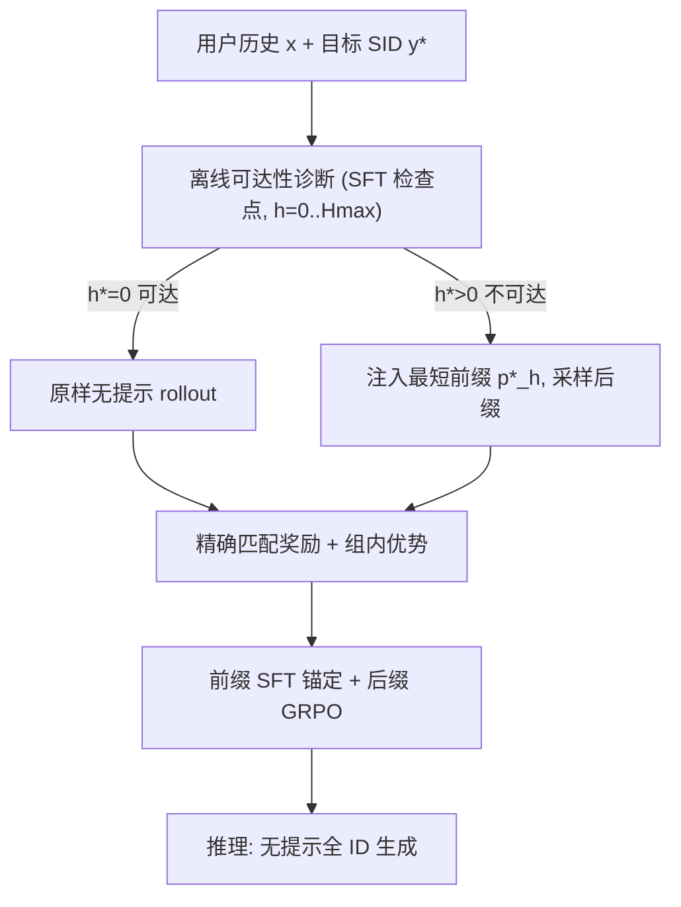
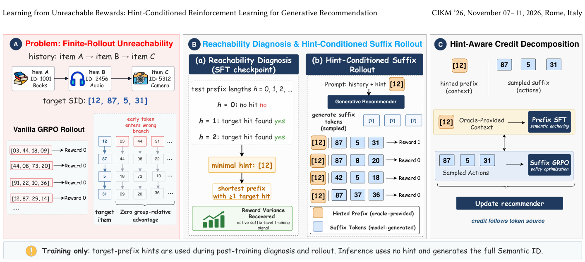

# Learning from Unreachable Rewards: Hint-Conditioned Reinforcement Learning for Generative Recommendation (从不可达奖励中学习：面向生成式推荐的提示条件强化学习)

- **会议/期刊**: CIKM 2026
- **作者与机构**: Kangning Zhang, Haotian Fang, Weiwen Liu, Weinan Zhang, Yong Yu 等（上海交通大学）；Xukun Luo, Hao Yin, Yang Gao, Peng Yan（美团）
- **推荐链路定位**: 端到端生成式（语义 ID 自回归生成 + 奖励后训练）
- **研究方向**: 生成式推荐 / 强化学习与动态探索推荐
- **论文原文**: [https://arxiv.org/abs/2608.11980v2](https://arxiv.org/abs/2608.11980v2)
- **开源代码**: [https://github.com/WncFht/GRec](https://github.com/WncFht/GRec)

## TL;DR (1分钟核心速览)

语义 ID 生成式推荐在 GRPO 后训练时存在**有限 rollout 不可达**瓶颈：物品 ID 是 4 个 token 的前缀树路径，早期 token 一旦选错分支，整组 rollout 全部拿 0 奖励、组内方差为零、优势恒为 0，样本彻底失效（实测 70%+ 组无梯度）。HCGRec 用 SFT 检查点离线诊断每个样本，仅对不可达样本注入**最短目标前缀提示**，把生成重定位到正确语义分支，并对"提示前缀（oracle 上下文）"与"采样后缀（模型动作）"做信用分解：前缀用 SFT 锚定、后缀用 GRPO 优化。在 Amazon 三域 Leave-One-Out + Full-Ranking 协议下，HR@50/NDCG@50 等指标超越 SFT 与 vanilla GRPO，零优势组比例降至 12%–17%。

## Background & Motivation (背景与核心矛盾)

- **主流范式**: TIGER/LC-Rec/OneRec 一脉采用"语义对齐 SFT + 奖励后训练（GRPO）"两阶段配方，物品被 RQ 量化为短 token 序列（本文 $M=4$），推荐即自回归生成 ID。
- **前人局限**: ① 物品级奖励稀疏，且稀疏性被**前缀树结构组织**——早期 token 错则后续 token 全在错误分支下解码，有限 rollout 预算内几乎不可能命中真值；② 现有补救（奖励塑形、生成-反思-纠错 GRC、Rank-GRPO 改信用单元）都在**序列生成之后**做修补，未回答训练期问题："当 rollout 分布几乎不进入奖励可区分区域时，样本如何学习？"
- **核心洞察 (Key Insight)**: 障碍不是奖励稀疏，而是**物品-token 空间内的奖励可达性 (reward reachability)**。目标语义 ID 前缀本身就是把样本拉回正确分支的最小脚手架；提示是前缀树可达性控制，而非答案泄漏——后缀仍由模型采样，组内奖励重新可区分。
- **本文切入点**: 离线诊断 + 最短前缀提示 + 按 token 来源分配信用，训练期改分布、推理期零改动。

## Method (核心方法设计)

### 1. 整体框架 (Overall Architecture)

从 SFT 检查点 $\pi_{\text{sft}}$出发，先对每个训练样本做**离线可达性诊断**：对提示长度$h=0,\dots,H_{\max}$各采样$G_d$条诊断后缀，记录首个使诊断组命中真值的长度$h^\star$；$h^\star=0$的样本原样训练，$h^\star>0$的样本在提示$x_h=[x;p^\star_h]$ 下做后缀 rollout。后训练阶段对完整 ID 计算精确匹配奖励与组内优势，但**只对后缀 token 施加 GRPO**，前缀 token 用 SFT 锚定，二者加权成总损失。推理时无任何提示，按原式生成完整语义 ID。

<figure class="paper-figure" markdown="span">
  <figcaption>图 1：HCGRec 概览。(A) 在语义-ID 生成式推荐中，无提示的 rollout 可能进入错误的前缀分支并产生相同奖励，使该实例在组相对优化中处于非活跃状态。(B) HCGRec 使用 SFT checkpoint 对每个实例进行诊断，选择能使目标在 rollout 预算内可达的最短目标前缀提示，并在提示后的语义分支下执行后缀 rollout。(C) 提示感知的信用分解将提示前缀视为由 SFT 锚定的 oracle 提供上下文，而采样后缀仍作为模型动作优化。</figcaption>
</figure>

### 2. 关键设计拆解 (Key Designs)

1. **可达性感知的最短前缀提示 (Reachability-Aware Hint Conditioning)**：痛点是无提示 rollout 组奖励方差为零。定义诊断组 $\tilde{y}^{(h)}_j = p^\star_h \oplus \tilde{s}^{(h)}_j$，可达集$\mathcal{C}(x,y^\star)=\{h: B_h(x,y^\star)=1\}$，取$h^\star=\min\mathcal{C}$，且约束$H_{\max}<M$ 保证至少一个 token 留给模型生成。直觉：提示只把生成搬到正确的粗粒度分支，细粒度后缀仍由策略探索，从而把"零优势死样本"转为"后缀补全的可比组"；且提示由 SFT 检查点一次性固定，避免动态提示导致优化目标漂移。

2. **提示感知信用分解 (Hint-Aware Credit Decomposition)**：痛点是被提示的前缀并非策略采样动作，若整序列套 GRPO 会把 oracle 上下文误当模型行为给信用；但前缀又承载物品语义与粗到细结构，不能丢弃。故后缀用组相对损失
$$\mathcal{L}_{\text{GRPO suffix}}=-\frac{1}{G}\sum_{j=1}^{G}\frac{1}{M-h}\sum_{t=h+1}^{M}\ell_{\text{clip}}\big(\rho^{(h)}_{j,t}(\theta),A^{(h)}_j\big),$$
前缀用锚定损失 $\mathcal{L}_{\text{SFT prefix}}=-\mathbb{I}[h>0]\sum_{t=1}^{h}\log\pi_\theta(y^\star_t\mid x,y^\star_{<t})$。直觉：信用按 token 来源分配——oracle 上下文保语义稳定，采样动作保偏好判别，避免全局 SFT 正则把后缀也"教死"。

3. **训练目标、负采样与推理效率**：总损失 $\mathcal{L}_{\text{HCGRec}}=\mathcal{L}_{\text{GRPO suffix}}+\lambda\mathcal{L}_{\text{SFT prefix}}$，$\lambda$默认 0.005。奖励为**精确目标匹配**$r=\mathbb{I}[\hat{y}=y^\star]$（无负采样，组内 16 条采样自比较）；诊断 beam size 16、$H_{\max}=3$、每 prompt 16 条 completion。推理零额外开销（无提示、无 value 模型），仅训练期多一次离线诊断 pass。

## Experimental Setup & Evaluation Protocol (实验设置与评估协议)

- **数据集与预处理**: Amazon Reviews 三域，沿用 GenRec 管线，物品统一 4-token 语义 ID，历史长度上限 50。

| 数据集 | #Users | #Items | #Interactions | 稀疏度 | 特征/场景说明 |
| :--- | :---: | :---: | :---: | :---: | :--- |
| Instruments | 17,112 | 6,250 | 136,226 | 99.87% | 乐器，平均序列长 7.96 |
| Arts | 22,171 | 9,416 | 174,079 | 99.92% | 工艺美术，平均长 7.85 |
| Games | 42,259 | 13,839 | 373,514 | 99.94% | 电子游戏，平均长 8.84 |

- **数据划分与防穿越**: `Leave-One-Out`——每用户最后一件测试、倒数第二件验证、其余训练，序列按时间戳构造。
- **排名评测协议**: 无偏 `Full-Ranking`（全物品集排序，非采样负例），生成式方法 beam size 固定 50；报告 HR@{5,10,50} 与 NDCG@{5,10,50}；各变体按 NDCG@10 选检查点后统一读数。
- **对比基线与超参**: 序列基线 Caser/GRU4Rec/BERT4Rec/SASRec，生成式 TIGER/LC-Rec，奖励后训练 GRPO Rule-only/MiniOneRec/offline-hint 变体；骨干 Qwen2.5-3B-Instruct 全参 SFT（lr $3\times10^{-4}$），RL lr$10^{-5}$、2 epoch、温度 1.0；所有 RL 变体共享同一 SFT 检查点、语义索引、组大小与奖励。

## Key Experimental Results (实验关键数据)

### 1. 主实验对比 (Main Results)

| 数据集 | 指标 | SASRec | TIGER | LC-Rec | GRPO Rule-only | MiniOneRec | HCGRec (offline hint) | **HCGRec** |
| :--- | :--- | :---: | :---: | :---: | :---: | :---: | :---: | :---: |
| Instruments | HR@10 | 0.0869 | 0.1044 | 0.1094 | 0.1179 | 0.1145 | 0.1189 | 0.1180 |
| Instruments | HR@50 | 0.1657 | 0.1763 | 0.1844 | 0.1681 | 0.1696 | 0.1941 | **0.1985** (+7.6% vs LC-Rec) |
| Instruments | NDCG@50 | 0.0799 | 0.0980 | 0.0985 | 0.1070 | 0.1071 | 0.1094 | **0.1118** (+13.5% vs LC-Rec) |
| Arts | HR@10 | 0.0814 | 0.1154 | 0.1164 | 0.1215 | 0.1189 | 0.1248 | **0.1257** (+8.0% vs LC-Rec) |
| Arts | NDCG@10 | 0.0498 | 0.0805 | 0.0870 | 0.0952 | 0.0931 | **0.0956** | **0.0956** (+9.9% vs LC-Rec) |
| Arts | NDCG@50 | 0.0673 | 0.1006 | 0.1038 | 0.1102 | 0.1071 | **0.1120** | 0.1118 |
| Games | HR@10 | 0.0556 | 0.0806 | 0.0804 | 0.0825 | 0.0802 | **0.0857** | **0.0857** (+6.6% vs LC-Rec) |
| Games | NDCG@50 | 0.0505 | 0.0704 | 0.0691 | 0.0683 | 0.0676 | 0.0723 | **0.0732** (+5.9% vs LC-Rec) |

### 2. 消融实验 (Ablation Study)

| 变体 (Instruments) | HR@5 | HR@10 | HR@50 | NDCG@10 | NDCG@50 |
| :--- | :---: | :---: | :---: | :---: | :---: |
| 仅 SeqRec 任务 | — | 0.1168 | 0.1951 | 0.0931 | 0.1102 |
| SeqRec + title/desc2index | — | 0.1189 | 0.1941 | 0.0931 | 0.1094 |
| **全 RL 任务 (SeqRec+title-seqrec+title/desc2index)** | **0.1009** | **0.1180** | **0.1985** | **0.0945** | **0.1118** |
| 后缀 GRPO only ($\lambda=0$) | — | 0.1189 | 0.1941 | 0.0931 | 0.1094 |
| 全序列 SFT + GRPO | — | 0.1168 | 0.1951 | 0.0931 | 0.1102 |
| **前缀 SFT + 后缀 GRPO (默认 $\lambda=0.005$)** | **0.1009** | 0.1180 | **0.1985** | **0.0945** | **0.1118** |
| $\lambda=0.1$（过强锚定） | — | 0.1137 | 0.1754 | 0.0912 | 0.1045 |

### 3. 关键实验发现 (Key Findings)

1. **可达性恢复是主因，信用分解是增益项**：offline-hint 变体已把 Instruments HR@50 从 GRPO 的 0.1681 拉到 0.1941，完整 HCGRec 再提至 0.1985；但增益并非全指标覆盖——Instruments 的 HR@5/NDCG@5 仍由 GRPO Rule-only 略胜（0.1027/0.0911），说明提示主要改善"分支稳定性与广覆盖"，而非极端头部排序。
2. **零梯度组比例是直接证据**：无提示基线训练末期零方差组占比约 0.55（Arts）/0.63（Instruments），前缀提示后降至约 0.12/0.17，与摘要"70%+ → 20% 以下"一致，证明提示把死样本转为有效组相对比较。
3. **提示深度呈任务异质性，且锚定需校准**：title-seqrec 的提示深度显著深于 SeqRec，title/desc2index 以浅层为主（图 3），故增益任务相关；$\lambda$在 0.001–0.01 区间最优，$\lambda=0.1$ 时 Instruments HR@50 从 0.1985 崩至 0.1754，印证"前缀锚定是校准旋钮而非缩放旋钮"。

## Highlights & Limitations (亮点、对比与审稿批判)

- **与代表作对比 (vs. Prior Work)**: 与 GRC（生成-反思-纠错）和 Rank-GRPO（改信用单元为排名位）相比，HCGRec 在**生成之前**解决可达性，属正交前置干预；与 HiLL/Scaf-GRPO 等通用推理脚手架相比，其提示是语义 ID 前缀树定义的目标前缀、仅训练期使用、且由离线诊断按需触发，并额外引入 token 来源感知的信用分解。
- **可迁移亮点**: ① "离线诊断 + 最短前缀"范式可迁移到任何层级码本生成检索（RQ-VAE/VQ 多级 ID、分层分类召回）；② 按 token 来源拆分 SFT/RL 信用的思路可用于 LLM 工具调用、检索增强生成中"外部注入上下文 vs 模型生成动作"的混合训练。
- **审稿级局限批判**: ① 诊断依赖 SFT 检查点一次性固定，训练中分布漂移后提示可能不再最短，作者亦将在线可达性估计列为未来工作；② 奖励仅为精确匹配，未验证连续/多目标奖励下的表现，且离线诊断需对每样本做 $H_{\max}\times G_d$ 次 beam 采样，训练前开销与数据规模线性相关；③ 主实验存在指标非全面占优（HR@50 在 Arts/Games 仍逊于 TIGER），提升幅度中等。

## Rating (四维评分)

- **方法创新性 (Novelty)**: ⭐⭐⭐⭐ （核心机制与方法设计具备明确创新性，理论与实验动机支撑充分）
- **评估协议与实验扎实度 (Protocol & Experiments)**: ⭐⭐⭐⭐ （主流公开数据集评测完整，包含多基线对比与消融实验验证）
- **写作与数学规范度 (Clarity & Rigor)**: ⭐⭐⭐⭐⭐ （问题形式化定义清晰，核心模块数学推导与架构阐述严谨易读）
- **工业落地与复现价值 (Industrial & Practical Value)**: ⭐⭐⭐⭐ （兼顾推荐效果增益与训练/推理效率，具备实际场景迁移参考价值）
