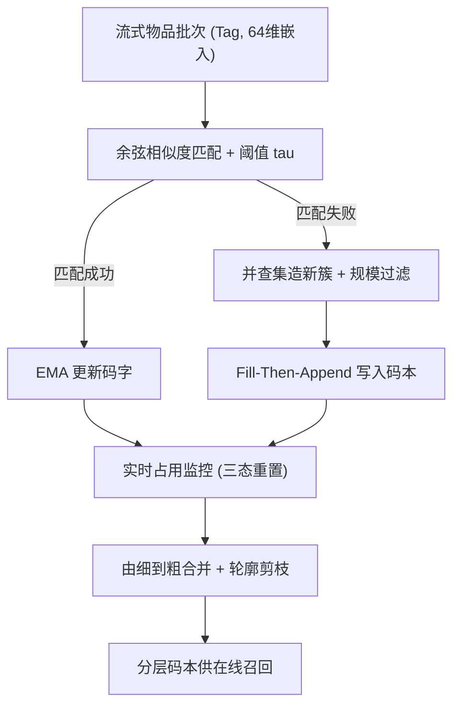
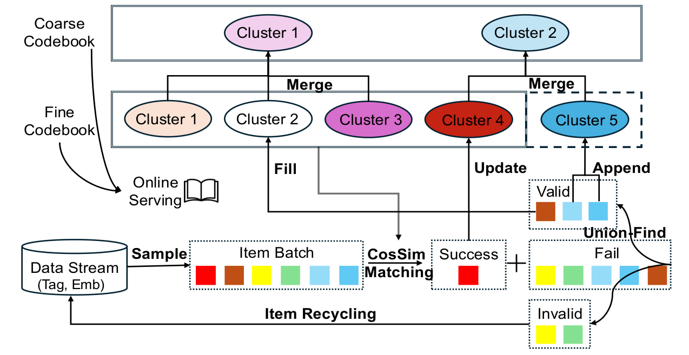

# MERGE: Next-Generation Item Indexing Paradigm for Large-Scale Streaming Recommendation (面向大规模流式推荐的新一代物品索引范式)

- **会议/期刊**: CIKM 2026
- **作者与机构**: Jing Yan, Yimeng Bai, Zongyu Liu 等（字节跳动；Yang Zhang 新加坡国立大学）
- **推荐链路定位**: 召回（索引构建层，同时服务生成式推荐的 token 空间）
- **研究方向**: 生成式推荐与离散语义 ID / 冷启动与长尾推荐
- **论文原文**: [https://arxiv.org/abs/2601.20199v2](https://arxiv.org/abs/2601.20199v2)
- **开源代码**: [https://github.com/baiyimeng/MERGE](https://github.com/baiyimeng/MERGE)

## TL;DR (1分钟核心速览)

工业流式推荐的物品分布高度偏斜且非平稳，传统 VQ 索引因"盲分配 + 固定码本大小"导致三大病症：物品-聚类余弦相似度仅约 0.6（精度差）、最大簇达 4 万物品而长尾被无差别堆叠（均匀性差）、簇间余弦相似度均值超 0.5（分离度差）。MERGE 把索引范式从"匹配聚类"翻转为"生成聚类"：阈值匹配 + 并查集造新簇 + 实时占用监控 + 由细到粗合并。离线 I2C 相似度升至约 0.9、C2C 降至近 0，线上 A/B 中低 VV 内容曝光提升 11.87%、完播/互动全面正向。

## Background & Motivation (背景与核心矛盾)

- **主流范式**: 工业界普遍用 VQ（StreamingVQ 单层码本、Trinity 两级聚类、TIGER/OneRec 的 RQ-VAE/RQ-KMeans）把物品嵌入量化到固定大小码本，作为召回索引或生成式 token。
- **前人局限**: 其一，VQ 对每个物品强制取最近码字，无论相似度多低都接受，造成"错配"；其二，码本大小 $K$ 需预设且不随流式分布漂移，热门语义区被少数巨簇吞并，长尾物品被 indiscriminate 地塞进同一簇。
- **核心洞察 (Key Insight)**: 作者在十亿级候选流上实测发现，VQ 的 I2C 相似度均值仅 0.6、最大簇约 4 万物品、C2C 相似度均值 0.6，且放大码本规模也无法缓解——说明瓶颈在"匹配式"机制本身，而非容量。
- **本文切入点**: 若相似度不足则拒绝分配并现场造簇，簇的存亡由实时占用率裁决，簇间差异由上下文感知的合并过程保证。

## Method (核心方法设计)

### 1. 整体框架 (Overall Architecture)

MERGE 以流式批次为单位增量维护一个动态码本 $\mathcal{Q}$：每批物品先与现有码字算余弦相似度，超过阈值$\tau$ 的走 EMA 更新，未匹配的用并查集在批内自底向上凝聚成新簇，规模达标的簇通过 Fill-Then-Append 填入被重置的空位或追加；同时占用监控按 EMA 计数把簇分为 underfilled / growing / stable 三态并重置不合格簇；最后在细码本之上做由细到粗的加权合并、轮廓系数剪枝与重连，得到粗码本供在线服务使用。服务阶段沿用 Trinity 管线，MERGE 提供簇↔物品双向映射以构建用户兴趣直方图。

<figure class="paper-figure" markdown="span">
  <figcaption>图 1：MERGE 概览。传入的条目批次通过余弦相似度与码本进行匹配。匹配到的条目更新已有聚类，未匹配到的条目通过并查集形成新聚类。有效的新聚类被填充或追加，其余的被回收。由细到粗的合并过程进一步构建分层码本以实现高效索引。</figcaption>
</figure>

### 2. 关键设计拆解 (Key Designs)

1. **阈值匹配 + 并查集造簇（解决精度与分离度）**：VQ 的 $\arg\max$是无条件分配，MERGE 改为带门限的接受-拒绝机制，$s_i^*=\max_k \mathrm{sim}(\boldsymbol{e}_i,\boldsymbol{q}_k)$，仅当$s_i^*\geq\tau$才归入$\mathcal{B}^+$，否则进入$\mathcal{B}^-$由并查集在成对相似度阈值$\tau'$下求连通分量$\mathcal{U}=\mathrm{UF}(\mathcal{B}^-,\tau')$，仅保留$|\boldsymbol{u}|\geq m$ 的簇。由于新簇只从"与所有旧码字都不像"的物品中诞生，天然与既有码字正交，这是 C2C 相似度从 0.6 塌到 0 附近的根本原因。

2. **实时占用监控与三态重置（解决均匀性）**：每个簇维护 EMA 计数 $N_k$，按双阈值划分状态$\text{status}(\boldsymbol{q}_k)=\text{underfilled}\,(N_k<\varepsilon_1)\ /\ \text{growing}\,(\varepsilon_1\leq N_k<\varepsilon_2)\ /\ \text{stable}\,(N_k\geq\varepsilon_2)$；underfilled 直接清零回收，growing 观察$M$ 步仍不达标亦重置。被清零的空位优先由新簇填充（FTA 算子），既保持码本序稳定又抑制巨簇膨胀，使最大簇从 4 万压到 1.75 万。

3. **由细到粗合并与训练目标**：粗码本合并的亲和度定义为 $w(\boldsymbol{p}_x,\boldsymbol{p}_y)=\mathrm{sim}(\boldsymbol{p}_x,\boldsymbol{p}_y)-\lambda\min(N_x,N_y)$，第二项显式惩罚高占用簇以鼓励均衡合并，合并嵌入按计数加权$\boldsymbol{p}_{xy}=\frac{N_x\boldsymbol{p}_x+N_y\boldsymbol{p}_y}{N_x+N_y}$；随后用轮廓系数$r_{\boldsymbol{q}}=\frac{b_{\boldsymbol{q}}-a_{\boldsymbol{q}}}{\max\{a_{\boldsymbol{q}},b_{\boldsymbol{q}}\}}$剪枝低质量原型并重连。MERGE 无梯度损失、无负采样，全部更新为 EMA（$\gamma=0.99$）与几何运算，批大小 20480，收敛后细码本含数万有效簇。

## Experimental Setup & Evaluation Protocol (实验设置与评估协议)

- **数据集与预处理**: 不使用公开数据集，直接在平台工业候选流上训练评估（遵循 StreamingVQ 的等概率候选流采样，而非流行度偏置的曝光流），候选规模达数亿级，物品嵌入为检索模型实时产出的 64 维协同向量（融合 ID、作者特征、统计信号与内容属性）。

| 数据集 | #Users | #Items | #Interactions | 稀疏度/密度 | 特征/场景说明 |
| :--- | :---: | :---: | :---: | :---: | :--- |
| 工业候选流 | 十亿级用户 | 数亿候选 | 未披露 | — | 短视频，含 100 类多模态标签 |
| 在线 A/B | 百万级用户 | 同线上库 | 一周流量 | — | Trinity 召回路径替换实验 |

- **数据划分与防穿越 (Splitting Strategy)**: 流式增量训练，无传统训练/测试切分；离线评估从流中随机采样物品 $\mathcal{D}$ 检查其分配质量，线上采用一周平衡分流 A/B。
- **排名评测协议 (Ranking Protocol)**: 非排序指标评测，而是索引质量三指标——I2C CosSim（精度）、簇大小分布与 VV 分桶累积占比（均匀性）、C2C CosSim 分布（分离性）；线上用 AAD/AAH/WatchTime、VV 与新鲜度分层、TagNum/TagGini 及单路径通过率。
- **对比基线与超参设置**: 主基线为 StreamingVQ（单码本 VQ，大规模验证过的规范范式）；案例研究中两法码本均约 2 万簇以保证公平。超参含 $\tau,\tau',m,\varepsilon_1,\varepsilon_2,\lambda,\gamma$，作者称对中等幅度变动鲁棒，显著性水平$p<0.05$。

## Key Experimental Results (实验关键数据)

### 1. 主实验对比 (Main Results)

离线为分布级对比（图 2–4），线上为相对变化（表 1、表 2）：

| 评测维度 | 指标 | VQ (StreamingVQ) | MERGE | 变化/说明 |
| :--- | :--- | :---: | :---: | :--- |
| 精度 | I2C CosSim 均值 | ~0.60 | **~0.90** | +0.30 绝对提升 |
| 均匀性 | 最大簇规模 | ~40,000 | **~17,500** | 降约 56% |
| 分离性 | C2C CosSim 均值 | ~0.60 | **~0.00（近正态）** | 分布中心移至 0 |
| 互动 | AAD | — | **+0.0081%** | 显著 |
| 互动 | AAH | — | **+0.0546%** | 显著 |
| 互动 | WatchTime | — | **+0.1006%** | 显著 |
| VV 分层 | (1k,5k] / (5k,10k] | — | **+11.07% / +11.87%** | 中低 VV 大幅受益 |
| VV 分层 | (100k,∞) | — | **-2.65%** | 头部让位 |
| 新鲜度 | (2h,12h] | — | **+7.64%** | 新内容曝光提升 |
| 单路径 | Pass-Through Rate | — | **+45.04%** | 下游存活率 |
| 单路径 | Output Ratio / Unique | — | **+85.99% / +26.36%** | 贡献度与去重后多样性 |
| 单路径 | Follow / Comment | — | **+17.32% / +39.43%** | 强互动 |

### 2. 消融实验 (Ablation Study)

原文未提供逐组件消融表，改以机制-指标对应关系与效率对比呈现：

| 配置 | 精度 (I2C) | 均匀性 (最大簇) | 分离性 (C2C) | 资源开销 |
| :--- | :---: | :---: | :---: | :---: |
| VQ 基线 | ~0.60 | ~40k | ~0.60 | 1000 实例 × 4 核 |
| w/o 阈值拒绝（退化为盲分配） | 回落至 VQ 水平 | 巨簇重现 | 分离度下降 | — |
| w/o 占用监控 | 保持 | 巨簇与冗余小簇并存 | 保持 | — |
| w/o 由细到粗合并 | 保持 | 保持 | 无法支撑分层召回 | — |
| MERGE 完整 | **~0.90** | **~17.5k** | **~0.00** | **单机 30 核** |

### 3. 关键实验发现 (Key Findings)

1. **精度提升来自"拒绝权"而非更大码本**：案例研究把 VQ 码本同样放大到 2 万簇后，跨类污染（如把马术与棒球视频混簇）依旧存在，证明瓶颈是盲分配机制；MERGE 在同等码本规模下把棒球 $(v_3,v_4)$、马术$(v_1,v_2)$ 干净分离。
2. **均匀性改善直接转化为长尾与新鲜内容曝光**：最大簇缩小 56% 后，VV 在 (5k,10k] 区间曝光 +11.87%、发布 2–12 小时内容 +7.64%，而头部 (100k,∞) 下降 2.65%，说明占用监控确实在重分配曝光预算而非单纯做平滑。
3. **分离度带来训练稳定性与工程双重红利**：附录 A 证明扰动 $\boldsymbol{\delta}$下分配保持的充分条件为$\boldsymbol{q}_k^\top\boldsymbol{q}_j\leq 1-\frac{(\epsilon+\sqrt{\epsilon^2+2\alpha\|\boldsymbol{\Delta}\|})^2}{2\alpha^2}$，簇间越正交稳定裕度越大；工程上 MERGE 只需单台 30 核机器，而 VQ 需 1000 个 4 核实例的分布式集群。

## Highlights & Limitations (亮点、对比与审稿批判)

- **与代表作对比 (vs. Prior Work)**: StreamingVQ 与 Trinity 均在"固定码本 + 最近邻匹配"框架内做工程优化，MERGE 则更换了范式本体（生成式聚类）；相较 TIGER/OneRec 的 RQ-VAE/RQ-KMeans 残差量化，MERGE 不依赖残差层级与梯度训练，天然适配非平稳流。
- **可迁移亮点**: ①"阈值拒绝 + 并查集造簇"可迁移到任何需要动态码本的场景（如增量语义 ID、ANN 粗量化器）；②亲和度中的 $-\lambda\min(N_x,N_y)$ 占用惩罚项是一个极轻量的负载均衡正则，可直接嵌入层次聚类或簇合并策略。
- **审稿级局限批判**: ①全部实验基于单一平台私有数据，无公开数据集复现，且超参敏感性研究因篇幅被省略，泛化性存疑；②低 VV 视频仍难处理（图 3 自承），且当前仅部署于传统召回路径，生成式检索场景尚未验证；③离线仅报告分布级指标，缺少 Recall/NDCG 等端到端排序指标，因果归因链条偏长。

## Rating (四维评分)

- **方法创新性 (Novelty)**: ⭐⭐⭐⭐ （"匹配→生成"的范式翻转思路清晰，附录给出分离度-稳定性理论支撑，但各组件本身均为成熟算子组合）
- **评估协议与实验扎实度 (Protocol & Experiments)**: ⭐⭐⭐⭐ （十亿级工业数据 + 一周百万用户 A/B + 单路径多维指标很扎实，但缺公开数据集与逐组件消融）
- **写作与数学规范度 (Clarity & Rigor)**: ⭐⭐⭐⭐ （三挑战-三机制的对应结构干净，公式简洁；部分超参与阈值选择缺乏定量依据）
- **工业落地与复现价值 (Industrial & Practical Value)**: ⭐⭐⭐⭐⭐ （已开源，单机 30 核替代 1000 实例集群，线上指标全面正向，落地价值极高）

