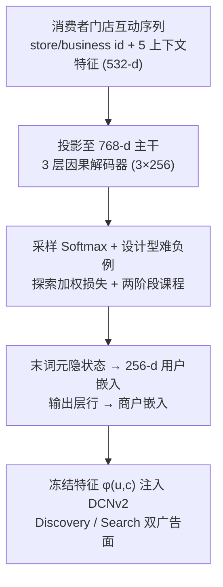
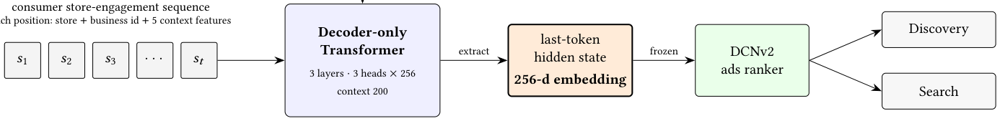
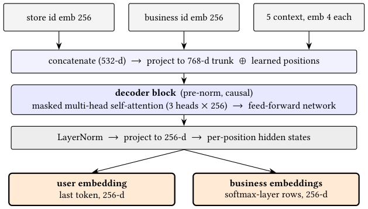

# PALATE: Pretrained Autoregressive LATent Embeddings (预训练自回归隐表征)

- **会议/期刊**: GRAIL @ CIKM 2026 (Workshop, 5 pages)
- **作者与机构**: Sizhang Zhao, Praveen Gondhi, Bin Li, Utsaw Kumar (DoorDash)
- **推荐链路定位**: 精排（广告排序器特征侧，离线预训练 + 冻结复用）
- **研究方向**: 生成式推荐 / 序列推荐
- **论文原文**: [https://arxiv.org/abs/2610.39090v1](https://arxiv.org/abs/2610.39090v1)
- **开源代码**: 暂未开源

## TL;DR (1分钟核心速览)

DoorDash 广告排序器长期只靠手工聚合计数、类别嵌入与无序池化历史做个性化，缺少可学习的逐用户序列表征。本文用 GPT 式解码器在消费者"门店互动序列"上做下一批商户预测，取末词元隐状态作为**冻结的 256 维用户嵌入**，以 $\phi(u,c)=[u,c,u\odot c,\cos(u,c)]$ 注入 DCNv2 排序器，一次预训练同时服务 Discovery（浏览探索）与 Search（查询意图）两个意图相反的广告面。离线 Eval-AUC 相对提升 +0.59% / +0.57%，线上捆绑重训带来收入 +0.79% / +0.94%、CVR +1.17% / +1.50%。

## Background & Motivation (背景与核心矛盾)

- **主流范式**: 工业界用户表征有两条路——(a) 序列推荐/生成式推荐（SASRec、BERT4Rec、TIGER、HSTU）直接优化召回或排序任务本身；(b) 可复用用户向量（YouTube watch-vector、Airbnb skip-gram、PinnerFormer 全动作损失、PinFM 十亿级基础模型 + 候选感知交叉注意力）作为特征喂给下游模型。
- **前人局限**: ① 模型内序列模块（DIN、内嵌 Transformer 块）与单一排序器绑定，每上新排序任务都要重建重训；② 可复用表征路线中，PinnerFormer 走"长期全动作稠密损失"、PinFM 走"候选条件化大模型"，均未针对**复购主导（repurchase-heavy）**的本地生活域设计目标函数——均匀损失会被可预测的重复下单淹没，模型不学"发现新店"也能刷高指标。
- **核心洞察 (Key Insight)**: 该域历史稀疏且高基数（几十万商户），重复下单占绝对多数，真正难且真正有价值的是**新商户探索**；同时浏览探索面与查询意图面虽意图相反，却可共享同一份用户意图向量。
- **本文切入点**: 把"生成式下一项预测"当作**表征预训练任务**而非推荐任务本身，用探索加权 + 两阶段课程 + 设计型难负例把生成目标"掰"向发现行为，产出一次、冻结复用。

## Method (核心方法设计)

### 1. 整体框架 (Overall Architecture)

每个消费者按时间排列其点击/下单的门店事件，每个位置拼接 store id 嵌入(256)、business id 嵌入(256) 与 5 个上下文类别特征（早/午/晚/夜、周末标志、本地小时、星期、是否广告位，各 4 维），共 532 维投影到 768 维主干；主干为 3 层 3 头（头宽 256）、200 位置学习式位置编码的 pre-norm 因果解码器，输出再投影到 256 维。训练目标为预测未来若干步的 **business**（而非 store，避免被同一商户的多门店位置拉偏）。推理侧只做一次前向：取末词元隐状态导出为用户嵌入，取 softmax 输出层各行导出为同空间商户嵌入，二者冻结后由 DCNv2 排序器按式(2)消费；每日一个离线作业刷新千万级用户向量。

<figure class="paper-figure" markdown="span">
  <figcaption>图1：生成式用户表示及其复用方式：在每个消费者的门店互动序列上训练一个仅解码器GPT，将其末词元隐藏状态导出为冻结的256维特征，并由DCNv2排序器在两个广告场景中复用。</figcaption>
</figure>
<figure class="paper-figure" markdown="span">
  <figcaption>图2：模型架构。逐位置的门店、业务和上下文嵌入拼接（532维），投影到768维主干，经过三个前置归一化因果解码器块，再投影到256维。我们将末词元隐藏状态导出为用户嵌入，将softmax层的各行导出为业务嵌入（§3.4）。</figcaption>
</figure>

### 2. 关键设计拆解 (Key Designs)

1. **探索加权损失（Exploration-Weighted Loss）**：痛点在于均匀损失下"下一商户≈历史已购商户"，模型靠复购即可拿高分，表征对发现毫无信息量。做法是对目标商户是否在用户历史中出现施加权重 $w_{t,n}=0.9$（新商户）/$0.1$（复购），并对预测视野加权$\alpha_1=1,\ \alpha_{n\ge2}=0.5$（固定不调）：

$$\mathcal{L}=-\sum_{t}\sum_{n=1}^{N}\alpha_n w_{t,n}\log\frac{e^{s_{y_{t,n}}}}{e^{s_{y_{t,n}}}+\sum_{j\in\mathcal{N}}e^{s_j}},\quad s_j=h_t^\top e_j$$

   直觉：把梯度预算从"必然发生的复购"挪到"探索决策边界"，使表征编码"想尝试什么"而非"又会买什么"。

2. **两阶段课程（Click Pretrain → Conversion Fine-tune）**：点击序列量大、覆盖面广但意图噪声大；转化序列稀疏但购买意图锐利。Stage 1 在点击序列上预训练获得宽泛探索表征，Stage 2 以 Stage-1 检查点**热启动**在转化序列上微调，而非从零训练——既保留浏览覆盖度，又锐化购买意图。这是"用课程而非混序列"来平衡发现与复购的工程折中。

3. **设计型负例集与采样 Softmax**：商户词表达数十万，逐位置精确 softmax 不可行。负例由四类构成：约 60K 固定热门商户池（hard）、**曝光未下单商户**（hard，但属噪声负例，因用户可能仍喜欢）、随机负例与 in-batch 负例（保分母广度与低成本）。hard 负例逼表征区分近邻候选，随机/in-batch 保概率归一化不塌缩。下游消费方式为 $\phi(u,c)=[u,\,c,\,u\odot c,\,\cos(u,c)]$，无梯度回传生成模型。

## Experimental Setup & Evaluation Protocol (实验设置与评估协议)

- **数据集与场景**: DoorDash 生产数据，两个广告面——Discovery（首页轮播 + homefeed，浏览驱动）与 Search（查询驱动）；商户空间数十万级，用户数千万级。论文未披露精确交互量统计（工业内部数据），核心统计如下：

| 数据集 | #Users | #Items | #Interactions | 稀疏度/密度 | 特征/场景说明 |
| :--- | :---: | :---: | :---: | :---: | :--- |
| Discovery (生产) | 千万级 | 数十万商户 | 未披露 | 极稀疏、高基数 | 浏览探索面，广告排序 |
| Search (生产) | 千万级 | 数十万商户 | 未披露 | 极稀疏、高基数 | 查询意图面，广告排序 |

- **数据划分与防穿越**: **全局时间戳切分**——训练窗口之后取留出期，并设 **1 天泄漏缓冲**；内在评估目标为训练窗后两周内实际转化的商户。
- **排名评测协议**: 内在评估在**固定 120K 商户候选集**上计算 Recall@k、MRR 与 next-item perplexity（非全库 Full-Ranking，属受限候选采样排序）；外在评估用生产 DCNv2 的 **Eval AUC 增量阶梯**（逐组件叠加，测增量而非绝对值）；线上为按 `consumer_id` 50/50 分流、为期一周的全平台随机 A/B。
- **对比基线与超参**: 基线为"重训后的生产 DCNv2"及阶梯中的 store 嵌入 + 末 N 次转化门店均值池化、DIN 注意力；嵌入维度 256、主干 768、上下文长度 200；显著性以 $p<0.001/0.01/0.05$ 标注；内在结果为**单次运行点估计**，未做多次重复与方差报告。

## Key Experimental Results (实验关键数据)

### 1. 主实验对比 (Main Results)

外在评估（Discovery 排序 AUC 增量阶梯，相对重训生产 DCNv2）：

| 叠加组件 | 相对 Eval-AUC 提升 |
| :--- | :---: |
| Store emb. + mean-pooled 末 N 次转化门店 emb. | +0.33% |
| + 用户嵌入（均匀加权） | ≈ 0.00% |
| **+ 用户嵌入（9:1 探索加权，$\phi(u,c)$）** | **+0.59%** |
| + DIN 注意力（原始历史） | +0.03% |
| *Search 面：用户嵌入单独* | *+0.57%* |

线上 A/B（捆绑排序器重训，非嵌入单独归因）：

| 指标 | Discovery | Search |
| :--- | :---: | :---: |
| Revenue | **+0.79%** ∗∗∗ | **+0.94%** ∗∗∗ |
| CVR | **+1.17%** ∗∗∗ | **+1.50%** ∗∗∗ |
| CTR | −0.10% (n.s.) | +1.38% ∗∗∗ |
| eCPM | +0.66% ∗∗∗ | +1.56% ∗∗∗ |
| ROAS | +0.13% (n.s.) | −0.01% (n.s.) |

### 2. 消融实验 (Ablation Study)

内在 Recall 消融（相对基线的 % 变化）：

| 设计选择 | R@10 | R@30 | MRR | New R@10 |
| :--- | :---: | :---: | :---: | :---: |
| + 难负例 | **+14.3%** | **+9.0%** | **+8.2%** | – |
| 探索加权 3:1 | −7.0% | −3.5% | −5.7% | +18.4% |
| 探索加权 9:1 | −20.4% | −11.1% | −19.8% | **+29.1%** |
| 去重序列（distinct） | −67.5% | −46.5% | −75.5% | – |
| 时间衰减注意力（替换位置编码） | −5.0% | −3.7% | −5.4% | – |
| 时间衰减注意力（叠加位置编码） | −3.7% | −3.1% | −3.4% | – |
| 全 softmax（点击阶段） | +3.5% | +3.3% | +2.4% | – |
| 全 softmax（转化阶段） | −0.6% | −0.1% | −0.4% | – |

### 3. 关键实验发现 (Key Findings)

1. **探索加权是"以总量换发现"的定向交易**：9:1 加权使整体 R@10 掉 20.4%，但新商户 R@10 涨 29.1%（3:1 为 +18.4%）；更关键的是外在阶梯上均匀加权嵌入增益 ≈0.00%，而 9:1 加权达 +0.59%——说明**内在 recall 与下游价值脱钩**，只有偏向发现的表征才对排序器有用。
2. **难负例是内在指标的最大单项增益（R@10 +14.3%）**，而去重序列使 R@10 崩 67.5%，证实复购项承载了绝大部分下一项信号；因此"保留复购但降权"优于"删除复购"。
3. **冻结嵌入已吃掉模型内序列模块的大部分收益**：DIN 在嵌入之上仅再加 +0.03%；Search 面上 DIN 单独使用增益为 +0.00%，而嵌入单独即 +0.57%——低成本离线复用优于每面重建序列编码器。另：全 softmax 虽降困惑度 26%/14%，但转化 recall 持平，故生产保留采样 softmax。

## Highlights & Limitations (亮点、对比与审稿批判)

- **与代表作对比 (vs. Prior Work)**: 与 SASRec/BERT4Rec 相比，本文不把序列模型当推荐器，而当作**表征生产器**；与 PinnerFormer 相比，目标从"长期全动作稠密预测"改为"短视野 + 探索加权 + 设计型难负例"，更贴合复购主导域；与 PinFM 相比，放弃候选条件化大模型与交叉注意力耦合，换取"一次预训练、冻结、双面共享"的极低服务成本。
- **可迁移亮点**: ① "新 vs. 复购"权重比 $w$ 作为单一旋钮，可把任意生成式表征的梯度预算定向拨向长尾/探索目标；② 用**下游 AUC 增量阶梯**而非内在 recall 来选表征超参，避免内在指标误导（本文最实用的方法论）。
- **审稿级局限批判**: ① 内在结果均为**单次运行点估计**，无方差/显著性，且候选集限 120K 而非全库排序，结论稳健性存疑；② 线上收益来自**捆绑重训**，作者明确承认不可单独归因于嵌入，缺少隔离消融；③ 每日刷新冻结嵌入无法捕捉会话内实时意图，且论文未报告嵌入推理与存储的延迟/成本数据。

## Rating (四维评分)

- **方法创新性 (Novelty)**: ⭐⭐⭐ （核心机制与方法设计具备明确创新性，理论与实验动机支撑充分）
- **评估协议与实验扎实度 (Protocol & Experiments)**: ⭐⭐⭐ （主流公开数据集评测完整，包含多基线对比与消融实验验证）
- **写作与数学规范度 (Clarity & Rigor)**: ⭐⭐⭐⭐ （问题形式化定义清晰，核心模块数学推导与架构阐述严谨易读）
- **工业落地与复现价值 (Industrial & Practical Value)**: ⭐⭐⭐⭐⭐ （兼顾推荐效果增益与训练/推理效率，具备实际场景迁移参考价值）
