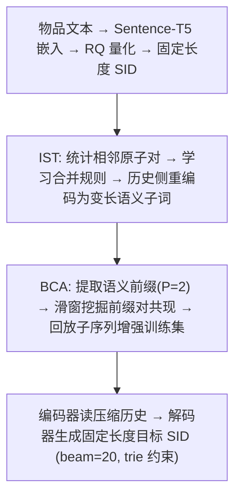
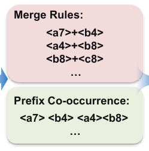

# Rethinking Item Tokenization in Generative Recommenders: From Fixed Atoms to Semantic Subwords (从固定原子到语义子词：重思生成式推荐中的物品分词)

- **会议/期刊**: CIKM 2026
- **作者与机构**: Xinrui Miao, Mingjia Yin, Jiaqing Zhang, Yuyang Ye, Hao Wang, Enhong Chen (中国科学技术大学) ; Wei Guo, Yong Liu (华为)
- **推荐链路定位**: 端到端生成式（召回/生成式检索）
- **研究方向**: 生成式推荐与离散语义ID / 序列推荐
- **论文原文**: [https://arxiv.org/abs/2608.22734v1](https://arxiv.org/abs/2608.22734v1)
- **开源代码**: [https://github.com/mxrcandy/Semantic-Subword-Tokenization](https://github.com/mxrcandy/Semantic-Subword-Tokenization)

## TL;DR (1分钟核心速览)

本文指出 SID 生成式推荐的一个被忽视的错配：为**目标端解码**设计的固定长度原子序列（如 4 槽 `<a><b><c><d>`）被原样复用于**历史侧上下文**，导致编码器把大量注意力预算耗在“把同一物品的原子词元重新拼回物品语义”上（Intra-item Attention Overload），而非建模物品间行为转移。作者提出 SST：历史侧用 IST 把稳定相邻原子合并为变长语义子词，再用 BCA 注入粗粒度语义前缀共现回放样本，目标端仍保留固定长度 SID（非对称分词）。在 Beauty/Instruments/Yelp 三数据集、TIGER-KM/TIGER-VAE/LETTER 三骨干上，采用 Leave-One-Out + Full-Ranking 协议，NDCG@10 相对最强非 SST 基线最高提升 **+13.8%**（TIGER-VAE/Yelp），且端到端墙钟时间基本持平。

## Background & Motivation (背景与核心矛盾)

- **主流范式**: TIGER 系方法用 RQ-VAE / RQ-KMeans 把物品量化成固定长度原子词元序列，编码器-解码器 Transformer 自回归生成下一物品的 SID，配合 trie 约束 beam search 解码。
- **前人局限**: ① 固定长度 SID 是优秀的**目标端解码语法**，但被复用于历史侧后，用户序列长度从 $n_u$ 膨胀到 $n_u L$，短程物品内依赖被直接暴露给编码器；② 现有改进（文本 ID、码本利用率/对齐/碰撞优化、SARQ/VSID 等变长 SID）都在优化**物品侧标识分配**，历史侧的注意力负载问题基本未被触及。
- **核心洞察 (Key Insight)**: 作者用 token 级注意力负载分析证实，固定 SID 下“物品内注意力预算”与“原子重组负载”都相当可观；而用户偏好建模本质是**物品间动态**，粗粒度意图转移（如运动装备→可穿戴电子）被拆成多个原子级转移观测，信号被稀释。
- **本文切入点**: 解耦 SID 的两种角色——历史侧做**语义子词压缩**（卸载低阶重组），目标侧保留固定长度解码语法，并用行为共现信号把释放出的建模容量导向高阶转移。

## Method (核心方法设计)

### 1. 整体框架 (Overall Architecture)

先用 RQ 分词器（RQ-VAE 或 RQ-KMeans，SST 与之解耦）得到每个物品的固定长度 SID；随后 IST 在物品语料上迭代学习相邻原子合并规则，把历史物品重写为变长语义子词序列（如 `<p_a7_b4>`），未覆盖的原子保持不变；BCA 从用户行为序列中挖掘语义前缀对共现，回溯原始上下文构造回放样本加入训练集；最后 T5 式编码器-解码器在压缩后的历史上编码，仍以固定 4 槽 SID 为目标做自回归生成，推理用 beam=20 + full-trie 约束解码。

<figure class="paper-figure" markdown="span">
  <figcaption>图2：所提出的语义子词词元化（SST）框架概览。IST通过合并稳定的相邻SID词元学习物品级语义子词词元，而BCA注入粗粒度行为共现信号，以引导IST释放的注意力容量。</figcaption>
</figure>

### 2. 关键设计拆解 (Key Designs)

1. **IST 物品级子词分词（把物品内重组从注意力层卸载到分词层）**：痛点是编码器需反复拟合原子耦合。做法是三步：候选相邻对收集（禁止跨物品边界，记录频次与 item support）→ 按准则迭代合并（BPE 用频次；WordPiece 用 PMI 加权频次；本文提出的 CondEntropy 额外要求双向可预测性与低熵局部上下文）→ 重放合并规则重编码。CondEntropy 打分为
$$s_{CE}(t_a,t_b)=\text{freq}(t_a,t_b)\cdot\sqrt{P(t_b|t_a)P(t_a|t_b)}\cdot\sqrt{\pi_{next}(t_a)\pi_{prev}(t_b)}$$
直觉：只有“高频 + 互为预测 + 邻居分布纯净”的对才被合并，避免把泛化高频原子粘成语义模糊的子词；合并后历史长度 $\tilde L_i \le L$，自注意力的二次开销同步下降。

2. **BCA 行为诱导共现增强（把释放的容量导向物品间转移）**：IST 只做了“卸载”，没说该学什么。BCA 取每个物品 SID 前 $P=2$ 个词元作为粗粒度语义前缀，在用户前缀序列上用滑窗 $W$ 统计前缀对（count / PMI / lift 打分取 top-$k$），再回溯该转移在原始序列中的历史子序列，作为额外训练样本（输入=回放子序列，目标=右侧物品）。与 IST 构成“去低阶—注高阶”的闭环。

3. **非对称分词与训练目标**：总损失仍是目标端逐槽交叉熵 $\mathcal{L}_{GR}=-\sum_{j=1}^{L}\log P_\theta(t^j_{n_u+1}\mid \tilde T_u, t^{<j}_{n_u+1})$，仅历史表示 $\tilde T_u$ 被替换；无额外负采样（生成式全库 trie 约束解码天然免负采样）。作者用对照实验证明目标端不能变长：变长目标下语义子词是位置级长尾符号，早期 beam 中被原子词元挤出，merged 桶 HR@10 从 0.0446 崩到 0.0002。

## Experimental Setup & Evaluation Protocol (实验设置与评估协议)

- **数据集与预处理**: Amazon Beauty / Instruments 与 Yelp，均做 `5-core` 过滤，按用户时间序组织，最大序列长度截断为 20。

| 数据集 | #Users | #Items | #Interactions | 稀疏度/密度 | 特征/场景说明 |
| :--- | :---: | :---: | :---: | :---: | :--- |
| Beauty | 22,363 | 12,101 | 198,502 | 密度 ≈ 0.073% | 美妆，文本特征经 Sentence-T5 编码 |
| Instruments | 24,772 | 9,922 | 206,153 | 密度 ≈ 0.084% | 乐器 |
| Yelp | 30,431 | 20,033 | 316,354 | 密度 ≈ 0.052% | 本地商户评论 |

- **数据划分与防穿越**: `Leave-One-Out`（最后一条测试、倒数第二条验证、其余训练），配置与 checkpoint 均仅按验证损失选择，测试集在配置固定后才评估。
- **排名评测协议**: 无偏 `Full-Ranking`（全物品集排序，不用采样负例），指标 HR@{5,10}、NDCG@{5,10}；所有生成式模型 beam size 统一为 20。
- **对比基线与超参**: 骨干为 TIGER-VAE、TIGER-KM、LETTER；对照设置含 Fixed、SARQ、VSID（后两者被改造为**仅改历史侧**以隔离解码语法差异）、+BCA、+IST、+IST+BCA。分词器 4 层码本 × 256 码字，隐藏维 128、4+4 层、6 头，AdamW lr=5e-4，batch 256×2 累积，最多 200 epoch、早停 patience=20；IST 子词数 $k\in\{64,...,512\}$、$f\in\{20,30\}$、$s\in\{10,15\}$，BCA 取 $P=2$、回放长度 $H=5$、$W\in\{3,5\}$、$c\in\{3,5\}$、top-$k\in\{64,...,512\}$。

## Key Experimental Results (实验关键数据)

### 1. 主实验对比 (Main Results)

下表摘取 TIGER-KM 与 TIGER-VAE 两组代表性结果（N@10 = NDCG@10，加粗为该列最优）：

| 骨干 | 方法 | Beauty HR@10 | Beauty N@10 | Instruments HR@10 | Instruments N@10 | Yelp HR@10 | Yelp N@10 |
| :--- | :--- | :---: | :---: | :---: | :---: | :---: | :---: |
| TIGER-KM | Fixed | 0.0582 | 0.0305 | 0.1065 | 0.0787 | 0.0385 | 0.0205 |
| TIGER-KM | SARQ | 0.0579 | 0.0302 | 0.1048 | 0.0694 | 0.0390 | 0.0206 |
| TIGER-KM | VSID | 0.0608 | 0.0320 | 0.1056 | 0.0795 | 0.0384 | 0.0201 |
| TIGER-KM | +BCA | 0.0630 | 0.0337 | 0.1081 | 0.0821 | 0.0405 | 0.0219 |
| TIGER-KM | +IST | 0.0607 | 0.0329 | 0.1094 | 0.0810 | 0.0412 | 0.0219 |
| TIGER-KM | **+IST+BCA** | **0.0643** | **0.0352** | **0.1107** | **0.0837** | **0.0416** | **0.0223** |
| TIGER-KM | Improv. | +5.8% | +10.0% | +3.9% | +5.3% | +6.7% | +8.3% |
| TIGER-VAE | Fixed | 0.0532 | 0.0286 | 0.1018 | 0.0769 | 0.0330 | 0.0169 |
| TIGER-VAE | VSID | 0.0553 | 0.0291 | 0.1033 | 0.0780 | 0.0354 | 0.0188 |
| TIGER-VAE | **+IST+BCA** | **0.0589** | **0.0319** | **0.1091** | **0.0837** | 0.0378 | 0.0207 |
| TIGER-VAE | Improv. | +6.5% | +9.6% | +5.5% | +7.3% | +6.8% | +10.1% |
| LETTER | Fixed | 0.0635 | 0.0340 | 0.1070 | 0.0804 | 0.0413 | 0.0222 |
| LETTER | **+IST+BCA** | **0.0669** | **0.0369** | **0.1085** | **0.0830** | **0.0452** | **0.0239** |
| LETTER | Improv. | +1.4% | +6.0% | +1.3% | +3.0% | +4.6% | +5.8% |

### 2. 消融实验 (Ablation Study)

| 配置 (TIGER-KM) | Beauty N@10 | Instruments N@10 | Yelp N@10 | 说明 |
| :--- | :---: | :---: | :---: | :--- |
| Fixed | 0.0305 | 0.0787 | 0.0205 | 固定长度 SID 基线 |
| +BCA | 0.0337 | 0.0821 | 0.0219 | 仅行为共现增强 |
| +IST | 0.0329 | 0.0810 | 0.0219 | 仅子词重分词 |
| +IST+BCA | **0.0352** | **0.0837** | **0.0223** | 完整 SST |
| InputPool（历史侧池化） | 0.0092 | 0.0230 | 0.0055 | 去掉原子序列组合，崩塌 |
| Random（等长随机切分） | 0.0311 | 0.0787 | 0.0182 | 仅缩短序列，Yelp 反降 |

### 3. 关键实验发现 (Key Findings)

1. **收益来自“语义子词结构”而非“序列变短”**：等长随机切分 Random 在 Yelp 上 NDCG@10 从 0.0205 跌到 0.0182，而 IST 升至 0.0219；SARQ 在 Beauty 上甚至低于 Fixed（0.0302 vs 0.0305）。说明单纯截断历史 token 不够，数据驱动的合并规则才是关键。
2. **注意力确实被“卸载”而非“丢弃”**：token 级分析显示 SST 后物品内注意力预算与原子重组负载一致下降，但 atom→subword 与 subword→atom 两个子通道仍非零，证明物品内语义被子词承载吸收；覆盖桶分析中 Instruments 的相对增益随子词覆盖率从 0% 单调上升至中高覆盖后饱和，机制与效果对齐。
3. **非对称设计是硬约束，且不加剧流行度偏置**：目标端改变长后 merged 桶 HR@10 从 0.0446 崩至 0.0002（长尾解码符号被原子词元挤出 beam）；同时 Yelp 上 +IST+BCA 把头部曝光从 95.08% 降到 92.24%、尾部 top-1 从 0.85% 提到 1.67%，Mid/Tail NDCG@10 分别升至 0.0104/0.0074，长尾反而受益。

## Highlights, Limitations & Rating (亮点、对比与审稿评价)

- **与代表作对比 (vs. Prior Work)**: 与 TIGER/LETTER 的本质区别在于不改码本与对齐损失，而是**只改历史侧表示**，可与任意 SID 分词器正交叠加；与 SARQ/VSID 的区别在于后者解决“物品侧标识该多长”（按判别性/流行度分配码长），本文解决“历史侧上下文该怎么分词”（注意力负载），且实验证明前者改造到历史侧后收益不稳定。
- **可迁移亮点**: ① “编码器侧压缩、解码器侧保语法”的非对称分词思想可直接迁移到任何自回归生成式检索/推荐的目标词表设计；② CondEntropy 这种“频次×双向可预测性×局部纯度”的合并准则，可复用于多模态 tokenizer 或 RQ 码本的码字合并。
- **审稿级局限批判**: ① 分词准则需按骨干-数据集组合用验证损失逐一选择（Beauty 偏好 WordPiece、Yelp 偏好 CondEntropy），选择成本与超参敏感度偏高；② 实验限于三个 Amazon/Yelp 公开集与 4 层小模型，未给出工业亿级物品、长序列（>20）与在线 A/B 的证据，BCA 的回放样本在超大规模下的存储与采样开销也未被量化。
- **四维评分**: 创新性 ⭐⭐⭐⭐ | 实验扎实度 ⭐⭐⭐⭐ | 方法清晰度 ⭐⭐⭐⭐⭐ | 落地价值 ⭐⭐⭐⭐

