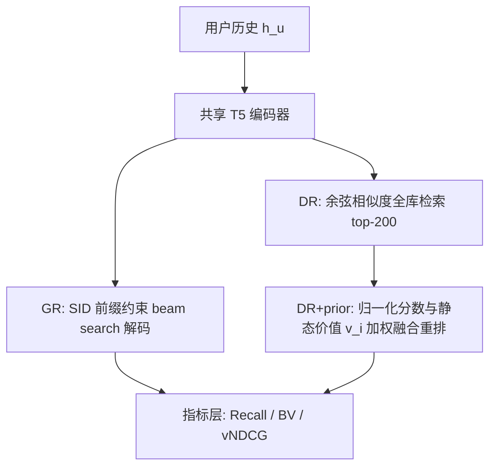
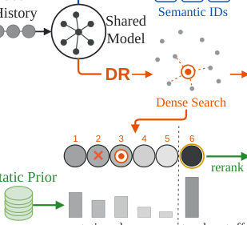

# Revisiting Generative vs. Dense Retrieval: A Static Value Prior Reverses the Gap (重审生成式检索与稠密检索：一个静态价值先验即可反转差距)

- **会议/期刊**: ACM CIKM 2026 (EARL Workshop)
- **作者与机构**: Renbo Tu (Shopify / University of Toronto / Vector Institute), Yang Liu, Shuying Sun (Shopify)
- **推荐链路定位**: 召回 (Candidate Generation)
- **研究方向**: 生成式推荐与离散语义 ID / 去偏公平与工业架构
- **论文原文**: [https://arxiv.org/abs/2610.19065v2](https://arxiv.org/abs/2610.19065v2)
- **开源代码**: [https://anonymous.4open.science/r/gr-dr-release-BCE4](https://anonymous.4open.science/r/gr-dr-release-BCE4)

## TL;DR (1分钟核心速览)

本文质疑"生成式检索 (GR) 全面优于稠密检索 (DR)"的流行叙事。在 TIGER/LIGER 受控框架下（同数据、同 T5 骨干，仅读出方式不同），作者在 Amazon Toys 2014/2023 上发现：**指标选择会反转胜负**——GR 在"最佳相关物品价值 BV@50"上领先，而 DR 在精确目标 Recall@50 与全列表价值 vNDCG@50 上领先。归因分析显示 GR 的价值优势中流行度贡献 49.8%/65.4%。仅对 DR 的 top-200 候选做一次免训练静态价值重排 (DR+prior)，即把 BV 差距从 −0.020 反转为 +0.023（2014），且 Recall 仍高于 GR。工业级 LLM 判官数据上，14B SID-LLM 仍逊于小 47× 的稠密编码器。

## Background & Motivation (背景与核心矛盾)

- **主流范式**: 电商召回长期以双塔/序列稠密检索 (DR) 为主；随着 LLM 与 RQ-VAE 语义 ID (SID) 成熟，逐 token 自回归解码 SID 的生成式检索 (GR, TIGER/LIGER 系) 被视为"更强替代品"，并已在工业规模落地。
- **前人局限**: ①现有对比几乎只用精确目标 Recall/NDCG，无法区分"替代品"与"无关物品"（作者称为 **substitute blindness**），且目录越大替代品越多（2014 中位 157 个同叶类替代品，2023 达 1,046 个，6.7×），精确命中指标的信息量随之崩塌；②GR 的"价值优势"从未被拆解，无法判断它来自用户历史建模还是来自物品本身的静态属性。
- **核心洞察 (Key Insight)**: 若 GR 的价值领先主要来自静态物品属性（尤其流行度），那么把同一份静态信息显式加给 DR，就应能无需求解码器地复现该优势——这是一个可证伪的推论。
- **本文切入点**: 定义互补指标（BV 与 vNDCG）分离"相关性"与"物品价值"，做价值归因分解，再用一次免训练重排验证该推论。

## Method (核心方法设计)

### 1. 整体框架 (Overall Architecture)

论文不是提出新模型，而是构建一个**受控对比 + 指标解耦 + 静态先验干预**的分析框架。GR 与 DR 共享同一交互数据、同一物品目录与联合训练的 T5 编码器-解码器：GR 通过前缀约束 beam search 解码合法 SID，DR 用同一历史编码向量做余弦相似度全库排序。评估层将相关性标签 $q_u(i)$与静态物品价值$v_i$严格分离，分别在"最佳相关物品"与"全列表"两个层面度量；最后把$v_i$ 作为一次重排信号注入 DR 的 top-200 候选池，检验 GR 的价值领先是否可被静态先验替代。

<figure class="paper-figure" markdown="span">
  <figcaption>图1：GR 和 DR 使用相同的用户历史，但分别通过语义 ID 解码和稠密检索生成候选。GR 在最佳物品价值上领先，而 DR 在精确目标检索和全列表价值上领先。静态先验对 DR 候选重新排序，并将一个潜在有价值的物品移入前 𝑘。</figcaption>
</figure>

### 2. 关键设计拆解 (Key Designs)

1. **互补指标：BV 与 vNDCG 解耦相关性与价值**：精确命中指标对替代品零给分，导致"漏检"不可解释。作者定义条件最佳物品价值 $BV^k_x(u;q,\mathbf{w})=\max_{i\in R^k_x(u;q)} v_i(\mathbf{w})$，仅在两法都命中相关物品的用户集$C^k_{x,a}$上报告配对差$\Delta BV$；同时定义价值加权列表指标$vDCG^k_x(u)=\sum_{j=1}^{k}\frac{q_u(i_j)\,v_{i_j}(\mathbf{w})}{\log_2(j+1)}$，并以所有方法候选池共享的 IDCG 归一化。直觉：BV 捕捉"头部是否够好"，vNDCG 捕捉"整张列表的价值密度"，二者可给出相反结论。
2. **静态物品价值先验与免训练重排**：价值由目录级百分位秩线性组合而成 $v_i(\mathbf{w})=w_p\,pop_i+w_r\,rate_i+w_b\,brand_i$，默认$\mathbf{w}=(0.25,0.25,0.50)$，其中$rate_i$为星级评分的 Wilson 下界。重排时对 DR 池内相似度做 min-max 归一化后线性融合：$\sigma_u(i)=(1-\alpha)\tilde{s}_u(i)+\alpha v_i,\ \alpha=0.5$。关键直觉：$v_i$ 与用户无关、每物品只算一次，因此若它能复现 GR 的 BV 领先，就说明该领先本质是静态先验而非序列建模能力。
3. **训练目标、负采样与推理效率**：两臂沿用 TIGER/LIGER 的常规下一物品训练目标（GR 为 SID token 的交叉熵，DR 为批内对比），本文不引入新损失；核心效率论点是 DR+prior 在服务期**无需自回归解码**，仅一次 top-200 重排，而 GR 需前缀约束 beam search。

## Experimental Setup & Evaluation Protocol (实验设置与评估协议)

- **数据集与预处理**:

| 数据集 | #Users | #Items | #Interactions | 稀疏度/密度 | 特征/场景说明 |
| :--- | :---: | :---: | :---: | :---: | :--- |
| Amazon Toys 2014 | 19,412 | 11,924 | 19,412 条留出目标 | 极稀疏 | 19,116 个目标训练中出现，296 个冷目标 |
| Amazon Toys 2023 | 156,797 (BV 配对用户) | ≈13.6× 于 2014 | 同左 | 极稀疏 | 目录规模放大 13.6×，检验规模鲁棒性 |
| 工业电商内部集 | 5,998 (评测集) | 未披露 | 真实交互历史 | — | LLM 判官分级相关性，250 条人工标注校准 |

- **数据划分与防穿越 (Splitting Strategy)**: `Leave-Last-Out`（留出每个用户最后一条交互作为 $y_u$），并单独统计训练中未出现的冷目标。
- **排名评测协议 (Ranking Protocol)**: 无偏 `Full-Ranking`（DR 对全库排序；GR 经前缀约束 beam search 解码合法 SID），报告 Recall@50、NDCG@50、$\Delta BV$@50、vNDCG@50；BV 配对比较以$\tau=0.05$ 判定胜负平。
- **对比基线与超参设置**: 基线为同骨干的 GR 与 DR 两臂（受控对比，非跨模型横比）；价值权重在 231 点单纯形上做敏感性扫描；工业侧 GR 为 Qwen3-14B SID-LLM，DR 为约 300M 参数的 GTE 编码器（参数差约 47×）。

## Key Experimental Results (实验关键数据)

### 1. 主实验对比 (Main Results)

| 方法 | Recall@50 (2014 / 2023) | NDCG@50 (2014 / 2023) | $\Delta BV$@50 (2014 / 2023) | vNDCG@50 (2014 / 2023) |
| :--- | :---: | :---: | :---: | :---: |
| GR | 0.167 / 0.052 | 0.056 / 0.017 | — | 0.215 / 0.160 |
| DR | **0.228 / 0.084** | **0.077 / 0.029** | −0.020 / −0.016 | 0.222 / 0.168 |
| DR+prior | 0.210 / 0.083 | 0.072 / 0.028 | **+0.023 / +0.006** | **0.240 / 0.175** |

工业 LLM 判官（NDCG@50，$n=5{,}998$）：GR 0.453 < DR 0.474 < **DR+prior 0.530**（先验使 DR 提升 11.8%）。

### 2. 消融与鲁棒性检验 (Ablation & Robustness)

| 检验项 | 结果 | 结论 |
| :--- | :--- | :--- |
| 价值权重单纯形扫描 | 2014: 223/231 点 DR>GR；2023: 231/231 点 DR>GR | vNDCG 结论对权重稳健，仅在流行度主导边缘失效 |
| 冷目标召回 (296 / 1,899) | GR 0 / 5；DR 47 / 27；DR+prior 36 / 21 | 生成式并未带来冷启动优势 |
| 共购替代品信用 (2014) | 精确 Recall 差 +0.0447 → 共购信用下 −0.0183 | 但等权随机信用移动幅度 ≥ 该反转，反转不可信 |
| 分级 NDCG@50 (2014) | DR 领先 +0.0153 | 分级信用下 DR 重新领先 |
| 价值归因分解 | 流行度占 GR 领先 49.8% (2014) / 65.4% (2023) | 静态属性是价值优势主成分 |

### 3. 关键实验发现 (Key Findings)

1. **指标即结论**：BV@50 下 GR 获胜频率是 DR 的 2 倍以上（2014: 19.8% vs 8.6%；2023: 21.5% vs 9.6%），但同一批模型在 vNDCG@50 上 DR 领先 2.9%/5.1%——"谁更强"完全由指标定义决定，且价值加权把 DR 的相关性优势压缩了一个数量级。
2. **GR 的价值优势可被静态先验替代**：流行度单独贡献 49.8%/65.4% 的领先，且 2014 上 50.3%、2023 上 75.1% 的留出目标在训练历史中出现 ≥10 次（流行度与出现频次 Spearman $\rho=0.582$），说明 GR 在预测 SID 时学到了对高频物品的偏好；一次免训练重排即把 BV 差距反转（−0.020→+0.023），同时 Recall 仍高于 GR。
3. **规模放大不改变结论、反而强化**：目录扩大 13.6× 后，替代品数量增 6.7×，精确命中指标进一步失真；工业级 14B SID-LLM 在 LLM 判官分级相关性下仍低于小 47× 的稠密编码器（0.453 vs 0.474），叠加先验后差距扩大到 0.530。

## Highlights & Limitations (亮点、对比与审稿批判)

- **与代表作对比 (vs. Prior Work)**: 相较 TIGER/LIGER 等仅报告精确目标 Recall 的 GR 工作，本文首次在**同骨干受控条件**下引入价值维度指标，指出其结论对指标选择高度敏感；相较流行度去偏工作（如对 LLM 内在偏置的缓解），本文不修改模型，而是证明该偏置可被一个用户无关的静态先验在 DR 侧等价复现，从而把"架构优势"降格为"先验优势"。
- **可迁移亮点**: ①"相关性标签 $q$与物品价值$v$分离 + 共享 IDCG 池化"的评测范式可直接迁移到任何存在商业价值异质性的召回评测；②免训练线性融合重排$\sigma=(1-\alpha)\tilde{s}+\alpha v$ 可作为生成式召回上线前的低成本强基线。
- **审稿级局限批判**: ①工业侧 GR 与 DR 骨干、参数量均不同（14B vs 300M），作者亦承认该实验无法隔离架构效应，只能作为"公开结论在工业场景仍成立"的旁证；②价值代理 $v_i$的权重$\mathbf{w}$与$\alpha=0.5$从 2014 直接迁移至 2023 未调参，且$rate_i$/$brand_i$ 的语义效度缺乏下游收益验证；③共购信用实验出现"随机信用同样能反转"的负结果，说明替代品相关性度量本身仍不稳健，分级判官仅 250 条人工校准，统计功效有限。

## Rating (四维评分)

- **方法创新性 (Novelty)**: ⭐⭐⭐ （不提出新模型，但"指标解耦 + 可证伪的静态先验推论"这一分析范式在 GR/DR 之争中颇具洞察力）
- **评估协议与实验扎实度 (Protocol & Experiments)**: ⭐⭐⭐⭐ （受控同骨干对比、231 点权重单纯形扫描、冷目标/共购/随机对照/工业判官四重稳健性检验，且诚实报告负结果）
- **写作与数学规范度 (Clarity & Rigor)**: ⭐⭐⭐⭐ （$q$与$v$ 的符号分离干净，BV/vNDCG 定义与配对统计口径明确，共享 IDCG 的不可跨池比较警示到位）
- **工业落地与复现价值 (Industrial & Practical Value)**: ⭐⭐⭐⭐⭐ （免训练、无解码、单次重排即可反超，代码已开源，对正在评估 GR 替换 DR 的团队具有直接的决策价值）
