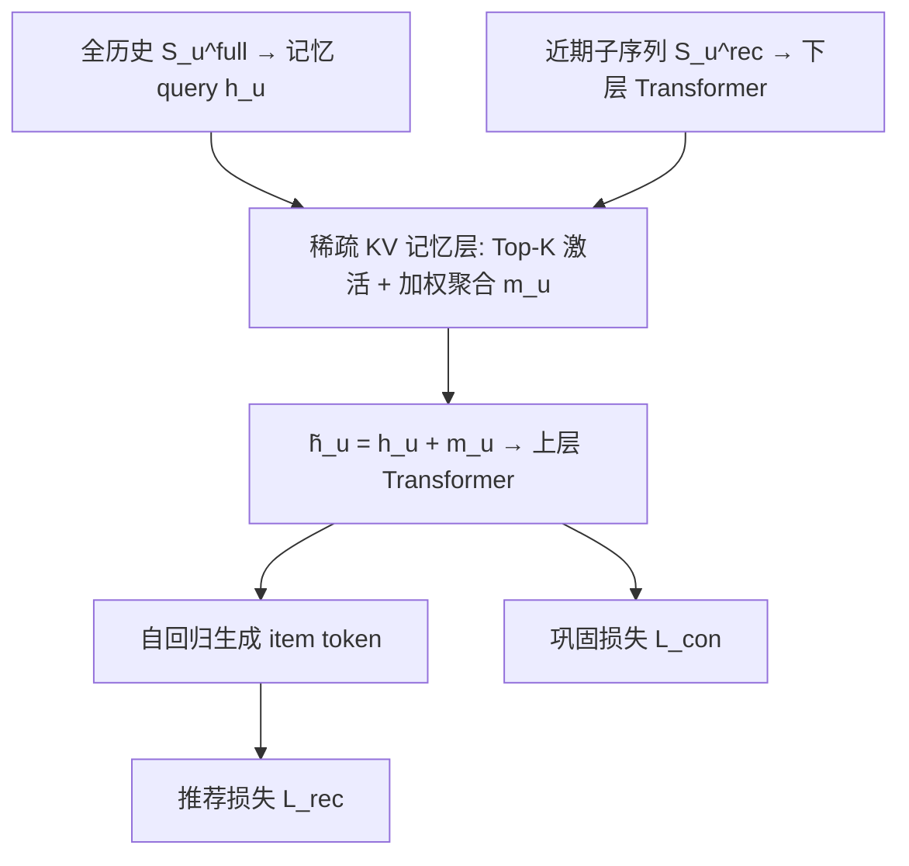

# Self-Evolving Memory for Generative Recommendation (面向生成式推荐的自演化记忆)

- **会议/期刊**: CIKM 2026
- **作者与机构**: Xinyu Lin, Zhuosong Jiang 等（NUS 与 Meta AI 联合）
- **推荐链路定位**: 端到端生成式（持续演化/在线更新）
- **研究方向**: 生成式推荐 / 序列推荐
- **论文原文**: [arXiv:2609.15598v1](https://arxiv.org/abs/2609.15598v1)
- **开源代码**: [JazyJiang/Self-Evolving-Memory-for-Generative-Recommendation](https://github.com/JazyJiang/Self-Evolving-Memory-for-Generative-Recommendation)

## TL;DR (1分钟核心速览)

生成式推荐（TIGER 类自回归模型）在流式数据上持续微调时，异构用户的行为漂移被挤在**同一套共享自回归参数**里优化，导致高频主导模式压制低频个性化模式，作者称之为**演化冲突 (evolution conflict)**。本文提出 LION：在 Transformer 中间层插入**稀疏 Key-Value 记忆层**，用 query 驱动 Top-K 激活实现“隔离记忆”，再以**巩固损失**直接监督记忆增强表征实现“强化演化”。在 Amazon Games/CDs/Toys 三数据集、5 时段 × 5 活跃度分组的持续演化协议下，LION 相对 TIGER 在 R@10 上提升 **+15.6%~+35.5%**，且非活跃用户组增益显著大于活跃组。

## Background & Motivation (背景与核心矛盾)

- **主流范式**: 生成式推荐将用户历史编码与物品 token 生成统一进一个共享 Transformer 参数空间；自演化则靠**持续微调**（仅用当期数据）或**蒸馏/回放式适配**（用全历史）来跟踪偏好漂移。
- **前人局限**: ① 持续微调会覆盖旧知识，蒸馏/回放虽缓解遗忘，但所有用户仍共享同一演化空间；② 现有方法只区分“新/旧知识”或“长/短期兴趣”，**从未区分不同用户群体的行为模式**，因此无法处理模式间的梯度冲突。
- **核心洞察 (Key Insight)**: 作者将目标分解为 $\mathcal{L}_{rec}=\mathcal{L}_{c}+\mathcal{L}_{unc}$，指出常见模式与罕见模式的梯度满足$g_c^\top g_{unc}<0$且$\|g_c\|\gg\|g_{unc}\|$，更新$\theta_{\tau+1}=\theta_\tau-\eta(g_c+g_{unc})$被$g_c$主导——形成“双重次优”：常见模式被$g_{unc}$部分抵消，罕见模式被$g_c$ 持续淹没。图 2 实证 TIGER 从 Period 0 到 Period 1 时活跃用户涨、非活跃用户（G3–G5）跌。
- **本文切入点**: 把“演化”从共享参数搬到**稀疏激活的记忆槽**上，让不同行为模式走不同优化通路，并对记忆表征额外加监督。

## Method (核心方法设计)

### 1. 整体框架 (Overall Architecture)

LION 在 T5 骨干的中间层（默认第 5 层）插入一个含 $N$个 Key-Value 对的稀疏记忆层。用户 query（由**全历史**$S_u^{full}$编码得到）与所有 memory key 计算相似度，取 Top-$K$槽位加权聚合为$m_u$，残差加回隐状态后继续上层 Transformer 与自回归解码。训练时同时优化推荐损失与巩固损失；每个演化周期$\mathcal{P}_\tau$到达后，骨干与记忆参数一起持续微调，更新后的$\theta_\tau$ 服务下一周期。

### 2. 关键设计拆解 (Key Designs)

1. **稀疏 KV 记忆与隔离记忆 (Sparse Memory Activation)**：稠密 per-user 参数（user embedding / adapter）参数量随用户数线性膨胀，不可扩展。LION 改为固定 $2Nd$参数的 KV 池，按相似度$s_i=\mathbf{h}_u^\top \mathbf{k}_i$取 Top-$K$集合$\mathcal{A}$，聚合$m_u=\sum_{i\in\mathcal{A}}\alpha_i \mathbf{v}_i$（$\alpha_i$为$\mathcal{A}$内 min-max 归一化权重），再$\tilde{\mathbf{h}}_u=\mathbf{h}_u+m_u$。直觉：不同模式被路由到不同槽位，梯度冲突被限制在重叠集$\mathcal{O}=\mathcal{A}_c\cap\mathcal{A}_{unc}$内，冲突比$\le\rho=|\mathcal{O}|/K$；且组合数$\binom{N}{K}\approx10^{15}$ 保证表征不共享。
2. **全序列记忆查询 (Full-Sequence Memory Query)**：生成式推荐受上下文限制只用近期窗口 $S_u^{rec}$，但行为模式需全历史刻画。LION 做**非对称设计**：记忆 query 由$S_u^{full}$计算，记忆层前后的 Transformer 仍只吃$S_u^{rec}$——既让路由基于完整行为上下文，又不增加骨干计算量。
3. **巩固损失与训练目标**：仅靠 $\mathcal{L}_{rec}$时，罕见模式的弱梯度在反传中被淹没，记忆 key 难以专门化。LION 直接在记忆增强表征$\tilde{\mathbf{h}}_u$上加辅助自回归监督$\mathcal{L}_{con}=-\sum_u\sum_t \log P(i_{t+1}\mid \tilde{\mathbf{h}}_u;\theta)$，总目标$\mathcal{L}=\mathcal{L}_{rec}+\lambda\mathcal{L}_{con}$。无需负采样（生成式 softmax 全词表），推理仅多一次 Top-K 检索，开销可忽略。

## Experimental Setup & Evaluation Protocol (实验设置与评估协议)

- **数据集与预处理**: Amazon Review 三域，按目标交互时间戳排序后**等交互量切分为 5 个时序周期**（Period 0–4）；用户按上一周期最大历史长度分为 G1–G5（活跃→不活跃）。

| 数据集 | #Users | #Items | #Interactions | 每周期交互数 | 场景说明 |
| :--- | :---: | :---: | :---: | :---: | :--- |
| Games | 34,089 | 11,037 | 252,015 | 50,403×5 | 视频游戏，较稠密 |
| CDs | 21,347 | 14,239 | 185,855 | 37,171×5 | 音乐专辑 |
| Toys | 22,158 | 11,250 | 140,943 | 28,188×4+28,191 | 玩具母婴 |

- **数据划分与防穿越 (Splitting Strategy)**: 全局时间戳切分为 5 个演化周期，每周期内构造 next-item 样本（输入至多 10 条历史）；在 Period 1–4 上分别评测，严格防穿越。
- **排名评测协议 (Ranking Protocol)**: 生成式 **beam search（beam=20）** 生成候选 token 序列，报告 R@{10,20} 与 N@{10,20}；主表为 4 个评测周期 × 5 个用户分组的**样本加权 micro 平均**。
- **对比基线与超参设置**: 传统 CL 基线 Replay、SAIL-PIW、PISA；生成式演化基线 RecICL、LSAT、PESO，以及直接微调的 TIGER。全部统一到 T5 骨干；学习率 $\{1\text{e-}4,\dots,3\text{e-}4\}$、batch$\{16,\dots,64\}$网格搜索；LION 默认记忆层第 5 层、$h_{rec}=2$、$n_k=64$、Top-$K=32$，$\lambda$按数据集在$\{0.1,0.3,0.5,1.0\}$ 上验证选取。

## Key Experimental Results (实验关键数据)

### 1. 主实验对比 (Main Results)

| Method | Games R@10 | Games N@10 | Games R@20 | CDs R@10 | CDs N@10 | CDs R@20 | Toys R@10 | Toys N@10 | Toys R@20 |
| :--- | :---: | :---: | :---: | :---: | :---: | :---: | :---: | :---: | :---: |
| Replay | 0.0616 | 0.0386 | 0.0819 | 0.0405 | 0.0297 | 0.0475 | 0.0551 | 0.0400 | 0.0651 |
| SAIL-PIW | 0.0572 | 0.0416 | 0.0766 | 0.0392 | 0.0302 | 0.0459 | 0.0689 | 0.0494 | 0.0847 |
| PISA | 0.0407 | 0.0245 | 0.0597 | 0.0217 | 0.0128 | 0.0298 | 0.0630 | 0.0395 | 0.0865 |
| RecICL | 0.0686 | 0.0470 | 0.0904 | 0.0352 | 0.0263 | 0.0425 | 0.0530 | 0.0409 | 0.0637 |
| LSAT | 0.0492 | 0.0344 | 0.0631 | 0.0358 | 0.0259 | 0.0435 | 0.0648 | 0.0421 | 0.0865 |
| PESO | 0.0584 | 0.0353 | 0.0800 | 0.0263 | 0.0166 | 0.0347 | 0.0625 | 0.0376 | 0.0857 |
| TIGER | 0.0558 | 0.0336 | 0.0784 | 0.0331 | 0.0213 | 0.0424 | 0.0666 | 0.0418 | 0.0884 |
| **LION** | **0.0724** | **0.0454** | **0.0986** | **0.0449** | **0.0306** | **0.0558** | **0.0769** | **0.0495** | **0.1018** |
| **Improv. vs TIGER** | +29.8% | +35.3% | +25.8% | +35.5% | +43.7% | +31.7% | +15.6% | +18.4% | +15.1% |

### 2. 消融实验 (Ablation Study)

| 配置 | Games R@10 | CDs R@10 | Toys R@10 |
| :--- | :---: | :---: | :---: |
| TIGER | 0.0558 | 0.0331 | 0.0666 |
| +Con（仅巩固损失） | 0.0532 | 0.0310 | 0.0559 |
| +SML（仅稀疏记忆） | 0.0558 | 0.0342 | 0.0654 |
| +SML+FS | 0.0586 | 0.0358 | 0.0687 |
| **+SML+FS+Con (LION)** | **0.0724** | **0.0449** | **0.0769** |

### 3. 关键实验发现 (Key Findings)

1. **巩固损失必须“挂在记忆上”才有效**：单独加 $\mathcal{L}_{con}$反而全面掉点（Games 0.0558→0.0532，Toys 0.0666→0.0559），因为它直接监督共享骨干、重新暴露于跨模式冲突；而 SML+FS+Con 相比 SML+FS 在 Games 上从 0.0586 跃至 0.0724，说明$\mathcal{L}_{con}$ 是主导增益来源，但前提是表征已被记忆隔离。
2. **增益集中在非活跃用户，且逐周期不衰减**：表 2 中 Toys 的 P0→P1 非活跃组 LION 0.1011 vs TIGER 0.0903，P3→P4 仍为 0.0777 vs 0.0672；Games 各周期非活跃组增益均大于活跃组，与 Corollary 4.2“罕见模式收敛加速更大”一致。
3. **梯度冲突被实测消除**：图 5 显示 TIGER 的活跃/非活跃梯度余弦多为负（如 CDs P0 为 −0.03），LION 全周期转正（CDs 达 +0.71~+0.86）；图 6 的物品侧（热门 top60% vs 长尾 40%）同样由负转正（CDs +0.61~+0.87），验证隔离机制对用户侧与物品侧冲突同时生效。

## Highlights & Limitations (亮点、对比与审稿批判)

- **与代表作对比 (vs. Prior Work)**: 与 LSAT（多 LoRA 分支区分长短期）和 SAIL-PIW（per-user 模仿权重）相比，LION 的隔离粒度是**行为模式而非用户或时间尺度**，且参数固定为 $2Nd$ 不随用户数增长；与 PESO（单 LoRA + 近端正则）相比，LION 从“正则约束共享空间”转为“结构隔离优化通路”，在 CDs 上 R@10 高出 70%（0.0449 vs 0.0263）。
- **可迁移亮点**: ① “全历史算 query、近期窗口算骨干”的非对称设计，可低成本迁移到任何受上下文长度限制的生成式推荐；② 在记忆/适配器表征上加辅助自回归损失，是缓解长尾梯度淹没的通用轻量手段。
- **审稿级局限批判**: ① 仅在 T5/TIGER 骨干上验证，未触及 LLM-based 生成式推荐（如 HSTU、OneRec），而后者参数量与路由开销量级完全不同；② 路由为固定 Top-$K$，且$\lambda$ 需按数据集调（Games 最优 1.0、CDs 最优 0.5），跨域鲁棒性存疑；③ 主表为 4 周期 × 5 组的加权平均，掩盖了单周期波动，且未报告方差与显著性检验。

## Rating (四维评分)

- **方法创新性 (Novelty)**: ⭐⭐⭐⭐ （“演化冲突”问题定义清晰且有梯度分析支撑，稀疏 KV 记忆做模式隔离的思路简洁，但 KV/MoE 式隔离本身并非全新范式）
- **评估协议与实验扎实度 (Protocol & Experiments)**: ⭐⭐⭐⭐ （5 周期 × 5 活跃度分组的持续演化协议设计细致，含梯度余弦与收敛曲线实证；扣分在于缺少显著性检验与方差报告）
- **写作与数学规范度 (Clarity & Rigor)**: ⭐⭐⭐⭐ （冲突比 $\rho$、收敛加速比、参数比三条定理推导干净，且明确将 Corollary 4.1 标注为“经验趋势而非保证”，学术诚实度高）
- **工业落地与复现价值 (Industrial & Practical Value)**: ⭐⭐⭐⭐⭐ （参数不随用户增长、Top-K 检索开销极小、代码已开源，且记忆规模缩 16× 性能仅波动 ±0.4%，工程友好度突出）
